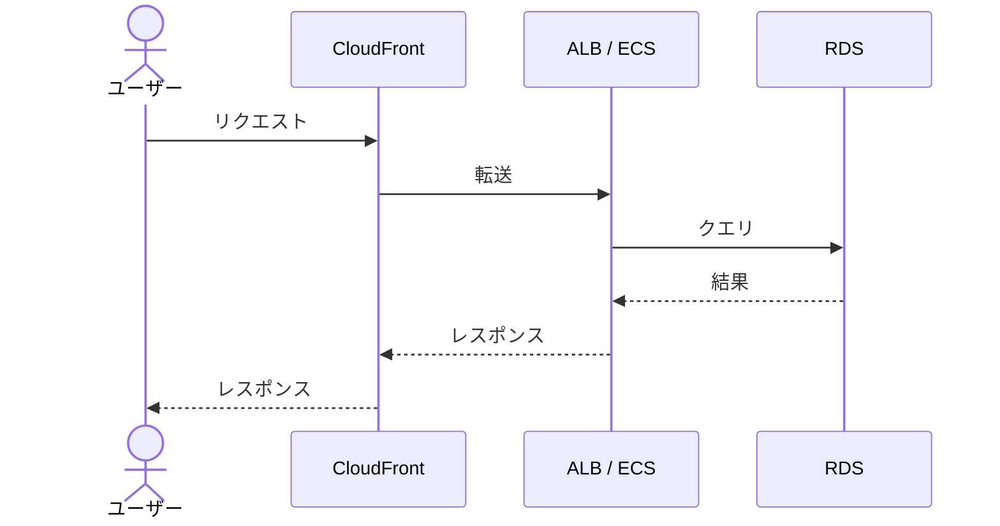

# Webアプリ構成（サンプル）

ページの書き方を示すサンプルです。実在の環境ではありません。

## 構成図

## API リクエストの流れ

画像や CSS などの静的ファイルは、CloudFront が S3 から取得して返します。

## 各リソースの役割

| リソース | 役割 |
|---|---|
| CloudFront | HTTPS の終端、キャッシュ、パスごとの振り分け |
| S3 | 静的ファイルの保存 |
| ALB | ECS タスクへの負荷分散 |
| ECS | アプリケーションの実行 |
| RDS | データの保存 |
