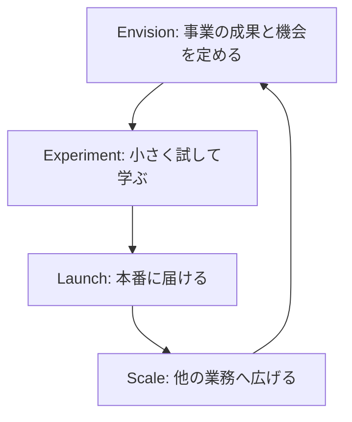

# 分野4: 事業の準備状況、リーダーシップ、AI 変革

配点は **24%** で、スキルの数は 19 と最多です。組織の現状を評価し、データと基盤を整え、人を動かし、実験から全社展開へ進める力を問います。

失敗の原因は、技術よりも組織にあることが多いです。この分野では、人と進め方の判断が中心になります。

## タスク 4.1: 事業の準備状況と成熟度を評価する {#task-4-1}

### 4.1.1 準備状況の評価 {#skill-4-1-1}

技術だけでなく、次の観点で確認します。

| 観点 | 確認すること | 不足の兆候 |
|---|---|---|
| リーダーシップの合意 | 経営層の合意と関与 | 部門ごとに目標がばらばら |
| データ品質 | 品質、アクセス、所有者 | データがどこにあるか不明 |
| 文化の準備 | 失敗の許容、変化への姿勢 | 現場が AI を脅威と感じている |
| 技術基盤 | クラウド、セキュリティ、運用の体制 | 既存システムと連携できない |
| ガバナンスの枠組み | 方針、リスク管理 | 誰が承認するか決まっていない |

詳細: [成熟度と準備状況](../../services/ai-fundamentals.md#maturity)

### 4.1.2 成熟度モデル {#skill-4-1-2}

企業が AI の道のりのどこにいるかを評価します。段階の名前はモデルによって異なります。次の表は例です。

| 段階 | 特徴 | 次にやること |
|---|---|---|
| 実験 | 個人や少数のチームが試している | 目標のある PoC を選び、統治の基本を作る |
| 部門での導入 | 一部の業務で本番に使っている | 共通の基盤と標準、効果の測定をそろえる |
| 全社展開 | 全社の基盤と統治の下で多くの業務に広がる | 改善を続け、事業モデルの変革へ進める |

段階を飛ばす計画は危険です。実験段階の企業に必要なのは、全社の高度な基盤より、最初の成功事例と基本の統治です。

詳細: [成熟度と準備状況](../../services/ai-fundamentals.md#maturity)

### 4.1.3 能力の不足の特定 {#skill-4-1-3}

不足は 4 つに分けて整理します。

| 領域 | 不足の例 | 対応の例 |
|---|---|---|
| 人材 | AI リテラシーの不足、専門人材の不在 | 研修、採用、パートナー |
| プロセス | 業務に組み込めない、承認の流れがない | 業務の再設計 |
| 技術 | データ基盤の不足、古いシステム | 基盤の近代化、マネージドサービスの利用 |
| ガバナンス | 方針がない、責任者が不明 | 委員会の設置、リスク分類 |

AWS CAF の 6 つのパースペクティブ（ビジネス、人材、ガバナンス、プラットフォーム、セキュリティ、オペレーション）も、不足を洗い出す枠組みになります。

詳細: [成熟度と準備状況](../../services/ai-fundamentals.md#maturity)、[Cloud Adoption Framework](../../services/cloud-foundations.md#caf)

### 4.1.4 投資の優先順位と成長の道筋 {#skill-4-1-4}

不足をすべて同時に埋めようとはしません。戦略の目標に直結し、他の前提になるものから投資します。

**例:** 2 年以内に顧客対応を AI で刷新する目標で、現状は実験段階とします。

1. 顧客データの整備と責任者の任命（前提になる）
2. 利用ルールとリスク分類（早く広げるための土台）
3. 顧客対応の担当者向けの研修
4. 1 つの窓口でのパイロット
5. 共通基盤と他の窓口への展開

各段階に到達の基準を決め、達成を確認して次へ進みます。

詳細: [成熟度と準備状況](../../services/ai-fundamentals.md#maturity)

## タスク 4.2: AI のためのデータと基盤を整える {#task-4-2}

### 4.2.1 データの準備状況 {#skill-4-2-1}

| 観点 | 問い | 問題の例 |
|---|---|---|
| 品質 | 正確で新しく、そろっているか | 顧客の名寄せができていない |
| アクセス | 必要な人とシステムが使えるか | 取り出しに毎回数週間かかる |
| サイロ | 部門間でつながるか | 販売とサポートのデータが別々 |
| 権利 | その目的で使ってよいか | 同意の範囲を超える |

サイロがあると、AI は全体を見られません。たとえば解約予測は、販売とサポートの両方のデータがあると精度が上がります。また、部門ごとに同じデータを重複して整備する費用も発生します。

詳細: [成熟度と準備状況](../../services/ai-fundamentals.md#maturity)、[データ品質と不均衡](../../services/ai-fundamentals.md#data-quality)

### 4.2.2 データ戦略、所有者、共有の枠組み {#skill-4-2-2}

| 要素 | 決めること | ないと起きること |
|---|---|---|
| データ戦略 | 事業の目標に必要なデータと、その整備の順序 | 個別の案件ごとに場当たりで整備する |
| データの所有者 | 品質とアクセス承認の責任者 | 品質の問題を誰も直さない |
| 共有の枠組み | 部門をまたぐ共有のルール、分類、利用条件 | 承認が案件ごとに滞る、または無秩序に広がる |

独自データは競争優位の源泉にもなります。データ戦略が、利用がデータを増やす好循環を支えます。

詳細: [成熟度と準備状況](../../services/ai-fundamentals.md#maturity)、[AWS Cloud Adoption Framework for AI](../../services/ai-fundamentals.md#caf-ai)

### 4.2.3 技術と基盤の要件 {#skill-4-2-3}

実際の設計は技術チームが行います。受験者は、事業の要件から何が必要かを問えれば十分です。

| 観点 | 問い |
|---|---|
| クラウドの基盤 | 必要な AI サービスを利用できる環境はあるか |
| 既存システムとの連携 | 業務システムやデータとつなげるか |
| セキュリティとコンプライアンス | データの所在や監査の要件を満たすか |
| 拡張性と性能 | 全社に広げたときの利用量と応答速度に耐えるか |
| 運用と監視 | 本番の監視と更新の体制があるか |
| 費用 | 利用が増えたときの費用を予測できるか |

マネージドサービスを使うと、基盤の負担を減らせます。自社で学習するほど、基盤と専門人材の要件が増えます。

| 階層 | サービス | 基盤と人材の要件 |
|---|---|---|
| アプリケーション | Amazon Quick | 小 |
| AI サービス、FM | Amazon Bedrock | 中 |
| ML プラットフォーム | Amazon SageMaker AI | 大 |

詳細: [AWS の AI の 3 階層](../../services/ai-managed-services.md#three-layers)、[Amazon Quick](../../services/ai.md#quick)

## タスク 4.3: 全社の変革を率い、AI に対応できる人材を育てる {#task-4-3}

### 4.3.1 経営層のスポンサーと AI チャンピオン {#skill-4-3-1}

変革には、予算と権限を持つスポンサーが必要です。現場に近い AI チャンピオンが広げます。

| 役割 | 担うこと |
|---|---|
| 経営層のスポンサー | 目標を示す、予算を確保する、部門間の対立を解く、自ら使う |
| 経営陣 | 同じ目標と優先順位で合意する |
| AI チャンピオン | 現場で成功例を示し、同僚を支援し、現場の声を伝える |

チャンピオンには、業務時間の確保や評価への反映といった権限と支援を与えます。善意だけに頼ると、勢いが続きません。

詳細: [変革の進め方](../../services/ai-fundamentals.md#change-management)、[役割と責任](../../services/ai-fundamentals.md#governance-roles)

### 4.3.2 部門横断のチームと責任 {#skill-4-3-2}

事業の責任者、技術の専門家、法務、コンプライアンスを、初めからチームに入れます。

| 参加者 | 貢献 |
|---|---|
| 事業の責任者 | 課題、成果の定義、現場への展開 |
| 技術の専門家 | 実現性、構築、運用 |
| 法務 | 契約、知的財産、規制の解釈 |
| コンプライアンス | 社内外の規則の順守の確認 |

誰が決め、誰が実行し、誰に相談するかを明確にします。たとえば事業の成果の責任は、技術チームではなく事業の責任者が持ちます。

詳細: [役割と責任](../../services/ai-fundamentals.md#governance-roles)

### 4.3.3 透明なコミュニケーション {#skill-4-3-3}

情報がないと、人は最悪の事態を想像します。不確かなことも含めて、率直に伝えます。

| 伝えること | 例 |
|---|---|
| 導入の時期 | 第 2 四半期に一部の窓口で試行する |
| 期待する成果 | 定型の作業を減らし、複雑な相談に時間を使う |
| 役割への影響 | どの業務が変わるか、どんな研修を提供するか |
| 未定のこと | 決まっていないことと、いつ決まるか |

「雇用への影響はない」と根拠なく約束すると、後で信頼を失います。わかっていることと、支援の内容を示します。一方的な通知で終わらせず、質問を受ける場も設けます。

詳細: [変革の進め方](../../services/ai-fundamentals.md#change-management)

### 4.3.4 文化の壁とリーダーの介入 {#skill-4-3-4}

| 壁 | 現れ方 | リーダーの介入 |
|---|---|---|
| リスク回避 | 承認が進まず、前例を求める | 低リスクの範囲を明示し、試してよい領域を作る |
| 変化への抵抗 | 使わない、旧来のやり方を続ける | 現場を設計に参加させ、仕事が楽になる実例を見せる |
| 失敗への恐れ | 実験の結果を隠す | 学びを称賛し、経営層が自分の失敗や学びを共有する |

命令だけで使わせても定着しません。評価制度も、挑戦と AI の活用を妨げていないか見直します。

詳細: [変革の進め方](../../services/ai-fundamentals.md#change-management)

### 4.3.5 人材育成の手法 {#skill-4-3-5}

目的に合わせて手法を組み合わせます。

| 手法 | 向いている目的 | 例 |
|---|---|---|
| 研修プログラム | 全社の共通の基礎を作る | 役割別の必修の基礎講座 |
| ハッカソン | 関心を高め、アイデアを集める | 部門混成で 2 日間 |
| PoC プログラム | 実務で経験を積み、価値を検証する | 実際の業務で少人数の試行 |
| 責任ある AI の研修 | 正しい利用の判断を身につける | 入力してよいデータ、確認の義務 |

全員に同じ内容ではなく、経営層、管理職、利用者、開発者の役割ごとに内容を変えます。責任ある AI の研修は、対象を限らず全員に必要です。

詳細: [変革の進め方](../../services/ai-fundamentals.md#change-management)

### 4.3.6 人の役割の移行 {#skill-4-3-6}

手作業から、AI の監督と協働へ役割を移します。

| 担当 | 向いている仕事 |
|---|---|
| AI | 大量の定型処理、要約、検索、下書き |
| 人 | 批判的思考による判断、共感が必要な対応、創造的な発想、例外の処理、最終的な責任 |

**例:** コールセンターでは、定型の問い合わせは AI が処理します。担当者は、苦情や複雑な相談、AI の回答の確認に集中します。そのためのリスキリングも計画します。

感情的に重い相談や高リスクの判断まで完全に自動化するのは、効率がよく見えても、顧客の信頼を損なう危険があります。

詳細: [変革の進め方](../../services/ai-fundamentals.md#change-management)、[人による監督](../../services/ai-fundamentals.md#human-oversight)

## タスク 4.4: パイロットから全社展開へ広げる {#task-4-4}

### 4.4.1 段階的な変革の進め方 {#skill-4-4-1}

試験ガイドは、envision、experiment、launch、scale を例に挙げています。一度で完成させず、繰り返して進めます。

| 段階 | 内容 | 次へ進む基準の例 |
|---|---|---|
| Envision | 成果を定め、候補に優先順位を付ける | 目標、KPI、スポンサーが決まった |
| Experiment | PoC で価値と実現性を確かめる | ベースラインに対して効果を確認できた |
| Launch | 本番の要件を満たして公開する | 監視と運用の体制が動いている |
| Scale | 他部門へ広げ、価値を出し続ける | 標準と共通基盤が整った |

!!! note "CAF との名前の違い"
    AWS CAF の 4 段階は Envision、**Align**、Launch、Scale です。Align は、基盤能力を整え、部門間の依存と懸念を明らかにする段階です。試験ガイドの 2 番目の例は **experiment** です。どちらの言い方でも答えられるようにします。CAF for AI のホワイトペーパー（2024年2月13日公開）は、現在「歴史的な参照用」と表示されています。

詳細: [AWS Cloud Adoption Framework for AI](../../services/ai-fundamentals.md#caf-ai)、[Cloud Adoption Framework](../../services/cloud-foundations.md#caf)

### 4.4.2 短期の成果から全社展開へ {#skill-4-4-2}

最初のパイロットは次の基準で選びます。

- 価値が見えやすい。
- データがそろっている。
- リスクが低い。
- 協力的な部門のスポンサーがいる。

小さな成功で支持を得て、その成果を次の投資の根拠にします。最初から全社一斉に展開すると、失敗の影響が大きく、学びも活かせません。一方で、短期の成果だけを繰り返すと、全社の基盤が育ちません。パイロットの段階から、再利用できる部品や標準を作ります。

詳細: [パイロットから全社展開へ](../../services/ai-fundamentals.md#scaling)

### 4.4.3 AI CoE と部門横断の連携 {#skill-4-4-3}

AI センターオブエクセレンス（CoE）は、標準、共通基盤、ノウハウを全社に提供します。

次の 3 つの形は AWS の公式の分類ではなく、このwikiの整理です。試験ガイドは CoE の形を定めていません。

| 形 | 特徴 | 注意 |
|---|---|---|
| 集中型 | 統一しやすく、初期に向く | 依頼が集中してボトルネックになる |
| 分散型 | 現場で早く動ける | 重複とルールのばらつき |
| ハブアンドスポーク | CoE が標準を示し、各部門が実行する | 役割の分担を明確にする |

CoE の目的は、すべてを自分で作ることではなく、各部門ができるようにすることです。中央で標準を持ちつつ実行は現場に任せる形は、統一と現場の速さを両立しやすい選択肢です。

詳細: [パイロットから全社展開へ](../../services/ai-fundamentals.md#scaling)、[役割と責任](../../services/ai-fundamentals.md#governance-roles)

### 4.4.4 継続的なフィードバックと成功の指標 {#skill-4-4-4}

| 仕組み | 例 |
|---|---|
| 利用者の評価 | 回答の良し悪しのボタン、調査 |
| 利用の指標 | 利用率、継続率 |
| 事業の指標 | KPI とベースラインの比較 |
| 定期的なレビュー | 四半期ごとに拡大、一時停止、中止を判断 |

導入時に効果が出ても、時間がたつと薄れることがあります。長期の価値を追い、結果を改善と投資の判断に戻します。

詳細: [パイロットから全社展開へ](../../services/ai-fundamentals.md#scaling)、[KPI と ROI](../../services/ai-fundamentals.md#kpi-roi)

### 4.4.5 実験から本番の水準へ {#skill-4-4-5}

PoC は小さなデータと少数の利用者で動きます。本番では、遅延、費用、データ品質の問題が新たに出ます。

| 観点 | PoC | 本番 |
|---|---|---|
| ガバナンス | 緩い | 承認、リスク分類、記録、責任者 |
| セキュリティ | 限定的なデータ | アクセス制御、監査、データの保護 |
| 運用 | 開発者が見る | 監視、障害時の手順、担当の体制 |
| 品質 | デモで動く | 評価の基準、ドリフトの監視、更新の手順 |
| 費用 | 少量 | 実際の利用量での試算と管理 |

PoC の成功は、本番の準備ができたことを意味しません。本番の要件を満たすまでの費用と期間も、初めの計画に入れます。

詳細: [パイロットから全社展開へ](../../services/ai-fundamentals.md#scaling)、[本番での監視](../../services/ai-fundamentals.md#production-monitoring)

### 4.4.6 拡大時の継続性と性能 {#skill-4-4-6}

拡大の途中も、複数の要素を同時に見ます。

| 要素 | 確認すること | 対応の例 |
|---|---|---|
| 事業の継続 | 業務が止まらないか | 段階的な切り替え、代替の手順 |
| 性能 | 利用が増えても品質と速度を保てるか | 負荷の確認、容量の確保 |
| 費用 | 利用の増加に費用が見合うか | Cost Explorer での追跡、モデルの見直し |
| 導入の状況 | 部門ごとに定着しているか | 研修、チャンピオンの支援 |
| リスクと規制 | 新しい地域や用途で要件が変わらないか | リスク分類の見直し、法務の確認 |

ある部門で成功しても、別の部門や国では条件が違います。データ、規制、業務に合わせて確認しながら広げます。

詳細: [パイロットから全社展開へ](../../services/ai-fundamentals.md#scaling)、[Cost Explorer](../../services/cost-management.md#cost-explorer)

## 確認問題 {#self-check}

??? question "問1: 製造業の企業で、経営層は全社の AI 基盤に大きな投資を決めようとしています。現状は数人の有志が個別に生成 AI を試している段階で、データの所有者も利用ルールもありません。何を助言しますか。"
    成熟度は実験段階なので、段階を飛ばさないよう助言します。まず価値が見えやすいパイロットを選び、データの責任者と利用ルールを決めて、最初の成功事例を作ります。全社の基盤への大きな投資は、成果と要件が見えてから段階的に判断します。

??? question "問2: 解約予測の PoC は有望でしたが、販売、サポート、請求のデータが部門ごとに分かれ、定義も違うことがわかりました。本番化に向けて最初に取り組むべきことは何ですか。"
    データの基礎を整えます。データ戦略に沿って、各データの所有者、共通の定義、部門間の共有の枠組みを決めます。データのサイロは予測の精度と展開の速さを制限するので、別のモデルを試すより先に解決します。

??? question "問3: コールセンターへの AI の導入が発表された後、担当者に職を失う不安が広がり、利用率が上がりません。経営層はどう対応すべきですか。"
    導入の時期、期待する成果、役割の変化を率直に伝え、未定のことも明らかにします。役割を監督や複雑な相談へ移す道筋と研修を示し、現場を設計に参加させ、チャンピオンが実例を示します。根拠のない約束や利用の強制は信頼を損ないます。

??? question "問4: 各部門が別々に AI を導入し、同じ機能の開発が重複しています。ベンダーとの契約や評価の基準もばらばらです。一方で現場の速さは保ちたいと考えています。どの体制が適切ですか。"
    AI CoE が標準、共通基盤、ノウハウを提供し、各部門が実行するハブアンドスポークの形が適切です。統一と現場の速さを両立できます。すべての開発を CoE に集めると、依頼が集中してボトルネックになります。

??? question "問5: 社内 100 人の PoC で高評価だった AI アシスタントを、来月から 2 万人に全社展開する案が出ています。どの点を確認すべきですか。"
    PoC の成功だけでは本番の準備ができたとはいえません。実際の利用量での費用と性能、アクセス制御と監査、ガバナンスの承認、監視と障害時の体制を確認します。一斉に展開せず、部門ごとに段階的に広げ、事業の継続と性能を確かめながら進めます。

??? question "問6: AI のパイロットの候補が 3 つあります。A は全社の基幹業務の完全な置き換え、B はデータが整った部門の問い合わせ要約で協力的なスポンサーがいる案件、C は採用の自動判定です。最初にどれを選びますか。"
    B を選びます。価値が見えやすく、データがそろい、リスクが低く、スポンサーもいるので、短期の成果を出して支持を広げられます。A は影響が大きく失敗の代償が大きいです。C は高リスクの用途で、統治の体制が整ってから慎重に検討します。
