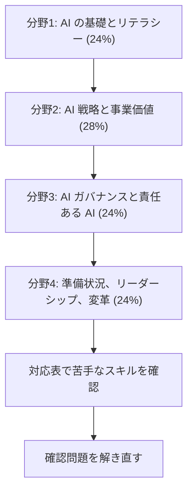

# AI Business Strategist（AIB-C01）

AI の能力を事業の成果につなげ、責任ある形で全社に広げる判断力を問う試験です。技術の実装より、戦略上の判断を重視します。コーディングや AWS の構築経験は必要ありません。

!!! warning "この試験はベータ版です（2026年10月31日時点）"
    AIB-C01 は現在**ベータ試験**です。標準版とは次の点が異なります。

    - **受験料:** 50 USD です。標準版は 100 USD です。
    - **受験は1回だけ:** 再受験するには、標準版の一般提供を待ちます。
    - **問題数:** 標準版より、総問題数も採点対象の問題数も多くなります。
    - **提供期間:** 限られています。AWS の方針では一般に 1〜3 か月です。**この試験の終了日と標準版の開始日は、公式に発表されていません。**
    - **公式模擬試験:** ベータ期間中は利用できません。

    次の点は標準版と同じです。

    - 合格すると正式な認定を取得でき、**3年間有効**です。
    - 結果は受験後 **5 営業日以内**に届きます。

    **2027年2月15日まで**に認定を取得すると、Early Adopter のデジタルバッジも受け取れます。これはバッジの期限で、ベータの終了日ではありません。

    条件は変わることがあります。予約の前に[公式ページ](https://aws.amazon.com/certification/certified-ai-business-strategist/)と[ベータ試験の方針](https://aws.amazon.com/certification/policies/before-testing/)を確認してください。

[:material-format-list-bulleted: このコースのサービス一覧](services.md){ .md-button } [:material-help-circle-outline: 問題集](exercises/index.md){ .md-button }

## 試験の概要 {#overview}

| 項目 | 内容 | 出典 |
|---|---|---|
| 区分 | Business | 公式ページ |
| 問題数 | 85問（ベータ版）。採点対象と対象外の内訳は公開されていません | 公式ページ |
| 試験時間 | 170分（ベータ版） | 公式ページ |
| 合格点 | 700点（100〜1,000点） | 試験ガイド |
| 受験料 | 50 USD（ベータ版）。標準版は 100 USD | 公式ページ |
| 言語 | 英語、日本語。一般提供時に他の言語を追加予定 | 公式ページ、[AWS の発表](https://aws.amazon.com/blogs/training-and-certification/introducing-aws-certified-ai-business-strategist-built-for-the-people-who-scale-ai/) |
| 受験方法 | Pearson のテストセンターまたはオンライン監視 | 公式ページ |
| 形式 | 択一、複数選択。複数選択は正解をすべて選んだときだけ得点になります | 試験ガイド |
| 採点方式 | 全体の得点で合否を判定します。分野ごとの合格点はありません | 試験ガイド |
| 減点 | 誤答による減点はありません。未回答は不正解になるので、すべて回答します | 試験ガイド |
| 前提 | 必須の認定はありません。AI の取り組みに関わる経験 6 か月程度を推奨 | 公式ページ、試験ガイド |
| 日程 | 登録開始 2026年9月1日、受験開始 2026年9月29日 | AWS の発表 |

!!! note "試験時間の記載が公式資料で異なります"
    試験ガイドは **130分**、公式ページのベータ試験の概要は **170分**です。このコースは、ベータ版の値として公式ページの 170 分を採用しています。標準版の問題数と時間は公式には示されていません。予約の画面で確認してください。

## 学習の順番 {#study-path}

配点の大きい分野2を中心にしつつ、用語の土台になる分野1から順に進めます。各分野のページでスキルごとの要点を確認し、足りないところはサービス解説で補います。話題ごとの[問題集](exercises/index.md)で理解を確かめます。

| 分野 | サービス別の学習 | 配点 | タスク | スキル | 中心の話題 |
|---|---|---|---|---|---|
| [分野1: AI の基礎とリテラシー](domain1.md) | [開く](study/domain1/index.md) | 24% | 3 | 13 | AI、ML、生成 AI の違い、解決策の選択、プロンプト、RAG |
| [分野2: AI 戦略と事業価値の創出](domain2.md) | [開く](study/domain2/index.md) | 28% | 3 | 14 | ユースケース、作る、買う、組む、KPI、ROI、競争優位 |
| [分野3: AI ガバナンスと責任ある AI のリーダーシップ](domain3.md) | [開く](study/domain3/index.md) | 24% | 3 | 12 | 責任ある AI、ガバナンス体制、規制、リスク対策 |
| [分野4: 事業の準備状況、リーダーシップ、AI 変革](domain4.md) | [開く](study/domain4/index.md) | 24% | 4 | 19 | 成熟度、データ基盤、変革の管理、全社展開 |

全スキルの一覧は[スキル対応表](coverage.md)にあります。

## 試験の考え方 {#exam-mindset}

問題文の多くは、経営や事業の場面です。次の順で考えると、選択肢を絞りやすくなります。

1. 解決したい事業課題は何か。AI が本当に必要か。
2. 成果をどの指標で測るか。導入前の値はあるか。
3. リスクの高さに見合う統制と人の監督があるか。
4. 組織、データ、人材の準備は整っているか。

「最も高度な技術を選ぶ」選択肢より、「課題に合い、測定でき、統制でき、組織が受け入れられる」選択肢が正解になりやすいです。

## 対象者と範囲外 {#candidate}

対象者は、自組織や顧客のために AI の取り組みを評価、推進、拡大するビジネスパーソンです。技術チームと協力しますが、AI を自分で作ることはしません。

典型的な役割は、プロダクトマネージャー、プログラムマネージャー、営業、事業部門の管理職、コンサルタント、マーケター、ビジネスアナリストです。レコメンド、NLP、コンピュータビジョン、文書抽出、顧客対応の AI といった分類と用途を見分けられることが期待されます。

### 範囲外の作業 {#out-of-scope}

次の作業は受験者に求められていません。

- AI や ML のモデルやアルゴリズムの開発、コーディング
- データエンジニアリング、特徴量エンジニアリングの実装
- ハイパーパラメータの調整、モデルの最適化
- AI や ML のパイプライン、インフラの構築とデプロイ
- AI や ML モデルの数学的、統計的な分析
- セキュリティやコンプライアンスの手順の実装
- AWS サービスやクラウド基盤の設定、デプロイ、管理
- 特定のアルゴリズム、フレームワーク、アーキテクチャの選定や調整
- データの前処理、クレンジング、ラベル付けの実作業
- 本番の AI システムの技術運用（インフラの監視、パイプラインのデバッグ、モデル性能の障害対応）

範囲外のサービスの例は、EC2、Lambda、VPC、CloudFront、RDS、S3、ECS、EKS、CodePipeline、CloudFormation、KMS、IAM ポリシーの記述、IoT、メディア系のサービスです。

## 対象のサービスと wiki のページ {#services}

どれも戦略レベルの理解で足ります。設定方法は問われません。

| 区分 | 対象 | 試験で知っておくこと | wiki のページ |
|---|---|---|---|
| AI と ML | Amazon Bedrock | 生成 AI 基盤、料金ティア、Guardrails、Knowledge Bases | [Guardrails](../../services/ai.md#guardrails)、[Knowledge Bases](../../services/genai-apps.md#knowledge-bases)、[料金](../../services/cost-management.md#bedrock-pricing) |
| AI と ML | Amazon SageMaker AI | 独自の ML、マネージドとカスタムの使い分け | [SageMaker AI](../../services/sagemaker.md)、[AI の 3 階層](../../services/ai-managed-services.md#three-layers) |
| BI | Amazon Quick | AI を使った業務アシスタント | [Amazon Quick](../../services/ai.md#quick) |
| 戦略と統治 | AWS CAF | AI の取り組みの計画と拡大 | [CAF](../../services/cloud-foundations.md#caf)、[CAF for AI](../../services/ai-fundamentals.md#caf-ai) |
| 戦略と統治 | 責任共有モデル | AI のデータ保護とコンプライアンスの分担 | [責任共有モデル](../../services/ai-fundamentals.md#shared-responsibility)、[基本](../../services/cloud-foundations.md#shared-responsibility) |
| 料金とコスト | AI サービスの料金体系 | 消費量、インスタンス、シート | [料金の形](../../services/ai-fundamentals.md#ai-pricing)、[料金の構造](../../services/cost-management.md#ai-pricing) |
| 料金とコスト | AWS Cost Explorer | 実績の分析 | [Cost Explorer](../../services/cost-management.md#cost-explorer) |
| 料金とコスト | AWS Marketplace | 作る、買う、組むの評価 | [Marketplace](../../services/cloud-foundations.md#marketplace) |
| 料金とコスト | AWS Pricing Calculator | 導入前の見積もり | [Pricing Calculator](../../services/cost-management.md#pricing-calculator) |

試験ガイドは、推奨知識として次の 2 つも挙げています。

- **Savings Plans:** [Savings Plans](../../services/cost-management.md#savings-plans)
- **Well-Architected Framework の Responsible AI Lens:** [分野3のスキル 3.1.1](domain3.md#skill-3-1-1) で扱います。

ここにないサービスも、例として名前が出ることがあります。深入りは不要です。

## 準備に使える公式の教材 {#prep}

公式ページと AWS の発表は、AWS Skill Builder の次の教材を案内しています。

- AI Business Strategist 向けのデジタルコース（4 分野、13 モジュール）
- 試験準備プラン、練習問題セット、Meeting Simulator

## 参考 {#references}

- [AIB-C01 試験ガイド](https://docs.aws.amazon.com/aws-certification/latest/ai-business-strategist-01/ai-business-strategist-01.html)
- [認定の公式ページ](https://aws.amazon.com/certification/certified-ai-business-strategist/)
- [受験前の方針（ベータ試験）](https://aws.amazon.com/certification/policies/before-testing/)
- [AWS の発表（2026年9月1日）](https://aws.amazon.com/blogs/training-and-certification/introducing-aws-certified-ai-business-strategist-built-for-the-people-who-scale-ai/)
