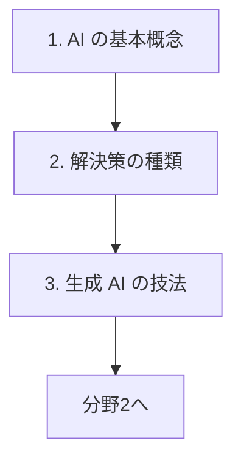

# 分野1: サービス別の学習

分野1（AI の基礎とリテラシー）は AIB-C01 の配点の 24% を占めます。用語の土台を作ってから、解決策の選び方、生成 AI の技法へ進みます。

| 順番 | 話題 | 問われること | 重要度 |
|---|---|---|---|
| 1 | [AI の基本概念](ai-concepts.md) | 用語、データの種類と品質、学習の限界、国際規格 | 高 |
| 2 | [解決策の種類](solution-types.md) | ルールか AI か、エージェント、監視と更新、シャドー AI | 高 |
| 3 | [生成 AI の技法](genai-techniques.md) | プロンプト、トークン、RAG、ファインチューニング | 高 |

重要度は公式のスキル一覧を見たこの wiki の判断で、公式の数字ではありません。

## 他のサービスにまたがる問題 {#other-questions}

<!-- questions:start -->

| 問題 | スキル | 内容 |
|---|---|---|
| [data-foundations 問4](../../exercises/data-foundations.md#q4) | 1.1.4 | 顧客の名寄せができておらず、同じ顧客が複数の番号で登録されています。AI の案件を進める前の評価とし… |

<!-- questions:end -->
