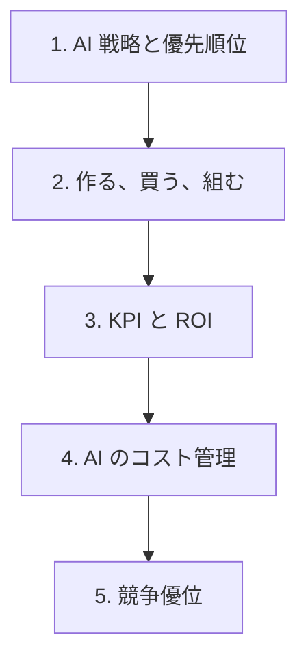

# 分野2: サービス別の学習

分野2（AI 戦略と事業価値の創出）は AIB-C01 の配点の 28% で、4 分野で最大です。何に投資するかを決め、効果を測り、競争力につなげる順に学びます。

| 順番 | 話題 | 問われること | 重要度 |
|---|---|---|---|
| 1 | [AI 戦略と優先順位](ai-strategy.md) | ユースケース、拡大と中止、AI を使わない判断 | 高 |
| 2 | [作る、買う、組むと移行](build-buy.md) | 調達の選択、ベンダーの比較、移行の確認 | 高 |
| 3 | [KPI と ROI](business-value.md) | 有形と無形、ベースライン、ROI の計算、先行指標 | 高 |
| 4 | [AI のコスト管理](ai-costs.md) | 料金の形、見積もりと実績、Bedrock のティア、Savings Plans | 高 |
| 5 | [競争優位](competitive-advantage.md) | 競争環境、変革、持続する優位、投資の水準 | 中 |

重要度は公式のスキル一覧を見たこの wiki の判断で、公式の数字ではありません。

## 他のサービスにまたがる問題 {#other-questions}

<!-- questions:start -->

| 問題 | スキル | 内容 |
|---|---|---|
| [genai-techniques 問9](../../exercises/genai-techniques.md#q9) | 2.2.5 | チャットの費用が想定の 3 倍になりました。調べると、毎回の呼び出しに長い会話履歴と数十ページの資料… |
| [solution-types 問5](../../exercises/solution-types.md#q5) | 2.1.4 | 経費精算の自動化を検討しています。紙の領収書から金額と日付を読み取る部分と、「1 件 5 万円を超え… |
| [solution-types 問15](../../exercises/solution-types.md#q15) | 2.1.5 | 利用中の Amazon Bedrock の基盤モデルが Legacy の状態になり、終了の日付が通知… |

<!-- questions:end -->
