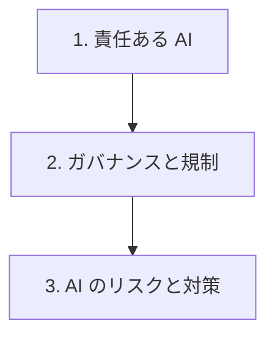

# 分野3: サービス別の学習

分野3（AI ガバナンスと責任ある AI のリーダーシップ）は AIB-C01 の配点の 24% です。原則を理解してから、体制と規制、具体的なリスクへの対策へ進みます。

| 順番 | 話題 | 問われること | 重要度 |
|---|---|---|---|
| 1 | [責任ある AI](responsible-ai.md) | 観点の見分け、対立の判断、人の監督と安全策 | 高 |
| 2 | [ガバナンスと規制](ai-governance.md) | 統治の体制、規制、責任共有、リスク分類 | 高 |
| 3 | [AI のリスクと対策](ai-risks.md) | 本番の監視、バイアス、知的財産、ハルシネーション | 高 |

重要度は公式のスキル一覧を見たこの wiki の判断で、公式の数字ではありません。

## 他のサービスにまたがる問題 {#other-questions}

<!-- questions:start -->

| 問題 | スキル | 内容 |
|---|---|---|
| [ai-concepts 問24](../../exercises/ai-concepts.md#q24) | 3.2.2 | AWS は ISO/IEC 42001 の認証を受けています。この事実を自社の AI の統治にどう位… |
| [build-buy 問8](../../exercises/build-buy.md#q8) | 3.2.2 | 候補のベンダーは機能と価格で最も優れていますが、自社の規制が求める地域でのデータ処理を保証できません… |
| [solution-types 問12](../../exercises/solution-types.md#q12) | 3.1.4 | 返金まで自動で行うエージェントの導入を承認します。自律性の高さに応じて、要求すべき統制はどれですか。… |
| [solution-types 問17](../../exercises/solution-types.md#q17) | 3.3.1 | 本番の AI の性能低下に備えて、導入前に決めておくべきことはどれですか。（2つ選択） |

<!-- questions:end -->
