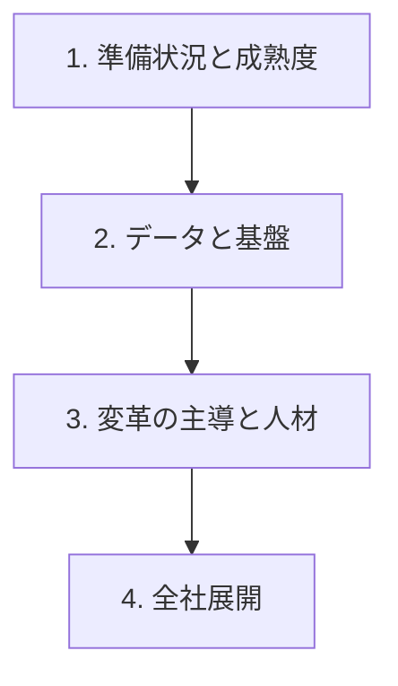

# 分野4: サービス別の学習

分野4（事業の準備状況、リーダーシップ、AI 変革）は AIB-C01 の配点の 24% で、スキルの数が最多です。現状の評価から始め、土台を整え、人を動かし、全社へ広げる順に学びます。

| 順番 | 話題 | 問われること | 重要度 |
|---|---|---|---|
| 1 | [準備状況と成熟度](readiness.md) | 評価の観点、成熟度の段階、不足の整理、投資の順序 | 高 |
| 2 | [データと基盤](data-foundations.md) | サイロ、所有者、データ戦略、基盤の要件 | 中 |
| 3 | [変革の主導と人材](change-leadership.md) | スポンサー、伝え方、文化の壁、育成、役割の移行 | 高 |
| 4 | [全社展開](scaling.md) | 変革の段階、短期の成果、AI CoE、本番への移行 | 高 |

重要度は公式のスキル一覧を見たこの wiki の判断で、公式の数字ではありません。

## 他のサービスにまたがる問題 {#other-questions}

<!-- questions:start -->

この分野の問題は、すべてサービス別のページに載っています。

<!-- questions:end -->
