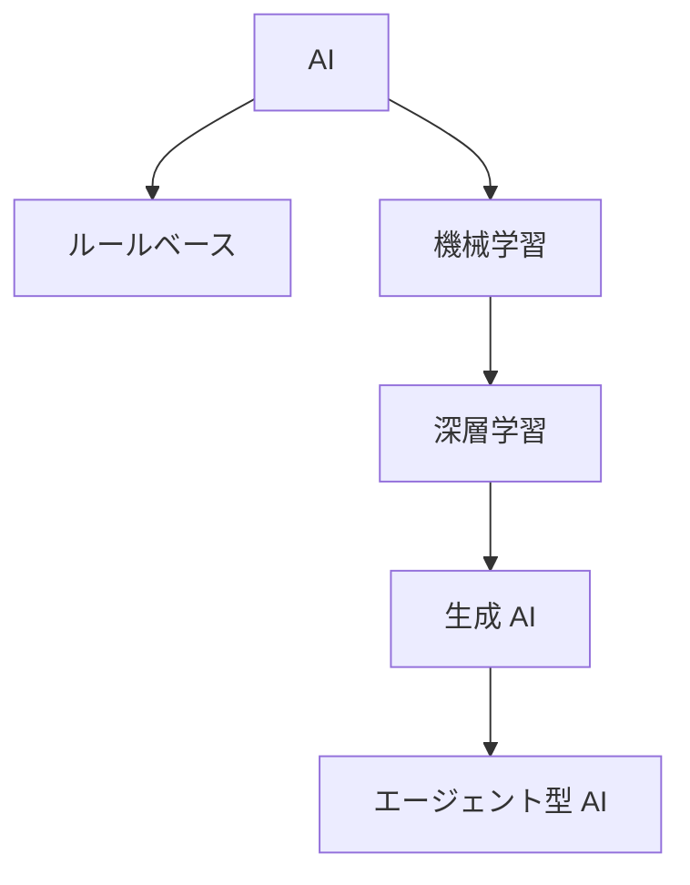
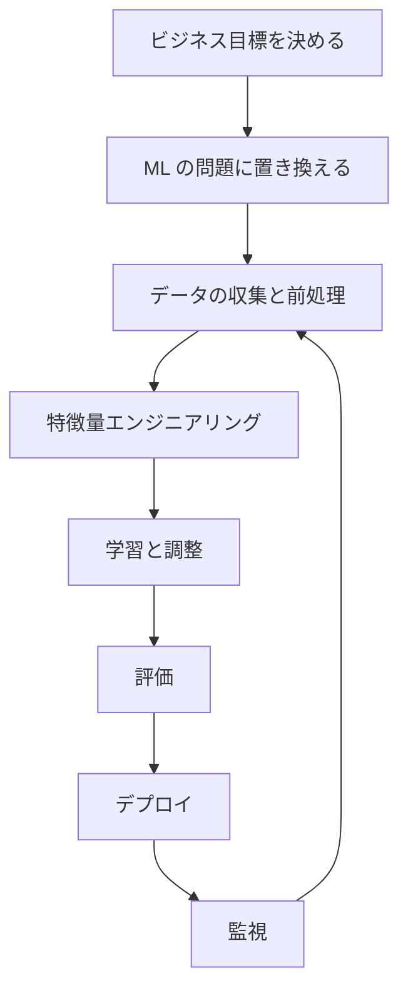

# 分野1: AI と ML の基礎

配点は **20%** です。用語の区別、業務に合う手法の選択、ML の開発の流れが中心です。計算やコードは求められません。「この状況ならどれか」を判断できるようにします。

この分野に限らず、コース全体で使うサービスは[サービス一覧](services.md)から確認できます。

## タスク 1.1: AI の基本概念と用語を説明する {#task-1-1}

### 1.1.1 基本用語の定義 {#obj-1-1-1}

試験では、用語の意味を状況の説明から選ばせます。

| 用語 | 意味 | 例 |
|---|---|---|
| AI | 人の知的な作業を機械で行う技術の総称 | 翻訳、チャット |
| 機械学習（ML） | 規則を書かず、データからパターンを学ぶ | 解約予測 |
| 深層学習 | 多層のニューラルネットワークを使う ML | 画像分類 |
| ニューラルネットワーク | 重みでつながれた計算ノードの層 | Transformer |
| コンピュータビジョン | 画像や動画を理解する | 製品の検品 |
| NLP | 自然言語を処理する | 感情分析 |
| アルゴリズム | 学習の手順 | 勾配ブースティング |
| モデル | 学習の結果できた、予測する関数 | 学習済みの解約予測モデル |
| 学習 | データから重みを求める | 過去 3 年の履歴で学ぶ |
| 推論 | 学習済みモデルで予測する | 今日の顧客を判定する |
| LLM | 言語を扱う大規模なモデル | 要約、チャット |
| 生成 AI | 学習した分布から新しい内容を作る | 文章や画像の生成 |
| エージェント型 AI | 計画、ツールの実行、結果の確認を繰り返す | 調査して発注まで行う |

**バイアス**には 2 つの意味があります。統計では予測の平均と正解のずれで、公平性の話では特定の集団に不利な結果が出ることです。**公平性**は、集団ごとの影響を考えることです。

**適合（fit）** は、データへの当てはまり方です。

| 状態 | 学習の精度 | 検証の精度 | 意味 |
|---|---|---|---|
| 過少適合 | 65% | 64% | 単純すぎる |
| 適合 | 92% | 90% | 汎化できている |
| 過学習 | 99% | 70% | 学習データを暗記した |

詳細: [用語の整理](../../services/ai-fundamentals.md#terms)、[モデルと推論](../../services/ai-fundamentals.md#model-training-inference)、[過学習](../../services/ai-fundamentals.md#overfitting)

### 1.1.2 AI、ML、生成 AI、深層学習、エージェント型 AI の違い {#obj-1-1-2}

外側ほど広い概念です。

共通点は、人の判断や作業を機械で助けることです。違いは次の問いで見分けます。

| 問い | はいなら |
|---|---|
| 人が書いた規則だけで動くか | ルールベースの AI。ML ではない |
| データから学ぶか | ML |
| 多層のニューラルネットワークを使うか | 深層学習 |
| 新しい文章や画像を作るか | 生成 AI |
| 目標に向けて自分で手順を決め、ツールを実行するか | エージェント型 AI |

**具体例:** 問い合わせに答えるだけなら生成 AI のチャットです。在庫を調べ、発注の API まで呼ぶならエージェント型 AI です。

詳細: [AI、ML、深層学習、生成 AI の関係](../../services/ai-fundamentals.md#ai-ml-dl)、[エージェント](../../services/ai-fundamentals.md#agents)

### 1.1.3 推論の種類 {#obj-1-1-3}

応答の速さと、データの大きさで選びます。

| 種類 | 特徴 | 向いている場面 | SageMaker AI の目安 |
|---|---|---|---|
| リアルタイム | 常時起動で低遅延 | 画面表示中の予測 | 入力は数十 MB 以内、通常 60 秒まで |
| サーバーレス | 待機コストなし、コールドスタートあり | 呼び出しが断続的 | 需要に応じて自動で増減 |
| 非同期 | キューに入れて処理する | 大きな入力、長い処理 | 入力 1 GB、1 時間まで |
| バッチ | データセットをまとめて処理する | 夜間の一括スコアリング | ジョブの間だけ起動 |

**具体例:** 1 日に数回しか呼ばれず、最初の呼び出しが少し遅くてもよいならサーバーレスです。数百 MB の入力を数分かけて処理するなら非同期です。

詳細: [推論の種類](../../services/ai-fundamentals.md#inference-types)、[エンドポイントと推論](../../services/sagemaker.md#endpoints)

### 1.1.4 AI モデルのデータの種類 {#obj-1-1-4}

| 分類 | 種類 | 例 |
|---|---|---|
| ラベル | ラベルあり | 「スパム」と印が付いたメール |
| ラベル | ラベルなし | 印のないメール |
| 構造 | 構造化 | 表、RDB、CSV |
| 構造 | 非構造化 | 文書、画像、音声 |
| 形式 | 表形式 | 顧客の属性と購入回数 |
| 形式 | 時系列 | 1 時間ごとのセンサー値 |
| 形式 | 画像 | 製品の写真 |
| 形式 | テキスト | 問い合わせ文 |

ラベルの有無は学習の種類を決めます。時系列は順序に意味があるので、学習用と評価用を時間順に分けます。

詳細: [データの種類](../../services/ai-fundamentals.md#data-types)

### 1.1.5 学習の種類 {#obj-1-1-5}

| 種類 | データ | 目的 | 事例 |
|---|---|---|---|
| 教師あり学習 | ラベルあり | 正解を当てる | 不正検知、価格予測 |
| 教師なし学習 | ラベルなし | 構造を見つける | 顧客のグループ分け |
| 強化学習 | 報酬 | 報酬を最大にする行動を学ぶ | ロボット制御、在庫の方策 |

問題文の「正解のラベルがある」「ラベルがない」「試行錯誤と報酬」という言葉が判断の手がかりです。

詳細: [学習の種類](../../services/ai-fundamentals.md#learning-types)

## タスク 1.2: AI の実用的なユースケースを見分ける {#task-1-2}

### 1.2.1 AI/ML が価値を生む場面 {#obj-1-2-1}

| 価値 | 内容 | 例 |
|---|---|---|
| 人の判断の支援 | 候補や根拠を示し、人が決める | 医師に画像の所見を提案する |
| 拡張性 | 人では追いつかない量を処理する | 毎日 100 万件のレビューの感情分析 |
| 自動化 | 繰り返しの作業を任せる | 請求書の項目の読み取り |

規則を書き切れないこと、大量のデータがあること、多少の誤りを許容できることがそろうと、AI が向きます。

詳細: [ユースケースの選定](../../services/ai-fundamentals.md#use-case-prioritization)

### 1.2.2 AI/ML が適切でない場面 {#obj-1-2-2}

ML の出力は予測です。確定した結果が必要な処理には向きません。

| 状況 | 選ぶもの | 理由 |
|---|---|---|
| 税額のような正確な計算 | 通常のプログラム | 予測ではなく確定値が必要 |
| 規則を書き切れ、常に同じ結果が必要 | ルールベース | 決定的で説明しやすい |
| 効果よりコストが大きい | 実施しない | 費用対効果が合わない |
| データが少ない、または質が低い | まずデータを整備 | 学習が成り立たない |

**具体例:** 「注文額が 5,000 円以上なら送料無料」は規則です。「この注文は不正か」は規則を書き切れないので ML が向きます。

詳細: [AI を使わない判断](../../services/ai-fundamentals.md#when-not-ai)

### 1.2.3 ユースケースに合う手法の選択 {#obj-1-2-3}

出力の形で見分けます。

| やりたいこと | 手法 | 出力 |
|---|---|---|
| 住宅価格を予測する | 回帰 | 数値 |
| メールがスパムか判定する | 分類（二値） | クラス |
| 問い合わせを 5 種類に分ける | 分類（多クラス） | クラス |
| 似た顧客をまとめる（正解なし） | クラスタリング | グループ |

詳細: [問題の種類](../../services/ai-fundamentals.md#problem-types)

### 1.2.4 実世界の AI の活用例 {#obj-1-2-4}

| 分野 | 例 | AWS の選択肢 |
|---|---|---|
| コンピュータビジョン | 不適切な画像の検出、ロゴの検出 | Rekognition |
| NLP | 感情分析、PII の検出 | Comprehend |
| 音声認識 | 会議の文字起こし | Transcribe |
| レコメンド | 商品のおすすめ | Personalize |
| 不正検知 | 不審な取引の検出 | SageMaker AI |
| 予測 | 来月の需要の予測 | SageMaker AI |
| ナレッジベース | 社内規定への質問応答 | Bedrock Knowledge Bases |
| エージェント型 AI | 調査から手続きまでの自動化 | AgentCore |

詳細: [選び方の比較](../../services/ai-managed-services.md#choosing)、[Knowledge Bases](../../services/genai-apps.md#knowledge-bases)

### 1.2.5 AWS のマネージド AI/ML サービスの機能 {#obj-1-2-5}

Transcribe から Rekognition までは、学習済みの機能を API で呼べます。ML の専門知識はあまり要りません。独自のモデルを作るなら SageMaker AI です。

| 入力 → 出力 | サービス | 問題文の手がかり |
|---|---|---|
| 音声 → 文字 | Transcribe | 文字起こし、通話の分析 |
| 文字 → 音声 | Polly | 読み上げ |
| テキスト → 別の言語 | Translate | 多言語化 |
| テキスト → 意味 | Comprehend | 感情、固有表現、PII |
| 音声やテキストの対話 | Lex | チャットボット、インテント |
| 文書 → 文字と表 | Textract | スキャン、請求書 |
| 画像や動画 → ラベル | Rekognition | 顔の比較、モデレーション |
| 行動履歴 → おすすめ | Personalize | レコメンド |
| データ → 独自のモデル | SageMaker AI | 学習、デプロイ、MLOps |

**紛らわしい組み合わせ:**

| 組み合わせ | 違い |
|---|---|
| Transcribe / Polly | 音声から文字 / 文字から音声 |
| Comprehend / Textract | 文の意味の分析 / 文書から文字の抽出 |
| Rekognition / Textract | 写真、動画 / 文書 |
| Lex / Bedrock | 決まった手続きの対話 / 自由な質問への回答 |

!!! note "サービスの状況（2026年10月時点）"
    - **Comprehend:** トピックモデリング、イベント検出、プロンプトの安全性分類は、2026-04-30 に新規顧客の受付を終了しました。
    - **Rekognition:** Streaming Video と Bulk Image Analysis は、2026-04-30 に新規顧客の受付を終了しました。
    - **Fraud Detector、Forecast、Kendra、Q Business、Augmented AI:** いずれも新規顧客を受け付けていません。現在の範囲内の一覧にもありません。古い教材で見かけたら、新規の代替は不正検知と需要予測が SageMaker AI、社内検索が Bedrock Knowledge Bases、業務アシスタントが Amazon Quick です。

詳細: [マネージド AI サービス](../../services/ai-managed-services.md)、[紛らわしい組み合わせ](../../services/ai-managed-services.md#confusing-pairs)、[Bedrock との比較](../../services/ai-managed-services.md#vs-bedrock)

### 1.2.6 従来の ML と FM の使い分け {#obj-1-2-6}

| 観点 | 従来の ML | 基盤モデル（FM） |
|---|---|---|
| 得意なこと | 表データの予測 | 文章、画像、対話 |
| 規制 | 説明が必須な判定に向く | 補助に留める |
| 説明可能性 | 手法により高い | 低い |
| 再現性 | 高い | 応答がぶれる |
| 運用の制約 | 自社のラベル付きデータと学習の運用が必要 | API ですぐ試せる。トークンの費用がかかる |

**具体例:** 融資の審査で否決の理由を示す必要があるなら、解釈しやすい従来の ML を選びます。審査の担当者が読む資料の要約なら FM が向きます。

詳細: [従来の ML と FM の使い分け](../../services/ai-fundamentals.md#ml-vs-fm)

## タスク 1.3: AI/ML の開発ライフサイクルを説明する {#task-1-3}

### 1.3.1 AI/ML パイプラインの構成要素 {#obj-1-3-1}

| 段階 | すること |
|---|---|
| データの収集と前処理 | 集める、欠損や重複を直す、傾向を確認する |
| 特徴量エンジニアリング | モデルへの入力の列を作る |
| 学習と調整 | モデルを学習させ、ハイパーパラメータを調整する |
| 評価 | テストデータで基準を満たすか確かめる。満たさなければ前の段階に戻る |
| デプロイ | 推論できる形で公開する |
| 監視 | 精度やデータの変化を見て、劣化したら再学習する |

データは学習用、検証用、テスト用に分けます。検証用は調整に、テスト用は最後の評価に使います。

詳細: [ML ライフサイクルと MLOps](../../services/ai-fundamentals.md#ml-lifecycle)

### 1.3.2 FM の入手元 {#obj-1-3-2}

| 入手元 | 内容 | 向いている場面 | AWS の例 |
|---|---|---|---|
| オープンソースの事前学習済みモデル | 公開された重みを使う | 自分で制御したい | JumpStart |
| 提供者のモデル | API で使う | すぐ使いたい | Bedrock |
| 自社で学習 | 独自のデータで学習する | 既存のモデルで足りない | SageMaker AI |

ゼロから学習するのは費用が最大で、ほとんどの場合は不要です。

詳細: [FM のライフサイクル](../../services/ai-fundamentals.md#fm-lifecycle)、[JumpStart](../../services/sagemaker.md#jumpstart)

### 1.3.3 本番でのモデルの使い方 {#obj-1-3-3}

| 観点 | マネージド API（Bedrock） | 自前のホスト（SageMaker AI のエンドポイント） |
|---|---|---|
| 運用 | インスタンスの管理が不要 | インスタンスを管理する |
| 課金 | 主にトークン単位 | インスタンスの起動時間 |
| 制御 | 少ない | 細かく制御できる |
| 向いている場面 | 素早く始める、負荷が変動する | 独自のモデル、細かい調整 |

詳細: [JumpStart と Bedrock の違い](../../services/sagemaker.md#jumpstart)、[選び方の比較](../../services/sagemaker.md#choosing)

### 1.3.4 パイプラインの各段階の AWS サービス {#obj-1-3-4}

| 段階 | サービス |
|---|---|
| データの保存 | S3 |
| データの準備 | Glue、Glue DataBrew、SageMaker AI の Data Wrangler と Processing |
| ラベル付け | SageMaker Ground Truth |
| 学習 | SageMaker AI |
| 評価 | MLflow on SageMaker AI、Bedrock の評価 |
| FM の利用 | Bedrock、JumpStart |
| デプロイ | SageMaker AI のエンドポイント、Bedrock の API |
| 監視 | CloudWatch、SageMaker Model Monitor |
| 開発の支援 | Kiro（仕様駆動の AI 開発環境） |
| 業務での利用 | Amazon Quick（チャット、分析、自動化、調査） |

!!! note "SageMaker AI の機能の状況（2026年10月時点）"
    **Clarify、Model Monitor、Ground Truth、Debugger** は新規顧客の受付を終了しました。既存の顧客は使い続けられます。役割は試験でも問われる可能性があるので押さえますが、新規の設計では公式の案内を確認します。監視の代替として、公式は MLflow や CloudWatch などを挙げています。

詳細: [ライフサイクルの表](../../services/ai-fundamentals.md#ml-lifecycle)、[SageMaker AI](../../services/sagemaker.md)、[Kiro](../../services/ai.md#kiro)、[Amazon Quick](../../services/ai.md#quick)

### 1.3.5 MLOps の基本概念 {#obj-1-3-5}

MLOps は、モデルを作って終わりにせず、継続して運用するための考え方です。

| 要素 | 内容 | AWS の例 |
|---|---|---|
| 実験 | パラメータと結果を記録し、再現できるようにする | MLflow |
| 反復可能なプロセス | 手作業をパイプラインで自動化する | SageMaker Pipelines |
| スケーラブルな仕組み | 処理量が増えても手作業に頼らない | マネージドの学習と推論 |
| 技術的負債の管理 | 特徴量の重複や未使用のコードを減らす | Feature Store |
| 本番準備 | テスト、承認、ロールバック | Model Registry |
| モデルの監視 | データと品質の変化を見る | CloudWatch |
| 再学習 | 定期的に、または変化を契機に実行する | Pipelines |

**データドリフト**は入力の分布の変化で、**コンセプトドリフト**は入力と正解の関係の変化です。不正の手口が変わるのは後者です。

詳細: [MLOps の要素](../../services/ai-fundamentals.md#ml-lifecycle)、[SageMaker の MLOps](../../services/sagemaker.md#mlops)、[ドリフトの種類](../../services/sagemaker.md#drift)

### 1.3.6 モデルの性能指標とビジネス指標 {#obj-1-3-6}

メール 1,000 通（スパム 100 通）の判定で、80 通のスパムを当て、30 通の通常メールを誤ってスパムとした例です。

| 指標 | 意味 | この例 | 重視する場面 |
|---|---|---|---|
| 精度（Accuracy） | 全体のうち正解した割合 | 0.95 | クラスが均衡している |
| 適合率（Precision） | 陽性と予測したうち本当に陽性の割合 | 0.727 | 誤検知の損失が大きい |
| 再現率（Recall） | 本当の陽性のうち見つけた割合 | 0.80 | 見逃しの損失が大きい |
| F1 スコア | 適合率と再現率の調和平均 | 0.762 | 両方を見たい |

**精度の罠:** 陽性がごく少ないと、全部を陰性と答えても精度は高くなります。不正検知や病気の検出では再現率を見ます。

モデルの指標がよくても、事業の成果になるとは限りません。

| ビジネス指標 | 見るもの |
|---|---|
| ユーザーあたりコスト | 1 人に提供する費用 |
| 開発コスト | 作るまでの費用 |
| 顧客のフィードバック | 満足度、評価 |
| ROI | 投資に対する効果 |

詳細: [分類の指標](../../services/ai-fundamentals.md#classification-metrics)、[ビジネス指標](../../services/ai-fundamentals.md#business-metrics)

## 確認問題 {#self-check}

??? question "問1: 保険会社に、過去の請求データと「不正」「正常」の判定結果があります。新しい請求が不正かどうかを判定したいとき、学習の種類と手法はどれですか。"
    教師あり学習の分類です。判定結果というラベルがあるので教師あり学習です。出力が「不正」「正常」のクラスなので、回帰ではなく分類になります。

??? question "問2: 小売企業が、200 万件の商品のスコアを毎晩計算して翌朝の画面に使います。推論の方式はどれが適切ですか。"
    バッチ推論です。結果をすぐ返す必要がなく、データセット全体を一度に処理するからです。常時起動のリアルタイム推論では、使わない時間にも費用がかかります。

??? question "問3: 経理部門が、税率表に基づいて消費税額を算出する処理に ML を使うことを検討しています。適切な助言はどれですか。"
    ML ではなく通常のプログラムを使うべきです。税額には予測ではなく確定した結果が必要です。規則も明確なので、学習の費用をかける理由がありません。

??? question "問4: コールセンターの英語の通話を日本語の文章にし、顧客の感情を分析したいです。サービスの組み合わせはどれですか。"
    Transcribe、Translate、Comprehend の順です。音声を文字にし、翻訳し、感情を分析します。Polly は文字を音声にするサービスで、向きが逆です。

??? question "問5: 銀行が融資の可否を自動で判定します。規制当局に否決の理由を説明する必要があります。従来の ML と FM のどちらを主に使いますか。"
    解釈しやすい従来の ML です。判定の理由を追いやすく、同じ入力で結果がぶれにくいからです。FM は応答が非決定的で内部を説明しにくいので、資料の要約のような補助に留めます。

??? question "問6: 取引の 0.5% だけが不正のデータで、モデルの精度は 99.5% でした。このモデルは不正検知に十分と言えますか。"
    言えません。全部を「正常」と答えても精度は 99.5% になります。不正の見逃しが問題なので、再現率を確認します。誤検知の影響も見るなら F1 スコアも使います。
