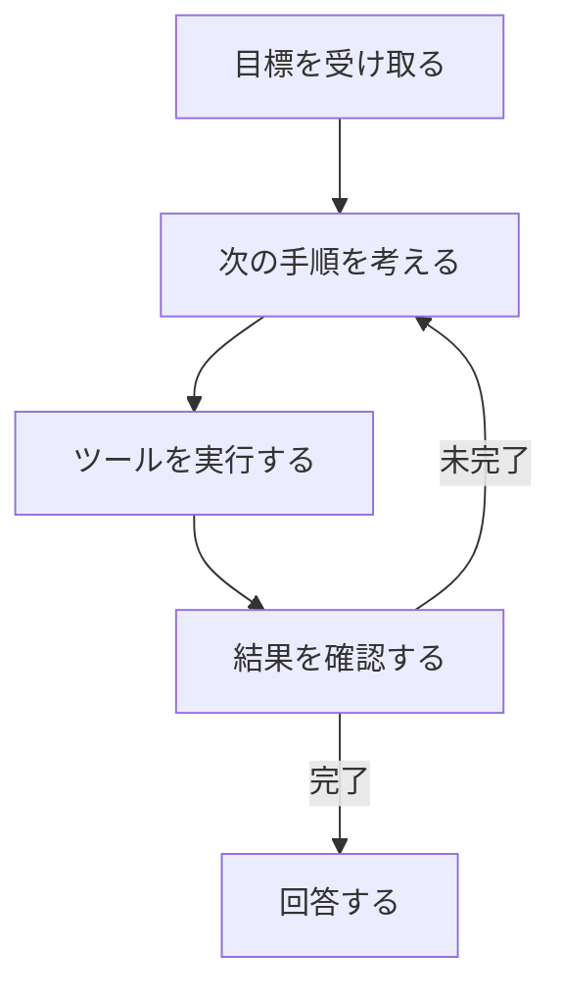

# 分野2: 生成 AI の基礎

配点は **24%** です。生成 AI の用語、長所と短所、AWS のサービスの選び方、料金の考え方が中心です。

この分野に限らず、コース全体で使うサービスは[サービス一覧](services.md)から確認できます。

## タスク 2.1: 生成 AI の基本概念を説明する {#task-2-1}

### 2.1.1 生成 AI の基本用語 {#obj-2-1-1}

| 用語 | 意味 | 問題文の手がかり |
|---|---|---|
| トークン | モデルが処理する文字列の単位 | 料金と速度の単位 |
| チャンク化 | 長い文書を検索しやすい単位に分ける | 文書が大きい、RAG |
| 埋め込み | 文章や画像を数値のベクトルに変えたもの | 意味が近いものを探す |
| ベクトル | 数値の並び。意味が近いと距離も近い | ベクトルデータベース |
| プロンプトエンジニアリング | 指示や例を工夫して出力を改善する | 再学習なしで改善 |
| Transformer ベースの LLM | 自己注意で文脈を捉える言語モデル | 文章の生成 |
| 基盤モデル（FM） | 広い用途に使える大規模な事前学習済みモデル | Bedrock のモデル |
| マルチモーダルモデル | テキスト、画像、音声などをまとめて扱う | 図表を読む |
| 拡散モデル | ノイズを少しずつ除去して生成する | 画像の生成 |

**具体例:** 「犬」と「子犬」のベクトルは近く、「犬」と「請求書」は遠くなります。これを使うと、キーワードが一致しなくても意味で検索できます。

詳細: [トークン](../../services/ai-fundamentals.md#tokens)、[埋め込み](../../services/ai-fundamentals.md#embeddings)、[モデルの種類](../../services/ai-fundamentals.md#model-kinds)

### 2.1.2 生成 AI のユースケース {#obj-2-1-2}

| ユースケース | 例 | 選択の目安 |
|---|---|---|
| 画像、動画、音声の生成 | 広告の素材 | Bedrock の対応モデル |
| 要約 | 通話や契約書の要約 | Bedrock の LLM |
| AI アシスタント | 社員の質問に答える | Amazon Quick、Bedrock |
| 翻訳 | 文脈に合わせた言い換え | 定型の大量翻訳は Translate、文脈に合わせるなら Bedrock |
| コード生成 | 実装やテストの作成 | Kiro |
| カスタマーサービスのエージェント | 注文を調べて返金まで行う | AgentCore |
| 検索 | 自然文で社内文書を探す | Bedrock Knowledge Bases |
| レコメンドエンジン | おすすめの理由の文章化 | 順位付けは Personalize、説明文は FM |

決まった形式の処理を大量に確実に行うなら、生成 AI よりマネージド AI サービスが向くことがあります。

!!! note "Nova のモデルの状況（2026年10月時点）"
    Nova v1 の Canvas と Reel は 2026-09-30、Sonic は 2026-09-14 にサポート終了に達しました。Amazon Nova は範囲内のままです。現行には Nova 2 Lite、Nova 2 Sonic、Nova Multimodal Embeddings があります。

詳細: [マネージド AI サービスと Bedrock](../../services/ai-managed-services.md#vs-bedrock)、[Nova と Titan](../../services/genai-apps.md#nova-titan)

### 2.1.3 FM のライフサイクル {#obj-2-1-3}

| 段階 | すること | 担当の例 |
|---|---|---|
| データの選定 | 代表性、権利、品質を確認する | 提供者、利用者 |
| モデルの選定 | コスト、遅延、モダリティなどで選ぶ | 利用者 |
| 事前学習 | 大量のデータで学ぶ | 通常は提供者 |
| ファインチューニング | 用途に合わせて調整する | 利用者 |
| 評価 | ベンチマーク、人の評価、LLM の採点 | 利用者 |
| デプロイ | API で使うか、自分でホストする | 利用者 |
| フィードバック | 利用者の評価を次の改善に使う | 利用者 |

並べ替えの問題に備えて、この順番を覚えます。

詳細: [FM のライフサイクル](../../services/ai-fundamentals.md#fm-lifecycle)

### 2.1.4 トークン単位の料金 {#obj-2-1-4}

オンデマンドの推論は、入力と出力のトークン数で課金されます。トークンが増えると、費用が増え、応答も遅くなります。

**計算例（単価は説明用の仮の値）:** 入力 100 万トークンあたり $3、出力 100 万トークンあたり $15 とします。1 日 1,000 回、1 回あたり入力 2,000、出力 500 トークンなら次のとおりです。

- 入力: 200 万トークン → $6
- 出力: 50 万トークン → $7.5
- 合計: 1 日 $13.5

出力の単価は入力より高いことが多いです。

| 減らし方 | 効果 |
|---|---|
| 最大出力トークンの制限、簡潔な回答の指示 | 出力を減らす |
| 会話履歴の要約、不要な情報の削除 | 入力を減らす |
| プロンプトキャッシュ | 長い固定の入力を再利用する |
| 小さなモデルへの変更 | 単価を下げ、応答も速くなることが多い |

最大出力トークンが小さすぎると、応答が途中で切れます。

詳細: [トークンの計算例](../../services/ai-fundamentals.md#tokens)、[料金の形](../../services/ai-fundamentals.md#ai-pricing)、[コストと遅延の最適化](../../services/genai-apps.md#optimization)

### 2.1.5 コンテキストエンジニアリング {#obj-2-1-5}

プロンプトの文面だけでなく、モデルに渡す情報全体を設計することです。

| 渡す情報 | 例 |
|---|---|
| 指示 | 役割、出力形式 |
| 検索結果 | RAG で取得した文書 |
| 会話履歴 | これまでのやり取り |
| ツールの定義 | 呼べる API の説明 |
| 記憶 | 利用者の好み、過去の事実 |

コンテキストウィンドウには上限があります。不要な情報を減らすと、費用も誤答も減ります。

**プロンプトエンジニアリングとの違い:** 前者は「どう書くか」で、こちらは「何を渡すか」です。

詳細: [プロンプトエンジニアリング](../../services/ai-fundamentals.md#prompt-engineering)、[トークンとコンテキストウィンドウ](../../services/ai-fundamentals.md#tokens)

### 2.1.6 エージェント型 AI の基本概念 {#obj-2-1-6}

エージェントは、目標に向けて考え、ツールを実行し、結果を確認することを繰り返します。

| 概念 | 意味 | 例 |
|---|---|---|
| ツールの利用 | API やデータベースを呼ぶ | 注文の状態を調べる |
| 記憶の管理 | 短期（今の会話）と長期（好みや過去の事実） | AgentCore Memory |
| ワークフローのオーケストレーション | 手順の順序や分岐を制御する | ルーティング、並列化 |
| MCP | エージェントとツールやデータをつなぐ標準プロトコル | 1 つのツールを複数のアプリで再利用 |

**マルチエージェントのパターン:** 複雑な仕事を専門のエージェントに分けます。

| パターン | 内容 | エージェント間のやり取り |
|---|---|---|
| Agents as Tools | 上位が他のエージェントをツールとして呼ぶ | 上位から下位へ指示する |
| Swarm | エージェント同士が仕事を引き継ぐ | 対等に引き継ぐ |
| Graph | 開発者が定義した流れ図に沿って進める（分岐やループも可） | エッジに沿って渡す |
| A2A | 別々の基盤のエージェントがプロトコルで通信する | 標準の通信 |

**覚え方:** MCP はエージェントとツールの接続で、A2A はエージェント同士の通信です。

詳細: [エージェント](../../services/ai-fundamentals.md#agents)、[パターン](../../services/genai-apps.md#workflow-patterns)、[マルチエージェント](../../services/genai-apps.md#multi-agent)、[MCP](../../services/genai-apps.md#mcp)、[Memory](../../services/genai-apps.md#agentcore-memory)

## タスク 2.2: 業務の課題に対する生成 AI の能力と限界を理解する {#task-2-2}

### 2.2.1 生成 AI の長所 {#obj-2-2-1}

| 長所 | 内容 | 例 |
|---|---|---|
| 適応性 | 同じモデルを多様な作業に使える | 要約にも分類にも使う |
| 応答性 | すぐに結果を返す | 文案を数秒で作る |
| 対話の能力 | 自然文でやり取りできる | 追加の質問に答える |
| 内容の生成 | 新しい文章や画像を作れる | 製品説明の下書き |

詳細: [生成 AI の長所と短所](../../services/ai-fundamentals.md#genai-pros-cons)

### 2.2.2 生成 AI の短所 {#obj-2-2-2}

| 短所 | 内容 | 例 | 対策 |
|---|---|---|---|
| ハルシネーション | もっともらしい誤りを作る | 存在しない判例を挙げる | RAG、根拠の提示 |
| 解釈の難しさ | 出力の理由を説明しにくい | 判断の根拠が追えない | 引用、人の確認 |
| 不正確さ | 事実と異なることがある | 古い情報で答える | 評価、人の確認 |
| 非決定性 | 同じ入力で結果が変わる | 毎回違う回答 | temperature を下げる、出力を検証する |

temperature を下げるとばらつきは減りますが、誤りがなくなるわけではありません。

詳細: [ハルシネーションへの対策](../../services/ai-fundamentals.md#hallucinations)

### 2.2.3 生成 AI のモデルを選ぶ観点 {#obj-2-2-3}

| 観点 | 確認すること | 例 |
|---|---|---|
| モデルの種類 | テキスト、画像、埋め込みなど | 図表を読むならマルチモーダル |
| 性能の要件 | 求める品質 | 自社のデータで比較する |
| 能力 | ツール、キャッシュ、構造化出力 | モデルカードで確認 |
| 制約 | コンテキスト長、対応言語 | 長い契約書なら長いモデル |
| コンプライアンス | リージョン、データの所在 | 国外へ出せないデータ |
| コスト | トークン単価 | 大量の分類なら安いモデル |
| 遅延 | 最初の応答までの時間 | 対話なら小さなモデル |
| モデルの複雑さ | 大きいほど高性能で高価になりやすい | 足りるなら小さなモデル |

最高性能のモデルが常に正解ではありません。問題文の制約に合うものを選びます。

詳細: [選定の観点](../../services/genai-apps.md#fm-criteria)

### 2.2.4 生成 AI のビジネス価値と指標 {#obj-2-2-4}

| 指標 | 意味 | 例 |
|---|---|---|
| 領域をまたぐ性能 | 複数の業務領域で同じ品質が出るか | 人事でも法務でも使えるか |
| ROI | 投資に対する効果 | 下の計算例 |
| 効率 | 時間や手間の削減 | 1 件の処理時間 |
| コンバージョン率 | 訪問者のうち購入などに至った割合 | 提案文の変更で 2% から 3% へ |
| ユーザーあたり平均収益（ARPU） | 利用者 1 人あたりの収益 | 月額の収益 |
| 精度 | 回答が正しい割合 | 正答率 |
| 顧客生涯価値（CLV） | 1 人の顧客が取引全体で生む価値 | 継続率の改善で増える |

ガイドの「cross-domain performance」は定義されていません。ここでは、複数の業務領域で同じ品質が出るかと解釈しています。

**ROI の計算例:** 問い合わせの処理が 12 分から 8 分になり、年 150,000 件なら 10,000 時間の削減です。時給 4,000 円で効果は 4,000 万円です。費用が 2,500 万円なら、ROI は (4,000 − 2,500) / 2,500 = 60% です。

導入前の値（ベースライン）がないと、効果を示せません。

詳細: [KPI と ROI](../../services/ai-fundamentals.md#kpi-roi)、[ビジネス指標](../../services/ai-fundamentals.md#business-metrics)

## タスク 2.3: 生成 AI アプリを作るための AWS の基盤と技術を説明する {#task-2-3}

### 2.3.1 生成 AI アプリのサービスと機能 {#obj-2-3-1}

| サービス | 役割 | 選ぶ場面 |
|---|---|---|
| Amazon Bedrock | 複数の FM を API で使う。Guardrails、Knowledge Bases も提供 | インスタンスを管理せず FM を使う |
| SageMaker AI | ML の学習からデプロイまで | モデルを細かく制御する |
| SageMaker JumpStart | 事前学習済みモデルのハブ | 自分のインスタンスにすぐデプロイする |
| Amazon Quick | 業務ユーザー向けのチャット、分析、自動化、調査 | コードを書かずに業務で使う |
| Kiro | 仕様駆動の AI 開発環境 | 開発を AI に支援させる |
| Strands Agents | オープンソースのエージェント SDK | コードでエージェントを作る |
| AgentCore | エージェントの実行基盤、記憶、ツール接続、認証、認可 | エージェントを本番で動かす |

**階層で考えます。**

| 階層 | サービス | 使う人 | 制御 |
|---|---|---|---|
| アプリケーション | Quick、Kiro | 業務ユーザー、開発者 | 小 |
| AI サービス、FM | Bedrock、マネージド AI サービス | アプリ開発者 | 中 |
| ML プラットフォーム | SageMaker AI | ML エンジニア | 大 |

**Strands と AgentCore:** Strands はエージェントを書く道具で、AgentCore は動かす基盤です。

詳細: [AWS の AI の 3 階層](../../services/ai-managed-services.md#three-layers)、[AgentCore](../../services/genai-apps.md#agentcore)、[Strands Agents](../../services/genai-apps.md#multi-agent)、[JumpStart](../../services/sagemaker.md#jumpstart)、[Kiro](../../services/ai.md#kiro)、[Amazon Quick](../../services/ai.md#quick)

### 2.3.2 AWS の生成 AI サービスを使う利点 {#obj-2-3-2}

| 利点 | 内容 | 例 |
|---|---|---|
| 利用のしやすさ | API や画面で使える | 複数の FM を同じ API で試す |
| 参入障壁の低さ | ML の専門家がいなくても始められる | Quick で業務部門が使う |
| 効率 | 基盤の管理が不要 | インスタンスを管理しない |
| 費用対効果 | 使った分だけ支払う | オンデマンドのトークン課金 |
| 市場投入の速さ | 既存のモデルで素早く作る | 学習せずに PoC を作る |
| 事業目標の達成 | 用途に合うモデルと機能を選べる | 評価してモデルを切り替える |

詳細: [マネージド AI サービスと Bedrock](../../services/ai-managed-services.md#vs-bedrock)、[作る、買う、組む](../../services/ai-fundamentals.md#build-buy-partner)

### 2.3.3 AWS の基盤の利点 {#obj-2-3-3}

| 観点 | 内容 |
|---|---|
| セキュリティ | IAM、KMS、PrivateLink で保護する。Bedrock は入出力をモデルの学習に使わず、モデル提供者とも共有しない |
| コンプライアンス | Artifact で第三者の監査レポートを入手する。利用するリージョンを選べる |
| 責任 | 責任共有モデルで分担する。AWS は基盤を、利用者はデータ、権限、アプリを担当する |
| 安全性 | Guardrails で有害な内容や機密情報を制御する |

詳細: [入出力は学習に使われるか](../../services/ai.md#training-use)、[責任共有モデル](../../services/ai-fundamentals.md#shared-responsibility)、[Guardrails](../../services/ai.md#guardrails)、[AWS Artifact](../../services/cloud-foundations.md#artifact)

### 2.3.4 AWS の生成 AI サービスのコストのトレードオフ {#obj-2-3-4}

| 選択肢 | 料金 | 利点 | 注意 |
|---|---|---|---|
| オンデマンド | トークン単位 | 負荷の変動に合う | クォータとスロットリングがある |
| Provisioned Throughput | モデルユニットの時間単位 | 固定の高い処理量に合う | 使わなくても課金される。コミットメント期間中は削除できない |
| バッチ | 非同期のジョブ | 大量で急がない処理に合う | すぐには結果が出ない |
| Priority / Flex | 割増 / 割引 | 応答の速さと費用を選べる | Flex は処理時間が長くなることがある |
| カスタムモデル | 学習、保存、推論の費用 | 文体や形式を合わせられる | Provisioned Throughput か、カスタムモデルのデプロイが必要 |
| クロスリージョン推論 | モデルと方式による | 可用性と容量が増える | データがリージョンをまたぐ |

**観点ごとのトレードオフ:**

| 観点 | 良くする方法 | 代償 |
|---|---|---|
| 応答性 | Priority、大きな容量 | 費用が増える |
| 可用性、冗長性 | クロスリージョン推論、別モデルへのフォールバック | データの所在の確認、モデルごとの検証が必要 |
| 性能 | 高性能なモデル | トークン単価が上がる |
| リージョンの範囲 | 地理的な推論プロファイル（`us`、`eu` など）でデータの所在を保つ | 処理先のリージョンがその地理の中に限られる |
| 価格 | グローバル推論プロファイル（地理的クロスリージョン推論より約 10% 安い） | データの所在の要件があると使えない |

**具体例:** 夜間に 10 万件を要約するならバッチです。1 日中高い負荷が続くなら Provisioned Throughput を検討します。負荷が読めないならオンデマンドです。

詳細: [スループットの選択肢](../../services/ai.md#throughput-options)、[推論の容量とプロファイル](../../services/genai-apps.md#inference-profiles)、[クロスリージョン推論の違い](../../services/ai.md#model-identifiers)、[耐障害の設計](../../services/genai-apps.md#fm-resilience)

## 確認問題 {#self-check}

??? question "問1: チャットアプリの Bedrock の費用が増えています。分析すると、毎回の入力に同じ長い規定文が含まれていました。品質を保って費用を減らす方法はどれですか。"
    プロンプトキャッシュです。長い固定の入力を再利用できるので、入力の費用を減らせます。最大出力トークンを小さくしても、入力の問題は解決せず、応答が途中で切れるおそれがあります。

??? question "問2: 同じ質問をしても、チャットボットの回答が毎回少しずつ変わり、利用者が混乱しています。この性質の名前と、まず調整するものはどれですか。"
    非決定性です。まず temperature を下げます。確率の高い語が選ばれやすくなり、ばらつきが減ります。ただし、回答の正しさを保証するものではありません。

??? question "問3: 企業が複数のエージェントから、同じ社内データベース用のツールを標準の方法で使いたいと考えています。適した仕組みはどれですか。"
    MCP です。エージェントとツールやデータをつなぐ標準プロトコルで、ツールを複数のアプリで再利用できます。A2A はエージェント同士の通信なので、この要件の中心ではありません。

??? question "問4: スタートアップに ML エンジニアがいません。インスタンスを管理せず、複数の FM を試して要約機能を作りたいです。適切なサービスはどれですか。"
    Amazon Bedrock です。API で複数の FM を使え、基盤の管理が不要です。JumpStart は自分のアカウントのインスタンスで動かすので、インスタンスの管理が必要です。

??? question "問5: 1 日中ほぼ一定の高い負荷があり、カスタムモデルを推論に使います。適切な容量の選択肢はどれですか。また、注意点は何ですか。"
    Provisioned Throughput です。固定の高い処理量とカスタムモデルに向いています。注意点は、使用率が低くても時間単位で課金されることと、コミットメントを選ぶとその期間中は削除できないことです。

??? question "問6: EC サイトが生成 AI で商品説明を改善しました。経営層は、この取り組みの事業への効果を知りたがっています。最も直接的な指標はどれですか。"
    コンバージョン率やユーザーあたり平均収益です。売上への影響を直接示せます。ROUGE のようなモデルの指標は品質の評価には使えますが、事業の成果は示しません。導入前のベースラインと比較します。
