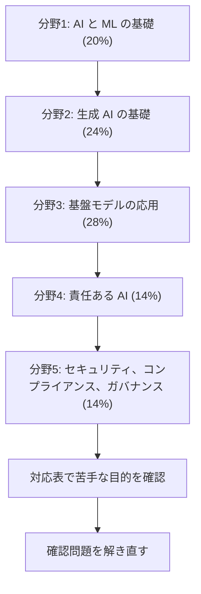

# AI Practitioner（AIF）

AI、機械学習、生成 AI の基本と、AWS の AI サービスの選び方を問う基礎レベルの試験です。モデルを作る力ではなく、業務に合う技術を判断する力が中心です。このコースは **AIF-C01** の試験ガイド（第 1.2 版、2026年10月29日公開）を基準にしています。

!!! warning "最近の変更（2026年10月時点）"
    - **言語:** 公式ページによると、イタリア語版とドイツ語版は **2026年10月15日** の後に終了しました。同じページの言語一覧にはこの 2 つがまだ載っているので、受験の予約画面でも確認してください。
    - **試験ガイド:** 第 1.2 版が **2026年10月29日** に公開されました。AWS は、ガイドの更新を試験への反映のおよそ 1 か月前に公開すると説明しています。反映の正確な日は示されていません。
    - **新しい版:** 公式ページに、AIF-C01 の後継の版や最終受験日の案内はありません。

## 試験の概要 {#overview}

| 項目 | 内容 | 出典 |
|---|---|---|
| 区分 | 基礎（Foundational） | 公式ページ |
| 問題数 | 65問（採点対象50問 + 採点対象外15問） | 試験ガイド、公式ページ |
| 試験時間 | 90分 | 公式ページ |
| 合格点 | 700点（100〜1,000点） | 試験ガイド |
| 受験料 | 100 USD（為替などによる追加費用は公式の料金ページを参照） | 公式ページ |
| 形式 | 択一、複数選択、並べ替え、組み合わせ | 試験ガイド |
| 採点方式 | 全体の得点で合否を判定します。分野ごとの合格点はありません | 試験ガイド |
| 減点 | 誤答による減点はありません。未回答は不正解になるので、すべて回答します | 試験ガイド |
| 受験方法 | Pearson VUE のテストセンターまたはオンライン監視 | 公式ページ |
| 言語 | アラビア語、英語、フランス語（フランス）、日本語、韓国語、ポルトガル語（ブラジル）、スペイン語（ラテンアメリカ）、スペイン語（スペイン）、簡体字中国語、繁体字中国語。イタリア語とドイツ語は上記のとおり終了 | 公式ページ |

並べ替えと組み合わせは、すべて正しいときだけ得点になります。複数選択も、正解をすべて選ぶ必要があります。

## 学習の順番 {#study-path}

分野3 は分野1、2 の用語を前提にするので、配点順ではなく番号順に進めます。各分野のページで目的ごとの要点を確認し、足りないところはサービス解説で補います。

| 分野 | 配点 | タスク | 目的の数 | 主なサービス |
|---|---|---|---|---|
| [分野1: AI と ML の基礎](domain1.md) | 20% | 3 | 17 | SageMaker AI、Comprehend、Transcribe、Translate、Lex、Polly |
| [分野2: 生成 AI の基礎](domain2.md) | 24% | 3 | 14 | Bedrock、JumpStart、Quick、Kiro、Strands Agents、AgentCore |
| [分野3: 基盤モデルの応用](domain3.md) | 28% | 4 | 19 | Knowledge Bases、OpenSearch、Aurora、Prompt Management、Bedrock の評価 |
| [分野4: 責任ある AI](domain4.md) | 14% | 2 | 11 | Guardrails、Model Cards、Bedrock の評価 |
| [分野5: セキュリティ、コンプライアンス、ガバナンス](domain5.md) | 14% | 2 | 8 | IAM、KMS、Macie、PrivateLink、Config、CloudTrail、Artifact |

試験ガイドの目的には番号がありません。このコースでは、ガイドの並び順に「1.1.1」のような番号を付けて区別しています。番号は公式のものではありません。全目的の一覧は[対応表](coverage.md)にあります。

## 受験者像と範囲外のもの {#out-of-scope}

AWS の AI/ML 技術に最大 6 か月ほど触れた人が対象です。AI/ML ソリューションを使う立場で、必ずしも作る必要はありません。

前提の知識は次のとおりです。

- EC2、S3、Lambda、Bedrock、SageMaker AI などの主要サービスと、その用途
- AWS の責任共有モデル
- IAM によるアクセス制御
- AWS のサービスの料金の考え方

次の作業は受験者に求められていません。

- AI/ML のモデルやアルゴリズムの開発とコーディング
- データエンジニアリングや特徴量エンジニアリングの実装
- ハイパーパラメータの調整やモデルの最適化
- AI/ML のパイプラインや基盤の構築とデプロイ
- AI/ML モデルの数学的、統計的な分析
- セキュリティやコンプライアンスの手順の実装
- ガバナンスの枠組みや方針の策定と実装

範囲外のサービスの例は、GuardDuty、WAF、Shield、Security Hub、Cognito、Control Tower、Direct Connect、Route 53、X-Ray、AWS Support です。脅威の検知のような**考え方**は範囲内ですが、これらのサービスの名前を選ぶ問題は想定しません。全体は[範囲外の一覧](https://docs.aws.amazon.com/aws-certification/latest/ai-practitioner-01/aif-01-out-of-scope-services.html)で確認できます。

改訂履歴によると、Elastic Transcoder、Elemental MediaStore、IoT 1-Click、IoT Analytics、IoT Events、Nimble Studio は範囲外の一覧から外れました。範囲内の一覧にも載っていません。

## 範囲内のサービス {#in-scope-services}

試験ガイドの一覧と、このwikiのページの対応です。一覧は網羅的ではなく、変更されることがあります。

| カテゴリ | サービスと解説 |
|---|---|
| 機械学習 | [Bedrock](../../services/ai.md#bedrock-runtime)、[AgentCore](../../services/genai-apps.md#agentcore)、[Comprehend](../../services/ai-managed-services.md#comprehend)、[Lex](../../services/ai-managed-services.md#lex)、[Nova](../../services/genai-apps.md#nova-titan)、[Personalize](../../services/ai-managed-services.md#personalize)、[Polly](../../services/ai-managed-services.md#polly)、[Rekognition](../../services/ai-managed-services.md#rekognition)、[SageMaker AI](../../services/sagemaker.md)、[JumpStart](../../services/sagemaker.md#jumpstart)、[Textract](../../services/ai-managed-services.md#textract)、[Transcribe](../../services/ai-managed-services.md#transcribe)、[Translate](../../services/ai-managed-services.md#translate)、[AWS Transform](../../services/migration.md#transform) |
| 開発ツール | [Kiro](../../services/ai.md#kiro)、[Strands Agents](../../services/genai-apps.md#multi-agent) |
| 分析 | [Data Exchange](../../services/data-engineering.md#data-exchange)、[EMR](../../services/data-engineering.md#emr)、[Glue](../../services/data-engineering.md#glue)、[Glue DataBrew](../../services/data-engineering.md#databrew)、[Lake Formation](../../services/data-engineering.md#lake-formation)、[OpenSearch Service](../../services/streaming.md#opensearch)、[Quick](../../services/ai.md#quick)、[Redshift](../../services/data-engineering.md#redshift) |
| データベース | [Aurora](../../services/databases.md#aurora)、[DocumentDB](../../services/databases-specialized.md#documentdb)、[DynamoDB](../../services/dynamodb.md)、[ElastiCache](../../services/databases.md#elasticache)、[Neptune](../../services/databases-specialized.md#neptune)、[RDS](../../services/databases.md#rds) |
| コンピューティング | [EC2](../../services/ec2-beanstalk.md)、[Lambda](../../services/lambda.md) |
| コンテナ | [ECS](../../services/containers.md#ecs)、[EKS](../../services/containers.md#eks) |
| ストレージ | [S3](../../services/s3.md)、[S3 Glacier](../../services/s3.md#glacier-retrieval) |
| ネットワーク | [CloudFront](../../services/networking.md#cloudfront)、[VPC](../../services/networking.md#vpc) |
| セキュリティ | [Artifact](../../services/cloud-foundations.md#artifact)、[IAM](../../services/iam.md)、[Inspector](../../services/threat-detection.md#inspector)、[KMS](../../services/kms.md)、[Macie](../../services/threat-detection.md#macie)、[Secrets Manager](../../services/secrets.md#secrets-manager) |
| 管理とガバナンス | [CloudTrail](../../services/observability.md#cloudtrail)、[CloudWatch](../../services/observability.md#cloudwatch-metrics)、[Config](../../services/governance.md#config)、[Trusted Advisor](../../services/cloud-foundations.md#trusted-advisor)、[Well-Architected Tool](../../services/cloud-foundations.md#wa-tool) |
| コスト | [Budgets](../../services/cost-management.md#budgets)、[Cost Explorer](../../services/cost-management.md#cost-explorer) |

## 参考 {#references}

- [AIF-C01 試験ガイド](https://docs.aws.amazon.com/aws-certification/latest/ai-practitioner-01/ai-practitioner-01.html)
- [範囲内のサービス](https://docs.aws.amazon.com/aws-certification/latest/ai-practitioner-01/aif-01-in-scope-services.html)
- [範囲外のサービス](https://docs.aws.amazon.com/aws-certification/latest/ai-practitioner-01/aif-01-out-of-scope-services.html)
- [改訂履歴](https://docs.aws.amazon.com/aws-certification/latest/ai-practitioner-01/aif-01-revisions.html)
- [認定の公式ページ](https://aws.amazon.com/certification/certified-ai-practitioner/)
