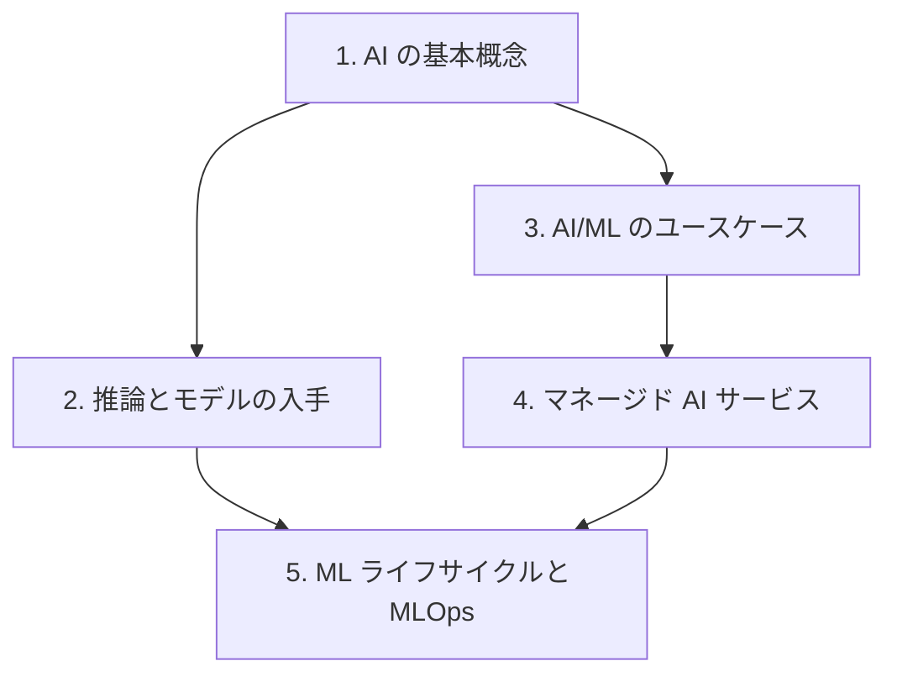

# 分野1: サービス別の学習

分野1（AI と ML の基礎）は AIF-C01 の配点の 20% を占め、用語の区別、業務に合う手法の選択、ML の開発の流れを扱います。用語を先に固めると、後のページの選択肢が読みやすくなります。

| 順番 | 話題 | 問われること | 重要度 |
|---|---|---|---|
| 1 | [AI の基本概念](ai-concepts.md) | 用語、AI と ML の違い、データと学習の種類 | 高 |
| 2 | [推論とモデルの入手](inference.md) | 推論の 4 種類、FM の入手元、本番での使い方 | 高 |
| 3 | [AI/ML のユースケース](ml-use-cases.md) | AI が向く場面と向かない場面、手法の選択、従来の ML と FM | 高 |
| 4 | [マネージド AI サービス](managed-ai.md) | 入力と出力からのサービスの選択、活用例 | 高 |
| 5 | [ML ライフサイクルと MLOps](ml-lifecycle.md) | パイプライン、各段階のサービス、MLOps、指標 | 高 |

重要度は公式の目的の一覧を見たこの wiki の判断で、公式の数字ではありません。

## 他のサービスにまたがる問題 {#other-questions}

<!-- questions:start -->

この分野の問題は、すべてサービス別のページに載っています。

<!-- questions:end -->
