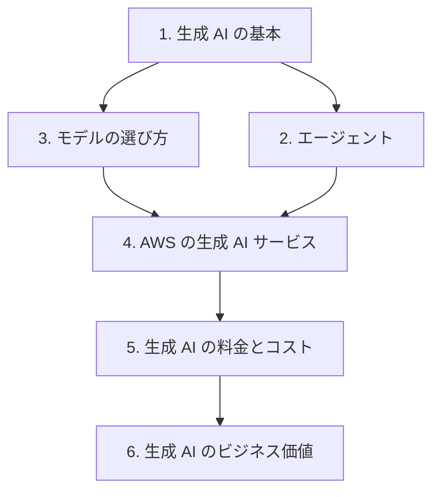

# 分野2: サービス別の学習

分野2（生成 AI の基礎）は AIF-C01 の配点の 24% を占め、生成 AI の用語、長所と短所、AWS のサービスの選び方、料金の考え方を扱います。用語から順に進めます。

| 順番 | 話題 | 問われること | 重要度 |
|---|---|---|---|
| 1 | [生成 AI の基本](genai-concepts.md) | 用語、ユースケース、ライフサイクル、長所と短所 | 高 |
| 2 | [エージェント](agents.md) | MCP、A2A、マルチエージェント、記憶 | 高 |
| 3 | [モデルの選び方](model-selection.md) | モデルの種類、制約、費用、遅延 | 中 |
| 4 | [AWS の生成 AI サービス](aws-genai-services.md) | Bedrock、JumpStart、Quick、Kiro、AWS の基盤の利点 | 高 |
| 5 | [生成 AI の料金とコスト](genai-cost.md) | トークン課金、容量の選択肢、推論プロファイル | 高 |
| 6 | [生成 AI のビジネス価値](business-value.md) | ROI、コンバージョン率、ベースライン | 中 |

重要度は公式の目的の一覧を見たこの wiki の判断で、公式の数字ではありません。

## 他のサービスにまたがる問題 {#other-questions}

<!-- questions:start -->

| 問題 | スキル | 内容 |
|---|---|---|
| [managed-ai 問13](../../exercises/managed-ai.md#q13) | 2.1.2 | 請求書の項目を毎月大量に、決まった形式で確実に抽出します。Bedrock の FM ではなく、マネー… |

<!-- questions:end -->
