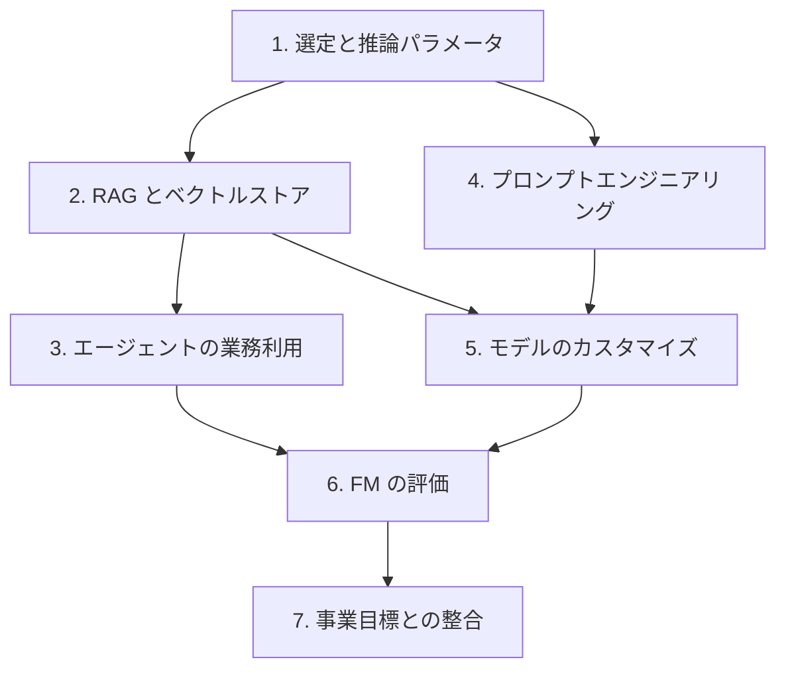

# 分野3: サービス別の学習

分野3（基盤モデルの応用）は AIF-C01 の配点の 28% で、5 分野の中で最大です。FM の選び方から順に、RAG、プロンプト、調整、評価と進みます。

| 順番 | 話題 | 問われること | 重要度 |
|---|---|---|---|
| 1 | [選定と推論パラメータ](model-selection.md) | FM の選定基準、temperature、top-p | 高 |
| 2 | [RAG とベクトルストア](rag.md) | RAG の仕組み、埋め込みの保存先 | 高 |
| 3 | [エージェントの業務利用](agents.md) | チャットとの違い、影響の大きい操作 | 中 |
| 4 | [プロンプトエンジニアリング](prompts.md) | 構成要素、手法、リスク、Prompt Management | 高 |
| 5 | [モデルのカスタマイズ](customization.md) | 費用のトレードオフ、ファインチューニング、データの準備 | 高 |
| 6 | [FM の評価](evaluation.md) | 評価の方法、BLEU、ROUGE、RAG とエージェントの評価 | 高 |
| 7 | [事業目標との整合](business-value.md) | 生産性、タスク完了率、やり取りあたりのコスト | 中 |

重要度は公式の目的の一覧を見たこの wiki の判断で、公式の数字ではありません。

## 他のサービスにまたがる問題 {#other-questions}

<!-- questions:start -->

この分野の問題は、すべてサービス別のページに載っています。

<!-- questions:end -->
