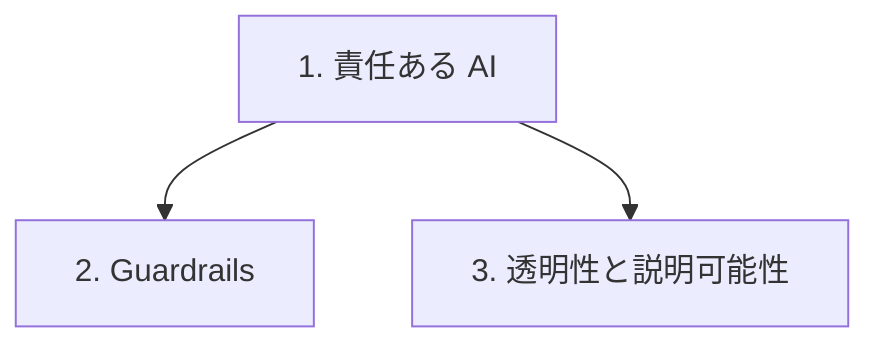

# 分野4: サービス別の学習

分野4（責任ある AI）は AIF-C01 の配点の 14% を占め、責任ある AI の特徴、偏りの見つけ方、透明で説明できるモデルの選び方を扱います。枠組みの策定や実装は求められません。

| 順番 | 話題 | 問われること | 重要度 |
|---|---|---|---|
| 1 | [責任ある AI](responsible-ai.md) | 特徴、法的なリスク、データセット、バイアスとバリアンス、検出の手法 | 高 |
| 2 | [Guardrails](guardrails.md) | 要件に合うフィルターの選択 | 高 |
| 3 | [透明性と説明可能性](explainability.md) | 解釈しやすいモデル、Model Cards、トレードオフ、人間中心の設計 | 中 |

重要度は公式の目的の一覧を見たこの wiki の判断で、公式の数字ではありません。

## 他のサービスにまたがる問題 {#other-questions}

<!-- questions:start -->

この分野の問題は、すべてサービス別のページに載っています。

<!-- questions:end -->
