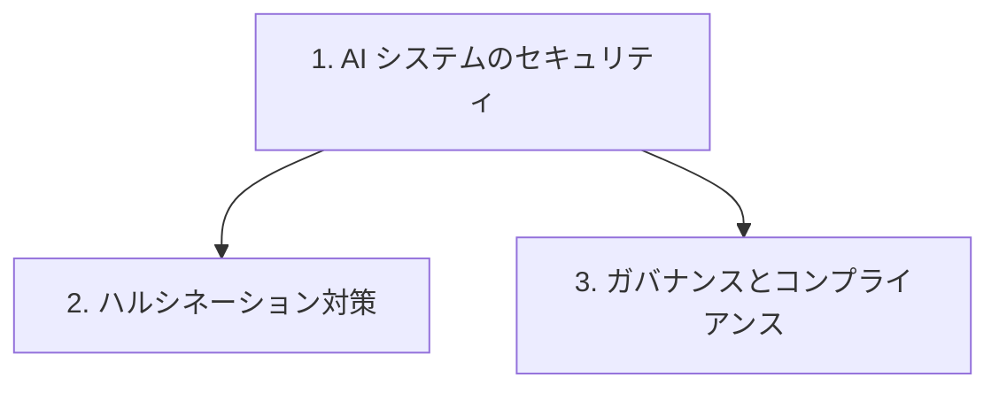

# 分野5: サービス別の学習

分野5（セキュリティ、コンプライアンス、ガバナンス）は AIF-C01 の配点の 14% を占めます。目的に合うサービスを選べることと、リスクの考え方の説明が中心で、実際の設定や枠組みの策定は求められません。

| 順番 | 話題 | 問われること | 重要度 |
|---|---|---|---|
| 1 | [AI システムのセキュリティ](ai-security.md) | IAM、KMS、Macie、PrivateLink、AgentCore、データの保護、ログ | 高 |
| 2 | [ハルシネーション対策](guardrails.md) | グラウンディング、出力の検証、信頼度 | 中 |
| 3 | [ガバナンスとコンプライアンス](governance.md) | 出典の明示、Config、CloudTrail、Artifact、Scoping Matrix | 高 |

重要度は公式の目的の一覧を見たこの wiki の判断で、公式の数字ではありません。

## 他のサービスにまたがる問題 {#other-questions}

<!-- questions:start -->

この分野の問題は、すべてサービス別のページに載っています。

<!-- questions:end -->
