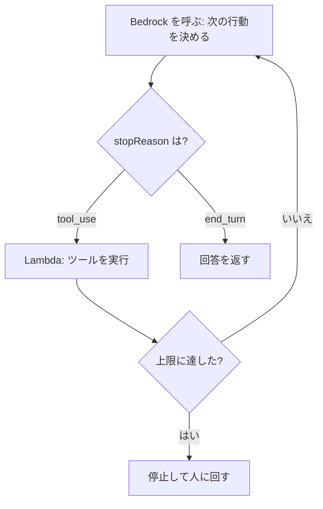
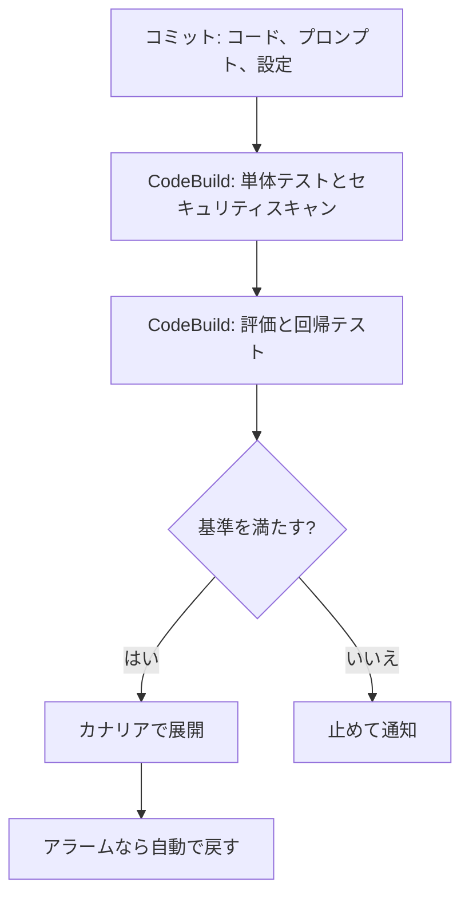

# 分野2: 実装と統合

配点は **26%** です。エージェント、モデルのデプロイ、企業システムとの統合、FM の API、アプリの開発の5タスクがあります。

モデルが手順を決める部分と、コードで決める部分をどう分けるかが、この分野の軸です。

この分野に限らず、コース全体で使うサービスは[サービス一覧](services.md)から確認できます。

## タスク 2.1: エージェント型 AI とツール連携を実装する {#task-2-1}

!!! note "Bedrock Agents の状況"
    Amazon Bedrock Agents は Agents Classic に改称され、2026-07-30 から新規顧客を受け付けていません。既存のエージェントは動き続けます。新規は AgentCore や Strands Agents で作ります。Knowledge Bases と Guardrails はこの変更の影響を受けません。

### 2.1.1 記憶と状態を持つ自律システム {#skill-2-1-1}

| 要素 | 選択肢 | 判断 |
|---|---|---|
| SDK | Strands Agents | モデル、プロンプト、ツールで書くオープンソースの SDK |
| ルーティング | Agent Squad | 問い合わせを適切なエージェントへ振り分け、文脈を保つ |
| ツールの接続 | MCP | ツールの提供側を標準化する |
| 実行基盤 | AgentCore Runtime | セッションごとに分離。microVM は最大 8 時間 |
| 記憶 | AgentCore Memory の短期と長期 | 自前なら DynamoDB とベクトルストア |

| マルチエージェントの手法 | 向いている場面 |
|---|---|
| Agents as Tools | 上位のエージェントが全体を統制する |
| Swarm | エージェント同士で仕事を引き継ぐ |
| Graph | 流れが決まっている |
| A2A | 別々の基盤のエージェントをつなぐ |

**落とし穴:** Runtime のデータは既定で揮発します。セッションをまたいで残すなら Memory やセッションストレージを使います。AgentCore は利用者とセッション ID の対応を強制しないので、バックエンドで管理します。

詳細: [マルチエージェント](../../services/genai-apps.md#multi-agent)、[MCP](../../services/genai-apps.md#mcp)、[Runtime の選び方](../../services/genai-apps.md#agentcore-runtime)、[Memory の設計](../../services/genai-apps.md#agentcore-memory)、[セッションの分離](../../services/ai.md#session-isolation)

### 2.1.2 構造化された推論で問題を解く {#skill-2-1-2}

ReAct は、考える、行動する、観察するを繰り返します。Step Functions では次のように組みます。

| 実装 | 利点 | 弱み |
|---|---|---|
| Step Functions | 各手順が実行履歴に残る。上限や分岐を明示できる | 定義が長くなる |
| Strands などの SDK | 短く書ける | 制御をコードで担保する |

Chain-of-thought は、1 回の呼び出しの中で段階的に考えさせます。外部の情報が要るなら ReAct です。

詳細: [構造のパターン](../../services/genai-apps.md#workflow-patterns)、[ツール利用の流れ](../../services/ai.md#tool-use-flow)、[Standard と Express](../../services/step-functions.md#standard-express)

### 2.1.3 安全に制御されたワークフロー {#skill-2-1-3}

| リスク | 実装 |
|---|---|
| 無限ループ | Step Functions のカウンタと Choice |
| 時間超過 | `TimeoutSeconds`、Lambda のタイムアウト |
| コストの暴走 | トークンの累計を記録して停止 |
| 権限の乱用 | 最小権限の IAM、AgentCore Policy |
| 依存先の障害 | サーキットブレーカー |

**モデルの判断に頼らない:** プロンプトで禁止するのではなく、実行の時点で止めます。AgentCore Policy は Gateway を通る呼び出しを、コードの外で決定的に判定します。Gateway を迂回できるなら効かないので、直接の呼び出しを禁止します。

詳細: [安全な自律動作](../../services/genai-apps.md#agent-safeguards)、[ツール利用の認可](../../services/ai.md#tool-authorization)、[Policy](../../services/genai-apps.md#agentcore-policy)、[タイムアウト](../../services/step-functions.md#timeouts)

### 2.1.4 複数のモデルの協調 {#skill-2-1-4}

| パターン | 内容 | 例 |
|---|---|---|
| 専門の FM に分担 | 仕事ごとに最適なモデルを使う | 分類は小さなモデル、推論は上位のモデル |
| アンサンブル | 複数の応答を自前の処理で統合する | 多数決、別のモデルで採点 |
| 選択の枠組み | 基準でモデルを選ぶ | 複雑さ、費用、遅延 |

アンサンブルは品質を上げられますが、呼び出しの数だけ費用が増えます。遅延は最も遅いモデルに引きずられます。誤りのコストが高い処理に限定します。

詳細: [構造のパターン](../../services/genai-apps.md#workflow-patterns)、[動的なモデル切り替え](../../services/genai-apps.md#dynamic-model-selection)

### 2.1.5 人の専門知識を組み込む {#skill-2-1-5}

| 場面 | 実装 |
|---|---|
| 影響の大きい操作の承認 | Step Functions の `waitForTaskToken`。Standard のみ |
| 承認結果の受け取り | API Gateway と Lambda から `SendTaskSuccess` |
| 利用者の評価の収集 | API Gateway、Lambda、DynamoDB |
| 信頼度が低い回答の確認 | しきい値で人に回す |

Standard は最大 1 年まで待てます。ただし、ハートビートやタイムアウトを設定しないと、承認者が応答しないまま止まり続けます。

!!! note "Amazon Augmented AI の状況"
    A2I は新規顧客を受け付けていません。信頼度のしきい値やランダムサンプリングで人に回す仕組みという役割を押さえます。新規の設計では Step Functions の人の承認で組めます。

詳細: [人による確認](../../services/genai-apps.md#human-in-the-loop)、[人の承認](../../services/step-functions.md#human-approval)、[タイムアウトとハートビート](../../services/step-functions.md#timeouts)、[A2I](../../services/ai-managed-services.md#a2i)

### 2.1.6 信頼できるツール連携 {#skill-2-1-6}

モデルは実行を要求するだけで、実際に呼ぶのはアプリです。モデルの出力を信用せず、呼び出しごとに検証します。

| 対象 | 実装 |
|---|---|
| ツールの定義 | 説明文を具体的に書く。モデルが選ぶ材料になる |
| 引数 | Lambda でスキーマと値を検証する |
| 失敗 | 例外を投げず、エラーを `toolResult` で返すとモデルが対応できる |
| 認可 | 利用者の権限で許可されるかを判定する |

**Strands の Hooks:** エージェントのループの特定の時点で独自の処理を実行します。

| イベント | 使いどころ |
|---|---|
| `BeforeToolCallEvent` | ツールや引数を確認、差し替える |
| `AfterToolCallEvent` | 結果を修正する |
| `AfterModelCallEvent` | 一時的なエラーのあとに再試行を要求する |

詳細: [ツール利用の流れ](../../services/ai.md#tool-use-flow)、[ツール利用の認可](../../services/ai.md#tool-authorization)、[マルチエージェント](../../services/genai-apps.md#multi-agent)

### 2.1.7 モデルの拡張の枠組み {#skill-2-1-7}

| MCP サーバーの置き場所 | 向いている場面 | 注意 |
|---|---|---|
| Lambda | ステートレスで軽いツール | 実行は最大 15 分 |
| ECS / Fargate | 複雑なツール、長い処理、状態を持つ | 常時の費用と運用 |
| AgentCore Runtime | マネージドで動かす | ポート 8000、パス `/mcp` |
| AgentCore Gateway | 既存の API や Lambda を MCP ツールにまとめる | 認証と検索も提供 |

クライアント側は MCP のクライアントライブラリで揃えると、接続の書き方が統一されます。ツールが多いときは、Gateway のセマンティック検索で適切なものを探せます。

詳細: [MCP](../../services/genai-apps.md#mcp)、[Gateway](../../services/genai-apps.md#agentcore-gateway)、[ECS](../../services/containers.md#ecs)

## タスク 2.2: モデルのデプロイ戦略を実装する {#task-2-2}

### 2.2.1 要件に応じた FM のデプロイ {#skill-2-2-1}

| 方式 | 課金 | 向いている場面 | 注意 |
|---|---|---|---|
| Lambda からオンデマンド | トークン | 断続的な負荷 | クォータとスロットリング |
| Provisioned Throughput | モデルユニットの時間課金 | 大きく安定した負荷、カスタムモデル | コミットメント中は削除できない。推論プロファイル不可 |
| Reserved ティア | 確保した容量 | ダウンタイムを許せない | 入力 100,000 TPM、出力 10,000 TPM 以上 |
| SageMaker AI エンドポイント | インスタンス | 独自モデル、GPU の制御 | 運用が必要 |
| ハイブリッド | 組み合わせ | 通常は Bedrock、特定の処理は自前 | 呼び出し方を抽象化する |

**判断:** 使用率が低い Provisioned Throughput は無駄です。ピーク時でもオンデマンドで足りるか、先に `InputTokenCount` と `OutputTokenCount` で確認します。

詳細: [デプロイ戦略](../../services/genai-apps.md#deployment)、[推論の容量とプロファイル](../../services/genai-apps.md#inference-profiles)、[スループットの選択肢](../../services/ai.md#throughput-options)

### 2.2.2 LLM に特有のデプロイの課題 {#skill-2-2-2}

| 課題 | 従来の ML との違い | 対応 |
|---|---|---|
| 起動 | モデルが大きく読み込みが遅い | 事前の読み込み、モデルのストリーミング、早めのスケールアウト |
| GPU メモリ | モデルが GPU メモリを占有する | 量子化、適切なインスタンス |
| 負荷の指標 | 応答時間が入出力の長さで大きく変わる | 同時実行数の指標で制御。`ConcurrentRequestsPerModel` |
| アイドルの費用 | GPU が高価 | 推論コンポーネントで共有、0 まで縮小 |

CPU 使用率でのスケーリングは、GPU の処理の実態を反映しません。ここがよく問われます。

詳細: [デプロイ戦略](../../services/genai-apps.md#deployment)、[推論コンポーネント](../../services/sagemaker.md#multi-model)、[自動スケーリング](../../services/sagemaker.md#autoscaling)、[インスタンスの選び方](../../services/sagemaker.md#instance-selection)

### 2.2.3 性能と資源の均衡 {#skill-2-2-3}

| 手法 | 内容 | リスク |
|---|---|---|
| 適切なモデル選択 | 必要な品質を満たす最小のモデル | 評価が必要 |
| 小さな事前学習済みモデル | 分類や抽出を専用の小さなモデルで | 用途が限られる |
| モデルカスケード | 小さなモデルで処理し、難しいものだけ上位へ | 判定を誤ると品質が落ちる |
| 蒸留 | 教師モデルの応答で生徒モデルを調整 | 学習のコスト |

カスケードでは、エスカレーションの割合を監視します。割合が高いと、2 回呼ぶ分だけ高くつきます。

詳細: [動的なモデル切り替え](../../services/genai-apps.md#dynamic-model-selection)、[モデルカスタマイズ](../../services/genai-apps.md#customization)、[JumpStart](../../services/sagemaker.md#jumpstart)

## タスク 2.3: 企業向けの統合アーキテクチャを設計する {#task-2-3}

### 2.3.1 既存の企業環境との接続 {#skill-2-3-1}

| 課題 | パターン |
|---|---|
| レガシーシステムを変更できない | API Gateway の変換や Lambda でアダプターを置く |
| 片方の停止を波及させない | EventBridge、SQS で疎結合にする |
| データをストアと揃える | DynamoDB Streams、S3 イベント、AppFlow のスケジュール |
| 応答を待てない | SQS で受けて、結果を通知する |

FM は遅く、スロットリングもあります。基幹システムから同期で直接呼ばず、間にキューを置くと影響を抑えられます。

詳細: [非同期と統合](../../services/genai-apps.md#async-integration)、[疎結合](../../services/messaging.md#coupling)、[変換](../../services/api-gateway.md#transformations)

### 2.3.2 既存のアプリに生成 AI を組み込む {#skill-2-3-2}

| 入口 | 向いている場面 |
|---|---|
| API Gateway のマイクロサービス統合 | 同期の問い合わせ |
| Lambda の Webhook ハンドラー | 外部の SaaS からの通知を受ける |
| EventBridge | 業務イベントで要約や分類を起動する |

Webhook はすぐに応答を返し、重い処理はキューの先で行います。送信元が再送するので、処理は冪等にします。

詳細: [非同期と統合](../../services/genai-apps.md#async-integration)、[EventBridge](../../services/messaging.md#eventbridge)、[冪等性](../../services/sdk-resilience.md#idempotency)

### 2.3.3 安全なアクセスの枠組み {#skill-2-3-3}

| 要件 | 手段 |
|---|---|
| 社内 IdP の利用者を認証する | Cognito のフェデレーション、IAM Identity Center |
| 利用者の代わりに外部の API を呼ぶ | AgentCore Identity の OAuth（3LO） |
| 使えるモデルを絞る | IAM の `bedrock:InvokeModel` をモデルの ARN に限定 |
| ガードレールを必須にする | `bedrock:GuardrailIdentifier` 条件キー |
| 文書の権限で検索を絞る | メタデータフィルター |
| 過剰な権限の発見 | IAM Access Analyzer |

**落とし穴:** クロスリージョン推論では、プロファイルだけでなく、宛先の各リージョンの基盤モデルにも権限が必要です。API キーより IAM ロールを基本にします。

詳細: [IAM のスコープ](../../services/ai.md#iam-scope)、[適用の強制](../../services/ai.md#guardrail-enforcement)、[Bedrock API キー](../../services/ai.md#api-keys)、[Cognito のフェデレーション](../../services/cognito.md#federation)、[IAM Identity Center](../../services/identity-directory.md#identity-center)、[データの保護](../../services/genai-apps.md#data-protection)

### 2.3.4 法域をまたぐデータの準拠 {#skill-2-3-4}

| 要件 | 選択 | 注意 |
|---|---|---|
| データをオンプレミスに置く | Outposts で処理する | リージョンへのサービスリンクが常時接続の前提 |
| 端末の近くで超低遅延 | Wavelength | 通信事業者のネットワーク内。同じ VPC でも、別の Wavelength Zone のインスタンスとは通信できない |
| 国や地域の中で処理する | 地理的な推論プロファイル | `global` は不可 |
| 閉域で Bedrock を呼ぶ | PrivateLink | 経路を守るだけで、処理リージョンは別の話 |

**考え方:** 生データは法域の中で処理し、匿名化したデータや必要な部分だけをモデルに渡します。

詳細: [デプロイ戦略](../../services/genai-apps.md#deployment)、[Outposts](../../services/network-connectivity.md#outposts)、[Wavelength](../../services/network-connectivity.md#wavelength)、[VPC エンドポイント](../../services/ai.md#privatelink)

### 2.3.5 CI/CD と GenAI ゲートウェイ {#skill-2-3-5}

**CI/CD:** コードに加えて、プロンプト、モデルの設定、評価データも管理します。

**ゲートウェイ:** アプリは共通の API を呼び、認証、制限、記録、モデル選択を 1 か所で行います。

| 実装 | 特徴 |
|---|---|
| API Gateway と Lambda | 細かく作り込める。保守は自分 |
| AgentCore Gateway | ツール、エージェント、LLM への単一の入口 |

ゲートウェイは迂回されると意味がありません。IAM で直接の呼び出しを制限します。また、組織全体の安全策なら Organizations の Bedrock ポリシーも選択肢です。

詳細: [GenAI ゲートウェイと CI/CD](../../services/genai-apps.md#genai-gateway)、[Gateway](../../services/genai-apps.md#agentcore-gateway)、[CodePipeline](../../services/cicd.md#codepipeline)、[CodeBuild](../../services/cicd.md#codebuild)、[テスト](../../services/genai-apps.md#testing)

## タスク 2.4: FM の API を統合する {#task-2-4}

### 2.4.1 柔軟なモデル呼び出し {#skill-2-4-1}

| 要件 | 構成 |
|---|---|
| すぐに応答が要る | Bedrock の API を同期で呼ぶ |
| 時間がかかる、スパイクがある | SQS と Lambda で非同期に |
| 大量で急がない | バッチ推論。対象のモデルで 50% 引き |
| 入力の検証 | API Gateway のリクエスト検証 |
| 認証情報 | SDK の認証情報チェーン。コードに書かない |

SQS で受ける構成では、可視性タイムアウトを Lambda のタイムアウトより長くします。短いと処理中に別のコンシューマーへ渡され、FM を二重に呼びます。

詳細: [非同期と統合](../../services/genai-apps.md#async-integration)、[リクエストの検証](../../services/api-gateway.md#request-validation)、[SQS と Lambda の設定](../../services/messaging.md#sqs-lambda-settings)、[スループットの選択肢](../../services/ai.md#throughput-options)

### 2.4.2 リアルタイムの応答 {#skill-2-4-2}

| 手段 | 通信 | 向いている場面 |
|---|---|---|
| API Gateway の REST API（`STREAM`） | 片方向。SSE に使える | 既存の REST の入口で段階的に返す |
| API Gateway の WebSocket API | 双方向 | 途中で停止の指示などを送る |
| Lambda のレスポンスストリーミング | 片方向 | 関数から直接返す |
| AppSync | GraphQL のサブスクリプション | GraphQL を使っている |

**REST API のストリーミングの制約:**

| 項目 | 内容 |
|---|---|
| 統合 | `HTTP_PROXY`、`AWS_PROXY` のみ。REST API のみ |
| 時間 | 最大 15 分 |
| アイドルタイムアウト | リージョン、プライベートは 5 分。エッジ最適化は 30 秒 |
| 帯域 | 最初の 10 MB は制限なし。超えると 2 MB/秒 |
| 使えない機能 | エンドポイントのキャッシュ、コンテンツエンコーディング、VTL での応答の変換 |

**WebSocket の制約:** 接続は最大 2 時間、アイドルは 10 分です。バックエンドからは `@connections` で送ります。

詳細: [リアルタイムの応答](../../services/genai-apps.md#streaming-patterns)、[ストリームのイベント](../../services/ai.md#stream-events)、[レスポンスストリーミング](../../services/api-gateway.md#response-streaming)、[WebSocket API](../../services/api-gateway.md#websocket)

### 2.4.3 信頼性の高い FM システム {#skill-2-4-3}

| 例外 | 再試行 | 対応 |
|---|---|---|
| `ThrottlingException` | する | バックオフとジッター。続くならクォータや容量を見直す |
| `ModelTimeoutException` | する | 入力を小さくする |
| `ServiceUnavailableException` | する | バックオフ、クロスリージョン推論 |
| `ValidationException` | しない | 入力を直す |
| `AccessDeniedException` | しない | 権限と前提を確認する |

- **SDK の再試行:** `standard` か `adaptive` を選びます。集中的なスロットリングには `adaptive` です。
- **多重の再試行:** SDK、Lambda、Step Functions の再試行は掛け算で増えます。どこで行うかを決めます。
- **レート制限:** API Gateway の使用量プランで、利用者ごとの量を抑えます。
- **観測:** X-Ray でサービス間をつなげて、遅い箇所を探します。

詳細: [エラー処理とスロットリング](../../services/ai.md#errors-throttling)、[SDK の再試行モード](../../services/sdk-resilience.md#retry-modes)、[使用量プラン](../../services/api-gateway.md#usage-plans)、[耐障害の設計](../../services/genai-apps.md#fm-resilience)、[X-Ray](../../services/observability.md#xray)

### 2.4.4 モデルの振り分け {#skill-2-4-4}

| 方式 | 実装 | 向いている場面 |
|---|---|---|
| 静的 | アプリの設定 | 単純で変更がまれ |
| 内容による | Step Functions で分類してから分岐 | 専門のモデルへの分担 |
| 指標による | 遅延やエラー率で切り替え。AppConfig と CloudWatch | 状況に応じて変える |
| API の変換 | API Gateway のマッピングテンプレート | パスやヘッダーで決まる |
| Bedrock の機能 | Intelligent Prompt Routing | 同じ系統で費用と品質の均衡を取る |

Intelligent Prompt Routing は英語のプロンプトに最適化されています。日本語が中心なら、自社のデータで効果を確かめます。

詳細: [動的なモデル切り替え](../../services/genai-apps.md#dynamic-model-selection)、[マッピングテンプレート](../../services/api-gateway.md#mapping-templates)、[Choice などの状態](../../services/step-functions.md#state-types)

## タスク 2.5: アプリの統合パターンと開発ツールを実装する {#task-2-5}

### 2.5.1 生成 AI 向けの API {#skill-2-5-1}

| 要件 | 対応 |
|---|---|
| 長い応答 | REST API のレスポンスストリーミング。通常の統合は既定で 29 秒 |
| トークンの上限 | `CountTokens` で事前に判定し、`maxTokens` を制限する |
| タイムアウト | 再試行の前に入力を減らす。SDK の読み取りタイムアウトを見直す |
| 長い呼び出しの切断 | インターフェイスエンドポイントのアイドルは 350 秒固定。TCP キープアライブを設定 |

**`maxTokens` の注意:** 開始時に「入力 + `maxTokens`」がクォータから差し引かれ、未使用分は完了時に戻ります。大きすぎると、同時に処理できる数が減ります。

詳細: [レスポンスストリーミング](../../services/api-gateway.md#response-streaming)、[クォータとトークンの数え方](../../services/ai.md#quotas-detail)、[VPC エンドポイントでの接続](../../services/ai.md#privatelink)、[タイムアウト](../../services/sdk-resilience.md#timeouts)

### 2.5.2 利用しやすい AI のインターフェイス {#skill-2-5-2}

| 手段 | 向いている場面 |
|---|---|
| AWS Amplify | フロントエンドを素早く作る。生成 AI のバックエンドを設定する AI kit もある |
| OpenAPI | API を先に定義する。API Gateway に取り込める |
| Bedrock Flows | コードなしでワークフローを作る |

詳細: [Amplify](../../services/cicd.md#amplify)、[Bedrock Flows](../../services/genai-apps.md#flows)、[非同期と統合](../../services/genai-apps.md#async-integration)

### 2.5.3 業務システムの強化 {#skill-2-5-3}

| 業務 | 構成 |
|---|---|
| CRM | Lambda で顧客情報を取得して要約し、CRM に戻す。AppFlow で SaaS のデータをつなぐ |
| 文書の処理 | Step Functions で抽出、検証、人の確認を順に実行 |
| 自動のデータ処理 | Bedrock Data Automation で文書、画像、動画、音声を構造化 |
| コンタクトセンター | Connect と Lex の対話に FM の回答を組み合わせる |

Bedrock Data Automation はプロンプトなしで構造化できます。独自の解釈が要るなら FM のパーサーです。文字だけの文書に使うと、不要な費用がかかります。

詳細: [非同期と統合](../../services/genai-apps.md#async-integration)、[Bedrock Data Automation](../../services/genai-apps.md#bda)、[AppFlow](../../services/data-engineering.md#appflow)、[Connect](../../services/other-services.md#connect)、[Lex](../../services/ai-managed-services.md#lex)

### 2.5.4 開発者の生産性を高める {#skill-2-5-4}

Amazon Q Developer で、コードの生成とリファクタリング、API の使い方の提案、テストの作成、性能の改善案を得ます。試験の対象一覧には Kiro も載っています。

!!! note "Q Developer の状況"
    IDE 向けの部分は Kiro へ移行中です。2026-05-15 に新規の Free Tier と新規サブスクリプションの作成が止まり、2027-04-30 に IDE プラグインのサポートが終了します。コンソールとチャットアプリの Q Developer は影響を受けません。

AI の出力はレビューとテストを通します。生成されたコードにも、プロンプトの評価と同じ品質ゲートを適用します。

詳細: [AI 開発ツール](../../services/ai.md#ai-dev-tools)、[Q Developer](../../services/ai.md#q-developer)、[Kiro](../../services/ai.md#kiro)、[テスト生成](../../services/ai.md#ai-testing)、[最適化](../../services/ai.md#ai-optimization)

### 2.5.5 高度な生成 AI アプリ {#skill-2-5-5}

| パターン | 実装 | 使い分け |
|---|---|---|
| プロンプトチェーン | Bedrock の連続呼び出し、Flows | 手順が決まっている |
| 明示的なオーケストレーション | Step Functions | 監査、エラー処理、人の承認 |
| モデルが手順を決める | Strands Agents | 手順を事前に決められない |
| 振り分け | Agent Squad | 専門のエージェントが複数ある |

自律性を上げるほど、予測しにくく、費用も読みにくくなります。決められる手順はワークフローで書き、判断が必要な部分だけをエージェントに任せます。

詳細: [構造のパターン](../../services/genai-apps.md#workflow-patterns)、[マルチエージェント](../../services/genai-apps.md#multi-agent)、[Bedrock Flows](../../services/genai-apps.md#flows)

### 2.5.6 トラブルシューティングの効率化 {#skill-2-5-6}

| 目的 | 手段 |
|---|---|
| プロンプトと応答の分析 | 呼び出しログと CloudWatch Logs Insights |
| サービス間の遅延 | X-Ray |
| エラーの傾向の把握 | Q Developer に生成 AI 特有のエラーを分析させる |
| 一連の流れの把握 | CloudWatch の生成 AI オブザーバビリティ |

呼び出しログは既定で無効です。障害が起きてから有効にしても、過去の分は調べられません。

詳細: [監視とオブザーバビリティ](../../services/genai-apps.md#observability)、[Logs Insights](../../services/observability.md#logs-insights)、[エラー分析](../../services/ai.md#ai-troubleshooting)、[モデル呼び出しログ](../../services/ai.md#invocation-logging)

## 確認問題 {#self-check}

??? question "問1: 返金を行うエージェントがあります。プロンプトで「1 万円を超える返金をしない」と指示しましたが、攻撃的な入力で超えることがありました。確実に防ぐには？"
    モデルの判断に頼らず、実行の時点で止めます。ツールを AgentCore Gateway の背後に置き、Policy in AgentCore で金額の条件を書きます。コードの外で決定的に判定されます。Gateway を迂回できないよう、ツールへの直接の呼び出しを禁止します。超える金額は、Step Functions の人の承認に回す設計もできます。

??? question "問2: Step Functions で作った ReAct のエージェントで、人の承認を挟みたいです。今は Express ワークフローです。何を変えますか？"
    Standard ワークフローに作り直し、`waitForTaskToken` を使います。Express は最大 5 分で、`.waitForTaskToken` に対応していません。種類は作成時に選び、後から変更できません。承認者が応答しない場合に備えて、タイムアウトも設定します。

??? question "問3: SageMaker AI で LLM を自前でホストしています。CPU 使用率でスケーリングしていますが、応答が遅いのにスケールアウトしません。どう直しますか？"
    同時実行数に基づく指標に変えます。例は `ConcurrentRequestsPerModel` のターゲット追跡です。LLM の負荷は GPU に現れ、CPU 使用率には表れにくいです。モデルの読み込みに時間がかかるので、早めにスケールアウトするしきい値にします。

??? question "問4: チャットを REST API で提供しています。回答が 1 分近くかかり、API がタイムアウトします。VTL で応答を変換し、API のキャッシュも使っています。ストリーミングに変えるときの注意は？"
    統合を `HTTP_PROXY` か `AWS_PROXY` にして `responseTransferMode` を `STREAM` にします。VTL での応答の変換とエンドポイントのキャッシュは使えないので、変換はバックエンドに移します。リージョンのエンドポイントならアイドルは 5 分、エッジ最適化では 30 秒です。ストリームは最大 15 分です。

??? question "問5: 夜間に 10 万件の要約を行い、翌朝までに終えればよいです。今は Lambda から同期で呼んでいて、スロットリングが出ます。最も安く安定させる方法は？"
    バッチ推論です。S3 の JSONL を入力に `CreateModelInvocationJob` で実行します。対象のモデルでオンデマンドの 50% 引きです。完了はポーリングせず EventBridge で検知します。ジョブの期限は 24〜168 時間で指定するので、翌朝の締め切りには余裕を持って開始します。バッチに対応しないモデルなら、Flex ティアも比べます。

??? question "問6: 欧州の工場に、データを外に出せない検査記録があります。一方で、要約には生成 AI を使いたいです。どう構成しますか？"
    記録の処理は Outposts で工場の近くに置き、モデルが必要な部分は法域の中で行います。匿名化してから、EU の地理的プロファイルと PrivateLink で Bedrock を呼びます。Outposts はリージョンへのサービスリンクが前提なので、回線の冗長化も必要です。PrivateLink は経路を守るだけで、処理の場所は決めません。
