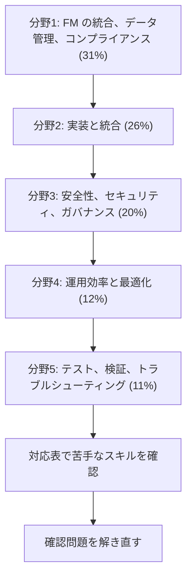

# Generative AI Developer - Professional（AIP-C01）

基盤モデル（FM）をアプリと業務に組み込み、本番で動かす力を問う試験です。RAG、エージェント、プロンプト、安全対策、コストと性能の最適化、評価までを扱います。

モデルの開発や学習は問われません。与えられた制約の中で、AWS のサービスをどう組み合わせるかが中心です。

## 試験の概要 {#overview}

| 項目 | 内容 |
|---|---|
| 問題数 | 75問（採点対象65問 + 採点対象外10問） |
| 試験時間 | 180分 |
| 合格点 | 750点（100〜1,000点） |
| 受験料 | 300 USD |
| 形式 | 択一、複数選択。複数選択は正解をすべて選んだときだけ得点になります |
| 採点方式 | 全体の得点で合否を判定します。分野ごとの合格点はありません |
| 言語 | 英語、日本語、韓国語、簡体字中国語 |
| 受験方法 | Pearson VUE のテストセンターまたはオンライン |
| 減点 | 誤答による減点はありません。未回答は不正解になるので、すべて回答します |

問題数の内訳、合格点、採点方式は試験ガイド、試験時間、受験料、言語、受験方法は公式の認定ページで確認しました（2026年10月31日）。

## 学習の順番 {#study-path}

配点の大きい分野から順に進めます。分野1の RAG とプロンプトは、後の分野の前提になります。

| 分野 | 配点 | タスク | スキル | 主なサービス |
|---|---|---|---|---|
| [分野1: FM の統合、データ管理、コンプライアンス](domain1.md) | 31% | 6 | 28 | Bedrock、Knowledge Bases、OpenSearch、Prompt Management、AppConfig |
| [分野2: 実装と統合](domain2.md) | 26% | 5 | 25 | AgentCore、Strands Agents、Step Functions、API Gateway、SageMaker AI |
| [分野3: AI の安全性、セキュリティ、ガバナンス](domain3.md) | 20% | 4 | 15 | Guardrails、Comprehend、Macie、Lake Formation、CloudTrail |
| [分野4: 運用効率と最適化](domain4.md) | 12% | 3 | 16 | CloudWatch、X-Ray、Cost Anomaly Detection、MemoryDB |
| [分野5: テスト、検証、トラブルシューティング](domain5.md) | 11% | 2 | 14 | Bedrock Evaluations、CloudWatch Synthetics、CodeBuild |

全スキルの一覧は[スキル対応表](coverage.md)にあります。

サービスの中心の解説は[生成 AI アプリの設計と運用](../../services/genai-apps.md)と [AI サービスと AI 開発ツール](../../services/ai.md)です。

## 対象となる受験者 {#target-candidate}

本番の生成 AI アプリを開発する人が対象です。試験ガイドが想定する経験は次のとおりです。

- AWS またはオープンソースの技術で本番アプリを作った経験が 2 年以上
- AI/ML またはデータエンジニアリングの一般的な経験
- 生成 AI ソリューションを実装した経験が 1 年

AWS の知識としては、コンピューティング、ストレージ、ネットワーク、セキュリティ、IaC、監視、コスト最適化を前提にします。

## 範囲外のもの {#out-of-scope}

次の作業は受験者に求められていません。

- モデルの開発と学習
- 高度な ML の技法
- データエンジニアリングと特徴量エンジニアリング

範囲外のサービスの例は、Redshift、Budgets、Savings Plans、AWS Batch、Elastic Beanstalk、CodeGuru、Direct Connect、Transit Gateway、VPN、Cloud Map、DataZone、DevOps Guru、Kinesis Video Streams です。一覧は[試験ガイド](https://docs.aws.amazon.com/aws-certification/latest/ai-professional-01/aip-01-out-of-scope-services.html)にあります。

## 対象のサービス {#services}

試験ガイドの対象一覧と、このwikiのページの対応です。一覧は網羅的ではなく、変更されることがあります。

!!! note "試験ガイドの名前と現在の名前"
    試験ガイドの Prompt Flows は、現在のドキュメントでは Amazon Bedrock Flows です。AWS Chatbot は Amazon Q Developer in chat applications に改称されました。提供状況が変わったサービスは、各分野のページに記載しています。

| 分類 | サービス |
|---|---|
| 分析 | [Athena](../../services/streaming.md#athena)、[EMR](../../services/data-engineering.md#emr)、[Glue](../../services/data-engineering.md#glue)、[Kinesis](../../services/streaming.md#kinesis-data-streams)、[OpenSearch Service](../../services/genai-apps.md#opensearch-vectors)、[Quick Sight](../../services/data-engineering.md#quick-sight)、[MSK](../../services/data-engineering.md#msk) |
| アプリ統合 | [AppFlow](../../services/data-engineering.md#appflow)、[AppConfig](../../services/secrets.md#appconfig)、[EventBridge](../../services/messaging.md#eventbridge)、[SNS](../../services/messaging.md#sns)、[SQS](../../services/messaging.md#sqs)、[Step Functions](../../services/step-functions.md) |
| コンピューティング | [App Runner](../../services/other-services.md#app-runner)、[EC2](../../services/ec2-beanstalk.md)、[Lambda](../../services/lambda.md)、[Lambda@Edge](../../services/networking.md#edge-functions)、[Outposts](../../services/network-connectivity.md#outposts)、[Wavelength](../../services/network-connectivity.md#wavelength) |
| コンテナ | [ECR](../../services/containers.md#ecr)、[ECS](../../services/containers.md#ecs)、[EKS](../../services/containers.md#eks)、[Fargate](../../services/containers.md#fargate-vs-ec2) |
| カスタマーエンゲージメント | [Connect](../../services/other-services.md#connect) |
| データベース | [Aurora](../../services/databases.md#aurora)、[DocumentDB](../../services/databases-specialized.md#documentdb)、[DynamoDB](../../services/dynamodb.md)、[DynamoDB Streams](../../services/dynamodb.md#streams)、[ElastiCache](../../services/databases.md#elasticache)、[Neptune](../../services/databases-specialized.md#neptune)、[RDS](../../services/databases.md#rds) |
| 開発者ツール | [Amplify](../../services/cicd.md#amplify)、[CDK](../../services/iac.md#cdk)、[CLI](../../services/iac.md#aws-cli)、[CloudFormation](../../services/iac.md#cloudformation-template)、[CodeArtifact](../../services/cicd.md#codeartifact)、[CodeBuild](../../services/cicd.md#codebuild)、[CodeDeploy](../../services/cicd.md#codedeploy)、[CodePipeline](../../services/cicd.md#codepipeline)、[Kiro](../../services/ai.md#kiro)、[Tools and SDKs](../../services/sdk-resilience.md#sdk-basics)、[X-Ray](../../services/observability.md#xray) |
| Bedrock | [Bedrock](../../services/ai.md#bedrock-runtime)、[AgentCore](../../services/genai-apps.md#agentcore)、[Knowledge Bases](../../services/genai-apps.md#knowledge-bases)、[Prompt Management](../../services/genai-apps.md#prompt-management)、[Flows](../../services/genai-apps.md#flows)、[Titan](../../services/genai-apps.md#nova-titan) |
| マネージド AI | [Augmented AI](../../services/ai-managed-services.md#a2i)、[Comprehend](../../services/ai-managed-services.md#comprehend)、[Kendra](../../services/ai-managed-services.md#kendra)、[Lex](../../services/ai-managed-services.md#lex)、[Q Business と Q Apps](../../services/ai-managed-services.md#q-business)、[Q Developer](../../services/ai.md#q-developer)、[Quick](../../services/ai.md#quick)、[Rekognition](../../services/ai-managed-services.md#rekognition)、[Textract](../../services/ai-managed-services.md#textract)、[Transcribe](../../services/ai-managed-services.md#transcribe) |
| SageMaker | [SageMaker AI](../../services/sagemaker.md)、[Clarify](../../services/sagemaker.md#clarify)、[Data Wrangler](../../services/sagemaker.md#data-wrangler)、[Ground Truth](../../services/sagemaker.md#ground-truth)、[JumpStart](../../services/sagemaker.md#jumpstart)、[Model Monitor](../../services/sagemaker.md#model-monitor)、[Model Registry](../../services/sagemaker.md#model-registry)、[Neo](../../services/sagemaker.md#neo)、[Processing](../../services/sagemaker.md#processing)、[Unified Studio](../../services/sagemaker.md#unified-studio) |
| 管理とガバナンス | [Auto Scaling](../../services/ec2-beanstalk.md#auto-scaling)、[Chatbot](../../services/operations.md#q-chat)、[CloudTrail](../../services/observability.md#cloudtrail)、[CloudWatch](../../services/observability.md#cloudwatch-metrics)、[CloudWatch Logs](../../services/observability.md#cloudwatch-logs)、[Synthetics](../../services/operations.md#synthetics)、[Cost Anomaly Detection](../../services/cost-management.md#cost-anomaly-detection)、[Cost Explorer](../../services/cost-management.md#cost-explorer)、[Managed Grafana](../../services/operations.md#managed-grafana)、[Service Catalog](../../services/governance.md#service-catalog)、[Systems Manager](../../services/operations.md#systems-manager)、[Well-Architected Tool](../../services/cloud-foundations.md#wa-tool) |
| 移行と転送 | [DataSync](../../services/migration.md#datasync)、[Transfer Family](../../services/migration.md#transfer-family) |
| ネットワーク | [API Gateway](../../services/api-gateway.md)、[AppSync](../../services/other-services.md#appsync)、[CloudFront](../../services/networking.md#cloudfront)、[ELB](../../services/networking.md#elb)、[Global Accelerator](../../services/network-connectivity.md#global-accelerator)、[PrivateLink](../../services/networking.md#vpc-endpoints)、[Route 53](../../services/networking.md#route53)、[VPC](../../services/networking.md#vpc) |
| セキュリティ | [Cognito](../../services/cognito.md)、[Encryption SDK](../../services/kms.md#encryption-sdk)、[IAM](../../services/iam.md)、[IAM Access Analyzer](../../services/iam.md#access-analyzer)、[IAM Identity Center](../../services/identity-directory.md#identity-center)、[KMS](../../services/kms.md)、[Macie](../../services/threat-detection.md#macie)、[Secrets Manager](../../services/secrets.md#secrets-manager)、[WAF](../../services/networking.md#cloudfront-waf) |
| ストレージ | [EBS](../../services/storage.md#ebs-volume-types)、[EFS](../../services/storage.md#efs-settings)、[S3](../../services/s3.md)、[S3 Intelligent-Tiering](../../services/s3.md#storage-classes)、[S3 Lifecycle](../../services/s3.md#lifecycle)、[S3 Cross-Region Replication](../../services/s3.md#replication) |

## 出題されうる技術と概念 {#technologies}

試験ガイドが挙げる項目です。RAG、ベクトルデータベースと埋め込み、プロンプトの設計と管理、FM の統合、エージェント、責任ある AI、コンテンツの安全対策、モデルの評価、AI のコストと性能の最適化、監視、セキュリティとガバナンス、API の設計と統合、イベント駆動、サーバーレス、コンテナのオーケストレーション、IaC、AI の CI/CD、ハイブリッドクラウド、企業システムとの統合です。

## 参考 {#references}

- [AIP-C01 試験ガイド](https://docs.aws.amazon.com/aws-certification/latest/ai-professional-01/ai-professional-01.html)
- [認定の公式ページ](https://aws.amazon.com/certification/certified-generative-ai-developer-professional/)
- [AWS Generative AI Lens](https://docs.aws.amazon.com/wellarchitected/latest/generative-ai-lens/generative-ai-lens.html)
