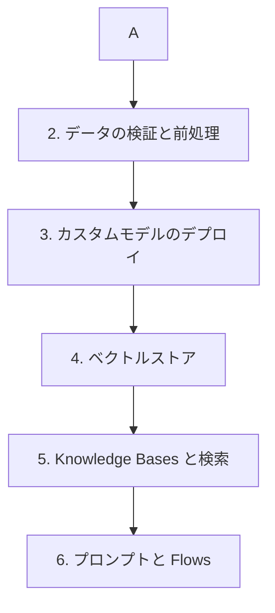

# 分野1: サービス別の学習

分野1（FM の統合、データ管理、コンプライアンス）は配点の 31% を占めます。FM の選定から始め、データ、ベクトルストア、検索、プロンプトの順に進むと、RAG の全体がつながります。

| 順番 | サービス | 問われること | 重要度 |
|---|---|---|---|
| 1 | [FM の選定と耐障害](fm-selection.md) | 要件の翻訳、PoC、切り替え、障害の備え | 高 |
| 2 | [データの検証と前処理](data-preparation.md) | 品質ゲート、複雑なデータ、入力の形式 | 中 |
| 3 | [カスタムモデルのデプロイ](custom-models.md) | LoRA、Model Registry、Custom Model Import | 中 |
| 4 | [ベクトルストア](vector-stores.md) | ストアの選択、メタデータ、シャード、必須の設定 | 高 |
| 5 | [Knowledge Bases と検索](knowledge-bases.md) | コネクタ、同期、チャンク、埋め込み、検索の改善 | 高 |
| 6 | [プロンプトと Flows](prompts.md) | テンプレート、対話の文脈、ガバナンス、Flows | 高 |

重要度は公式のスキル一覧を見たこの wiki の判断で、公式の数字ではありません。

## 他のサービスにまたがる問題 {#other-questions}

<!-- questions:start -->

この分野の問題は、すべてサービス別のページに載っています。

<!-- questions:end -->
