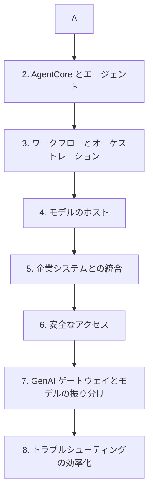

# 分野2: サービス別の学習

分野2（実装と統合）は配点の 26% を占めます。API の基本から始め、エージェントとワークフローへ進み、モデルのホスト、企業システム、ゲートウェイの順に広げます。

| 順番 | サービス | 問われること | 重要度 |
|---|---|---|---|
| 1 | [Bedrock の API 統合](bedrock-api.md) | 同期と非同期、ストリーミング、再試行、タイムアウト | 高 |
| 2 | [AgentCore とエージェント](agents.md) | Runtime、Memory、Policy、ツール、MCP | 高 |
| 3 | [ワークフローとオーケストレーション](workflows.md) | ReAct、アンサンブル、人の承認、実装の選択 | 高 |
| 4 | [モデルのホスト](custom-models.md) | デプロイ方式、LLM のスケーリング、カスケード | 中 |
| 5 | [企業システムとの統合](enterprise-integration.md) | 疎結合、Webhook、データの所在、開発ツール | 中 |
| 6 | [安全なアクセス](access-and-data-protection.md) | モデルの権限、ガードレールの強制、委任 | 高 |
| 7 | [GenAI ゲートウェイとモデルの振り分け](genai-gateway.md) | 入口の集約、CI/CD、振り分けの方式 | 中 |
| 8 | [トラブルシューティングの効率化](observability.md) | 呼び出しログ、X-Ray、AI での分析 | 低 |

重要度は公式のスキル一覧を見たこの wiki の判断で、公式の数字ではありません。

## 他のサービスにまたがる問題 {#other-questions}

<!-- questions:start -->

この分野の問題は、すべてサービス別のページに載っています。

<!-- questions:end -->
