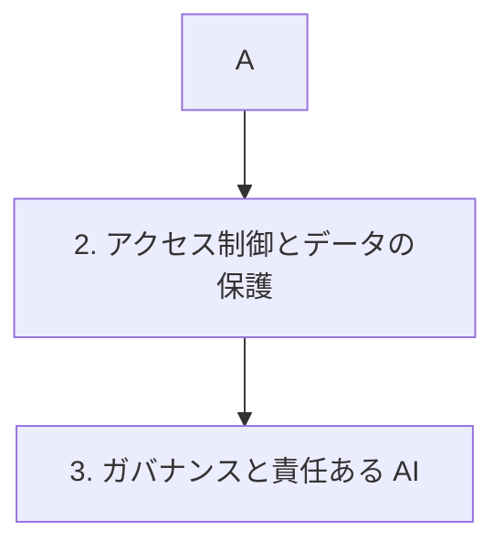

# 分野3: サービス別の学習

分野3（AI の安全性、セキュリティ、ガバナンス）は配点の 20% を占めます。Guardrails で入出力を守り、データと組織の統制へ進み、最後に責任ある AI を確認します。

| 順番 | サービス | 問われること | 重要度 |
|---|---|---|---|
| 1 | [Guardrails と入出力の安全対策](guardrails.md) | 層の選択、グラウンディング、多層防御、敵対的な入力 | 高 |
| 2 | [アクセス制御とデータの保護](access-and-data-protection.md) | PrivateLink、機密情報、ログの保護、組織の統制 | 高 |
| 3 | [ガバナンスと責任ある AI](governance.md) | 文書化、追跡、継続的な監視、透明性、公平性 | 中 |

重要度は公式のスキル一覧を見たこの wiki の判断で、公式の数字ではありません。

## 他のサービスにまたがる問題 {#other-questions}

<!-- questions:start -->

この分野の問題は、すべてサービス別のページに載っています。

<!-- questions:end -->
