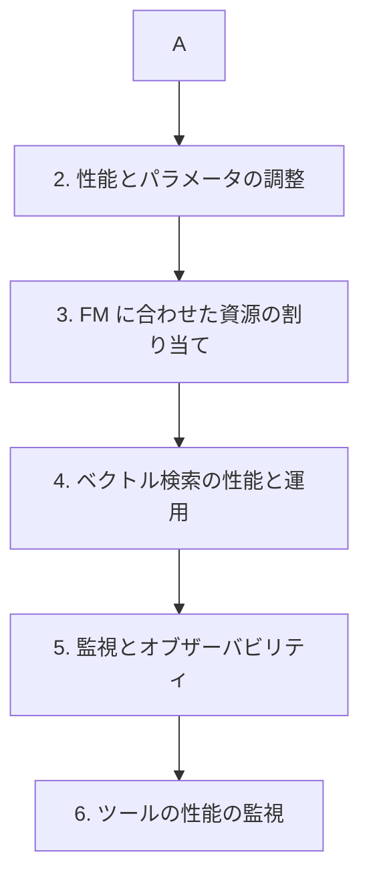

# 分野4: サービス別の学習

分野4（運用効率と最適化）は配点の 12% を占めます。コストから始め、性能、検索、監視の順に進みます。

| 順番 | サービス | 問われること | 重要度 |
|---|---|---|---|
| 1 | [コストの最適化とキャッシュ](cost-optimization.md) | トークン、層の選択、容量、キャッシュ | 高 |
| 2 | [性能とパラメータの調整](performance.md) | 遅延の指標、流量の制御、推論パラメータ | 高 |
| 3 | [FM に合わせた資源の割り当て](custom-models.md) | トークンでの計画、スケーリングの指標 | 低 |
| 4 | [ベクトル検索の性能と運用](vector-stores.md) | HNSW の調整、スコアの合成、運用の監視 | 中 |
| 5 | [監視とオブザーバビリティ](observability.md) | 指標の区分、異常検知、障害の調査 | 高 |
| 6 | [ツールの性能の監視](agents.md) | ツールの指標、ループの検知、EMF | 低 |

重要度は公式のスキル一覧を見たこの wiki の判断で、公式の数字ではありません。

## 他のサービスにまたがる問題 {#other-questions}

<!-- questions:start -->

この分野の問題は、すべてサービス別のページに載っています。

<!-- questions:end -->
