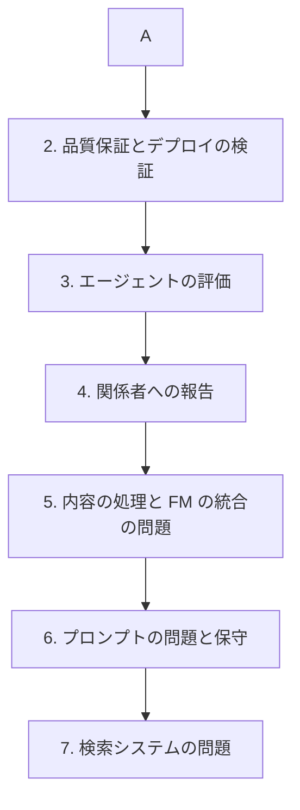

# 分野5: サービス別の学習

分野5（テスト、検証、トラブルシューティング）は配点の 11% を占めます。評価の仕組みを先に押さえ、品質保証へ進み、最後に症状から原因を切り分ける練習をします。

| 順番 | サービス | 問われること | 重要度 |
|---|---|---|---|
| 1 | [評価と Bedrock Evaluations](evaluations.md) | 指標の意味、評価の方式、取得のテスト | 高 |
| 2 | [品質保証とデプロイの検証](genai-gateway.md) | 品質ゲート、定期の評価、合成監視 | 高 |
| 3 | [エージェントの評価](agents.md) | トレースの評価、AgentCore Evaluations | 中 |
| 4 | [関係者への報告](observability.md) | 相手ごとの指標、報告の自動化 | 低 |
| 5 | [内容の処理と FM の統合の問題](bedrock-api.md) | `stopReason`、例外の切り分け | 高 |
| 6 | [プロンプトの問題と保守](prompts.md) | 戻し方、体系的な改善、再発の防止 | 中 |
| 7 | [検索システムの問題](vector-stores.md) | 切り分け、埋め込み、解析、キャッシュ | 高 |

重要度は公式のスキル一覧を見たこの wiki の判断で、公式の数字ではありません。

## 他のサービスにまたがる問題 {#other-questions}

<!-- questions:start -->

この分野の問題は、すべてサービス別のページに載っています。

<!-- questions:end -->
