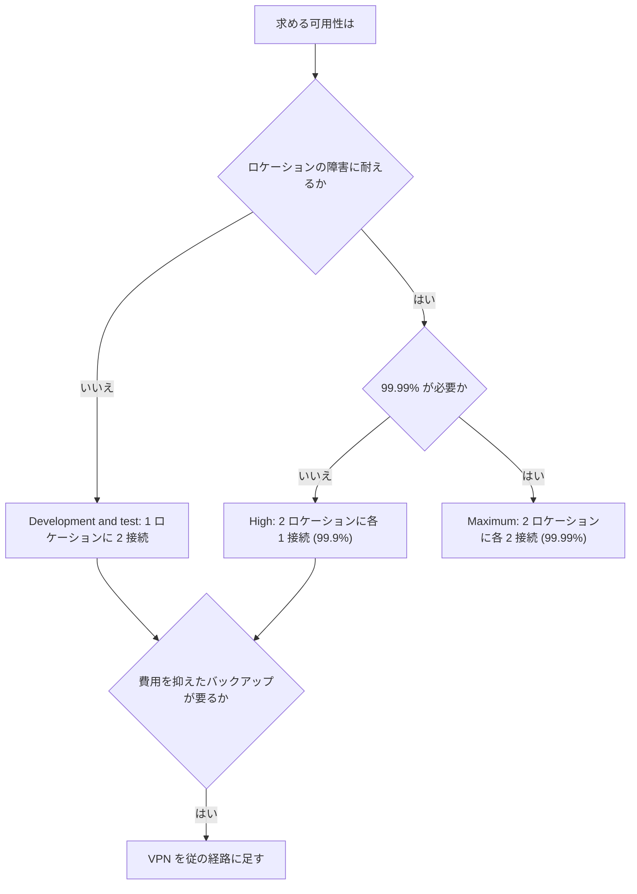

# 分野1: ネットワーク設計

配点は **30%** で、4分野の中で最大です。エッジ、DNS、ロードバランサー、監視、ハイブリッド接続、マルチ VPC の設計を問います。

問題の多くは「どれも動くが、条件に最も合うものはどれか」という形です。固定 IP、MTU、運用の手間、コストなど、条件の一語で答えが変わります。

この分野に限らず、コース全体で使うサービスは[サービス一覧](services.md)から確認できます。

## タスク 1.1: エッジサービスでグローバルな性能と通信を最適化する {#task-1-1}

### CDN の設計パターン {#t1-1-cdn}

CloudFront は HTTP と HTTPS の CDN です。キャッシュでオリジンの負荷を減らし、キャッシュしない動的な通信でも AWS のネットワークを経由させます。

| 要件 | 設計 |
|---|---|
| 静的コンテンツを S3 に置き、直接のアクセスを禁止 | CloudFront と OAC |
| パスごとにオリジンやキャッシュを変える | ビヘイビアを分ける（`/api/*` は ALB、`/img/*` は S3） |
| ALB を CloudFront 経由に限定 | カスタムヘッダーを ALB のルールで確認する |
| オリジンの障害に備える | オリジンフェイルオーバー（プライマリの接続失敗は既定で最大 30 秒かかるので、回数とタイムアウトを短くする） |
| オリジンへの負荷をさらに減らす | Origin Shield |

キャッシュキーに入れるヘッダーやクエリ文字列を増やすと、ヒット率が下がります。必要なものはオリジンリクエストポリシーでオリジンへ渡し、キャッシュキーには入れません。

詳細: [CloudFront](../../services/networking.md#cloudfront)、[キャッシュキーとポリシー](../../services/networking.md#cache-keys)、[オリジンの設定](../../services/networking.md#origin-settings)、[オリジンフェイルオーバー](../../services/networking.md#origin-failover)

### グローバルなトラフィック管理 {#t1-1-global-traffic}

Global Accelerator は、2 個の固定エニーキャスト IP で受け、最寄りのエッジから AWS ネットワークを通して正常なエンドポイントへ送ります。DNS のキャッシュに左右されずに切り替わるのが、Route 53 との大きな違いです。

| | Global Accelerator | CloudFront | Route 53 の DNS ルーティング |
|---|---|---|---|
| 層 | L4（TCP、UDP） | L7（HTTP、HTTPS） | DNS |
| キャッシュ | なし | あり | リゾルバーが応答をキャッシュ |
| 入口 | 固定 IP | DNS 名 | DNS 名 |
| 切り替え | エッジ側で切り替え | オリジングループ | TTL の影響を受ける |
| 向く通信 | 非 HTTP、固定 IP の許可リスト、動的 API | Web、動画、静的コンテンツ | 費用を抑えた地域分散 |

**判断の手がかり:** 「取引先のファイアウォールに固定 IP を登録する」「UDP のゲーム」は Global Accelerator です。ゲームで特定のサーバーへ決定的に送るなら、カスタムルーティングアクセラレーターです。

詳細: [Global Accelerator](../../services/network-connectivity.md#global-accelerator)、[Global Accelerator との比較](../../services/resilience.md#global-accelerator)

### 他のサービスとの統合 {#t1-1-integration}

| 組み合わせ | ポイント |
|---|---|
| CloudFront + ALB | ALB の証明書は ALB のリージョン、CloudFront の証明書は `us-east-1` |
| CloudFront + API Gateway | エッジ最適化の API は内部で CloudFront を使います。自前の CloudFront を前に置くならリージョナル API にします |
| CloudFront + AWS WAF | Web ACL は `us-east-1` にグローバルスコープで作ります |
| Global Accelerator + ALB、NLB | エンドポイントは ALB、NLB、EC2、Elastic IP です。API Gateway は一覧にありません |
| Global Accelerator + NLB | 標準アクセラレーターの一部のエンドポイントでクライアント IP を保持できます |
| Route 53 + CloudFront、ALB、Global Accelerator | ゾーンの頂点でも使えるエイリアスレコードで指します |

詳細: [リージョンのルール](../../services/certificates.md#region-rules)、[API の種類](../../services/api-gateway.md#api-types)、[WAF のアタッチ先](../../services/certificates.md#waf-resources)、[TTL とエイリアス](../../services/networking.md#route53-ttl)

### 要件から配信方式を選ぶ {#t1-1-requirements}

まず通信の向きと中身を整理します。

| 要件 | 選択 | 理由 |
|---|---|---|
| 世界の利用者へ同じ画像を配信し、転送費用も減らす | CloudFront | キャッシュで送信量が減る |
| 動的な HTTP API の遅延を下げ、WAF で守る | CloudFront（キャッシュなし）と ALB | L7 の機能を使える |
| MQTT や独自 TCP、固定 IP | Global Accelerator と NLB | L4 で固定 IP |
| 2 リージョンの片方を保守で切り離す | Global Accelerator のトラフィックダイヤルを 0 | DNS の TTL を待たない |
| 利用者の位置で法規制上の宛先を変える | Route 53 の位置情報ルーティング | 応答する宛先自体を変える |
| 大きなファイルを世界から S3 へアップロード | S3 Transfer Acceleration | 受信側の高速化 |
| VPC からインターネットへの送信の費用と集中管理 | 集中型の NAT ゲートウェイと Transit Gateway | 外向きの出口をまとめる |

詳細: [S3 Transfer Acceleration](../../services/s3.md#transfer-acceleration)、[データ転送の費用](../../services/cost-management.md#data-transfer)、[NAT ゲートウェイ](../../services/network-connectivity.md#nat-gateway)

## タスク 1.2: パブリック、プライベート、ハイブリッドの DNS を設計する {#task-1-2}

### DNS プロトコルの基礎 {#t1-2-dns-protocol}

| 用語 | 試験で押さえる点 |
|---|---|
| ゾーン | ドメインのレコードの管理単位。公開ゾーンとプライベートホストゾーン（PHZ）がある |
| レコード | `A`、`AAAA`、`CNAME`、`MX`、`TXT`、`NS`、`PTR`。Route 53 独自のエイリアス |
| TTL | キャッシュの秒数。短いと切り替えは速いが、クエリと料金が増える |
| 委任 | 親ゾーンの `NS` レコードで、サブドメインを別のネームサーバーに任せる |
| DNSSEC | 応答の改ざんを署名で検出する。中身は暗号化しない |

**移行の定石:** 切り替えの前日に TTL を `86400` から `60` に下げます。古いキャッシュが切れてから切り替えれば、1 分程度で移ります。

DNSSEC の設定は [タスク 2.3](domain2.md#t2-3-dnssec) で扱います。

詳細: [レコード](../../services/networking.md#route53-records)、[TTL とエイリアス](../../services/networking.md#route53-ttl)

### DNS のログと監視 {#t1-2-logging}

ログは 2 種類あり、見ている場所が違います。

| | 公開 DNS クエリログ | Resolver クエリログ |
|---|---|---|
| 対象 | Route 53 の権威 DNS が受けた問い合わせ | VPC、インバウンド、アウトバウンド、DNS Firewall のクエリ |
| 送信先 | CloudWatch Logs のみ。ロググループは `us-east-1` | CloudWatch Logs、S3、Firehose |
| 記録されないもの | 利用者側のリゾルバーがキャッシュから答えたもの | VPC Resolver がキャッシュから答えたもの |

**落とし穴:** どちらも全件の記録ではありません。フローログには Amazon DNS への問い合わせが出ないので、VPC からの名前解決を調べるなら Resolver クエリログです。

件数だけでよいなら、公開ゾーンの CloudWatch メトリクスで足ります。

!!! info "公式の出典"
    公開クエリログの条件は公式文書の [Public DNS query logging](https://docs.aws.amazon.com/Route53/latest/DeveloperGuide/query-logs.html) と [Resolver query logging](https://docs.aws.amazon.com/Route53/latest/DeveloperGuide/resolver-query-logs.html) によります。

詳細: [フローログの分析](../../services/network-connectivity.md#flow-log-analysis)、[どのログを見るか](../../services/threat-detection.md#log-sources)

### Route 53 の機能 {#t1-2-features}

| 機能 | 使いどころ |
|---|---|
| エイリアス | ゾーンの頂点で AWS リソースを指す。AWS リソースへのクエリは無料 |
| ルーティングポリシー | 加重、レイテンシー、フェイルオーバー、位置情報、地理的近接性、IP ベース、複数値回答 |
| Traffic Flow | レイテンシーと加重などを組み合わせた木構造を、バージョン付きのトラフィックポリシーとして管理する |
| VPC Resolver | VPC の既定のリゾルバー。エンドポイントでオンプレミスとつなぐ |
| ヘルスチェック | エンドポイント、計算、CloudWatch アラームの 3 種類 |

**Traffic Flow:** ビジュアルエディタで作った構成を、トラフィックポリシーレコードとしてゾーンに適用します。根のレコードだけが一覧に出て、下のレコードは Route 53 が管理します。前のバージョンへ戻せるので、複雑な構成の更新に向きます。

**プライベートなリソースのヘルスチェック:** チェッカーはインターネットにあり、VPC 内の IP には届きません。CloudWatch アラーム型を使います。

詳細: [ルーティングポリシー](../../services/networking.md#routing-policies)、[Route 53 ヘルスチェック](../../services/networking.md#route53-health-checks)、[VPC Resolver](../../services/network-connectivity.md#vpc-resolver)

### 公開ゾーンとプライベートゾーン、VPC との統合 {#t1-2-public-private}

| | 公開ホストゾーン | プライベートホストゾーン |
|---|---|---|
| 答える相手 | インターネット全体 | 関連付けた VPC |
| 必要な設定 | レジストラの NS を Route 53 に向ける | `enableDnsHostnames` と `enableDnsSupport` を `true` |
| ヘルスチェック | エンドポイント型を使える | CloudWatch アラーム型 |

**解決の順序が重要です。** 名前に一致する PHZ があるとそのゾーンだけを探し、レコードがなければ NXDOMAIN を返します。公開 DNS へは流れません。

同名の公開ゾーンと PHZ を作るスプリットビューでは、VPC 内から引く名前をすべて PHZ にも登録します。「VPC 内からだけ `www` が引けない」の原因はこれです。

**他の VPC サービスとの関係:**

- インターフェイスエンドポイントのプライベート DNS は、AWS が管理する隠れた PHZ で実現しています。
- Transit Gateway は PHZ の名前を解決してくれません。
- 独自の DNS サーバーを使う VPC は、プライベートの問い合わせを VPC+2 へ転送します。

詳細: [プライベートホストゾーン](../../services/network-connectivity.md#private-hosted-zones)、[VPC の DNS 属性](../../services/networking.md#vpc-dns-attributes)、[エンドポイントの選び方](../../services/networking.md#endpoint-settings)

### ハイブリッド、マルチアカウント、マルチリージョンの DNS {#t1-2-hybrid}

| 向き | AWS 側 | オンプレミス側 |
|---|---|---|
| オンプレミス → AWS | インバウンドエンドポイント（SG は受信 53） | 条件付き転送をエンドポイントの IP へ |
| AWS → オンプレミス | アウトバウンドエンドポイント（SG は送信 53）、Forward ルール、VPC への関連付け | 通信を許可 |

**マルチアカウントの推奨構成:** 共有サービス VPC にエンドポイントを集め、Forward ルールを RAM で共有します。各 VPC の PHZ は共有サービス VPC にも関連付けます。インバウンドエンドポイントはその VPC の視点で解決するからです。

**容量:** IP あたり UDP で 10,000 QPS です。SG の接続追跡が働くと大きく下がります。2 万 QPS で AZ 障害にも耐えるなら、各 AZ に 2 個で計 4 個です。

**マルチリージョン:** エンドポイントはリージョンのリソースです。Transit Gateway のピアリングは、他リージョンの Resolver によるプライベート解決に対応しません。各リージョンに置くかを検討します。

Route 53 Profiles を使うと、PHZ、Resolver ルール、DNS Firewall をまとめて多数の VPC に適用できます。

詳細: [エンドポイント](../../services/network-connectivity.md#resolver-endpoints)、[転送ルール](../../services/network-connectivity.md#resolver-rules)、[ハイブリッド DNS](../../services/network-connectivity.md#hybrid-dns)

### Route 53 によるグローバルなトラフィック管理 {#t1-2-global}

| 要件 | ポリシー |
|---|---|
| 最も遅延が小さいリージョンへ | レイテンシー（測定値で決まり、距離ではない） |
| 1% だけ新環境へ | 加重（`99` と `1`） |
| 主系が落ちたら副系へ | フェイルオーバー（プライマリにヘルスチェック） |
| 国ごとに宛先を固定 | 位置情報（**既定のレコードがないと「no answer」**） |
| リソースの担当範囲を広げる | 地理的近接性の `Bias` |
| ISP ごとに宛先を変える | IP ベース |
| 正常な複数の IP を返す | 複数値回答（最大 8 個） |

**Route 53 と Global Accelerator:** Route 53 は安価で設定も簡単ですが、切り替えはキャッシュの影響を受けます。数十秒以内の切り替えを確実にしたいなら Global Accelerator です。

詳細: [ルーティングポリシーの設定](../../services/networking.md#routing-settings)、[Route 53 のフェイルオーバー設計](../../services/resilience.md#route53-failover)

### ドメイン登録 {#t1-2-domains}

ドメインの**登録**（レジストラ）と **DNS サービス**は別物です。Route 53 で両方を担うことも、片方だけ使うこともできます。

| 作業 | 押さえる点 |
|---|---|
| 新規登録 | 対応する TLD から選ぶ。自動更新と連絡先のプライバシー保護を設定する |
| 他社から移管 | ドメインのロックを解除し、認証コードを取得する。登録者のメールのリンクを 5 日以内に承認する |
| 移管できないとき | 登録または前回の移管から 60 日以内、期限切れから復元して 60 日以内 |
| 別の AWS アカウントへ | 受け取る側が 3 日以内に承認する。**ホストゾーンは一緒に移らない** |
| 親が別の DNS のまま | サブドメインのゾーンだけ Route 53 に作り、親に NS を追加する |

**落とし穴:** 同じアカウントの Route 53 ドメインを、そのアカウントのルートユーザーのメールドメインに使わないでください。アカウントが停止されるとドメインも止まり、復旧のメールが届かなくなります。

!!! info "公式の出典"
    公式文書の [Registering a new domain](https://docs.aws.amazon.com/Route53/latest/DeveloperGuide/domain-register.html)、[Transferring registration to Route 53](https://docs.aws.amazon.com/Route53/latest/DeveloperGuide/domain-transfer-to-route-53.html)、[Transferring to a different AWS account](https://docs.aws.amazon.com/Route53/latest/DeveloperGuide/domain-transfer-between-aws-accounts.html) によります。

## タスク 1.3: 負荷分散を組み込んだ設計 {#task-1-3}

### L3、L4、L7 とロードバランサーの選択 {#t1-3-choose}

| | ALB | NLB | GWLB |
|---|---|---|---|
| 層 | L7 | L4 | L3 |
| プロトコル | HTTP、HTTPS、gRPC | TCP、TLS、UDP、QUIC | IP（GENEVE でカプセル化） |
| 振り分けの根拠 | パス、ホスト、ヘッダー | フロー（5 タプルなど） | フロー |
| 固定 IP | なし | AZ ごとに固定できる | なし |
| 主な用途 | Web、マイクロサービス、認証 | 非 HTTP、高負荷、PrivateLink の公開 | 第三者のアプライアンスを透過的に挟む |
| WAF | 可 | 不可 | 不可 |

**選び方の手がかり:**

- URL のパスで振り分ける、Cognito で認証する、Lambda を呼ぶ → ALB
- 固定 IP、UDP、PrivateLink のサービス提供 → NLB
- 仮想ファイアウォールを全ポートで挟む → GWLB
- 固定 IP と L7 の両方 → NLB のターゲットに ALB を登録、または Global Accelerator と ALB

詳細: [ALB と NLB の違い](../../services/networking.md#alb-vs-nlb)、[GWLB](../../services/networking.md#gwlb)、[Gateway Load Balancer による検査](../../services/network-connectivity.md#gwlb-inspection)

### 内部と外部の接続パターン {#t1-3-patterns}

| スキーム | 置く場所 | 例 |
|---|---|---|
| インターネット向け | パブリックサブネット。ターゲットはプライベートでよい | 公開 Web |
| 内部 | プライベートサブネット。プライベート IP で解決 | 3 層の Web と App の間、オンプレミスから DX で利用 |

**ターゲットを `ip` にすると**、ピアリング先やオンプレミスの IP も登録できます。移行中に新旧へ振り分けるときに使います。

スキームは作成後に変更できません。ターゲットの AZ にロードバランサーのサブネットがないと、そのターゲットへ送れません。

詳細: [ターゲットタイプ](../../services/networking.md#target-types)

### スケーリングの要因と Auto Scaling {#t1-3-scaling}

| 要因 | 内容 |
|---|---|
| サブネットの空き | ALB は AZ ごとに `/27` 以上、**空き IP 8 個以上**を確保します。足りないとスケールできず 5xx が出ることがあります |
| 急な増加 | 自動スケールが間に合わないと見込むときは、LCU の予約で最小の容量を確保します |
| NLB のポート | クライアント IP の保持を無効にすると、ターゲット（IP とポート）あたり同時に約 55,000 接続までです |
| GWLB | エンドポイントは AZ あたり 10 Gbps から 100 Gbps まで自動で増えます |

**Auto Scaling との統合:** ターゲットグループを Auto Scaling グループに関連付けると、登録と解除が自動になります。ELB のヘルスチェックも使うように設定すると、アプリの異常でも置き換わります。スケールの指標には、ALB のターゲットあたりのリクエスト数を使えます。

詳細: [EC2 Auto Scaling](../../services/ec2-beanstalk.md#auto-scaling)、[ヘルスチェック](../../services/ec2-beanstalk.md#asg-health-checks)、[高可用性のための Auto Scaling](../../services/resilience.md#auto-scaling-ha)

!!! info "公式の出典"
    サブネットと LCU の条件は [Application Load Balancers](https://docs.aws.amazon.com/elasticloadbalancing/latest/application/application-load-balancers.html) と [Capacity reservations](https://docs.aws.amazon.com/elasticloadbalancing/latest/application/capacity-unit-reservation.html) によります。

### 他のサービスとの統合 {#t1-3-integrations}

| 統合先 | ポイント |
|---|---|
| Global Accelerator | 固定 IP を前に置く。ALB や NLB をエンドポイントにする |
| CloudFront | オリジンにする。カスタムヘッダーで直接アクセスを防ぐ |
| AWS WAF | ALB には付けられるが、NLB には付けられない |
| Route 53 | エイリアスで指し、`Evaluate Target Health` を `Yes` にする |
| EKS | [AWS Load Balancer Controller](#t1-3-lbc) で作成する |
| ACM | 証明書はロードバランサーと同じリージョン |

**既存のアプリへの組み込み:** まず同じ VPC に作ってターゲットを登録し、ヘルスチェックを確認します。DNS の TTL を下げてから、加重レコードで少しずつ移します。ターゲットの SG は、NLB でクライアント IP を保持する場合はクライアントの範囲を許可します。

詳細: [WAF の関連付け](../../services/certificates.md#waf-association)、[NLB の設定](../../services/networking.md#nlb-settings)、[統合サービス](../../services/certificates.md#integrated-services)

### ロードバランサーの設定 {#t1-3-config}

| 設定 | 対象 | 内容 |
|---|---|---|
| プロキシプロトコル v2 | NLB | クライアントの接続情報をヘッダーで渡す |
| クロスゾーン | ALB は常に有効、NLB と GWLB は既定で無効 | AZ の台数の偏りをならす |
| スティッキーセッション | ALB は Cookie、NLB は送信元 IP | セッションを同じターゲットへ |
| アルゴリズム | ALB | `round_robin`、`least_outstanding_requests`、`weighted_random` |
| 登録解除の待ち | 共通（既定 300 秒） | 処理中の接続を待つ |
| スロースタート | ALB | 新しいターゲットへの割合を徐々に増やす。`round_robin` のみ |

**プロキシプロトコルの判断:** ALB には `X-Forwarded-For` があり、プロキシプロトコルは NLB の話です。NLB の `ip` ターゲットが TCP や TLS だと、既定では送信元が NLB のプライベート IP になります。クライアント IP の保持が使えない構成なら、プロキシプロトコルで受け取ります。

**落とし穴:**

- ターゲットがヘッダーを解釈できないと、ヘルスチェックも失敗します（HTTP 400 など）。
- TLS リスナーは、クライアントなどが付けたプロキシプロトコルヘッダーつきの接続を受け付けません。
- QUIC はプロキシプロトコルに対応しません。
- 別の経路でも同じターゲットへ届くと、ヘッダーの数や信頼性が変わります。

**クロスゾーンの計算:** A に 2 台、B に 8 台なら、有効で各 10%、無効で A が各 25%、B が各 6.25% です。

詳細: [クロスゾーン負荷分散](../../services/networking.md#cross-zone)、[スティッキーセッション](../../services/networking.md#stickiness)、[ターゲットグループの属性](../../services/networking.md#target-group-attributes)、[X-Forwarded-For](../../services/networking.md#x-forwarded-for)

!!! info "公式の出典"
    プロキシプロトコルの条件は [Edit target group attributes](https://docs.aws.amazon.com/elasticloadbalancing/latest/network/edit-target-group-attributes.html) によります。

### ターゲットグループの設定 {#t1-3-target-groups}

| 項目 | ALB | NLB | GWLB |
|---|---|---|---|
| プロトコル | HTTP、HTTPS | TCP、TLS、UDP、TCP_UDP、QUIC、TCP_QUIC | GENEVE（6081） |
| ターゲット | instance、ip、lambda | instance、ip、alb | instance、ip |

| | `instance` | `ip` |
|---|---|---|
| 指定 | インスタンス ID | IP アドレス |
| NLB の送信元 IP | クライアント IP を保持 | TCP、TLS は既定で NLB の IP。UDP は保持 |
| VPC の外のターゲット | 不可 | ピアリング先、オンプレミスも可 |
| 向く場面 | EC2 の Auto Scaling | Fargate、Pod、オンプレミス |

**GWLB:** GENEVE が 68 バイト足すので、インターフェイスが 8500 ならアプライアンスは 8568 以上に対応させます。フラグメントも PMTUD もないので、超えたパケットは黙って破棄されます。

詳細: [ターゲットタイプ](../../services/networking.md#target-types)、[Gateway Load Balancer による検査](../../services/network-connectivity.md#gwlb-inspection)

### AWS Load Balancer Controller {#t1-3-lbc}

Kubernetes のリソースを監視して、ELB を作るコントローラーです。

| Kubernetes のリソース | 作られるもの |
|---|---|
| `Ingress` | ALB |
| `Service`（`type: LoadBalancer`） | NLB |
| `Gateway`（バージョン 2.14.0 以降） | ALB |

設定はアノテーションで指定します。バージョン 2.3.0 以降なら、NLB のターゲットに `instance` と `ip` のどちらも使えます。Fargate の Pod にはノードがないので `ip` を使います。

コントローラーには AWS の API を呼ぶ IAM 権限が必要です。

詳細: [EKS](../../services/containers.md#eks)、[Pod に IAM 権限を与える](../../services/containers.md#pod-identity)

!!! info "公式の出典"
    公式文書の [AWS Load Balancer Controller](https://docs.aws.amazon.com/eks/latest/userguide/aws-load-balancer-controller.html) によります。

### 暗号化と認証 {#t1-3-tls}

| 構成 | TLS の終端 | 向く場面 |
|---|---|---|
| ALB の HTTPS リスナー | ALB | L7 の振り分け、WAF |
| ALB からターゲットも HTTPS | ALB で復号し、再び暗号化 | 区間すべてを暗号化。ターゲットは自己署名でも可 |
| NLB の TLS リスナー | NLB | L4 のまま ACM で証明書を管理 |
| NLB の TCP リスナー（パススルー） | ターゲット | エンドツーエンドの暗号化、ターゲット側の証明書 |

**判断の手がかり:** 「ロードバランサーで復号してはならない」なら NLB の TCP パススルーです。ただし、L7 のルーティングと WAF は使えません。

**認証:** ALB のリスナーは Cognito や OIDC でユーザーを認証できます。

詳細: [転送時の TLS](../../services/certificates.md#tls-in-transit)、[リスナーとルール](../../services/networking.md#alb-listeners)、[NLB の設定](../../services/networking.md#nlb-settings)

## タスク 1.4: ログと監視の要件を定義する {#task-1-4}

### CloudWatch による可視化 {#t1-4-cloudwatch}

| 機能 | ネットワークでの使い方 |
|---|---|
| メトリクス | DX、VPN、Transit Gateway、NAT、ELB の標準メトリクス |
| エージェント | EC2 の OS の値やログを集める |
| Logs | フローログ、Resolver ログ、VPN のトンネルログを集める |
| アラーム | `TunnelState` が 0 なら通知 |
| ダッシュボード | 拠点やリージョンをまとめて表示 |
| Logs Insights | フローログを検索して集計 |

詳細: [CloudWatch メトリクス](../../services/observability.md#cloudwatch-metrics)、[アラーム](../../services/observability.md#alarms)、[ダッシュボードとインサイト](../../services/observability.md#dashboards)、[Logs Insights](../../services/observability.md#logs-insights)、[CloudWatch エージェント](../../services/operations.md#cloudwatch-agent)

### Transit Gateway Network Manager {#t1-4-network-manager}

複数のアカウント、リージョン、オンプレミスをトポロジーとして表示し、ルートの変更やイベントを監視します。「世界中の拠点を 1 つの画面で」という要件に合います。

個々のフローの中身は見えません。フローログや Traffic Mirroring と組み合わせます。

詳細: [Route Analyzer と Global Networks](../../services/network-connectivity.md#route-analyzer)

### VPC Reachability Analyzer {#t1-4-reachability}

設定のモデルを解析し、2 点間の到達性を調べます。パケットを送らないので本番に影響しません。

設計の段階で「変更のたびに到達性を確認する」と決めておくと、問題を早く見つけられます。IPv4 のみで、Connect の先や OS のファイアウォールは見えません。

詳細: [Reachability Analyzer](../../services/network-connectivity.md#reachability-analyzer)

### フローログと Traffic Mirroring {#t1-4-flow-mirror}

| | フローログ | Traffic Mirroring |
|---|---|---|
| 取得するもの | メタデータ | パケットそのもの |
| 量とコスト | 小さい | 大きい |
| 用途 | 通信の有無、拒否の確認、常時の記録 | IDS、フォレンジック、原因の深掘り |
| 設計 | 全 VPC で有効にする | 必要な ENI に絞る |

既定の形式では足りないことがあります。`pkt-srcaddr`、`tcp-flags`、`flow-direction` が要るならカスタム形式で作ります。作成後は変更できません。

詳細: [フローログの分析](../../services/network-connectivity.md#flow-log-analysis)、[Traffic Mirroring](../../services/network-connectivity.md#traffic-mirroring)

### アクセスログ {#t1-4-access-logs}

| ログ | 送信先 | 特徴 |
|---|---|---|
| ALB のアクセスログ | S3 | リクエストごとの詳細 |
| NLB のアクセスログ | S3 など | TLS 接続の情報 |
| CloudFront の標準ログ v2 | CloudWatch Logs、Firehose、S3 | ベストエフォート。会計用途には向かない |
| CloudFront のリアルタイムログ | Kinesis Data Streams | 数秒以内。サンプリング率を指定 |

詳細: [CloudFront のログ](../../services/networking.md#cloudfront-logs)、[他のログとの対応](../../services/network-connectivity.md#flow-log-analysis)

### ログと監視の要件を特定する {#t1-4-requirements}

要件から逆算して決めます。

| 要件 | 必要なもの |
|---|---|
| 誰がどこへ通信したかを 1 年保持 | フローログを S3 へ。ライフサイクルで保持 |
| 拒否された通信をすぐ知りたい | フローログを CloudWatch Logs へ、メトリクスフィルターとアラーム |
| IDS でパケットを検査 | Traffic Mirroring |
| 問い合わせたドメインの記録 | Resolver クエリログ |
| 設定変更の追跡 | CloudTrail、Config |

詳細: [他のログとの対応](../../services/network-connectivity.md#flow-log-analysis)、[メトリクスフィルター](../../services/observability.md#metric-filters)、[Config と CloudTrail の違い](../../services/governance.md#config-vs-cloudtrail)

### 状態を示すメトリクスとベースライン {#t1-4-metrics}

| 対象 | 見るメトリクス |
|---|---|
| Direct Connect | `ConnectionState`、`ConnectionBpsEgress`、`ConnectionErrorCount` |
| Site-to-Site VPN | `TunnelState`、`TunnelDataIn`、`TunnelDataOut` |
| Transit Gateway | `BytesIn`、`PacketDropCountBlackhole`、`PacketDropCountNoRoute` |
| NAT ゲートウェイ | `ErrorPortAllocation`、`PacketsDropCount` |
| NLB | `ActiveFlowCount`、`UnHealthyHostCount`、`TCP_Target_Reset_Count` |
| EC2（ENA ドライバーの統計） | `bw_in_allowance_exceeded`、`pps_allowance_exceeded`、`conntrack_allowance_exceeded`、`linklocal_allowance_exceeded` |

**ベースラインの取得:** 正常時の遅延、損失、帯域を記録しておくと、変化に気付けます。

| ツール | 測るもの |
|---|---|
| CloudWatch Network Synthetic Monitor | VPC とオンプレミスの間の遅延と損失。エージェント不要 |
| CloudWatch Network Flow Monitor | EC2、EKS、S3、DynamoDB などとの通信の性能。エージェントを導入 |
| CloudWatch Internet Monitor | 利用者とアプリの間のインターネットの影響 |
| CloudWatch の異常検知 | 過去の値からの逸脱で通知 |

詳細: [異常検知](../../services/observability.md#anomaly-detection)

!!! info "公式の出典"
    [Network Synthetic Monitor](https://docs.aws.amazon.com/AmazonCloudWatch/latest/monitoring/what-is-network-monitor.html)、[Network Flow Monitor](https://docs.aws.amazon.com/AmazonCloudWatch/latest/monitoring/CloudWatch-NetworkFlowMonitor.html)、[Internet Monitor](https://docs.aws.amazon.com/AmazonCloudWatch/latest/monitoring/CloudWatch-InternetMonitor.html) を確認してください。

## タスク 1.5: オンプレミスと AWS の接続とルーティングを設計する {#task-1-5}

### ルーティングの基礎 {#t1-5-routing}

**最長一致が常に最初**です。同じ長さの経路があるときだけ、次の規則を使います。

| 表 | 順序 |
|---|---|
| VPC ルートテーブル | `local` > 静的 > プレフィックスリスト > 伝播（DX の BGP > VPN の静的 > VPN の BGP） |
| VGW | DX の BGP > VPN の静的 > VPN の BGP > AS_PATH > MED |
| Transit Gateway | 静的 > VPC の伝播 > DX ゲートウェイの伝播 > Connect > プライベート IP VPN > VPN |

| | 動的（BGP） | 静的 |
|---|---|---|
| 障害時の切り替え | 自動 | 別の仕組みが要る |
| ECMP（Transit Gateway の VPN） | 可 | 不可 |
| 向く場面 | 対応機器があれば常に | BGP 非対応の機器 |

**落とし穴:** Transit Gateway では、VPN の静的ルートが DX の伝播に勝ちます。DX を主にしたいなら VPN を BGP にします。

詳細: [ルートの優先順位](../../services/network-connectivity.md#route-priority)、[計算例](../../services/network-connectivity.md#route-priority-examples)

### 物理接続の L1 と L2 {#t1-5-physical}

| 項目 | 内容 |
|---|---|
| 光 | シングルモードファイバー。1000BASE-LX、10GBASE-LR、100GBASE-LR4、400GBASE-LR4 |
| VLAN | 802.1Q。VIF ごとに一意で、作成後は変更不可 |
| LAG | 同じ速度の専用接続を LACP で束ねる。100 Gbps 未満は 4 本、以上は 2 本まで |
| ジャンボフレーム | プライベート VIF は 9001、トランジット VIF は 8500、公開 VIF は 1500 |

**LAG は冗長化の手段ではありません。** 同じ DX エンドポイントで終端するので、デバイスやロケーションの障害には耐えません。冗長化は別のロケーションで行います。

**最小リンク数:** 10 Gbps を 4 本束ねて 25 Gbps を流す場合、`minimumLinks=3` にすると 2 本になった時点で LAG 全体が止まり、BGP が別の経路へ切り替えます。輻輳のまま使い続けるより切り替えたいときの設定です。

詳細: [接続の種類](../../services/network-connectivity.md#dx-connections)、[LAG](../../services/network-connectivity.md#dx-lag)、[MTU とジャンボフレーム](../../services/network-connectivity.md#mtu)

### カプセル化と暗号化 {#t1-5-encapsulation}

| 技術 | 層 | 暗号化 | AWS での使いどころ |
|---|---|---|---|
| GRE | トンネル | なし | Transit Gateway Connect |
| IPsec | L3 | あり | Site-to-Site VPN |
| MACsec | L2 | あり（区間のみ） | Direct Connect の専用接続 |
| GENEVE | トンネル | なし | GWLB |
| VXLAN | トンネル | なし | Traffic Mirroring（UDP 4789） |

カプセル化すると MTU が下がります。GRE は外部 1500 で内側 1476、VPN は最大でも 1446 です。DX から VPN へ切り替わると急に小さくなり、大きなパケットが消える原因になります。

詳細: [MACsec](../../services/network-connectivity.md#dx-macsec)、[MTU と MSS](../../services/network-connectivity.md#vpn-mtu)、[Connect](../../services/network-connectivity.md#tgw-connect)

### アカウント間のリソース共有 {#t1-5-sharing}

| 共有するもの | 方法 |
|---|---|
| Transit Gateway | RAM で共有。各アカウントがアタッチする |
| Direct Connect ゲートウェイ | 関連付けの提案と承認（RAM ではない） |
| トランジット VIF、プライベート VIF | ホスト VIF として別のアカウントへ |
| Resolver ルール、プレフィックスリスト、IPAM プール | RAM で共有 |
| サブネット | [VPC 共有](#t1-6-vpc-sharing) |

**設計の例:** ネットワークアカウントが DX と Transit Gateway を持ち、RAM で共有します。各アカウントは VPC をアタッチするだけで済み、ルートテーブルはネットワークアカウントが管理します。

詳細: [AWS Resource Access Manager](../../services/governance.md#ram)、[Direct Connect ゲートウェイ](../../services/network-connectivity.md#dx-gateway)、[VIF の種類](../../services/network-connectivity.md#dx-vif-types)

### ハイブリッド接続の要件を特定する {#t1-5-requirements}

| 要件 | 選択 |
|---|---|
| 今日から使いたい、低コスト | Site-to-Site VPN |
| 安定した帯域、大量のデータ転送 | Direct Connect |
| 専用線で暗号化（ルーターと DX ロケーションの間） | DX と MACsec |
| 専用線で暗号化（VPC まで、公開 IP なし） | トランジット VIF の上のプライベート IP VPN |
| 多数の小規模拠点（25 拠点以上、各 100 Mbps 未満） | VPN Concentrator |
| 遠隔地の VPN の品質を上げる | アクセラレーション（Transit Gateway のみ） |
| 2 つの DX ロケーションの間を AWS で結ぶ | SiteLink |
| 利用者の端末から | Client VPN |

| VIF の要件 | 選択 |
|---|---|
| 1 VPC、同じリージョン | プライベート VIF と VGW |
| 複数リージョンの少数の VPC | プライベート VIF と DX ゲートウェイ |
| 多数の VPC | トランジット VIF、DX ゲートウェイ、Transit Gateway |
| S3 などの公開エンドポイント | 公開 VIF |

詳細: [オンプレミスとの接続の選び方](../../services/network-connectivity.md#choosing-hybrid)、[DX の VIF](../../services/network-connectivity.md#choosing-vif)

### 冗長なハイブリッド接続 {#t1-5-redundancy}

**VPN をバックアップにする場合の確認:**

| 確認すること | 理由 |
|---|---|
| 帯域 | トンネルは標準 1.25 Gbps。DX の全量は運べないことがある |
| プレフィックス | VPN により具体的な経路を広告すると、平常時も VPN へ流れる |
| MTU | DX の 8500 から約 1400 へ下がる |
| VPN の種類 | Transit Gateway で静的にすると DX に勝ってしまう |

**テスト:** Direct Connect のフェイルオーバーテストで BGP セッションを止め、切り替わるか確認します。

詳細: [回復性のモデル](../../services/network-connectivity.md#dx-resiliency)、[例 4: DX を主、VPN を従にする](../../services/network-connectivity.md#bgp-dx-vpn)

### BGP 属性で通信を制御する {#t1-5-bgp}

**最初に方向を決めます。** AWS から戻る通信は「広告の仕方」で動かし、オンプレミスから出る通信は「自分のルーターの Local preference」で動かします。

| 方向 | 手段（強い順） |
|---|---|
| AWS → オンプレミス | プレフィックス長 > `7224:7100〜7300` のコミュニティ > AS_PATH の付加 > MED |
| オンプレミス → AWS | ルーターの受信ポリシーの Local preference |

| やりたいこと | 設定 |
|---|---|
| active/passive | A に `7224:7300`、B に `7224:7100`。ルーターの Local preference も A を高く |
| active/active | 同じプレフィックス、コミュニティ、AS_PATH 長、MED で ECMP |
| 公開 VIF の広がりを限定 | `7224:9100`（リージョン）、`7224:9200`（大陸） |

**よく出る落とし穴:** AS_PATH を付加しても動かないのは、Local preference が先に評価されるからです。リージョンは関連付いたロケーションに medium を与えるので、付加では遠いロケーションへ動きません。コミュニティを使います。

片方向だけ設定すると、行きと戻りが非対称になり、ステートフルな機器で切れます。

詳細: [属性の一覧](../../services/network-connectivity.md#bgp-attributes)、[例 1](../../services/network-connectivity.md#bgp-active-passive)、[例 2](../../services/network-connectivity.md#bgp-active-active)、[例 3](../../services/network-connectivity.md#bgp-associated-region)、[公開 VIF](../../services/network-connectivity.md#bgp-public-vif)

### SD-WAN とオーバーレイネットワーク {#t1-5-sdwan}

オーバーレイは、既存のネットワーク（アンダーレイ）の上に論理的なネットワークを張る考え方です。SD-WAN の機器は、GRE や IPsec のトンネルを拠点間に張ります。

**Transit Gateway Connect** は、SD-WAN の仮想アプライアンスを GRE と BGP でつなぎます。

| 項目 | 内容 |
|---|---|
| 土台 | VPC アタッチメント、または Direct Connect アタッチメント |
| 帯域 | ピアあたり最大 5 Gbps。アタッチメントあたり 4 ピアで合計 20 Gbps |
| BGP | ピアあたり 2 本。静的ルート、BFD は非対応 |
| ECMP | 同じプレフィックスを、同じ AS_PATH と ASN で広告する |

**VPN と比べた利点:** 帯域が大きく、BGP を統一できます。ただし GRE に暗号化はありません。アンダーレイが DX で暗号化も必要なら、オーバーレイ側で暗号化します。

詳細: [Connect](../../services/network-connectivity.md#tgw-connect)

## タスク 1.6: マルチアカウント、マルチリージョン、マルチ VPC の設計 {#task-1-6}

### 接続パターンの選択 {#t1-6-patterns}

| | VPC ピアリング | Transit Gateway | PrivateLink | VPC Lattice |
|---|---|---|---|---|
| 層 | L3 | L3 | L4 | L7 中心 |
| 接続の単位 | VPC 全体 | VPC 全体 | 1 つのサービス | サービス、リソース |
| 推移 | 不可 | 可 | なし | なし |
| CIDR の重複 | 不可 | 問題（1:1 NAT で回避） | 問題なし | 問題なし |
| 通信の開始 | 両方向 | 両方向 | 利用者から提供者へのみ | クライアントからサービスへ |
| 費用 | データ転送のみ | 時間とデータ処理 | 時間とデータ | サービス単位 |
| MTU | 同じリージョンは 9001 | 8500 | | |

**数の計算:** 10 個の VPC をメッシュにすると `10 × 9 / 2 = 45` 本です。多いなら Transit Gateway にします。多数のリージョンを 1 つのポリシーで統一するなら Cloud WAN です。

**判断の手がかり:** 「2 つの VPC の間で大量の転送、コストと MTU を優先」はピアリングです。「数百の VPC の分離とオンプレミス」は Transit Gateway です。「SaaS を顧客の VPC へ公開」は PrivateLink です。

詳細: [VPC ピアリング](../../services/network-connectivity.md#vpc-peering)、[Transit Gateway](../../services/network-connectivity.md#transit-gateway)、[Cloud WAN](../../services/network-connectivity.md#cloud-wan)、[VPC 同士の接続の選び方](../../services/network-connectivity.md#choosing-multi-vpc)、[VPC Lattice](../../services/network-connectivity.md#vpc-lattice)、[PrivateLink](../../services/networking.md#vpc-endpoints)

### VPC 共有 {#t1-6-vpc-sharing}

オーナーのアカウントが VPC を持ち、サブネットを同じ組織の参加者アカウントへ共有します。VPC を増やさず、請求とアクセス権限だけをアカウントで分けられます。

| | オーナー | 参加者 |
|---|---|---|
| サブネット、ルートテーブル、NACL、ゲートウェイ | 作成、管理 | 参照のみ（作成、変更は不可） |
| ENI、SG | 自分のものを管理 | 自分のものを管理 |
| NAT ゲートウェイ | 管理 | 作成も参照も不可 |
| フローログ | 全 ENI とサブネット | 自分の ENI のみ |

| | VPC 共有 | ピアリング、Transit Gateway |
|---|---|---|
| VPC の数 | 少ない | アカウントごと |
| 通信 | 同じ VPC 内の暗黙のルーティング | 経路と費用が要る |
| 分離の強さ | 同じ信頼の境界向き | ネットワークで分離 |
| IP の消費 | 大きな VPC に集中 | 分散 |

**前提:** オーナーと参加者は同じ AWS Organizations で管理され、管理アカウントで RAM の組織共有を有効にします。

**判断の手がかり:** 「アカウントは分けたいが、VPC とルートの管理は中央に集めたい、アプリ同士は密に通信する」は VPC 共有です。

詳細: [VPC サブネットの共有](../../services/governance.md#ram-vpc-sharing)

!!! info "公式の出典"
    権限の細部は [Responsibilities and permissions](https://docs.aws.amazon.com/vpc/latest/userguide/vpc-share-limitations.html) によります。

### IP の重複への対処 {#t1-6-overlap}

| 方法 | 向く場面 | 制約 |
|---|---|---|
| Transit Gateway の 1:1 NAT | ネットワーク全体、両方向 | 変換前後でプレフィックス長が同じ。IPv4 のみ |
| プライベート NAT ゲートウェイ | VPC から外へ | 内向きの接続は受けられない |
| PrivateLink | 特定のサービスだけ公開 | 片方向。NLB が要る |
| VPC Lattice | サービス単位の接続 | VPC の関連付けが要る |
| Transit Gateway のルート設計 | 重複先を別のルートテーブルで分ける | 重複する VPC 同士は通信できない |
| アドレスの付け替え | 根本的な解決 | 時間がかかる |

**プライベート NAT の例:** VPC（`10.0.0.0/16`）がオンプレミスと重複している場合、重複しないセカンダリ CIDR（`100.64.0.0/24`）を足し、そこにプライベート NAT ゲートウェイを置きます。そこから Transit Gateway へ向けます。相手には NAT の IP が見えます。

**予防:** IPAM のプールを RAM で共有すれば、組織内の重複を防げます。

詳細: [1:1 NAT](../../services/network-connectivity.md#tgw-nat)、[VPC の CIDR](../../services/network-connectivity.md#vpc-cidr)、[NAT ゲートウェイ](../../services/network-connectivity.md#nat-gateway)、[IPAM](../../services/network-connectivity.md#ipam)

## 確認問題 {#self-check}

??? question "問1: UDP の独自プロトコルで世界中の利用者へサービスを提供しています。取引先がファイアウォールに固定 IP を登録する必要があり、東京と米国のリージョン障害では数十秒で切り替えたいです。何を使いますか。"
    Global Accelerator の標準アクセラレーターと、各リージョンの NLB です。CloudFront は HTTP のみで UDP を扱えません。Route 53 のフェイルオーバーは固定 IP を提供せず、切り替えがリゾルバーのキャッシュに左右されます。

??? question "問2: 東京リージョンの VPC と PHZ `corp.example.com` があります。オンプレミスから DX 経由で引けるようにするため、インバウンドエンドポイントとオンプレミスの条件付き転送を設定しましたが、NXDOMAIN が返ります。エンドポイントは共有サービス VPC にあり、PHZ はワークロード VPC にだけ関連付いています。原因は何ですか。"
    PHZ が共有サービス VPC に関連付いていないことです。インバウンドエンドポイントは、それが置かれた VPC の視点で解決します。PHZ を共有サービス VPC にも関連付けます。別のアカウントなら CLI か API で許可してから関連付けます。

??? question "問3: 2 本の DX を別々のロケーションに持ち、遠いロケーションの接続を主にしたいです。近いロケーションの広告に AS_PATH を付加しましたが、戻りの通信は近いロケーションを通ります。どう直しますか。"
    主にする接続の広告に `7224:7300`、もう一方に `7224:7100` を付けます。リージョンは関連付いたロケーションに高い Local preference を与え、これは AS_PATH より先に評価されるので、付加は効きません。より具体的なプレフィックスを主の接続で広告する方法もあります。

??? question "問4: 10 Gbps の DX を同じロケーションで 2 本束ねた LAG があります。監査で「ロケーション障害でも接続が続くこと」を求められました。LAG の本数を増やす案と、別のロケーションに接続を足す案のどちらを選びますか。"
    別のロケーションに接続を足します。LAG は同じ DX エンドポイントで終端するので、本数を増やしてもデバイスやロケーションの障害には耐えません。99.99% が必要なら、2 ロケーションに各 2 接続を別のデバイスで終端します。

??? question "問5: NLB の `ip` ターゲットで、TCP のアプリがクライアント IP をログに残す必要があります。ターゲットは Transit Gateway の先のオンプレミスにあり、クライアント IP の保持を有効にできません。どうしますか。またヘルスチェックで注意することは何ですか。"
    ターゲットグループでプロキシプロトコル v2 を有効にし、アプリでヘッダーを読みます。ヘルスチェックの接続にもヘッダーが付くので、ターゲットが解釈できないと失敗します。先にアプリ側を対応させてから有効にします。

??? question "問6: 複数のアプリチームをアカウントで分け、請求も分けたいです。ただしネットワークの管理は中央のチームに集め、アプリ同士は同じ信頼の境界で密に通信します。VPC を増やさない設計はどれですか。参加者は何を変更できませんか。"
    AWS RAM による VPC 共有です。中央のアカウントが VPC を持ち、同じ組織の各アカウントへサブネットを共有します。参加者は自分の ENI や SG を管理できますが、ルートテーブル、NACL、ゲートウェイは変更できません。
