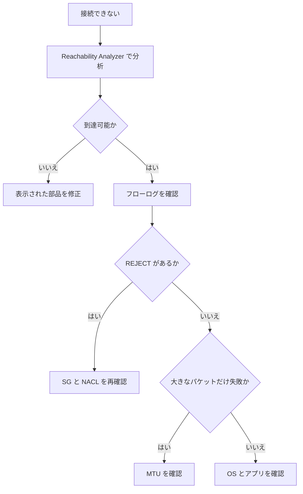

# 分野3: ネットワークの管理と運用

配点は **20%** です。動いているネットワークの維持、問題の切り分け、性能とコストの最適化を問います。

「症状 → 使うツール → 原因」の流れを押さえます。上限値と MTU の数値は、ここで最も問われます。

## タスク 3.1: ルーティングと接続を維持する {#task-3-1}

### BGP の管理 {#t3-1-bgp}

| 操作 | 方法 |
|---|---|
| 経路を片方へ寄せる | [コミュニティ、AS_PATH、プレフィックス長](domain1.md#t1-5-bgp) |
| 速く障害を検出する | BFD。VIF では自動で有効で、ルーター側で設定するまで効かない |
| DX の切り替えを試す | フェイルオーバーテスト。履歴は 365 日残り、CloudTrail に記録される |
| VPN のトンネルの保守に備える | 両トンネルの AS_PATH と Weight をそろえ、AWS が付ける MED に従う |

**VPN のトンネルと BGP:** AWS は MED で主のトンネルを示し、保守中はもう一方に低い MED を設定します。Weight や Local preference は MED より先に評価されるので、両方で同じ値にしないと、AWS の MED が無視されます。

**Connect の制約:** BFD とグレースフルリスタートは使えません。タイマーはキープアライブ 10 秒、ホールド 30 秒です。

詳細: [VPN の 2 本のトンネル](../../services/network-connectivity.md#bgp-vpn-tunnels)、[VIF の種類](../../services/network-connectivity.md#dx-vif-types)、[回復性のモデル](../../services/network-connectivity.md#dx-resiliency)

### 接続方式の運用 {#t3-1-connectivity}

| 部品 | 運用で押さえる点 |
|---|---|
| DX ゲートウェイ | グローバル。VGW 系と Transit Gateway 系でゲートウェイを分ける |
| 許可プレフィックス | VGW はフィルター、Transit Gateway はそのまま広告 |
| Transit Gateway | ルートテーブルの関連付けは 1 つ、伝播は複数へ |
| VIF | VGW 直結は同じリージョン。DX ゲートウェイなら他のリージョンへ |

**許可プレフィックスの症状:** Transit Gateway の場合、ここに書いた値だけがオンプレミスへ広告されます。VPC を追加しても経路が来ないときは、一覧を確認します。

**DX ゲートウェイの関連付け同士は原則として通信しません。** ただしオンプレミスが、VPC を含むスーパーネットを同じ VIF で広告すると、VPC 同士が通信できてしまいます。

詳細: [Direct Connect ゲートウェイ](../../services/network-connectivity.md#dx-gateway)、[DX の VIF](../../services/network-connectivity.md#choosing-vif)

### 上限とクォータの影響 {#t3-1-quotas}

| 上限 | 値 | 超えたときの対処 |
|---|---|---|
| プライベート、トランジット VIF の受信経路 | IPv4、IPv6 各 100（プレフィックス制御で 1,000 まで） | 集約する |
| 公開 VIF の受信経路 | 1,000 | 集約する |
| Transit Gateway からトランジット VIF | 合計 200 | 許可プレフィックスで集約 |
| VPC の伝播ルート | 100（変更不可） | デフォルトルートを広告 |
| VPN の動的経路（CGW → VGW） | 100 | Transit Gateway なら 1,000 |
| VPN トンネルの帯域 | 1.25 Gbps | ECMP、Large Bandwidth Tunnel |
| Connect のピア | 5 Gbps | ピアを増やす（4 ピアで 20 Gbps） |
| VPC アタッチメント | AZ あたり 100 Gbps | |
| ENI のリンクローカル | 1024 PPS | DNS のキャッシュ |
| NAT の同じ宛先 | IP あたり 55,000 接続 | IP を追加 |

**最も危険なもの:** VIF の経路の上限です。超えると BGP が `idle` になり、**全経路が消えます**。

**NAT の計算:** 同じ宛先へ 20 万の同時接続なら `200,000 / 55,000 = 3.6` で IP が 4 個要ります。`ErrorPortAllocation` が増えていたら、これを疑います。

詳細: [既定値と上限のまとめ](../../services/network-connectivity.md#numbers)、[経路数の上限](../../services/network-connectivity.md#bgp-route-limits)、[NAT ゲートウェイ](../../services/network-connectivity.md#nat-gateway)

### カスタムサービスへのプライベートアクセス {#t3-1-private-access}

| | PrivateLink | VPC ピアリング |
|---|---|---|
| 公開の範囲 | NLB の裏のサービスだけ | VPC 全体（経路と SG で絞る） |
| CIDR の重複 | 問題なし | 作れない |
| 通信の向き | 利用者から提供者へ | 両方向 |

**PrivateLink の維持で確認すること:**

| 症状 | 確認すること |
|---|---|
| 新しい利用者が接続できない | 許可するプリンシパルと接続の承認 |
| 一部の AZ で接続できない | 提供者の NLB と利用者のエンドポイントの AZ |
| タイムアウトする | エンドポイントの SG、NLB のターゲットの正常性 |
| 名前が公開 IP に解決される | プライベート DNS、VPC の DNS 属性 |

**ピアリングの維持で確認すること:** 両方のルートテーブル、SG、CIDR の追加時の重複です。推移的な通信はできません。

詳細: [VPC エンドポイントと PrivateLink](../../services/networking.md#vpc-endpoints)、[VPC ピアリング](../../services/network-connectivity.md#vpc-peering)

### リージョン内とリージョン間の通信パターン {#t3-1-patterns}

| 範囲 | パターン | 特徴 |
|---|---|---|
| リージョン内 | VPC ピアリング | 9001 MTU、時間料金なし |
| リージョン内 | Transit Gateway | 8500 MTU、集中管理 |
| リージョン間 | VPC ピアリング | 8500 MTU |
| リージョン間 | Transit Gateway ピアリング | 静的ルート、AES-256 で暗号化、8500 MTU |
| リージョン間 | Cloud WAN | 動的、ポリシーで統一 |
| 拠点間 | SiteLink | リージョンを経由せず最短経路 |

詳細: [ピアリング](../../services/network-connectivity.md#tgw-peering)、[Cloud WAN](../../services/network-connectivity.md#cloud-wan)、[SiteLink](../../services/network-connectivity.md#dx-sitelink)

### ルートテーブルで通信を制御する {#t3-1-route-tables}

| 部品 | 自動の仕組み | 手動の仕組み |
|---|---|---|
| VPC ルートテーブル | VGW の伝播（BGP と静的） | 静的ルート |
| Transit Gateway ルートテーブル | 伝播、既定の関連付け | 静的ルート、ブラックホール |
| VPC の中のアプライアンス | VPC Route Server | ENI へのルート |

**例:** Transit Gateway で開発 VPC の通信を特定の宛先だけ止めるなら、宛先を `--blackhole` で登録します。

**VPC の例:** `10.1.0.0/16` に静的のピアリングと伝播の VGW があれば、静的が勝ちます。`10.1.5.0/24` が伝播で来ていれば、最長一致でそちらが勝ちます。

**表に出るのは優先経路だけです。** DX と VPN で同じ経路を広告すると DX だけが表示されます。VPN の経路が表にないのは異常ではありません。

詳細: [VPC ルートテーブル](../../services/network-connectivity.md#vpc-route-priority)、[Transit Gateway ルートテーブル](../../services/network-connectivity.md#tgw-route-priority)、[計算例](../../services/network-connectivity.md#route-priority-examples)

### AWS サービスへのプライベートとパブリックのアクセス {#t3-1-access-aws}

| 経路 | 使う IP | 暗号化 | 向く場面 |
|---|---|---|---|
| DX の公開 VIF | 公開 | なし（VPN を足せる） | S3 への大量転送 |
| DX のプライベートまたはトランジット VIF + インターフェイスエンドポイント | プライベート | TLS のみ | 公開 IP を使えない |
| VPN + インターフェイスエンドポイント | プライベート | IPsec | 小規模 |
| インターネット | 公開 | TLS | 最も簡単 |

**公開 VIF の注意:** 受信した経路には AWS の全リージョンの公開プレフィックスが含まれます。ルーターで絞ります。同じリージョンだけなら `7224:8100` の経路を受け入れます。

**ゲートウェイエンドポイントは VPC の外から使えません。** オンプレミスから S3 へプライベートに接続するなら、インターフェイスエンドポイントです。

詳細: [公開 VIF の経路制御](../../services/network-connectivity.md#bgp-public-vif)、[エンドポイントの選び方](../../services/networking.md#endpoint-settings)

### 経路の最適化 {#t3-1-route-optimization}

| 問題 | 対処 |
|---|---|
| 経路が多い | 集約する。`10.1.0.0/24`〜`10.1.255.0/24` を `10.1.0.0/16` へ |
| CIDR が重複 | [重複への対処](domain1.md#t1-6-overlap) |
| 集約で帯域が偏る | より具体的な経路で主の接続へ寄せる |
| VPN へ意図せず流れる | VPN のプレフィックスを DX より細かくしない |
| 静的と動的が混在 | Transit Gateway では VPN の静的が DX の伝播に勝つ。BGP へ統一 |

**新しい CIDR と既存のルート:** 追加する CIDR は、既存のルートの宛先と同じか、より大きくはできません。

詳細: [VPC の CIDR](../../services/network-connectivity.md#vpc-cidr)、[計算例](../../services/network-connectivity.md#route-priority-examples)

## タスク 3.2: 通信を監視、分析して問題を切り分ける {#task-3-2}

### 性能の指標と到達性の制約 {#t3-2-metrics}

| 指標 | 意味 | 主な原因 |
|---|---|---|
| 遅延、ジッター | 経路の長さと混雑 | インターネット経由、輻輳 |
| パケット損失 | 届かない割合 | 帯域の超過、経路の問題 |
| スループット | 実効の帯域 | シングルフローの上限、MTU |
| 到達性 | 届くかどうか | ルート、SG、NACL、**パケットサイズ** |

**インスタンスの上限:** `ethtool -S` の `bw_in_allowance_exceeded`、`bw_out_allowance_exceeded`、`pps_allowance_exceeded` が増えていれば、インスタンスの帯域の上限です。CloudWatch の値だけでは見えません。

詳細: [MTU とジャンボフレーム](../../services/network-connectivity.md#mtu)、[接続できないときの切り分け](../../services/networking.md#vpc-troubleshooting)

### 調べるログとメトリクス {#t3-2-logs}

| 症状 | ログやメトリクス |
|---|---|
| Transit Gateway でパケットが消える | `PacketDropCountNoRoute`、`PacketDropCountBlackhole` |
| VPN が不安定 | `TunnelState`、トンネルログ |
| DX の損失 | `ConnectionErrorCount` |
| NAT の接続エラー | `ErrorPortAllocation` |
| ALB の 5xx | `HTTPCode_ELB_5XX_Count`、アクセスログ |
| 接続が拒否される | フローログの `REJECT` |
| ハイブリッドの遅延と損失 | Network Synthetic Monitor |

詳細: [他のログとの対応](../../services/network-connectivity.md#flow-log-analysis)、[状態を示すメトリクス](domain1.md#t1-4-metrics)

### ログの収集と分析 {#t3-2-tools}

**フローログの読み方:**

| 観察 | 解釈 |
|---|---|
| `tcp-flags=2` が続き、応答がない | SYN を送ったが返らない。経路か戻りの問題 |
| SYN が `REJECT` | SG か NACL で拒否 |
| 受信が `ACCEPT`、送信が `REJECT` | NACL の戻りの通信（ステートレス） |
| RST（4）が多い | アプリやアイドルタイムアウトの切断 |
| `log-status=SKIPDATA` | 記録が欠けた |

**SG は戻りの通信を自動で許可するので、片方だけ `REJECT` なら NACL を疑います。**

**Logs Insights の例:** REJECT の多い組み合わせを探します。

```text
fields @timestamp, srcAddr, dstAddr, dstPort, action
| filter action = "REJECT"
| stats sum(packets) as pkts by srcAddr, dstAddr, dstPort
| sort pkts desc
| limit 20
```

**記録されないもの:** Amazon DNS への問い合わせ、メタデータ（`169.254.169.254`）、DHCP、ARP。

詳細: [フローログの分析](../../services/network-connectivity.md#flow-log-analysis)、[VPC フローログの調査](../../services/threat-detection.md#investigate-flow-logs)、[Logs Insights](../../services/observability.md#logs-insights)

### 経路の問題を分析する {#t3-2-routing-tools}

| ツール | 質問 | パケット |
|---|---|---|
| Reachability Analyzer | A から B へ届くか、何が止めているか | 送らない |
| Route Analyzer | Transit Gateway の経路は正しいか | 送らない |
| Network Access Analyzer | 望まない経路がないか | 送らない |
| Network Manager のトポロジー | 全体の構成はどうなっているか | |
| Traffic Mirroring | 中身はどうなっているか | 複製する |

詳細: [接続の調査](../../services/network-connectivity.md#network-analysis)

### トポロジーを把握する {#t3-2-topology}

Network Manager のグローバルネットワークに Transit Gateway とオンプレミスの拠点を登録すると、トポロジーを地図や図で見られます。ルートの変更や状態の変化も追えます。

**使う場面:** 拠点が多く、障害の影響範囲をすぐ把握したいときです。Route Analyzer も同じコンソールにあります。

詳細: [Route Analyzer と Global Networks](../../services/network-connectivity.md#route-analyzer)

### パケットを分析する {#t3-2-packets}

Traffic Mirroring でパケットをコピーし、Wireshark や IDS で読みます。

| 手順 | 注意 |
|---|---|
| 送信元の ENI を選ぶ | 対応インスタンスのみ（Nitro が中心） |
| ターゲットを作る | ENI、UDP の NLB、GWLB。SG で **UDP 4789** を許可 |
| フィルターを作る | **ルールがなければ何もコピーしない** |
| セッションを作る | 番号の小さい順。パケットは 1 回しかコピーされない |
| 不要になったら消す | セッションが残ると課金が続く |

**パケットの整形（シェーピング）の問題:** 再送の増加、ウィンドウの縮小、断片化はパケットを見ないと分かりません。インスタンスの帯域や PPS の上限に当たると、キューイングや破棄が起こります。`allowance_exceeded` の統計と合わせて確認します。

詳細: [Traffic Mirroring](../../services/network-connectivity.md#traffic-mirroring)

### 設定の誤りを切り分ける {#t3-2-misconfig}



**Reachability Analyzer の結果の見方:** 到達できないときは、止めている部品を示します。到達できるなら、ネットワークの設定には問題がありません。OS のファイアウォールやアプリを調べます。

| 制約 | 内容 |
|---|---|
| IP | IPv4 のみ |
| 範囲 | 同じリージョン |
| 解析しない | Connect の先、ターゲットの正常性、GWLB エンドポイントの先 |
| Transit Gateway の TCP | 行きだけ解析 |

詳細: [Reachability Analyzer](../../services/network-connectivity.md#reachability-analyzer)、[接続できないときの切り分け](../../services/networking.md#vpc-troubleshooting)

### 設計どおりかを検証し、自動で確かめる {#t3-2-verify}

| 目的 | ツール |
|---|---|
| 特定の 2 点が通信できる（できない） | Reachability Analyzer |
| 本番と開発の分離、IGW への経路にファイアウォールがある | Network Access Analyzer |

**接続の意図を自動で確認する:**

1. `AWS::EC2::NetworkInsightsPath` で、確認する経路をコードにします。
2. ネットワークの変更を EventBridge で検知します。
3. Lambda や Automation で分析（`start-network-insights-analysis`）を実行します。
4. 期待と違えば SNS で通知し、必要なら変更を戻します。

CI/CD に組み込むと、デプロイのたびに検証できます。パケットを送らないので本番に影響しません。

詳細: [Reachability Analyzer](../../services/network-connectivity.md#reachability-analyzer)、[Network Access Analyzer](../../services/network-connectivity.md#network-access-analyzer)

### パケットサイズの不一致を直す {#t3-2-mtu}

**症状:** ping や小さなリクエストは通るのに、大きな応答や転送だけ止まります。接続は確立するので、最初はアプリの障害に見えます。

| 区間 | MTU |
|---|---|
| VPC 内 | 9001 |
| 同じリージョンのピアリング | 9001 |
| リージョン間のピアリング | 8500 |
| Transit Gateway | 8500（VPN は 1500 以下） |
| DX プライベート VIF | 1500 または 9001 |
| DX トランジット VIF | 1500 または 8500 |
| IGW | 1500 |
| Site-to-Site VPN | 実効は最大 1446 |
| GWLB | 8500（アプライアンスは 8568） |

**切り分けの手順:**

```bash
# 8500 が通るか（8500 - IP 20 - ICMP 8 = 8472）
ping -M do -s 8472 10.1.0.10
# VPN の 1446 が通るか（1446 - 28 = 1418）
ping -M do -s 1418 192.168.0.10
# 経路の MTU を調べる
tracepath 10.1.0.10
```

**直し方:**

| 原因 | 対処 |
|---|---|
| SG や NACL が ICMP を止めている | IPv4 は Type 3 Code 4、IPv6 は Packet Too Big を許可 |
| PMTUD がない経路（VPN、GWLB、DX から入る Transit Gateway） | MSS を下げる、MTU を下げる |
| UDP が消える | MSS クランプは TCP だけ。アプリか MTU で調整 |
| インターネットと VPC の両方へ通信 | 経路ごとに MTU を指定（`ip route add ... mtu 1400`） |

詳細: [MTU とジャンボフレーム](../../services/network-connectivity.md#mtu)、[PMTUD とトラブルシューティング](../../services/network-connectivity.md#pmtud)

## タスク 3.3: 性能、信頼性、費用を最適化する {#task-3-3}

### VPC ピアリング、プロキシ、Transit Gateway の選択 {#t3-3-peer-vs-tgw}

| 条件 | 選択 |
|---|---|
| VPC が少ない、大量の転送、費用と MTU を優先 | VPC ピアリング |
| VPC が多い、推移的な接続、集中管理 | Transit Gateway |
| 特定のサービスだけ公開、CIDR 重複 | PrivateLink |
| 外向きの通信を中央で検査、URL で制御 | プロキシのパターン（NLB と EC2 の Squid など） |
| 大量の VPC 間を局所的に最適化 | Transit Gateway を基本に、転送の多い組だけピアリングを併用 |

**移行時の注意:** ピアリングから Transit Gateway へ移ると MTU が 9001 から 8500 に下がります。両方の VPC を同時に切り替えないと、非対称な経路で大きなパケットが落ちます。

**プロキシのパターンを選ぶとき:** ドメインや URL で許可する、認証する、という要件です。透過的に検査するなら Network Firewall です。プロキシは EC2 の運用と、スケールが負担になります。

**実装:** 要件に合う接続を [タスク 2.2](domain2.md#t2-2-multi-vpc) の手順で作ります。VPN は暗号化が必要なとき、または DX がないときです。

詳細: [VPC ピアリング](../../services/network-connectivity.md#vpc-peering)、[VPC 同士の接続の選び方](../../services/network-connectivity.md#choosing-multi-vpc)

### 帯域の使用量を減らす {#t3-3-bandwidth}

| 方法 | 効果 |
|---|---|
| CloudFront | キャッシュでオリジンからの転送が減る |
| マルチキャスト | 送信元は 1 回だけ送る。ユニキャストなら受信者の数だけ送る |
| 圧縮 | CloudFront で自動圧縮 |
| VPC エンドポイント | NAT やインターネットを通らない |
| 同じ AZ で完結 | AZ 間の転送が減る。ただし可用性とのトレードオフ |

詳細: [圧縮](../../services/networking.md#cloudfront-compression)、[データ転送の費用](../../services/cost-management.md#data-transfer)

### 費用の低い接続 {#t3-3-cost}

| 通信 | 費用の特徴 |
|---|---|
| インターネットから AWS へ、DX の受信 | 無料 |
| DX の送信 | ポート料金に加えて送信データ |
| VPN | 接続の時間と送信データ |
| Transit Gateway | アタッチメントの時間とデータ処理 |
| VPC ピアリング | データ転送のみ |
| ゲートウェイエンドポイント | 無料 |
| NAT ゲートウェイ | 時間と処理データ |

**判断の手がかり:** 少量で短期なら VPN です。送信が多く安定しているなら DX です。ポート料金を送信データの差額で回収できるかで決めます。

**S3 への大量転送の NAT 費用が高い:** ゲートウェイエンドポイントで解決します。

詳細: [データ転送の費用](../../services/cost-management.md#data-transfer)、[Cost Explorer](../../services/cost-management.md#cost-explorer)、[オンプレミスとの接続の選び方](../../services/network-connectivity.md#choosing-hybrid)

### ネットワークインターフェイスの種類 {#t3-3-interfaces}

| 種類 | 用途 | 特徴 |
|---|---|---|
| ENI | 標準の仮想 NIC | SG、IP、MAC を持ち、同じ AZ のインスタンスへ付け替えられる |
| ENA | 拡張ネットワーキング | 高帯域、高 PPS、低遅延。ドライバーと AMI の対応が必要 |
| ENA Express | 同じリージョンの EC2 間 | SRD を使い、シングルフローの上限を 5 Gbps から最大 25 Gbps へ |
| EFA | HPC、機械学習のノード間 | OS をバイパスする。MPI、NCCL を使う |

**EFA の制約:** EFA の通信は**ルーティングできず、AZ も VPC も越えられません**。EFA with ENA のインターフェイスなら、通常の IP 通信は ENA のデバイスで通ります。EFA は対応するインスタンスタイプに限られ、Outposts では使えません。

| 要件 | 選択 |
|---|---|
| 一般の Web サーバー | ENA（現行の多くの標準） |
| 別のサブネットに足を出す、管理用 | ENI を追加 |
| 緊密に結合した MPI ジョブ | EFA とクラスタープレイスメントグループ |
| 同じリージョンの 2 台の間で大きな 1 フロー | ENA Express |

詳細: [プレイスメントグループ](../../services/operations.md#placement-groups)

!!! info "公式の出典"
    [Elastic network interfaces](https://docs.aws.amazon.com/AWSEC2/latest/UserGuide/using-eni.html)、[ENA](https://docs.aws.amazon.com/AWSEC2/latest/UserGuide/enhanced-networking-ena.html)、[ENA Express](https://docs.aws.amazon.com/AWSEC2/latest/UserGuide/ena-express.html)、[EFA](https://docs.aws.amazon.com/AWSEC2/latest/UserGuide/efa.html) によります。

### Route 53 の高可用性 {#t3-3-route53-ha}

**レイテンシーと加重の組み合わせ:** レイテンシーのレコードで最適なリージョンを選び、その先の加重レコードで複数の ALB に分けます。各レコードにヘルスチェックを付けます。エイリアスは `Evaluate Target Health` を `Yes` にします。

| 機能 | 信頼性への寄与 |
|---|---|
| フェイルオーバー | 主系の異常で副系へ |
| 複数値回答 | 正常な IP を最大 8 個 |
| 計算ヘルスチェック | 複数のチェックを組み合わせて判定 |
| CloudWatch アラーム型 | プライベートなリソース、複合の条件 |
| ARC のルーティングコントロール | データプレーンで切り替え |
| ARC のゾーンシフト | AZ の障害時に切り離し |

**データプレーンで切り替える:** Route 53 のコントロールプレーンは 1 か所に依存するので、障害時にレコードの変更を当てにしません。ヘルスチェックで切り替わるように作ります。

**レコードと AZ の最適化:**

| 方法 | 内容 |
|---|---|
| 公開と PHZ のレコード | 内外で別の宛先、同じ名前 |
| エンドポイントの zonal DNS 名 | 特定の AZ の ENI へ送る。AZ 間の転送と遅延を減らす |
| PHZ の加重やフェイルオーバー | VPC の中で AZ ごとの宛先へ分ける |

インターフェイスエンドポイントには Regional と zonal の DNS 名があります。zonal を使うと同じ AZ へ送れますが、AZ の障害時の切り替えは自分で設計します。

詳細: [Route 53 のフェイルオーバー設計](../../services/resilience.md#route53-failover)、[Route 53 ヘルスチェック](../../services/networking.md#route53-health-checks)、[ARC](../../services/resilience.md#arc)、[ゾーンシフト](../../services/resilience.md#arc-zonal)、[フェイルオーバーはデータプレーンで](../../services/resilience.md#failover-data-plane)

!!! info "公式の出典"
    zonal DNS 名は [Access AWS services through AWS PrivateLink](https://docs.aws.amazon.com/vpc/latest/privatelink/privatelink-access-aws-services.html) によります。

### 負荷分散と分散のパターン {#t3-3-lb}

| パターン | 向く場面 |
|---|---|
| Route 53 + 複数リージョンの ALB | リージョンの分散 |
| Global Accelerator + NLB | 固定 IP と高速な切り替え |
| クロスゾーン有効 | AZ の台数が不均等 |
| クロスゾーン無効 | AZ 間の転送を避ける |
| `least_outstanding_requests` | 処理時間のばらつきが大きい |
| 加重ターゲットグループ | カナリアの移行 |

**落とし穴:** 加重の先の片方が空、または異常のみでも、自動で他方へは切り替わりません。

詳細: [リスナーとルール](../../services/networking.md#alb-listeners)、[クロスゾーン負荷分散](../../services/networking.md#cross-zone)

### サブネットの最適化と IP の枯渇 {#t3-3-subnets}

サブネットの CIDR は作成後に変更できません。足りなければ新しいサブネットを足します。

**Auto Scaling に合わせる:**

| 確認項目 | 内容 |
|---|---|
| 最大台数 | 各 AZ で最大数の IP を確保する |
| 予約 | サブネットごとに先頭 4 個と最後の 1 個は使えない（`/24` なら 251 個） |
| AZ | 複数の AZ のサブネットを Auto Scaling グループに指定 |
| ロードバランサー | ALB は `/27` 以上で空き 8 個以上 |
| ローリング更新 | 更新中は台数が増えるので余裕を持つ |

**IP の枯渇への対処:**

| 方法 | 内容 |
|---|---|
| セカンダリ CIDR | VPC に追加。VPC あたり既定 5 個（50 まで） |
| `100.64.0.0/10` | EKS の Pod によく使う。ルーティングできる範囲に注意 |
| IPv6 | IPv4 の消費を減らす |
| IPAM | 使用状況を監視し、枯渇前に通知 |

**追加の制限:** 既存の CIDR が `10.0.0.0/8` なら、他の RFC 1918 の範囲は追加できません。`100.64.0.0/10` や公開範囲は追加できます。

詳細: [VPC の CIDR](../../services/network-connectivity.md#vpc-cidr)、[IPAM](../../services/network-connectivity.md#ipam)、[容量の設定](../../services/ec2-beanstalk.md#asg-capacity)

### フレームサイズの最適化 {#t3-3-frames}

大きなフレームは CPU の負荷とヘッダーの割合を減らし、スループットを上げます。ただし経路全体で対応が必要です。

**ジャンボフレームを有効にする手順（DX）:**

1. VIF の MTU を変更します（プライベートは 9001、トランジットは 8500）。
2. 接続のジャンボ対応が未設定なら、更新で**最大 30 秒、その接続の全 VIF が中断**します。
3. オンプレミスのルーターと、経路上の機器の MTU を変更します。
4. EC2 の MTU を確認します。

```bash
aws directconnect update-virtual-interface-attributes \
  --virtual-interface-id dxvif-EXAMPLE --mtu 8500
```

**1500 に落ちる場合:** 同じ経路を別の MTU の VIF や VPN でも広告している、ホスト接続の親接続でジャンボが有効でない、です。公開 VIF と VPN はジャンボに対応しません。

**VPC 側の条件:** ジャンボが効くのは、Direct Connect の伝播ルートと、Transit Gateway へのルートです。

詳細: [MTU とジャンボフレーム](../../services/network-connectivity.md#mtu)

### スループットを最適化する {#t3-3-throughput}

| 制約 | 内容 | 対処 |
|---|---|---|
| シングルフロー | クラスタープレイスメントグループの外では 5 Gbps | 複数のフローに分ける、ENA Express、クラスター配置 |
| IGW 経由 | 32 vCPU 未満のインスタンスは 5 Gbps まで | 大きなインスタンス |
| バースト | 16 vCPU 以下は「最大」の帯域がクレジット次第 | ベースラインで設計する |
| VPN | トンネルあたり 1.25 Gbps | ECMP、Large Bandwidth Tunnel |
| Transit Gateway の ECMP | 種類の違うアタッチメントの間では組めない | |

**MTU との関係:** VPC 内なら 9001 のままで、外へ出る経路だけ下げます。

詳細: [トンネル](../../services/network-connectivity.md#vpn-tunnels)

!!! info "公式の出典"
    [Amazon EC2 instance network bandwidth](https://docs.aws.amazon.com/AWSEC2/latest/UserGuide/ec2-instance-network-bandwidth.html) によります。

### マルチキャストの実装 {#t3-3-multicast}

VPC 自体はマルチキャストに対応しないので、Transit Gateway のマルチキャストを使います。

| 項目 | 内容 |
|---|---|
| 有効化 | **Transit Gateway の新規作成時のみ**（`MulticastSupport=enable`） |
| ドメイン | サブネット単位で参加 |
| メンバーの管理 | IGMPv2、または API で静的に |
| 送信元 | Nitro のインスタンスのみ |
| 上限 | グループのメンバー 100、フローあたり 1 Gbps |
| 非対応 | **Direct Connect、VPN、ピアリング、Connect** |
| フラグメント | 破棄する |

**オンプレミスとの間:** Transit Gateway のマルチキャストだけでは実現できません。必要なら、オンプレミスのルーターと VPC 内の機器の間に GRE などのトンネルを張り、ユニキャストとして運びます。これは自分で構築するオーバーレイです。

詳細: [マルチキャスト](../../services/network-connectivity.md#tgw-multicast)

### Global Accelerator で性能と可用性を上げる {#t3-3-global-accelerator}

| 設定 | 既定値 | 使い方 |
|---|---|---|
| トラフィックダイヤル | 100% | リージョンの保守で 0 に。新しい接続にのみ効く |
| エンドポイントの重み | 128（0〜255） | 新版へ 1/256 を流すなら `1` と `255` |
| クライアントアフィニティ | `None` | `Source IP` で同じ先へ |
| ヘルスチェック | あり | EC2 は Route 53 のヘルスチェッカーの IP を SG で許可 |

**注意:**

- ping にはエッジが応答するので、性能の測定に使えません。
- 全エンドポイントが異常になると、グループ内の全エンドポイントへ送ります。
- 削除すると固定 IP を失います。無効化なら保たれます。

詳細: [Global Accelerator](../../services/network-connectivity.md#global-accelerator)

## 確認問題 {#self-check}

??? question "問1: オンプレミスのルーターに新しい拠点の経路を足した直後、プライベート VIF の BGP が `idle` になり、全経路が消えました。原因と恒久的な対策は何ですか。"
    広告した経路が上限（既定で IPv4 100）を超えました。超えると BGP セッションが落ち、全経路が消えます。まず広告を減らして復旧し、集約したプレフィックスを広告するよう変更します。プレフィックス制御で上限を広げられる場合もあります。

??? question "問2: EC2 から Transit Gateway 経由でオンプレミスへの通信で、SSH と小さな HTTP は通りますが、大きなファイル転送だけ止まります。経路には VPN があります。何を確認し、どう直しますか。"
    MTU です。VPN は PMTUD に対応せず、実効 MTU は最大 1446 です。`ping -M do -s` で大きさを試し、CGW で MSS を調整して、暗号化前のフラグメントを設定します。インスタンス側で経路ごとに MTU を下げる方法もあります。TCP は MSS クランプで救われますが、UDP は救われません。

??? question "問3: 2 つのインスタンス間で帯域を測ると、1 つのフローが 5 Gbps で頭打ちです。インスタンスタイプの帯域はずっと大きいです。同じ AZ で、アプリは TCP の 1 接続です。どうしますか。"
    クラスタープレイスメントグループに入れるか、対応インスタンスで ENA Express を有効にします。ENA Express はシングルフローの上限を最大 25 Gbps に上げます。アプリを複数接続に分ける方法もあります。インスタンスの上限に当たっているかは、`ethtool -S` の `allowance_exceeded` でも確認します。

??? question "問4: 新しい構成を入れるたびに「本番と開発は通信できない」「この VPC からオンプレミスの DB へ 1433 で届く」を確認したいです。パケットを流さず、自動で実行する方法はどれですか。"
    Network Access Analyzer で分離の要件を、Reachability Analyzer で特定の 2 点を確認します。パスを `AWS::EC2::NetworkInsightsPath` で定義し、変更を EventBridge で検知して Lambda や Automation から分析を実行します。どちらも設定を解析するので、本番に影響しません。

??? question "問5: EC2 上の市場データ配信アプリを、VPC 内の複数の受信者へマルチキャストで送りたいです。既存の Transit Gateway があります。どう実装しますか。また、オンプレミスへ直接マルチキャストできますか。"
    マルチキャストは既存の Transit Gateway では有効にできないので、新規に `MulticastSupport=enable` で作り、ドメインにサブネットを関連付けます。送信元は Nitro のインスタンスです。Direct Connect と VPN はマルチキャストに対応しないので、オンプレミスへは直接送れません。

??? question "問6: Auto Scaling で台数を増やそうとすると、起動に失敗することがあります。VPC の CIDR は `10.0.0.0/24` で、サブネットの空き IP がほとんどありません。止めずに対処するにはどうしますか。"
    セカンダリ CIDR を VPC に追加し、新しいサブネットを作って Auto Scaling グループへ追加します。サブネットや VPC の既存の CIDR のサイズは変更できません。`10.0.0.0/8` の範囲なら、他の RFC 1918 の範囲は追加できないので、同じ範囲か `100.64.0.0/10` などから選びます。あわせて IPAM で使用状況を監視します。
