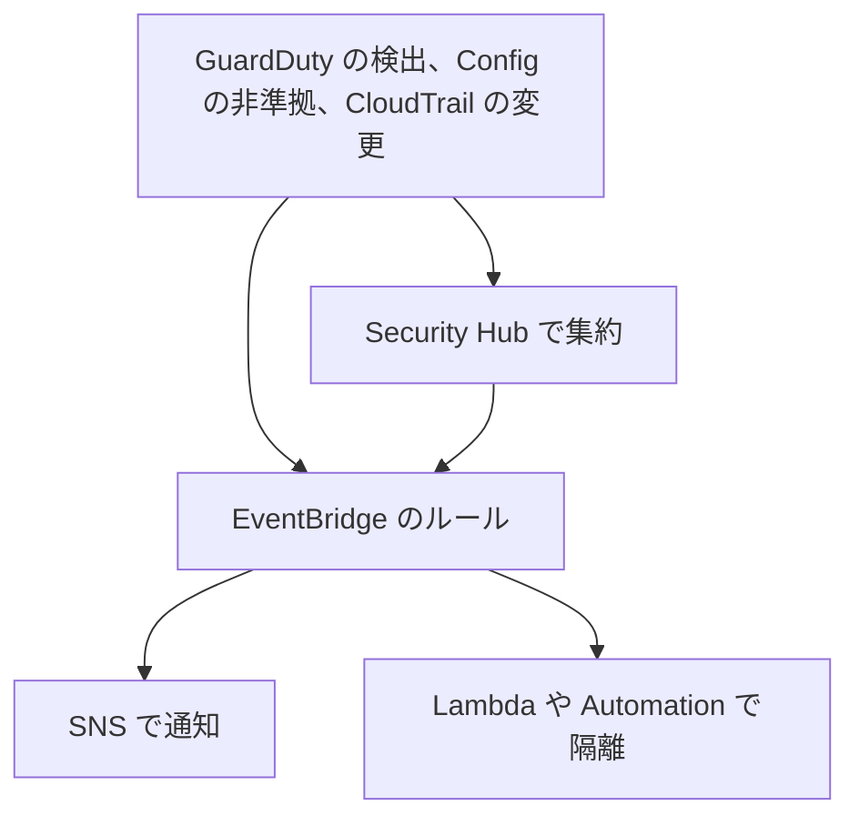

# 分野4: ネットワークのセキュリティ、コンプライアンス、ガバナンス

配点は **24%** です。通信の向きごとの防御、ログによる監査、暗号化を問います。

どの層で止めるかが判断の中心です。DDoS、Web の攻撃、ドメインやパケットの検査で、使うサービスが変わります。

この分野に限らず、コース全体で使うサービスは[サービス一覧](services.md)から確認できます。

## タスク 4.1: セキュリティとコンプライアンスの要件を満たす {#task-4-1}

### 脅威モデルと一般的な脅威 {#t4-1-threat-models}

脅威モデルは「何を守り、誰が、どの経路で攻撃するか」を整理し、対策を決める作業です。アーキテクチャで脅威は変わります。

| 構成 | 主な脅威 | 緩和策 |
|---|---|---|
| 公開 Web（CloudFront、ALB） | DDoS、SQL インジェクション、XSS、ボット | Shield、AWS WAF、オリジンの保護 |
| 公開 API（NLB、非 HTTP） | L4 の DDoS、ポートスキャン | Shield Advanced、SG、Elastic IP の保護 |
| 内部の多層 | 横移動、侵害したホストの拡大 | SG の最小化、サブネットの分離、Transit Gateway の分離 |
| 外向きの通信 | データの持ち出し、C2 への接続、DNS トンネリング | Network Firewall、DNS Firewall、プロキシ |
| ハイブリッド | 平文の専用線、不正な経路の広告 | IPsec、MACsec、BGP の MD5、プレフィックスのフィルター |
| エンドポイント | 別のアカウントのバケットへの持ち出し | エンドポイントポリシー、`aws:SourceVpce` |

**手順:** データの流れを図にして境界を見つけ、各境界の脅威を列挙し、緩和策を割り当て、テストします。

詳細: [Shield](../../services/threat-detection.md#shield)、[エンドポイントポリシー](../../services/networking.md#endpoint-policies)、[データ境界](../../services/identity-directory.md#data-perimeter)、[GuardDuty](../../services/threat-detection.md#guardduty)

### アプリの通信を守る仕組み {#t4-1-flows}

| 通信の流れ | 仕組み |
|---|---|
| 利用者 → Web | TLS、WAF、CloudFront |
| Web 層 → App 層 → DB 層 | SG の参照で必要な層だけ許可 |
| サービス → サービス（別 VPC） | PrivateLink、VPC Lattice の認証ポリシー |
| VPC → AWS サービス | VPC エンドポイントとポリシー |
| 端末 → VPC | Client VPN、Verified Access |
| 拠点 → VPC | IPsec、DX と MACsec |

詳細: [VPC Lattice](../../services/network-connectivity.md#vpc-lattice)、[Verified Access](../../services/identity-directory.md#verified-access)、[Client VPN](../../services/network-connectivity.md#client-vpn)

### 要件を満たすネットワーク構成 {#t4-1-architecture}

| 構成 | 内容 | 要件の例 |
|---|---|---|
| 3 層 | パブリック（ALB）、プライベート（App）、分離（DB） | 基本の多層防御 |
| 境界 VPC | 外部との入口と出口を 1 つの VPC に集める | 検査の一元化 |
| 信頼できないネットワーク | 外部の接続先を DMZ の VPC で受け、検査してから内部へ | パートナーの接続 |
| 分離された VPC | インターネットへの経路なし。エンドポイントのみ | 規制データ |

**VPC Block Public Access:** アカウントのリージョン単位で、IGW と Egress-only IGW の通信を一括で止めます。ルートや SG の設定より優先されます。

| モード | 動作 |
|---|---|
| 双方向 | IGW と Egress-only IGW の通信をすべて遮断（除外を除く） |
| 受信のみ | インターネットからの受信を遮断。NAT と Egress-only IGW の外向きは通る |
| 除外 | VPC やサブネットを対象外にする（双方向、または外向きのみ） |

フローログの `reject-reason` が `BPA` なら、これで止まっています。

詳細: [サブネットとルートテーブル](../../services/networking.md#subnets-route-tables)、[検査の配置](../../services/network-connectivity.md#choosing-inspection)、[マルチアカウントのパターン](../../services/governance.md#multi-account-patterns)

!!! info "公式の出典"
    [Block public access to VPCs and subnets](https://docs.aws.amazon.com/vpc/latest/userguide/security-vpc-bpa.html) によります。

### 受信の通信を守る {#t4-1-inbound}

| サービス | 層 | 向く攻撃 | 付ける場所 |
|---|---|---|---|
| Shield Standard | L3、L4 | 一般的な DDoS | 全ユーザーに自動 |
| Shield Advanced | L3、L4、WAF と連携 | 大規模な DDoS、コスト保護、SRT | CloudFront、Route 53、Global Accelerator、Elastic IP、ALB |
| AWS WAF | L7 | SQL インジェクション、XSS、レート制限 | CloudFront、ALB、API Gateway |
| Network Firewall | L3〜L7 | IPS、VPC への受信の検査 | VPC |

**NLB を守るには:** WAF は NLB に付きません。CloudFront や ALB を前に置くか、Network Firewall で検査します。Shield Advanced では Elastic IP として保護します。

**Shield Advanced の判断:** 大きな攻撃の費用保護、24 時間の SRT の支援が要るときです。ヘルスベース検出を使うと誤検知が減り、検出が早くなります。リソースは自動では保護されないので指定します。

詳細: [Shield Advanced](../../services/threat-detection.md#shield-advanced)、[AWS WAF](../../services/certificates.md#waf)、[似た機能との比較](../../services/certificates.md#waf-comparison)、[Network Firewall](../../services/network-connectivity.md#network-firewall)

### 送信の通信を守る {#t4-1-outbound}

| 手段 | 判定の基準 | 限界 |
|---|---|---|
| Network Firewall | IP、ポート、TLS の SNI、Suricata のルール | 復号しないと中身は見えない（TLS インスペクションは別） |
| DNS Firewall | ドメイン名 | IP 直接の通信や独自の DNS はすり抜ける |
| プロキシ（EC2 の Squid など） | URL、認証 | EC2 の運用とスケール |
| GWLB | 第三者のアプライアンス | アプライアンスの管理 |

**集中型の出口:** スポーク VPC から Transit Gateway を通り、検査 VPC の Network Firewall、NAT ゲートウェイ、IGW へ出します。

**SNI の偽装対策:** 解決済み IP の検証を使うと、SNI が VPC Resolver の解決した IP と合うかを確かめられます。

**判断の手がかり:** 「ドメインと IP の両方で制限」は Network Firewall です。「マルウェアのドメインの解決を止めたい」は DNS Firewall です。

詳細: [DNS Firewall](../../services/network-connectivity.md#dns-firewall)、[ステートフルのルール順序](../../services/network-connectivity.md#nfw-rule-order)、[Gateway Load Balancer による検査](../../services/network-connectivity.md#gwlb-inspection)

### VPC 間の通信を守る {#t4-1-inter-vpc}

| 手段 | 範囲 | 注意 |
|---|---|---|
| SG | ENI | 同じリージョンのピアリング先の SG を参照できる |
| NACL | サブネット | ステートレス。戻りのエフェメラルポートを許可 |
| VPC エンドポイントポリシー | エンドポイント経由の API | 権限の上限。権限は与えない |
| Transit Gateway のルートテーブル | アタッチメント | 通信できる範囲を経路で決める |
| Network Firewall、GWLB | VPC 間の検査 | アプライアンスモード |
| Firewall Manager | 組織全体 | SG と NACL の基準を強制 |

**推奨:** Transit Gateway のアタッチメント用サブネットの NACL は開けておき、ワークロード側で制御します。

**例:** Transit Gateway で本番と開発を分離するなら、関連付けと伝播を分けます。既定のまま使うと全 VPC が通信できます。

詳細: [セキュリティグループと NACL](../../services/networking.md#security-groups-nacls)、[エンドポイントポリシー](../../services/networking.md#endpoint-policies)、[ルートテーブル](../../services/network-connectivity.md#tgw-route-tables)

### 要件を満たすかテストする {#t4-1-testing}

| テスト | 方法 |
|---|---|
| DX の切り替え | Direct Connect のフェイルオーバーテスト |
| 部品の障害 | AWS FIS の `aws:network:disrupt-connectivity` |
| AZ の切り離し | ARC のゾーンシフト |
| 到達できないことの確認 | Reachability Analyzer、Network Access Analyzer |
| IGW から届くリソースの一覧 | Network Access Analyzer |
| DNS の切り替え | ヘルスチェックを失敗させて確認 |
| 回復性の評価 | Resilience Hub |

**コンプライアンス:** テストの結果を証跡として残します。Config の適合パックで継続的に評価します。

詳細: [回復性のモデル](../../services/network-connectivity.md#dx-resiliency)、[FIS](../../services/resilience.md#fis)、[ゾーンシフト](../../services/resilience.md#arc-zonal)、[Network Access Analyzer](../../services/network-connectivity.md#network-access-analyzer)、[適合パック](../../services/governance.md#config-conformance-packs)

### セキュリティインシデントの通知を自動化する {#t4-1-automation}

| きっかけ | 例 | 処理 |
|---|---|---|
| GuardDuty | ポートスキャン、C2 への通信、DNS の異常 | SNS で通知、SG で隔離 |
| Config | 開放された SG | Automation で修正 |
| CloudTrail + EventBridge | SG の変更、ルートの変更 | 通知、差し戻し |
| CloudWatch アラーム | `TunnelState`、拒否の増加 | SNS |
| Shield Advanced | 攻撃の検出 | SRT への連絡 |

GuardDuty の DNS ベースの検出は、AWS のリゾルバーを使っている場合に働きます。

詳細: [EventBridge による自動化](../../services/threat-detection.md#ir-eventbridge)、[EC2 の隔離](../../services/threat-detection.md#ir-ec2-isolation)、[Security Hub](../../services/threat-detection.md#security-hub)、[修復パターン](../../services/operations.md#eventbridge-remediation)

## タスク 4.2: 監視とログでセキュリティを検証、監査する {#task-4-2}

### 監視とログのサービス {#t4-2-services}

| サービス | 分かること | 分からないこと |
|---|---|---|
| CloudWatch | 指標、ログの集約、アラーム | 中身の検査 |
| CloudTrail | 誰がいつ API を呼んだか | パケット |
| VPC フローログ | IP の通信、許可と拒否 | パケットの中身、DNS の問い合わせ |
| Traffic Mirroring | パケットの中身 | 長期の記録には不向き |
| Network Manager | トポロジーとルートの変更 | 個々のフロー |

**問題の形:** 「SG を誰が変更したか」は CloudTrail です。「どの IP が拒否されたか」はフローログです。「設定の変更履歴」は Config です。

詳細: [CloudTrail の設定](../../services/observability.md#cloudtrail)、[CloudWatch と CloudTrail の違い](../../services/observability.md#cloudtrail-vs-cloudwatch)、[接続の調査](../../services/network-connectivity.md#network-analysis)

### 通知の仕組み {#t4-2-alerts}

**アラームの作り方:**

| 種類 | 使いどころ |
|---|---|
| 静的なしきい値 | `TunnelState` が 0、拒否が毎分 100 件超 |
| 異常検知 | 通信量の平常からの逸脱 |
| 複合アラーム | 複数の条件で誤報を減らす。VPN の両方のトンネルが落ちたときだけ通知 |
| M out of N | 一時的な揺れを無視 |

**カスタムメトリクスの作り方:**

| 方法 | 例 |
|---|---|
| メトリクスフィルター | フローログの `REJECT` を数える |
| `PutMetricData` | 自前のプローブの遅延を送る |
| CloudWatch エージェント | OS の接続数、`ethtool` の統計 |
| EMF | Lambda のログに指標を埋め込む |

**例:** フローログを CloudWatch Logs へ送り、メトリクスフィルターで `action = "REJECT"` を数えます。カスタムメトリクスにアラームを付け、SNS で通知します。

詳細: [アラーム](../../services/observability.md#alarms)、[複合アラーム](../../services/observability.md#composite-alarms)、[異常検知](../../services/observability.md#anomaly-detection)、[メトリクスフィルター](../../services/observability.md#metric-filters)、[PutMetricData](../../services/observability.md#put-metric-data)、[CloudWatch エージェント](../../services/operations.md#cloudwatch-agent)

### サービスごとのログの作成 {#t4-2-log-creation}

| ログ | 有効にする場所 | 注意 |
|---|---|---|
| VPC フローログ | VPC、サブネット、ENI | 作成後は変更不可。作り直す |
| Transit Gateway フローログ | Transit Gateway | アタッチメント間の通信 |
| ALB のアクセスログ | ロードバランサーの属性。S3 | バケットポリシーで ELB の書き込みを許可 |
| NLB のアクセスログ | ロードバランサーの属性 | TLS 接続の情報 |
| CloudFront の標準ログ | ディストリビューション | ベストエフォート |
| Network Firewall | ファイアウォールのログ設定 | Alert、Flow、TLS |
| Route 53 公開クエリログ | ホストゾーン | ロググループは `us-east-1` |
| Resolver クエリログ | クエリログの設定と VPC の関連付け | |
| WAF | Web ACL | |

詳細: [フローログの分析](../../services/network-connectivity.md#flow-log-analysis)、[CloudFront のログ](../../services/networking.md#cloudfront-logs)、[WAF のログ](../../services/certificates.md#waf-logging)、[DNS のログと監視](domain1.md#t1-2-logging)

### ログの配信 {#t4-2-delivery}

| ログ | CloudWatch Logs | S3 | Firehose | Kinesis Data Streams |
|---|---|---|---|---|
| VPC フローログ | 可 | 可（Parquet も可） | 可 | |
| Resolver クエリログ | 可 | 可 | 可 | |
| Route 53 公開クエリログ | 可（のみ） | | | |
| CloudFront 標準ログ v2 | 可 | 可 | 可 | |
| CloudFront リアルタイムログ | | | | 可 |
| Network Firewall | 可 | 可 | 可 | |

**選び方:**

| 要件 | 送信先 |
|---|---|
| 検索とアラーム | CloudWatch Logs |
| 長期保存、低コスト、Athena で分析 | S3 |
| 外部の SIEM や OpenSearch へ | Firehose |
| 数秒以内の処理 | Kinesis Data Streams |

**集中管理:** CloudWatch Logs のサブスクリプションフィルターで、ログ用アカウントへ集めます。S3 なら 1 つのバケットへ、各アカウントから配信します。

詳細: [サブスクリプションフィルター](../../services/observability.md#subscription-filters)、[S3 へのエクスポート](../../services/observability.md#logs-export)、[Athena](../../services/streaming.md#athena)

### ネットワーク設定の監査 {#t4-2-audit}

| 仕組み | 監査できること | 向く場面 |
|---|---|---|
| Firewall Manager | SG の共通適用、内容の監査、未使用の整理。NACL、Network Firewall、WAF、DNS Firewall | 組織全体の基準を強制 |
| AWS Config | `restricted-ssh`、`vpc-flow-logs-enabled` などのルール、変更履歴 | 準拠の継続的な評価 |
| Trusted Advisor | 無制限に開いた SG などの推奨 | 手軽な点検 |
| Network Access Analyzer | 望まない経路 | 到達の監査 |
| Security Hub CSPM | 標準に沿ったコントロール | 複数の標準の集約 |
| IAM Access Analyzer | 外部へ公開されたリソース | リソースポリシーの監査 |

**複数アカウントの監査戦略:**

1. Config のアグリゲーターで全アカウントの準拠を集めます。
2. Firewall Manager で SG と NACL の基準を強制します。まず自動修復を無効にして影響を確認します。
3. Network Access Analyzer で分離を確認します。
4. 結果を Security Hub で集約し、非準拠を通知します。

**Firewall Manager の前提:** Organizations のすべての機能、管理者、対象での AWS Config が要ります。Network Firewall と DNS Firewall のポリシーには RAM の組織共有も要ります。

詳細: [Firewall Manager](../../services/threat-detection.md#firewall-manager)、[AWS Config](../../services/governance.md#config)、[アグリゲーター](../../services/governance.md#config-aggregators)、[Trusted Advisor](../../services/cloud-foundations.md#trusted-advisor)、[Security Hub CSPM](../../services/threat-detection.md#security-hub-cspm)、[IAM Access Analyzer](../../services/identity-directory.md#access-analyzer)

### フローログの作成と分析 {#t4-2-flow-logs}

**基本のフィールド（バージョン 2）:** `version account-id interface-id srcaddr dstaddr srcport dstport protocol packets bytes start end action log-status`

| 追加のフィールド | バージョン | 使いどころ |
|---|---|---|
| `vpc-id`、`subnet-id`、`instance-id` | 3 | 範囲を絞る |
| `tcp-flags` | 3 | 接続の状態 |
| `pkt-srcaddr`、`pkt-dstaddr` | 3 | NAT や Pod の裏の元の IP |
| `region`、`az-id` | 4 | AZ の偏り |
| `pkt-src-aws-service` | 5 | AWS サービスとの通信 |
| `flow-direction`、`traffic-path` | 5 | 向きと、外へ出る経路 |
| `reject-reason` | 8 | `BPA`、`EC` |

**NAT の裏の送信元:** NAT の ENI の記録では、`srcaddr` は NAT の IP、`pkt-srcaddr` は元の IP です。既定の形式にはないので、カスタム形式で作り直します。

**`traffic-path` の値:** 1 は同じ VPC、3 は VGW、4 は同じリージョンのピアリング、5 はリージョン間のピアリング、8 は IGW です。

**`tcp-flags`:** FIN=1、SYN=2、RST=4、SYN-ACK=18 です。集約期間内で OR されるので、`19` は SYN-ACK と FIN です。

詳細: [フローログの分析](../../services/network-connectivity.md#flow-log-analysis)、[VPC フローログの調査](../../services/threat-detection.md#investigate-flow-logs)

### Traffic Mirroring の作成と分析 {#t4-2-mirroring}

| 要素 | 内容 |
|---|---|
| 送信元 | `interface` タイプの ENI |
| ターゲット | ENI、UDP の NLB、UDP の GWLB |
| フィルター | 受信と送信のルール。**ルールがなければ何もコピーしない** |
| カプセル化 | VXLAN、UDP 4789 |

**監査での使い方:** 不審な通信のパケットを IDS へ送り、シグネチャと照合します。通信量が多いならパケットの切り詰めやフィルターで量を減らします。

**注意:** ターゲットとして使っている ENI は送信元にできません。VNI は認証されないので、信頼の境界に使いません。

詳細: [Traffic Mirroring](../../services/network-connectivity.md#traffic-mirroring)

### 複数のログの相関分析 {#t4-2-correlation}

| 調べたいこと | 組み合わせ |
|---|---|
| 不審な通信の前にあった変更 | フローログ + CloudTrail |
| どのドメインへ接続したか | Resolver クエリログ + フローログ |
| WAF が止めた攻撃と元の IP | WAF のログ + ALB のアクセスログ |
| 調査の起点と影響範囲 | GuardDuty + Detective |
| 複数のアカウントのログをまとめて | Security Lake、Athena |

**時刻のそろえ方:** フローログは集約間隔（10 分か 1 分）と配信の遅れがあります。CloudTrail の時刻と比べるときは、余裕を持って範囲を取ります。

Logs Insights は複数のロググループを 1 つのクエリで検索できます。

詳細: [ログの調査](../../services/threat-detection.md#log-investigation)、[Detective](../../services/threat-detection.md#detective)、[Security Lake](../../services/threat-detection.md#security-lake)、[どのログを見るか](../../services/threat-detection.md#log-sources)

## タスク 4.3: データと通信の機密性を保つ {#task-4-3}

### 暗号化の選択肢 {#t4-3-options}

| 方法 | 暗号化の範囲 | 層 | 速度 |
|---|---|---|---|
| TLS | アプリの間 | L7 に近い | アプリ次第 |
| IPsec（Site-to-Site VPN） | CGW と VGW、Transit Gateway | L3 | トンネルあたり 1.25 または 5 Gbps |
| プライベート IP VPN | CGW と Transit Gateway（DX の上） | L3 | 同上 |
| MACsec | ルーターと DX ロケーション | L2 | ポート速度（10、100、400 Gbps） |
| Client VPN | 端末と VPC | TLS | 接続あたり基準 50 Mbps |
| AWS の自動の暗号化 | リージョン間ピアリング、Transit Gateway ピアリング | | |

**要件から選ぶ:**

| 要件 | 選択 |
|---|---|
| 100 Gbps の DX で暗号化 | MACsec。VPN では帯域が足りない |
| VPC までエンドツーエンドで | プライベート IP VPN、または TLS |
| 暗号化できないなら通信を止める | MACsec の `must_encrypt` |
| 内部の監査でアプリ間も | TLS（mTLS） |

詳細: [MACsec](../../services/network-connectivity.md#dx-macsec)、[プライベート IP VPN](../../services/network-connectivity.md#vpn-private-ip)、[mTLS](../../services/certificates.md#mtls)

### Direct Connect の上の VPN {#t4-3-vpn-dx}

**DX は既定で暗号化されません。** 暗号化が要るなら上に IPsec を張ります。

| | 公開 VIF の上の VPN | トランジット VIF の上のプライベート IP VPN |
|---|---|---|
| トンネルの外部 IP | 公開 | プライベート（Transit Gateway の CIDR から） |
| 経路 | 公開 VIF、VPN エンドポイント | トランジット VIF、DX ゲートウェイ、Transit Gateway |
| 公開 IP の要否 | 必要 | **不要** |
| アクセラレーション | 併用不可 | |

**併用:** ルートテーブルを分ければ、暗号化ありとなしの通信を同時に使えます。

**帯域の注意:** VPN を重ねるとトンネルの帯域が上限になります。DX の全帯域は使えません。

詳細: [プライベート IP VPN](../../services/network-connectivity.md#vpn-private-ip)、[アクセラレーション](../../services/network-connectivity.md#vpn-accelerated)

### 転送時の暗号化の方式 {#t4-3-ipsec}

| 項目 | 内容 |
|---|---|
| IPsec | IKE で鍵を交換し、ESP で暗号化する。AWS の VPN はトンネルモードのルートベース |
| IKE | IKEv2 を推奨 |
| 暗号 | AES-GCM は MTU の効率がよい（NAT-T なしで 1446） |
| PSK | 自動生成か指定。8〜64 文字 |
| TLS | 証明書で相手を確認し、セッション鍵で暗号化 |
| MACsec | L2 のフレームを暗号化。CKN/CAK は手動、SAK は自動でローテーション |

詳細: [トンネルオプション](../../services/network-connectivity.md#vpn-tunnel-options)、[MTU と MSS](../../services/network-connectivity.md#vpn-mtu)、[保存時と転送時の暗号化](../../services/kms.md#at-rest-in-transit)

### 責任共有モデルと暗号化 {#t4-3-shared-responsibility}

| 責任 | 内容 |
|---|---|
| AWS | リージョン間のバックボーンなど、基盤の保護。Transit Gateway ピアリングのリージョン間の暗号化 |
| お客様 | 暗号化を選び、設定する。証明書の管理。DX の暗号化。TLS の強制 |

**問題の形:** 「DX は専用線だから安全」は誤りです。平文で通るので、規制があるならお客様が暗号化します。**S3 が TLS を強制するか**もお客様の設定です（`aws:SecureTransport`）。

詳細: [責任共有モデル](../../services/cloud-foundations.md#shared-responsibility)、[サービスごとの違い](../../services/cloud-foundations.md#responsibility-by-service)

### DNS の通信の保護 {#t4-3-dns}

| 手段 | 守るもの | 守らないもの |
|---|---|---|
| DNSSEC | 応答の真正性と改ざんの検出 | 問い合わせの内容（**暗号化しない**） |
| DoH（Resolver エンドポイント） | オンプレミスとエンドポイントの間の機密性 | 権威 DNS までの全区間 |
| DNS Firewall | 悪いドメインの解決 | IP 直接の通信 |
| VPN、DX の暗号化 | 通る区間全体 | |

**実装:**

1. 公開ゾーンで DNSSEC 署名を有効にし、親に DS を登録します。手順は [DNSSEC](domain2.md#t2-3-dnssec) を参照してください。
2. VPC で DNSSEC 検証を有効にします。
3. 要件があれば、Resolver エンドポイントのプロトコルを DoH にします。
4. DNS Firewall でドメインを絞り、DNS トンネリングを Advanced ルールで検出します。

**判断の手がかり:** 「改ざんを防ぐ」は DNSSEC です。「盗聴を防ぐ」は DoH です。

詳細: [エンドポイント](../../services/network-connectivity.md#resolver-endpoints)、[DNS Firewall](../../services/network-connectivity.md#dns-firewall)

### サービスごとの転送時の暗号化 {#t4-3-in-transit}

| 対象 | 設定 |
|---|---|
| CloudFront | ビューワープロトコルポリシー（HTTPS にリダイレクト）、オリジンプロトコルポリシー、最小 TLS |
| ALB | HTTPS リスナーとセキュリティポリシー。ターゲットも HTTPS にすれば再暗号化 |
| NLB | TLS リスナー、または TCP のパススルー |
| VPN over DX | [上記](#t4-3-vpn-dx) |
| AWS のマネージド DB | RDS は CA を信頼して TLS で接続。ElastiCache は `TransitEncryptionEnabled` |
| S3 | バケットポリシーで `aws:SecureTransport` が `false` を拒否 |
| EC2 の独自の構成 | アプリで TLS、または IPsec のソフトウェア。証明書は ACM のエクスポート可能な公開証明書、ACME、Private CA |
| Transit Gateway | リージョン間ピアリングは AES-256 で暗号化。それ以外の区間で暗号化が要件なら、アプリの TLS か VPN を使う |

詳細: [転送時の TLS](../../services/certificates.md#tls-in-transit)、[統合サービス](../../services/certificates.md#integrated-services)、[保存時と転送時の暗号化](../../services/kms.md#at-rest-in-transit)、[ピアリング](../../services/network-connectivity.md#tgw-peering)、[HTTPS](../../services/networking.md#cloudfront-https)

### 証明書の管理 {#t4-3-certificates}

| | ACM（公開） | AWS Private CA |
|---|---|---|
| 発行元 | Amazon の公開 CA | 自分のプライベート CA |
| 信頼 | ブラウザーが信頼 | 自分で配布 |
| 用途 | 公開の Web | 社内の TLS、mTLS、IoT |
| 自動更新 | DNS 検証が確実 | ACM から発行するなら管理される。API 直接は対象外 |

**リージョンの規則:** CloudFront とエッジ最適化の API Gateway は `us-east-1`、ALB と NLB はロードバランサーと同じリージョンです。証明書はコピーできないので、リージョンごとに発行します。

**自動更新の失敗:** メール検証は承認が要ります。DNS 検証の CNAME を消すと更新できません。期限を EventBridge や CloudWatch で監視します。

**EC2 に直接置く:** エクスポート可能な公開証明書か ACME を使います。通常は前に ALB や CloudFront を置くほうが簡単です。

詳細: [ACM](../../services/certificates.md#acm)、[リージョンのルール](../../services/certificates.md#region-rules)、[自動更新](../../services/certificates.md#auto-renewal)、[AWS Private CA](../../services/certificates.md#private-ca)、[更新の監視](../../services/certificates.md#renewal-monitoring)

## 確認問題 {#self-check}

??? question "問1: 非 HTTP の公開サービスを NLB で提供しています。DDoS の大規模な攻撃の費用を保護し、攻撃時に AWS の支援を受けたいです。WAF の案と Shield Advanced の案のどちらを選びますか。"
    Shield Advanced です。NLB は Elastic IP の関連付けとして保護の対象に指定します。コスト保護と SRT の支援（Business 以上のサポートが前提）を受けられます。WAF は NLB に付けられず、L7 の HTTP が対象なので、この要件に合いません。

??? question "問2: プライベートサブネットの EC2 から、許可したドメインだけに HTTPS で出したいです。IP 直接の通信も止めたいです。DNS Firewall だけで足りますか。"
    足りません。DNS Firewall は名前の解決だけを止めるので、IP 直接の通信や独自の DNS サーバーはすり抜けます。Network Firewall の Strict ルール順序で TLS の SNI を許可し、既定アクションを `Drop established` にします。必要なら解決済み IP の検証も有効にします。

??? question "問3: 全アカウントの VPC で、`0.0.0.0/0` から SSH を開いた SG を見つけて自動で閉じたいです。組織全体の基準として強制するには何を使いますか。"
    Firewall Manager の SG の監査ポリシーです。Organizations のすべての機能と各アカウントの AWS Config が前提です。まず自動修復を無効にして影響を確認し、その後で有効にします。単発の検出なら Config の `restricted-ssh` と修復の Automation でも実現できます。

??? question "問4: NAT ゲートウェイの裏の EC2 が不審な宛先へ通信しています。フローログで元のプライベート IP を確認したいですが、NAT の ENI の `srcaddr` は NAT の IP です。どうしますか。"
    `pkt-srcaddr` を含むカスタム形式のフローログを作ります。既定の形式にはこのフィールドがなく、作成後のフローログは変更できないので、作り直します。どのドメインへ接続したかは Resolver クエリログと組み合わせ、変更の経緯は CloudTrail と照らします。

??? question "問5: 金融の監査で「100 Gbps の DX で全通信を暗号化し、暗号化できないなら通信を止めること」を求められました。何を選びますか。VPC の中まで暗号化が必要な場合はどうしますか。"
    100 Gbps の専用接続で MACsec を使い、`must_encrypt` にします。VPN はトンネルあたり最大 5 Gbps なので、この帯域に向きません。ただし MACsec はルーターと DX ロケーションの間だけです。VPC までならプライベート IP VPN か、アプリの TLS を加えます。

??? question "問6: Route 53 の公開ゾーンの応答が改ざんされないようにしたい、という要件と、オンプレミスから Resolver エンドポイントへの問い合わせの盗聴を防ぎたい、という要件があります。それぞれ何を使いますか。"
    前者は DNSSEC 署名です。`us-east-1` の非対称 KMS キーから KSK を作り、親に DS を登録します。後者はエンドポイントの DoH です。DNSSEC は問い合わせを暗号化しないので、盗聴は防げません。区間そのものを VPN で暗号化する方法もあります。
