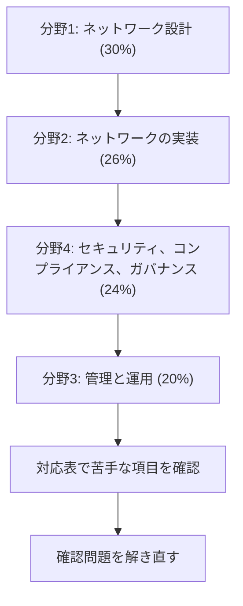

# Advanced Networking - Specialty（ANS）

AWS とハイブリッドのネットワークを、大規模に設計、実装、管理、保護する力を問う試験です。このコースは **ANS-C01** を基準にしています。

!!! warning "この試験は 2026年12月31日で終了します"
    **最終受験日は 2026年12月31日です。** 2026年10月31日時点で、残りは約2か月です。

    - **取得済みの認定:** 試験の終了より前に取得した認定は、標準の3年間有効です。
    - **終了後:** この認定は新しく発行されません。
    - **後継:** 公式ページに後継の試験の記載はありません。ネットワークの学習を続ける先として、AWS Skill Builder の[デジタルトレーニング](https://skillbuilder.aws/search?searchText=networking&page=1)を案内しています。

    認定を取るなら、試験日の予約と準備の時間を先に確保します。出典は[認定の公式ページ](https://aws.amazon.com/certification/certified-advanced-networking-specialty/)と[試験の一覧](https://aws.amazon.com/certification/exams/)です。

!!! note "更新の方法は公式の記載を確認してください"
    [再認定のページ](https://aws.amazon.com/certification/recertification/)は、この認定の更新方法として「最新版の試験に合格」（3年延長）と「Skill Builder での Maintain」（1年延長）を挙げています。試験が終了した後にこれらをどう扱うかの記載は、確認できませんでした。すでに持っている人は、期限が近づいたら公式の案内を確認します。

    第三者の記事には 2026年8月25日という別の日付が残っています。このページは公式ページの 12月31日を使っています。

!!! note "提供状況と名称（2026年10月時点）"
    試験ガイドの名前と、現在の名前や状況が違うものがあります。試験では引き続き問われる可能性があります。

    - **AWS App Mesh** は範囲の一覧にありますが、2026年9月30日にサポートが終了しました。新規の構成には使えません。概念は[App Mesh の状況](../../services/network-connectivity.md#app-mesh)にまとめています。
    - **Route 53 Resolver** は現在 **Route 53 VPC Resolver** です。
    - **Transit Gateway Network Manager** の機能は、現在は **AWS Global Networks for Transit Gateways** として説明されています。コンソールは AWS Network Manager です。

[:material-format-list-bulleted: このコースのサービス一覧](services.md){ .md-button }

## 試験の概要 {#overview}

| 項目 | 内容 | 出典 |
|---|---|---|
| 問題数 | 65問（採点対象50問 + 採点対象外15問） | 試験ガイド、公式ページ |
| 試験時間 | 170分 | 公式ページ |
| 合格点 | 750点（100〜1,000点） | 試験ガイド |
| 受験料 | 300 USD（為替などで追加の費用がかかる場合があります） | 公式ページ |
| 形式 | 下の注を参照 | |
| 言語 | 英語、日本語、韓国語、簡体字中国語 | 公式ページ |
| 受験方法 | Pearson VUE のテストセンターまたはオンライン | 公式ページ |
| 採点方式 | 全体の得点で合否を判定します。分野ごとの合格点はありません | 試験ガイド |
| 減点 | 誤答による減点はありません。未回答は不正解になるので、すべて回答します | 試験ガイド |
| 認定の有効期間 | 3年 | 公式ページ |

**問題の形式は資料で異なります。** 公式ページは「択一または複数選択」と書いています。試験ガイドは「複数選択」（5個以上の選択肢から2個以上）と「組み合わせ」（3〜7個の項目を対応付ける。すべて正しいときだけ得点）を挙げています。どちらにも備えます。

## 学習の順番 {#study-path}

配点の大きい分野から順に進めます。各分野のページで項目ごとの要点を確認し、足りないところはサービス解説で補います。

| 分野 | 配点 | タスク数 | 主なサービス |
|---|---|---|---|
| [分野1: ネットワーク設計](domain1.md) | 30% | 6 | CloudFront、Global Accelerator、Route 53、ELB、Direct Connect、Transit Gateway |
| [分野2: ネットワークの実装](domain2.md) | 26% | 4 | Direct Connect、Site-to-Site VPN、Transit Gateway、VPC Resolver、CloudFormation |
| [分野3: ネットワークの管理と運用](domain3.md) | 20% | 3 | Reachability Analyzer、フローログ、Traffic Mirroring、Route 53、Global Accelerator |
| [分野4: セキュリティ、コンプライアンス、ガバナンス](domain4.md) | 24% | 3 | WAF、Shield、Network Firewall、Firewall Manager、ACM、CloudTrail |

全項目と各ページの対応は[対応表](coverage.md)で確認できます。

## 想定する受験者と範囲外のもの {#candidate}

試験ガイドの想定は、**5年以上のネットワークの経験と、2年以上のクラウドとハイブリッドのネットワークの経験**です。AWS のネットワークとサービス統合の細かな点、セキュリティのベストプラクティス、コンピューティングとストレージの選択肢を知っている人を想定しています。

範囲外のサービスの例は次のとおりです。ガイドの一覧は網羅的ではなく、変更されることがあります。

| 分類 | サービス |
|---|---|
| 分析 | CloudSearch、Data Exchange、Data Pipeline、EMR、Glue、Lake Formation、MSK、OpenSearch Service、QuickSight、Redshift |
| AR と VR | Sumerian |
| ブロックチェーン | Managed Blockchain、QLDB |
| 開発者ツール | Device Farm、X-Ray |
| ロボット | RoboMaker |
| 衛星 | Ground Station |

## 範囲のサービスと解説ページ {#in-scope-services}

試験ガイドの一覧と、このwikiのページの対応です。この一覧も網羅的ではありません。

| 分類 | サービス | ページ |
|---|---|---|
| アプリケーション統合 | EventBridge、SNS、SQS | [EventBridge](../../services/messaging.md#eventbridge)、[SNS](../../services/messaging.md#sns)、[SQS](../../services/messaging.md#sqs) |
| コンピューティング | EC2、EC2 Auto Scaling、Lambda | [EC2 の運用](../../services/operations.md#ec2-operations)、[EC2 Auto Scaling](../../services/ec2-beanstalk.md#auto-scaling)、[Lambda の VPC 接続](../../services/lambda.md#vpc-access) |
| コンテナ | ECR、ECS、EKS、Fargate | [ECR](../../services/containers.md#ecr)、[ECS](../../services/containers.md#ecs)、[EKS](../../services/containers.md#eks)、[Fargate](../../services/containers.md#fargate-vs-ec2) |
| コスト管理 | Cost Explorer | [Cost Explorer](../../services/cost-management.md#cost-explorer) |
| フロントエンド | API Gateway | [API Gateway](../../services/api-gateway.md#api-types) |
| 管理とガバナンス | AWS Auto Scaling | [高可用性のための Auto Scaling](../../services/resilience.md#auto-scaling-ha)（AWS Auto Scaling の専用の説明はありません） |
| 管理とガバナンス | CLI、CloudFormation | [AWS CLI](../../services/iac.md#aws-cli)、[CloudFormation](../../services/iac.md#cloudformation-template) |
| 管理とガバナンス | CloudTrail、CloudWatch | [CloudTrail](../../services/observability.md#cloudtrail)、[CloudWatch](../../services/observability.md#cloudwatch-metrics) |
| 管理とガバナンス | Config、Control Tower、Organizations | [Config](../../services/governance.md#config)、[Control Tower](../../services/governance.md#control-tower)、[Organizations](../../services/governance.md#organizations) |
| 管理とガバナンス | Health Dashboard、コンソール、Trusted Advisor、Well-Architected Tool | [Health Dashboard](../../services/cloud-foundations.md#health)、[コンソール](../../services/cloud-foundations.md#access-methods)、[Trusted Advisor](../../services/cloud-foundations.md#trusted-advisor)、[Well-Architected Tool](../../services/cloud-foundations.md#wa-tool) |
| ネットワーク | API Gateway | [プライベート統合](../../services/api-gateway.md#private-integration) |
| ネットワーク | App Mesh | [App Mesh の状況](../../services/network-connectivity.md#app-mesh) |
| ネットワーク | Client VPN | [Client VPN](../../services/network-connectivity.md#client-vpn) |
| ネットワーク | Cloud Map | [分野2 の名前解決](domain2.md#t2-2-name-resolution) |
| ネットワーク | CloudFront、ELB、Route 53、VPC、PrivateLink | [CloudFront](../../services/networking.md#cloudfront)、[ELB](../../services/networking.md#elb)、[Route 53](../../services/networking.md#route53)、[VPC](../../services/networking.md#vpc)、[PrivateLink](../../services/networking.md#vpc-endpoints) |
| ネットワーク | Direct Connect、Site-to-Site VPN | [Direct Connect](../../services/network-connectivity.md#direct-connect)、[Site-to-Site VPN](../../services/network-connectivity.md#site-to-site-vpn) |
| ネットワーク | Global Accelerator、Transit Gateway | [Global Accelerator](../../services/network-connectivity.md#global-accelerator)、[Transit Gateway](../../services/network-connectivity.md#transit-gateway) |
| セキュリティ | Firewall Manager、Shield | [Firewall Manager](../../services/threat-detection.md#firewall-manager)、[Shield](../../services/threat-detection.md#shield) |
| セキュリティ | IAM、RAM | [IAM](../../services/iam.md#principals)、[RAM](../../services/governance.md#ram) |
| セキュリティ | Network Firewall、WAF | [Network Firewall](../../services/network-connectivity.md#network-firewall)、[WAF](../../services/certificates.md#waf) |
| サーバーレス | API Gateway、EventBridge、Fargate、Lambda、SNS、SQS、S3 | 上記の各ページと [S3](../../services/s3.md#basics) |
| ストレージ | S3 | [S3](../../services/s3.md#basics) |

試験ガイドに直接の名前はありませんが、ハイブリッド接続とマルチ VPC では [Cloud WAN](../../services/network-connectivity.md#cloud-wan)、[VPC Lattice](../../services/network-connectivity.md#vpc-lattice)、[IPAM](../../services/network-connectivity.md#ipam) も比較の対象としてよく登場します。

## 参考 {#references}

- [ANS-C01 試験ガイド](https://docs.aws.amazon.com/aws-certification/latest/advanced-networking-specialty-01/advanced-networking-specialty-01.html)
- [認定の公式ページ](https://aws.amazon.com/certification/certified-advanced-networking-specialty/)
- [AWS 認定の試験の一覧](https://aws.amazon.com/certification/exams/)
- [再認定](https://aws.amazon.com/certification/recertification/)
- [ネットワーク接続のリファレンス](../../services/network-connectivity.md)
- [ネットワークのリファレンス](../../services/networking.md)
