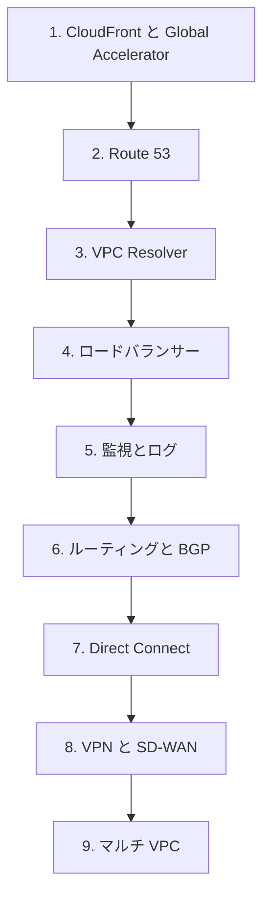

# 分野1: サービス別の学習

分野1（ネットワーク設計）は配点の 30% を占め、4 分野の中で最大です。エッジ、DNS、ロードバランサー、監視、ハイブリッド、マルチ VPC の順に進めると、後の実装の分野も読みやすくなります。

| 順番 | サービス | 問われること | 重要度 |
|---|---|---|---|
| 1 | [CloudFront と配信設計](cloudfront.md) | キャッシュ、オリジンの保護、配信方式の選択 | 高 |
| 2 | [Global Accelerator と分散](global-accelerator.md) | 固定 IP、DNS との違い、カスタムルーティング | 中 |
| 3 | [Route 53 のゾーンとレコード](route53-zones.md) | TTL、ドメイン登録、PHZ の解決の順序 | 高 |
| 4 | [Route 53 のルーティングと高可用性](route53-routing.md) | ルーティングポリシー、ヘルスチェック、Traffic Flow | 高 |
| 5 | [VPC Resolver とハイブリッド DNS](resolver.md) | エンドポイントの配置、容量、クエリログ | 高 |
| 6 | [ロードバランサー](elb.md) | 種類の選択、設定、ターゲット、TLS の終端 | 高 |
| 7 | [CloudWatch とログの要件](cloudwatch.md) | メトリクス、ベースライン、アクセスログ | 中 |
| 8 | [フローログと Traffic Mirroring](flow-logs.md) | メタデータとパケットの使い分け | 中 |
| 9 | [到達性の検証とトポロジー](reachability.md) | Network Manager と Reachability Analyzer | 中 |
| 10 | [ルーティングと BGP](routing-bgp.md) | ルートの優先順位、BGP 属性による制御 | 高 |
| 11 | [Direct Connect](direct-connect.md) | 物理接続、冗長構成、VIF の選択 | 高 |
| 12 | [VPN とカプセル化](vpn.md) | GRE と IPsec、カプセル化と MTU | 中 |
| 13 | [Transit Gateway と SD-WAN](transit-gateway.md) | Connect の条件、オーバーレイ | 中 |
| 14 | [マルチ VPC とマルチアカウント](multi-account.md) | 接続パターン、VPC 共有、IP の重複 | 高 |

重要度は公式の項目一覧を見たこの wiki の判断で、公式の数字ではありません。

## 他のサービスにまたがる問題 {#other-questions}

<!-- questions:start -->

この分野の問題は、すべてサービス別のページに載っています。

<!-- questions:end -->

