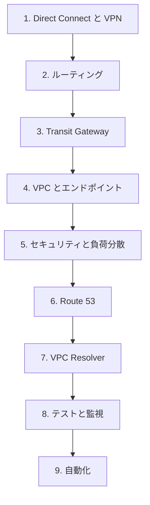

# 分野2: サービス別の学習

分野2（ネットワークの実装）は配点の 26% を占めます。設計を設定値で実装する力を問うので、物理、ルーティング、VPN、DNS、マルチ VPC、自動化の順に手順で覚えます。

| 順番 | サービス | 問われること | 重要度 |
|---|---|---|---|
| 1 | [Direct Connect](direct-connect.md) | 開通の手順、L1 と L2 の症状、既存の網の確認 | 高 |
| 2 | [VPN とカプセル化](vpn.md) | トンネルオプション、アクセラレーション、Client VPN | 高 |
| 3 | [ルーティングと BGP](routing-bgp.md) | 接続ごとの方式、伝播、VPC 側の経路 | 中 |
| 4 | [Transit Gateway と SD-WAN](transit-gateway.md) | Connect の実装、ルートテーブルの分離、第三者製品 | 高 |
| 5 | [マルチ VPC とマルチアカウント](multi-account.md) | RAM の共有、Cloud WAN、接続の拡張 | 中 |
| 6 | [VPC の構成とエンドポイント](vpc-endpoints.md) | PrivateLink の手順、VPC のサービス、DHCP | 高 |
| 7 | [ネットワークのセキュリティ](network-security.md) | アプライアンスモード、Network Firewall の実装 | 高 |
| 8 | [ロードバランサー](elb.md) | ヘルスチェックの計算、502 と 503 と 504 | 中 |
| 9 | [Route 53 のゾーンとレコード](route53-zones.md) | ゾーンの選択、委任、レコード、DNSSEC | 高 |
| 10 | [Route 53 のルーティングと高可用性](route53-routing.md) | ポリシーの設定値、PHZ のヘルスチェック | 中 |
| 11 | [VPC Resolver とハイブリッド DNS](resolver.md) | エンドポイントとルールの実装、共有、ログ | 高 |
| 12 | [到達性の検証とトポロジー](reachability.md) | 接続のテスト、ツールの使い分け | 中 |
| 13 | [CloudWatch とログの要件](cloudwatch.md) | トンネルログ、Transit Gateway フローログ、集約 | 中 |
| 14 | [ネットワークの自動化](automation.md) | IaC、イベント駆動、ハードコード、最適化 | 高 |

重要度は公式の項目一覧を見たこの wiki の判断で、公式の数字ではありません。

## 他のサービスにまたがる問題 {#other-questions}

<!-- questions:start -->

この分野の問題は、すべてサービス別のページに載っています。

<!-- questions:end -->

