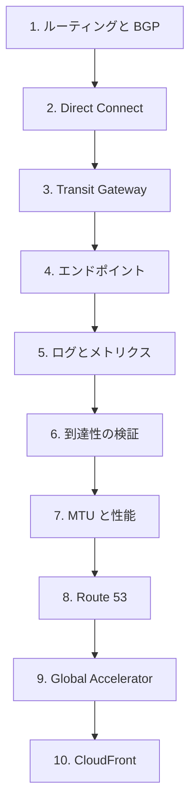

# 分野3: サービス別の学習

分野3（ネットワークの管理と運用）は配点の 20% です。「症状、使うツール、原因」の流れで進め、上限値と MTU の数値を覚えます。

| 順番 | サービス | 問われること | 重要度 |
|---|---|---|---|
| 1 | [ルーティングと BGP](routing-bgp.md) | BGP の管理、ルートテーブル、経路の最適化 | 高 |
| 2 | [Direct Connect](direct-connect.md) | DX ゲートウェイ、許可プレフィックスの運用 | 中 |
| 3 | [Transit Gateway と SD-WAN](transit-gateway.md) | 上限、通信パターン、接続の選択、マルチキャスト | 高 |
| 4 | [VPC の構成とエンドポイント](vpc-endpoints.md) | PrivateLink の維持、AWS サービスへのアクセス | 中 |
| 5 | [CloudWatch とログの要件](cloudwatch.md) | 指標の解釈、調べるメトリクス | 中 |
| 6 | [フローログと Traffic Mirroring](flow-logs.md) | フローログの読み方、パケットの分析 | 高 |
| 7 | [到達性の検証とトポロジー](reachability.md) | 経路の分析、設定の誤り、検証の自動化 | 高 |
| 8 | [MTU と性能の最適化](performance.md) | MTU、スループット、インターフェイス、費用 | 高 |
| 9 | [Route 53 のルーティングと高可用性](route53-routing.md) | データプレーンの切り替え、zonal DNS | 中 |
| 10 | [Global Accelerator と分散](global-accelerator.md) | ダイヤル、重み、分散のパターン | 中 |
| 11 | [CloudFront と配信設計](cloudfront.md) | 帯域の使用量を減らす方法 | 低 |

重要度は公式の項目一覧を見たこの wiki の判断で、公式の数字ではありません。

## 他のサービスにまたがる問題 {#other-questions}

<!-- questions:start -->

この分野の問題は、すべてサービス別のページに載っています。

<!-- questions:end -->

