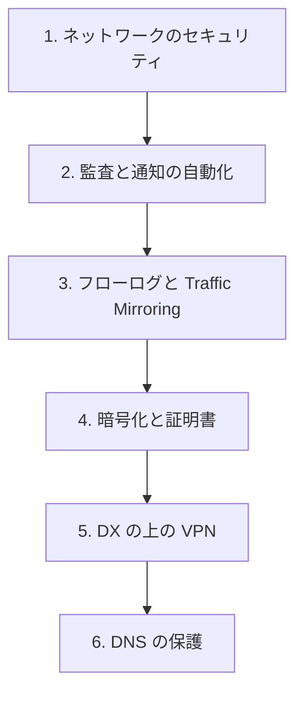

# 分野4: サービス別の学習

分野4（セキュリティ、コンプライアンス、ガバナンス）は配点の 24% です。通信の向きごとの防御、ログによる監査、暗号化の順に進めます。

| 順番 | サービス | 問われること | 重要度 |
|---|---|---|---|
| 1 | [ネットワークのセキュリティ](network-security.md) | 受信、送信、VPC 間の保護、脅威モデル | 高 |
| 2 | [監査と通知の自動化](security-operations.md) | テスト、通知、監査の戦略 | 高 |
| 3 | [フローログと Traffic Mirroring](flow-logs.md) | フィールド、ログの配信、相関分析 | 高 |
| 4 | [暗号化と証明書](encryption.md) | 暗号化の選択、転送時の設定、証明書、責任 | 高 |
| 5 | [VPN とカプセル化](vpn.md) | DX の上の VPN、IPsec の方式 | 中 |
| 6 | [Route 53 のゾーンとレコード](route53-zones.md) | DNSSEC と DoH の使い分け | 中 |

重要度は公式の項目一覧を見たこの wiki の判断で、公式の数字ではありません。

## 他のサービスにまたがる問題 {#other-questions}

<!-- questions:start -->

この分野の問題は、すべてサービス別のページに載っています。

<!-- questions:end -->

