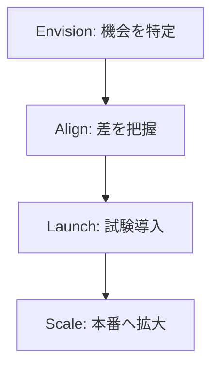

# 分野1: クラウドの概念

配点は **24%** です。クラウドの利点、Well-Architected Framework、移行の考え方、費用の考え方を扱います。

用語の意味を区別できることが中心です。設定の手順は問われません。問題文の要件が、どの利点やどの柱の話かを判断できるようにします。

## タスク 1.1: AWS クラウドの利点を説明する {#task-1-1}

### AWS クラウドの価値 {#t1-1-value}

クラウドは、IT リソースを必要な分だけ使い、使った分だけ払う形です。AWS は次の 6 つの利点を挙げています。

| 利点 | 問題文での表れ方 |
|---|---|
| 固定費を変動費に変える | サーバーを先に買いたくない |
| 規模の経済の恩恵を受ける | 多数の利用者の集約で単価が下がる |
| 容量の推測が不要になる | 需要が読めない、セールのときだけ増やしたい |
| 速度と俊敏性を高める | 検証環境を数分で用意して、すぐ捨てたい |
| データセンターの運用をやめる | ラックや電源の管理をやめて開発に人を回したい |
| 数分で世界に展開する | 海外の利用者の近くにすぐ置きたい |

詳細: [クラウドの 6 つの利点](../../services/cloud-foundations.md#six-advantages)

### グローバルインフラの利点 {#t1-1-global}

世界中のリージョンにすぐ配置できるので、データセンターを建てずに海外へ展開できます。これが展開の速さと世界展開の意味です。

たとえば、東南アジアの利用者が増えたら、近くのリージョンに同じ構成を作ります。静的なコンテンツはエッジロケーションから配信して、遅延を減らします。

詳細: [グローバルインフラストラクチャ](../../services/cloud-foundations.md#global-infrastructure)

### 高可用性、弾力性、俊敏性 {#t1-1-ha-elastic-agile}

3 つの区別がよく問われます。

| 用語 | 意味 | 例 |
|---|---|---|
| 高可用性 | 一部が故障しても動き続ける | 複数 AZ に配置する |
| 弾力性 | 負荷に合わせて自動で増減する | Auto Scaling で台数を増減する |
| 俊敏性 | 新しいことを短時間で試せる | 数分で環境を作って試す |

「夜間は台数を減らす」は弾力性、「AZ の障害でも止まらない」は高可用性です。

詳細: [高可用性、弾力性、俊敏性](../../services/cloud-foundations.md#ha-elasticity-agility)

## タスク 1.2: AWS クラウドの設計原則を理解する {#task-1-2}

### Well-Architected Framework {#t1-2-wa-framework}

AWS 上のシステムを評価するための設計指針です。6 つの柱で構成されます。

Well-Architected Tool を使うと、ワークロードを質問形式でレビューできます。追加料金はかかりません。ツールは指摘と記録を行うもので、リソースを自動では直しません。

詳細: [Well-Architected Framework](../../services/cloud-foundations.md#well-architected)、[Well-Architected Tool](../../services/cloud-foundations.md#wa-tool)

### 6 つの柱 {#t1-2-pillars}

| 柱 | 問うこと |
|---|---|
| 運用上の優秀性 | 運用を継続的に改善できるか |
| セキュリティ | データとシステムを守れるか |
| 信頼性 | 障害から復旧し、期待どおり動くか |
| パフォーマンス効率 | リソースを効率よく使えるか |
| コスト最適化 | 不要な費用を避けられるか |
| サステナビリティ | 環境への影響を減らせるか |

詳細: [Well-Architected Framework](../../services/cloud-foundations.md#well-architected)

### 柱の違いの見分け方 {#t1-2-pillar-differences}

問題文の動詞や目的から柱を判断します。

| 問題文の表現 | 柱 |
|---|---|
| 小さく元に戻せる変更を頻繁に行う、手順をコード化する | 運用上の優秀性 |
| 人をデータから遠ざける、追跡できるようにする | セキュリティ |
| 復旧手順をテストする、自動で復旧する | 信頼性 |
| サーバーレスを使う、頻繁に実験して最適な構成を選ぶ | パフォーマンス効率 |
| 使った分だけ払う形にする、費用を分析して配賦する | コスト最適化 |
| 使用率を上げて消費電力を減らす、効率のよい新しいハードウェアを使う | サステナビリティ |

紛らわしいのは、コスト最適化とサステナビリティです。費用を減らす話か、環境負荷を減らす話かで分けます。同じく、信頼性は障害からの復旧、パフォーマンス効率はリソースの選び方と使い方です。

詳細: [Well-Architected Framework](../../services/cloud-foundations.md#well-architected)

## タスク 1.3: 移行の利点と戦略を理解する {#task-1-3}

### クラウド導入の戦略 {#t1-3-adoption-strategies}

導入は一度に終えるものではなく、段階を追って進めます。AWS CAF は、変革の進め方を 4 つのフェーズで示しています。

すべてをクラウドに移す形だけでなく、オンプレミスと併用するハイブリッドの形もあります。

詳細: [Cloud Adoption Framework](../../services/cloud-foundations.md#caf)、[デプロイモデル](../../services/cloud-foundations.md#deployment-models)

### 移行を支える情報源とプログラム {#t1-3-resources}

「何を調べるか」「誰に頼るか」で選びます。

| 必要なもの | 選択肢 |
|---|---|
| 組織の準備の整理 | AWS CAF |
| 移行の具体的な手順 | AWS Prescriptive Guidance |
| 費用対効果の試算 | Migration Evaluator |
| サーバーの一覧や依存関係の把握 | Application Discovery Service、AWS Transform |
| 移行の進み具合の追跡 | AWS Migration Hub |
| 専門家の有償の支援 | AWS Professional Services、AWS Partner |
| 移行の計画と資金面の支援 | AWS Migration Acceleration Program（MAP） |

MAP は、評価（Assess）、準備（Mobilize）、移行とモダナイズ（Migrate & Modernize）の 3 段階で進むプログラムです。ツール、研修、パートナーの知見に加えて、移行の初期費用を補う資金面の支援があります。

!!! note "移行サービスの提供状況と名称（2026年10月時点）"
    試験ガイドの対象一覧に残っていますが、次のものは状況が変わっています。試験対策としては役割を覚えます。

    - AWS Migration Hub は 2025年11月7日に新規受付を終了しました。Application Discovery Service も新規受付を終了しています。後継は AWS Transform です。
    - AWS Application Migration Service は、現在 AWS Transform MGN と呼ばれています。

詳細: [Migration Hub](../../services/migration.md#migration-hub)、[Application Discovery Service](../../services/migration.md#application-discovery)、[Migration Evaluator](../../services/migration.md#migration-evaluator)、[AWS Transform](../../services/migration.md#transform)、[サポートの情報源](../../services/cloud-foundations.md#support-resources)

MAP の参考: [AWS Migration Acceleration Program](https://aws.amazon.com/migration-acceleration-program/)

### AWS CAF の成果とパースペクティブ {#t1-3-caf}

AWS CAF は、組織がクラウドに移行するための準備を整理した枠組みです。試験ガイドは、得られる成果の例として次の 4 つを挙げています。

- ビジネスリスクの低減
- 環境、社会、ガバナンス（ESG）の改善
- 収益の増加
- 運用効率の向上

パースペクティブは 6 つです。前半の 3 つは事業寄り、後半の 3 つは技術寄りです。

| パースペクティブ | 焦点 |
|---|---|
| ビジネス | クラウド投資を事業の成果につなげる |
| 人材 | 文化、組織構造、リーダーシップ、人材 |
| ガバナンス | 効果を最大化し、変革のリスクを抑える |
| プラットフォーム | スケールする基盤、既存の刷新、新規開発 |
| セキュリティ | データとワークロードの機密性、完全性、可用性 |
| オペレーション | 事業の要求を満たすサービス提供 |

「社員のスキルや文化の準備」は人材です。システムの設計を見直すなら、CAF ではなく Well-Architected です。

詳細: [Cloud Adoption Framework](../../services/cloud-foundations.md#caf)

### 移行の戦略（7 つの R） {#t1-3-migration-strategies}

アプリごとに移行の方法を決めます。

| 戦略 | 内容 | 問題文での表れ方 |
|---|---|---|
| Retire | 止める | 使われていない |
| Retain | 今は移さない | 規制や専用ハードウェアの都合で残す |
| Rehost | 変えずに EC2 へ移す | 短期間で、手を加えずに |
| Relocate | 同じ基盤のまま移す | VMware をそのまま AWS 上の VMware へ |
| Repurchase | 別の製品に買い替える | 自社開発の CRM を SaaS にする |
| Replatform | 少し手を入れる | 自前の DB を RDS にする |
| Refactor | クラウド向けに作り直す | サーバーレスで作り直す |

ガイドの例にあるデータベースのレプリケーションは、AWS DMS で実現します。全ロードの後に変更を流し続けるので、元のデータベースを動かしたまま移行でき、停止を短くできます。

詳細: [移行の 7 つの R](../../services/migration.md#seven-rs)、[DMS の移行タイプ](../../services/migration.md#dms-migration-types)

## タスク 1.4: クラウドの経済性を理解する {#task-1-4}

### 経済性の見方と節約の要素 {#t1-4-economics}

費用は機器代だけで比べません。電力、施設、人件費まで含めた総費用（TCO）で比べます。

移行で費用が下がる主な理由は次のとおりです。

- 設備を先に買わず、使った分を払う
- 余らせていた容量を減らせる
- データセンターの運用の手間がなくなる
- 確約割引やスポットなどの購入方法を選べる

詳細: [クラウドの経済性](../../services/cloud-foundations.md#cloud-economics)

### 固定費と変動費 {#t1-4-fixed-variable}

| | 固定費（オンプレミス） | 変動費（クラウド） |
|---|---|---|
| 支払い | 使う前にまとめて購入する | 使った分を払う |
| 需要の予測が外れたとき | 余るか足りなくなる | 増減して合わせられる |
| 新しい試み | 投資の判断が必要 | 小さく始めて、やめられる |

詳細: [クラウドの 6 つの利点](../../services/cloud-foundations.md#six-advantages)

### オンプレミスにかかる費用 {#t1-4-onprem-costs}

見落としやすいのは、機器代以外です。

- 機器の購入と更新
- 施設、ラック、電力、冷却
- ネットワークと保守の契約
- 運用する人員

比較の問題では、これらをすべて含めたものが正解です。

詳細: [クラウドの経済性](../../services/cloud-foundations.md#cloud-economics)

### ライセンスの持ち込みとライセンス込み {#t1-4-licensing}

| 方式 | 内容 | 向く場面 |
|---|---|---|
| BYOL | 手持ちのライセンスをクラウドに持ち込む | 有効なライセンスをすでに持っている |
| ライセンス込み | 料金にライセンスが含まれる | 持っていない、調達の手間を省きたい |

ソケットやコア単位のライセンスを持ち込むなら、Dedicated Hosts を選びます。ライセンスの使用数を管理して超過を防ぐのは AWS License Manager です。

詳細: [クラウドの経済性](../../services/cloud-foundations.md#cloud-economics)、[購入オプション](../../services/cost-management.md#purchase-options)、[License Manager](../../services/governance.md#license-manager)

### 適正サイズ {#t1-4-rightsizing}

実際の使用率に合わせて、リソースを小さくすることです。CPU 使用率が常に低いインスタンスは、小さいタイプに変えると費用が下がります。

提案を出すのは AWS Compute Optimizer です。使うにはオプトインが必要です。

詳細: [Compute Optimizer と適正サイズ](../../services/cost-management.md#compute-optimizer)

### 自動化の利点 {#t1-4-automation}

手作業を減らすと、人件費とミスが減り、同じ構成を何度でも作れます。

| 自動化するもの | サービス |
|---|---|
| 環境の作成 | CloudFormation |
| 台数の増減 | Auto Scaling |
| パッチの適用などの運用 | Systems Manager |

詳細: [クラウドの経済性](../../services/cloud-foundations.md#cloud-economics)、[CloudFormation](../../services/iac.md#cloudformation-template)、[Systems Manager](../../services/operations.md#systems-manager)

### 規模の経済 {#t1-4-scale}

多数の利用者の使用量が集まるので、AWS は機器などを安く調達でき、その分だけ単価が下がります。1 社では得られない単価を使えるという利点です。

利用者自身の使用量が増えて割引が増えるのは、別の話です（ボリューム割引や一括請求）。

詳細: [クラウドの 6 つの利点](../../services/cloud-foundations.md#six-advantages)、[一括請求](../../services/cost-management.md#consolidated-billing)

## 確認問題 {#self-check}

??? question "問1: 小売企業は年末のセールの数週間だけアクセスが数倍になります。普段は余らせたくありません。どの利点の話ですか？"
    弾力性です。負荷に合わせて自動で増減します。容量の推測が不要になるという利点にも当たります。高可用性は故障しても動き続けることなので、ここでは違います。

??? question "問2: 復旧手順を定期的に試し、障害から自動で回復できるようにしています。Well-Architected のどの柱ですか？"
    信頼性です。障害から復旧して期待どおり動くかを問う柱です。運用手順のコード化だけが要点なら運用上の優秀性ですが、ここでは復旧が目的です。

??? question "問3: 古いサーバーを新しい世代に替えて使用率を上げ、消費電力を減らします。費用の話は出ていません。どの柱ですか？"
    サステナビリティです。環境への影響を減らすことが目的です。費用を減らすことが目的ならコスト最適化になります。

??? question "問4: 期限まで 3 か月で、数百台のサーバーをコードを変えずに移したいです。どの移行戦略ですか？"
    Rehost です。期限が短く、手を加えないという条件に合います。Refactor は作り直すので時間がかかり、この条件には合いません。

??? question "問5: 経営層が、クラウド移行に向けて社員のスキルと組織の準備を整理したいと考えています。どの枠組みを使いますか？"
    AWS CAF です。中でも人材のパースペクティブが該当します。Well-Architected はシステムの設計を評価する枠組みです。

??? question "問6: オンプレミスと AWS の費用を比べる資料に、サーバーの購入費だけが載っています。何が足りませんか？"
    施設、電力、冷却、保守、運用の人員です。TCO はこれらを含めた総費用です。購入費だけで比べると、オンプレミスの費用を少なく見積もります。
