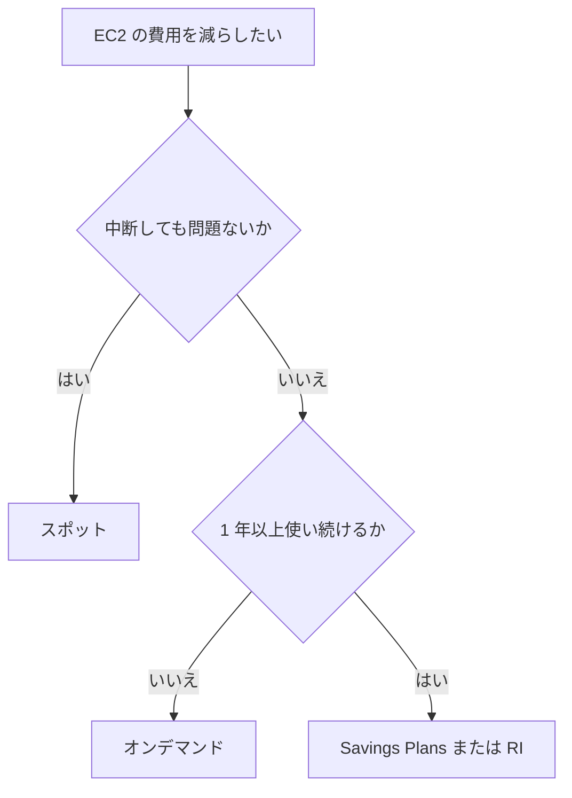

# 分野4: 請求、料金、サポート

配点は **12%** で、4分野の中で最小です。購入オプション、費用管理の道具、サポートプラン、情報源を扱います。

割引率を細かく覚えるより、要件に合う購入方法と道具を選べるようにします。

この分野に限らず、コース全体で使うサービスは[サービス一覧](services.md)から確認できます。

## タスク 4.1: 料金モデルを比較する {#task-4-1}

### コンピューティングの購入オプション {#t4-1-compute-options}

| オプション | 確約 | 中断 | 向くもの |
|---|---|---|---|
| オンデマンド | なし | なし | 短期、予測できない負荷 |
| リザーブドインスタンス（RI） | 1 年か 3 年、構成 | なし | 構成が変わらない定常負荷 |
| Savings Plans | 1 年か 3 年、USD/時 | なし | 定常負荷。構成が変わる可能性がある |
| スポットインスタンス | なし | あり | 中断できるバッチ、CI |
| Dedicated Hosts | - | なし | 物理ホストの専有。ソケットやコア単位の BYOL |
| Dedicated Instances | - | なし | 単一テナントのハードウェアで動かす |
| Capacity Reservations | なし | なし | 特定の AZ に容量を確保する |

割引の上限は、スポットが最大 90%、EC2 Instance Savings Plans とスタンダード RI が最大 72%、Compute Savings Plans が最大 66% です。

Dedicated Hosts と Dedicated Instances の違いは、Dedicated Hosts は物理サーバーを見える形で割り当てるので、物理的なソケットやコアの単位でライセンスを持ち込める点です。

Savings Plans と RI は割引で、容量の確保はしません（ゾーナル RI は例外です）。確保が必要なら Capacity Reservations を使います。

詳細: [購入オプション](../../services/cost-management.md#purchase-options)、[向いているものの選び方](../../services/cost-management.md#purchase-choice)、[スポット](../../services/cost-management.md#spot)、[Savings Plans](../../services/cost-management.md#savings-plans)

### リザーブドインスタンスの柔軟性 {#t4-1-ri-flexibility}

| 項目 | スタンダード | コンバーティブル |
|---|---|---|
| 割引 | 大きい | 小さい |
| 別の構成への交換 | 不可 | 可 |
| マーケットプレイスでの販売 | 可 | 不可 |

適用範囲にも種類があります。

| 項目 | リージョナル | ゾーナル |
|---|---|---|
| 容量の確保 | しない | 指定の AZ で確保する |
| AZ の柔軟性 | リージョン内のどの AZ でも割引 | 指定の AZ のみ |
| サイズの柔軟性 | ファミリー内で適用（Linux/Unix、デフォルトテナンシーのみ） | なし |

「構成が変わるかもしれない」なら、コンバーティブル RI か Savings Plans です。

詳細: [Reserved Instances](../../services/cost-management.md#reserved-instances)

### Organizations での RI の動き {#t4-1-ri-organizations}

RI と Savings Plans の割引は、組織の中で共有されます。購入したアカウントで使わない分は、他のアカウントの条件の合う利用に適用されます。

共有は管理アカウントが制御します。割引の共有をオフにしたアカウントには適用されません。

詳細: [Reserved Instances](../../services/cost-management.md#reserved-instances)、[一括請求](../../services/cost-management.md#consolidated-billing)

### データ転送の費用 {#t4-1-data-transfer}

基本は「入るのは無料、出るのは有料」です。

| 経路 | 料金 |
|---|---|
| インターネットから AWS へ | 無料 |
| 同じ AZ 内 | 無料 |
| 同じリージョンの AZ 間 | 有料 |
| リージョン間 | 送信元の送信分が有料 |
| AWS からインターネットへ | 有料。月 100 GB まで無料 |

同じリージョンの S3 に大量に送るときは、ゲートウェイエンドポイントを使うと NAT ゲートウェイの費用を減らせます。

詳細: [データ転送の費用](../../services/cost-management.md#data-transfer)

### ストレージの料金 {#t4-1-storage}

S3 は、アクセス頻度が低いクラスほど保存料が安く、取り出し料がかかります。

| クラス | 最低保存期間 | 取り出し料 |
|---|---|---|
| Standard | なし | なし |
| Intelligent-Tiering | なし | なし（監視料あり） |
| Standard-IA、One Zone-IA | 30 日 | あり |
| Glacier Instant Retrieval、Flexible Retrieval | 90 日 | あり |
| Glacier Deep Archive | 180 日 | あり |

最低保存期間より前に削除しても、その期間分の料金がかかります。短期間で消すデータを Glacier に置くと、かえって高くなることがあります。

EBS は確保した容量などで課金されます。使っていなくても料金がかかります。EFS と S3 は使った容量で課金されます。

詳細: [S3 のストレージ費用](../../services/cost-management.md#s3-cost)、[ストレージクラス](../../services/s3.md#storage-classes)、[EBS、EFS、S3 の比較](../../services/storage.md#comparison)

## タスク 4.2: 請求と費用管理の道具を理解する {#task-4-2}

### 請求の情報 {#t4-2-billing-info}

請求書、支払い方法、クレジットは、Billing and Cost Management のコンソールで確認します。アカウントと請求の問い合わせは、Basic Support でも受けられます。

詳細: [Billing and Cost Management](../../services/cost-management.md#billing)

### サービスの料金情報 {#t4-2-pricing-info}

料金はサービスごと、リージョンごとに異なります。AWS の各サービスの料金ページで確認します。

無料で試算するなら、次の AWS Pricing Calculator を使います。

詳細: [Pricing Calculator](../../services/cost-management.md#pricing-calculator)

### Budgets と Cost Explorer {#t4-2-budgets-explorer}

| 道具 | 役割 | 問題文での表れ方 |
|---|---|---|
| AWS Budgets | しきい値を決めて、超えそうなときに通知する | 月の予算の 80% で通知したい |
| AWS Cost Explorer | 費用と使用量をグラフで分析する | 先月からどのサービスが増えたか見たい |

Budgets は予測の超過でも通知できます。Cost Explorer は過去の分析に加えて、今後の予測もできます。

詳細: [AWS Budgets](../../services/cost-management.md#budgets)、[Cost Explorer](../../services/cost-management.md#cost-explorer)

### Pricing Calculator {#t4-2-pricing-calculator}

構成の費用を、作る前に見積もる道具です。公開の Web サイトはアカウント不要で無料です。

「移行前に見積もる」なら Pricing Calculator、「作った後の実績を分析する」なら Cost Explorer です。

詳細: [Pricing Calculator](../../services/cost-management.md#pricing-calculator)

### Organizations の一括請求 {#t4-2-organizations}

AWS Organizations の管理アカウントが、メンバーアカウントの費用をまとめて支払います。追加料金はかかりません。

| 利点 | 内容 |
|---|---|
| 請求書の集約 | 1 つの請求書にまとまる |
| 追跡 | アカウントごとの費用を確認できる |
| 使用量の合算 | ボリューム割引を組織全体で共有できる |
| 割引の共有 | RI と Savings Plans の割引を他のアカウントでも使える |

詳細: [一括請求](../../services/cost-management.md#consolidated-billing)、[Organizations](../../services/governance.md#organizations)

### コスト配分タグとレポート {#t4-2-tags}

タグを費用の分類に使う仕組みです。リソースに付けるだけでは請求データに出ません。**有効化が必要です。**

| 種類 | 付ける主体 | 例 |
|---|---|---|
| AWS 生成タグ | AWS | `aws:createdBy` |
| ユーザー定義タグ | 利用者 | `CostCenter` |

有効にしたタグは、Cost Explorer や AWS Cost and Usage Report（CUR）で使えます。CUR は最も詳しい費用と使用量のデータで、S3 に配信されます。

「部門ごとの費用を、行単位で詳しく分析したい」なら、タグを有効化して CUR を使います。現在の推奨は Data Exports で作る CUR 2.0 です。

詳細: [コスト配分タグ](../../services/cost-management.md#cost-allocation-tags)、[Data Exports と CUR](../../services/cost-management.md#data-exports)

## タスク 4.3: 技術リソースとサポートの選択肢を理解する {#task-4-3}

### AWS の公式サイトの情報 {#t4-3-official-sites}

ホワイトペーパー、ブログ、ドキュメントは、AWS の公式サイトにあります。

| 情報 | 内容 |
|---|---|
| AWS ドキュメント | サービスごとの使い方の説明 |
| ホワイトペーパー | 設計の考え方や Well-Architected の解説 |
| AWS のブログ | 新機能や手法の解説 |

詳細: [サポートの情報源](../../services/cloud-foundations.md#support-resources)

### 技術リソースの探し方 {#t4-3-technical-resources}

| リソース | 使いどころ |
|---|---|
| AWS Prescriptive Guidance | 移行や実装の具体的な手順 |
| AWS Knowledge Center | よくある質問と解決方法 |
| AWS re:Post | コミュニティの Q&A |

詳細: [サポートの情報源](../../services/cloud-foundations.md#support-resources)

### サポートプラン {#t4-3-support-plans}

!!! note "サポートプランの変更（2026年10月時点）"
    試験ガイドは新しいプランの名前を使っています。古い教材の Developer、Business、Enterprise On-Ramp は **2027年1月1日に終了**します（AWS GovCloud (US) では継続）。

| プラン | 主な特徴 | 事業に重大な障害の応答目標 | Trusted Advisor | 専任 TAM |
|---|---|---|---|---|
| Basic | 全利用者に無料。アカウントと請求の問い合わせ、クォータの引き上げ、ドキュメント | 技術サポートのケースなし | 一部のチェック | なし |
| Business Support+ | AI による支援と 24 時間の技術者対応 | 30 分未満 | 全チェック | なし |
| Enterprise | 上記に加え、専任 TAM、AWS Security Incident Response、戦略レビュー | 15 分未満 | 全チェックと Priority | あり |
| Unified Operations | 専任 TAM、ドメインスペシャリストエンジニア、重要ワークロードのレビュー | インシデント管理エンジニアから 5 分 | 全チェックと Priority | あり |

ガイドの「顧客サービスとコミュニティ」は、Basic で使えるアカウントと請求の窓口と、re:Post などのコミュニティにあたります。

選び方は次のとおりです。

- 費用をかけずにアカウントと請求の相談だけなら Basic
- 24 時間の技術サポートと全チェックを最小の費用でほしいなら Business Support+
- 専任の TAM が必要なら Enterprise 以上

詳細: [AWS Support プラン](../../services/cloud-foundations.md#support-plans)

### AWS Support Center {#t4-3-support-center}

サポートのケースを作成して管理する場所です。アカウントと請求の問い合わせや、技術的な問題を起票します。

詳細: [サポートの情報源](../../services/cloud-foundations.md#support-resources)

### Trusted Advisor と Health による管理 {#t4-3-monitoring-role}

| 道具 | 役割 |
|---|---|
| AWS Trusted Advisor | 環境を点検し、使っていないリソースなどの節約の余地を示す |
| AWS Health Dashboard | AWS 側の障害や予定が、自分のリソースにどう影響するかを示す |
| AWS Health API | Health の情報を社内システムと連携する。Business Support+ 以上で使える |

「自分の設定の改善」は Trusted Advisor、「AWS 側の障害の影響」は Health です。CloudWatch は自分のリソースのメトリクスを見るもので、AWS 側の障害情報は分かりません。

詳細: [Trusted Advisor](../../services/cloud-foundations.md#trusted-advisor)、[Health Dashboard](../../services/cloud-foundations.md#health)

### AWS Trust & Safety {#t4-3-trust-safety}

AWS のリソースから送られるスパム、ポートスキャン、DoS 攻撃などの悪用を報告する先です。

公式の「Amazon AWS abuse form」から報告します。AWS Support は悪用の報告を扱いません。

詳細: [サポートの情報源](../../services/cloud-foundations.md#support-resources)

参考: [Report abuse of AWS resources](https://repost.aws/knowledge-center/report-aws-abuse)

### AWS Partner Network {#t4-3-apn}

AWS Partner Network（APN）は、AWS と協力する企業のプログラムです。

| 種類 | 役割 | 例 |
|---|---|---|
| 独立系ソフトウェアベンダー（ISV） | 自社のソフトウェアを提供する | AWS Marketplace で SaaS を販売する |
| システムインテグレーター | 構築や移行を請け負う | 顧客のシステムを AWS に移す |

AWS Marketplace は、パートナーが顧客に製品を販売する場でもあります。

詳細: [サポートの情報源](../../services/cloud-foundations.md#support-resources)、[AWS Marketplace](../../services/cloud-foundations.md#marketplace)

### AWS Partner になる利点 {#t4-3-partner-benefits}

試験ガイドは、例としてパートナー向けの研修と認定、パートナーのイベント、ボリューム割引を挙げています。

公式のパートナーのページでは、研修、ウェビナーやイベント、販売を支援するプログラムやインセンティブ、Marketplace での販売が案内されています。

参考: [AWS Partner Network](https://aws.amazon.com/partners/)

### AWS Marketplace の主な機能 {#t4-3-marketplace}

サードパーティのソフトウェア、データ、サービスを探して購入し、デプロイできるカタログです。料金は AWS の請求書に合算されます。

| ガイドの観点 | 機能 |
|---|---|
| 費用の管理 | 請求の一本化。Procurement insights ダッシュボードで組織全体の費用と契約を確認。コスト配分タグ |
| ガバナンス | Private Marketplace で、購入できる製品を承認済みのものに絞る |
| 権利（エンタイトルメント） | 購入するとライセンスが作られ、AWS License Manager で組織のアカウントに配布できる |

詳細: [AWS Marketplace](../../services/cloud-foundations.md#marketplace)、[License Manager](../../services/governance.md#license-manager)

参考: [Managing costs](https://docs.aws.amazon.com/marketplace/latest/buyerguide/cost-and-procurement-insights.html)、[Private Marketplace](https://docs.aws.amazon.com/marketplace/latest/buyerguide/private-marketplace-current.html)、[Managing licenses](https://docs.aws.amazon.com/marketplace/latest/buyerguide/managing-licenses.html)

### 技術支援の選択肢 {#t4-3-technical-assistance}

| 支援 | 内容 | 問題文での表れ方 |
|---|---|---|
| AWS Professional Services | AWS の専門チームによる有償の支援 | 移行プロジェクトに AWS の専門家の手を借りたい |
| AWS ソリューションアーキテクト | 設計の相談 | AWS 上の設計を相談したい |
| AWS Partner | パートナー企業による構築や移行 | 構築を外部に任せたい |
| テクニカルアカウントマネージャー（TAM） | サポートプランの専任の担当者 | 継続して担当者についてほしい |

詳細: [サポートの情報源](../../services/cloud-foundations.md#support-resources)、[AWS Support プラン](../../services/cloud-foundations.md#support-plans)

## 確認問題 {#self-check}

??? question "問1: 3 年間止まらず動き続ける業務システムの費用を減らしたいです。将来インスタンスファミリーを変える可能性があります。何を選びますか？"
    Compute Savings Plans です。ファミリーやリージョンを問わず適用されます。スポットは中断があるので向きません。スタンダード RI は別の構成に交換できません。

??? question "問2: 毎晩のバッチ処理は、途中で止まっても再実行できます。最も安い購入オプションは何ですか？"
    スポットインスタンスです。最大 90% 安くなりますが、中断されることがあります。止まっても再実行できるので問題になりません。

??? question "問3: 部門ごとの AWS の費用を分けて見たいと考え、リソースにタグを付けましたが、Cost Explorer で選べません。何が足りませんか？"
    コスト配分タグの有効化です。タグは付けるだけでは請求データに出ません。有効化しても反映まで最大 24 時間かかります。

??? question "問4: AWS を使う前に、計画中の構成の月額費用を見積もりたいです。何を使いますか？"
    AWS Pricing Calculator です。公開の Web サイトはアカウントなしで使えます。Cost Explorer は実際にかかった費用の分析に使います。

??? question "問5: 専任の担当者はいらないものの、本番障害のときに 24 時間技術者に相談でき、Trusted Advisor の全チェックも使いたいです。費用を最小にするならどのプランですか？"
    Business Support+ です。専任の TAM が必要なら Enterprise 以上になります。Basic には技術サポートのケースがありません。

??? question "問6: AWS の IP アドレスから自社のサーバーへ攻撃らしき通信が来ています。どこに報告しますか？"
    AWS Trust & Safety です。公式の悪用の報告フォームを使います。AWS Support は悪用の報告を扱いません。
