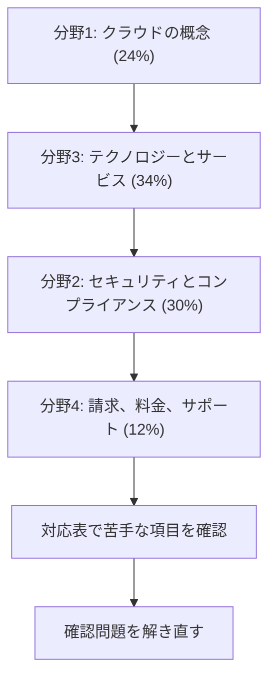

# Cloud Practitioner（CLF）

AWS クラウド全体の知識を、特定の職種によらず問う試験です。このコースは **CLF-C02** を基準にしています。公式の項目は[対応表](coverage.md)ですべて確認できます。

!!! warning "イタリア語とドイツ語の試験が終了します"
    公式ページによると、イタリア語とドイツ語の試験は **2026年12月31日より後に提供されなくなります**。2026年10月31日時点で、公式ページに CLF-C02 の後継や最終受験日の案内はありません。

## 試験の概要 {#overview}

| 項目 | 内容 |
|---|---|
| 問題数 | 65問（採点対象50問 + 採点対象外15問） |
| 試験時間 | 90分 |
| 合格点 | 700点（100〜1,000点） |
| 受験料 | 100 USD。為替などで追加の費用がかかる場合があります |
| 形式 | 択一（正解1つ、誤答3つ）、複数選択（5つ以上の選択肢から2つ以上の正解） |
| 採点方式 | 全体の得点で合否を判定します。分野ごとの合格点はありません |
| 言語 | 英語、日本語、韓国語、簡体字中国語、繁体字中国語、アラビア語、フランス語（フランス）、ドイツ語、イタリア語、ポルトガル語（ブラジル）、スペイン語（ラテンアメリカ）、スペイン語（スペイン） |
| 受験方法 | Pearson VUE のテストセンターまたはオンライン |
| 減点 | 誤答による減点はありません。未回答は不正解になるので、すべて回答します |

問題数、時間、受験料、言語、受験方法は[公式ページ](https://aws.amazon.com/certification/certified-cloud-practitioner/)、採点対象の内訳、合格点、形式は[試験ガイド](https://docs.aws.amazon.com/aws-certification/latest/cloud-practitioner-02/cloud-practitioner-02.html)によります。

試験ガイドは、2026年10月29日に v1.3 が公開されています。ガイドの更新は、公開の約 1 か月後に試験へ反映されます。受験の直前に対象サービスの一覧を確認してください。

## 学習の順番 {#study-path}

まず分野1で用語を押さえ、配点が最大の分野3でサービスの役割を覚えます。セキュリティのサービスは他のサービスを知っていると理解しやすいので、分野2はその後にします。

| 分野 | 配点 | 主な内容 |
|---|---|---|
| [分野1: クラウドの概念](domain1.md) | 24% | クラウドの利点、Well-Architected、CAF、移行の戦略、経済性 |
| [分野2: セキュリティとコンプライアンス](domain2.md) | 30% | 責任共有モデル、Artifact、IAM、ルートユーザー、GuardDuty、WAF |
| [分野3: クラウドのテクノロジーとサービス](domain3.md) | 34% | リージョンと AZ、EC2、RDS、VPC、S3、AI と分析 |
| [分野4: 請求、料金、サポート](domain4.md) | 12% | 購入オプション、Budgets、Cost Explorer、サポートプラン |

## 対象となる受験者と範囲外のもの {#target-candidate}

AWS クラウドの設計、実装、運用に最大 6 か月ほど触れた人を想定しています。クラウドのキャリアを始めたばかりの人や、クラウドの担当者と一緒に働く人が対象です。

次の作業は受験者に求められていません。

- コーディング
- クラウドアーキテクチャの設計
- トラブルシューティング
- 実装
- 負荷テストと性能テスト

範囲外のサービスの例は、CodeDeploy、CodeArtifact、CloudShell、MSK、MemoryDB、Keyspaces、Network Firewall、Transfer Family、FSx for Lustre、Personalize、Greengrass です。一覧は[試験ガイド](https://docs.aws.amazon.com/aws-certification/latest/cloud-practitioner-02/clf-02-out-of-scope-services.html)で確認できます。一覧はすべてを網羅するものではなく、変更されることがあります。

## 対象サービスとページの対応 {#in-scope-services}

試験ガイドの対象サービスと、解説ページの対応です。一覧はカテゴリごとに分かれています。

| カテゴリ | サービス |
|---|---|
| 分析 | [Athena](../../services/streaming.md#athena)、[EMR](../../services/data-engineering.md#emr)、[Glue](../../services/data-engineering.md#glue)、[Kinesis](../../services/streaming.md#kinesis-data-streams)、[OpenSearch Service](../../services/streaming.md#opensearch)、[Amazon Quick](../../services/ai.md#quick)、[Redshift](../../services/data-engineering.md#redshift) |
| アプリケーション統合 | [EventBridge](../../services/messaging.md#eventbridge)、[SNS](../../services/messaging.md#sns)、[SQS](../../services/messaging.md#sqs)、[Step Functions](../../services/step-functions.md#standard-express) |
| 業務アプリケーション | [Amazon Connect](../../services/other-services.md#connect)、[SES](../../services/other-services.md#ses) |
| クラウド財務管理 | [Budgets](../../services/cost-management.md#budgets)、[Cost and Usage Reports](../../services/cost-management.md#data-exports)、[Cost Explorer](../../services/cost-management.md#cost-explorer)、[Marketplace](../../services/cloud-foundations.md#marketplace) |
| コンピューティング | [Batch](../../services/other-services.md#batch)、[EC2](../../services/ec2-beanstalk.md#instance-types)、[Elastic Beanstalk](../../services/ec2-beanstalk.md#beanstalk-environments)、[Lightsail](../../services/cloud-foundations.md#lightsail)、[Outposts](../../services/cloud-foundations.md#outposts) |
| コンテナ | [ECR](../../services/containers.md#ecr)、[ECS](../../services/containers.md#ecs)、[EKS](../../services/containers.md#eks) |
| 顧客支援 | [AWS Support](../../services/cloud-foundations.md#support-plans) |
| データベース | [Aurora](../../services/databases.md#aurora)、[DocumentDB](../../services/databases-specialized.md#documentdb)、[DynamoDB](../../services/dynamodb.md#keys)、[ElastiCache](../../services/databases.md#elasticache)、[Neptune](../../services/databases-specialized.md#neptune)、[RDS](../../services/databases.md#rds) |
| 開発ツール | [AWS CLI](../../services/iac.md#aws-cli)、[CodeBuild](../../services/cicd.md#codebuild)、[CodePipeline](../../services/cicd.md#codepipeline)、[X-Ray](../../services/observability.md#xray) |
| エンドユーザーコンピューティング | [AppStream 2.0](../../services/other-services.md#appstream)、[WorkSpaces](../../services/other-services.md#workspaces)、[WorkSpaces Secure Browser](../../services/other-services.md#secure-browser) |
| フロントエンドとモバイル | [Amplify](../../services/cicd.md#amplify) |
| IoT | [IoT Core](../../services/other-services.md#iot-core) |
| 機械学習 | [Comprehend](../../services/ai-managed-services.md#comprehend)、[Lex](../../services/ai-managed-services.md#lex)、[Polly](../../services/ai-managed-services.md#polly)、Amazon Q（[Q Business](../../services/ai-managed-services.md#q-business)、[Q Developer](../../services/ai.md#q-developer)）、[Rekognition](../../services/ai-managed-services.md#rekognition)、[SageMaker AI](../../services/sagemaker.md#studio)、[Textract](../../services/ai-managed-services.md#textract)、[Transcribe](../../services/ai-managed-services.md#transcribe)、[Translate](../../services/ai-managed-services.md#translate) |
| 管理とガバナンス | [Auto Scaling](../../services/ec2-beanstalk.md#auto-scaling)、[CloudFormation](../../services/iac.md#cloudformation-template)、[CloudTrail](../../services/observability.md#cloudtrail)、[CloudWatch](../../services/observability.md#cloudwatch-metrics)、[Compute Optimizer](../../services/cost-management.md#compute-optimizer)、[Config](../../services/governance.md#config)、[Control Tower](../../services/governance.md#control-tower)、[Health Dashboard](../../services/cloud-foundations.md#health)、[License Manager](../../services/governance.md#license-manager)、[マネジメントコンソール](../../services/cloud-foundations.md#access-methods)、[Organizations](../../services/governance.md#organizations)、[Service Catalog](../../services/governance.md#service-catalog)、[Service Quotas](domain3.md#t3-1-operating-tools)、[Systems Manager](../../services/operations.md#systems-manager)、[Trusted Advisor](../../services/cloud-foundations.md#trusted-advisor)、[Well-Architected Tool](../../services/cloud-foundations.md#wa-tool) |
| 移行と転送 | [Application Discovery Service](../../services/migration.md#application-discovery)、[Application Migration Service](../../services/migration.md#mgn)、[DMS](../../services/migration.md#dms)、[Migration Evaluator](../../services/migration.md#migration-evaluator)、[Migration Hub](../../services/migration.md#migration-hub)、[SCT](../../services/migration.md#sct) |
| ネットワークとコンテンツ配信 | [API Gateway](../../services/api-gateway.md#api-types)、[CloudFront](../../services/networking.md#cloudfront)、[Direct Connect](../../services/network-connectivity.md#direct-connect)、[Global Accelerator](../../services/network-connectivity.md#global-accelerator)、[PrivateLink](../../services/networking.md#vpc-endpoints)、[Route 53](../../services/networking.md#route53)、[Transit Gateway](../../services/network-connectivity.md#transit-gateway)、[VPC](../../services/networking.md#vpc)、[Site-to-Site VPN](../../services/network-connectivity.md#site-to-site-vpn)、[Client VPN](../../services/network-connectivity.md#client-vpn) |
| セキュリティ、ID、コンプライアンス | [Artifact](../../services/cloud-foundations.md#artifact)、[ACM](../../services/certificates.md#acm)、[CloudHSM](../../services/identity-directory.md#cloudhsm)、[Cognito](../../services/cognito.md#user-vs-identity-pools)、[Detective](../../services/threat-detection.md#detective)、[Directory Service](../../services/identity-directory.md#directory-service)、[Firewall Manager](../../services/threat-detection.md#firewall-manager)、[GuardDuty](../../services/threat-detection.md#guardduty)、[IAM](../../services/iam.md#principals)、[IAM Identity Center](../../services/identity-directory.md#identity-center)、[Inspector](../../services/threat-detection.md#inspector)、[KMS](../../services/kms.md#key-types)、[Macie](../../services/threat-detection.md#macie)、[RAM](../../services/governance.md#ram)、[Secrets Manager](../../services/secrets.md#secrets-manager)、[Security Hub](../../services/threat-detection.md#security-hub)、[Shield](../../services/threat-detection.md#shield)、[WAF](../../services/certificates.md#waf) |
| サーバーレス | [Fargate](../../services/containers.md#fargate-vs-ec2)、[Lambda](../../services/lambda.md#execution-model) |
| ストレージ | [Backup](../../services/resilience.md#backup)、[EBS](../../services/storage.md#ebs-volume-types)、[EFS](../../services/storage.md#efs-settings)、[Elastic Disaster Recovery](../../services/resilience.md#drs)、[FSx](../../services/storage-advanced.md#fsx-selection)、[S3](../../services/s3.md#storage-classes)、[S3 Glacier](../../services/s3.md#glacier-retrieval)、[Storage Gateway](../../services/migration.md#storage-gateway) |

## 参考 {#references}

- [CLF-C02 試験ガイド](https://docs.aws.amazon.com/aws-certification/latest/cloud-practitioner-02/cloud-practitioner-02.html)
- [対象サービス](https://docs.aws.amazon.com/aws-certification/latest/cloud-practitioner-02/clf-02-in-scope-services.html)
- [ガイドの改訂履歴](https://docs.aws.amazon.com/aws-certification/latest/cloud-practitioner-02/clf-02-revisions.html)
- [認定の公式ページ](https://aws.amazon.com/certification/certified-cloud-practitioner/)
