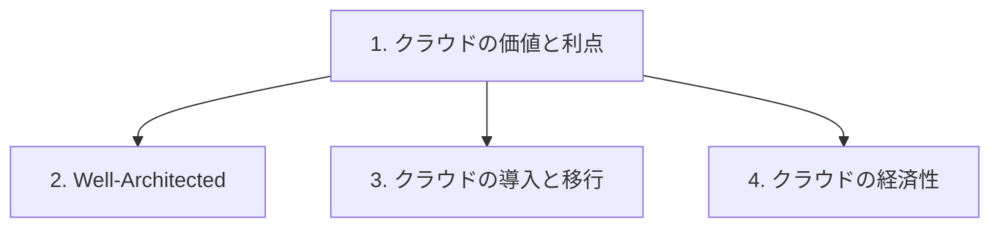

# 分野1: サービス別の学習

分野1（クラウドの概念）は CLF-C02 の配点の 24% を占めます。クラウドの利点、Well-Architected、移行、経済性の 4 つを扱います。

用語の区別が中心です。問題文の要件がどの言葉の話かを判断できるようにします。

| 順番 | 話題 | 問われること | 重要度 |
|---|---|---|---|
| 1 | [クラウドの価値と利点](cloud-value.md) | 6 つの利点、世界展開、高可用性と弾力性と俊敏性 | 高 |
| 2 | [Well-Architected Framework](well-architected.md) | 6 つの柱、柱の見分け方、Well-Architected Tool | 高 |
| 3 | [クラウドの導入と移行](migration.md) | AWS CAF、移行の 7 つの R、移行を支える情報源 | 高 |
| 4 | [クラウドの経済性](cloud-economics.md) | 固定費と変動費、TCO、BYOL、適正サイズ、規模の経済 | 中 |

重要度は公式の項目を見たこの wiki の判断で、公式の数字ではありません。

## 他のサービスにまたがる問題 {#other-questions}

<!-- questions:start -->

この分野の問題は、すべてサービス別のページに載っています。

<!-- questions:end -->
