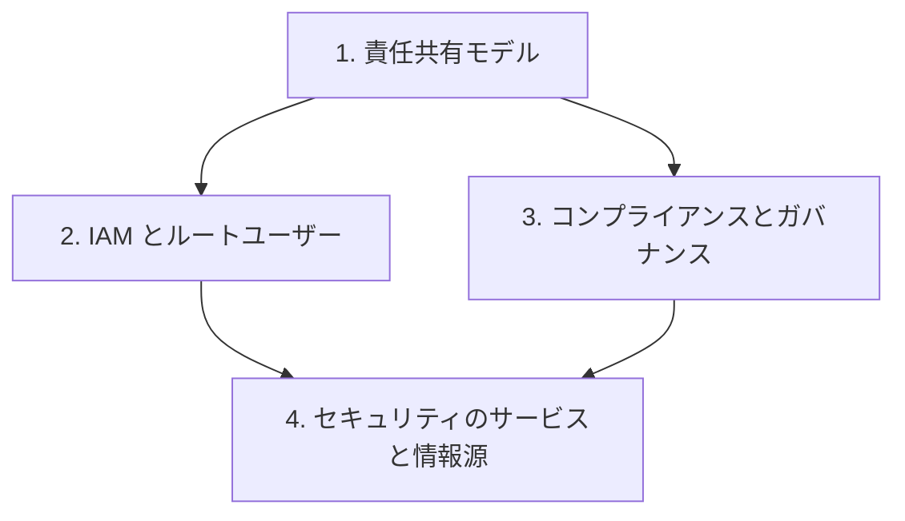

# 分野2: サービス別の学習

分野2（セキュリティとコンプライアンス）は CLF-C02 の配点の 30% を占めます。誰の責任か、どのサービスが何を見つけるかを区別します。

ポリシーを書く力は問われません。責任共有モデルから順に進めると、後のサービスの役割が読みやすくなります。

| 順番 | 話題 | 問われること | 重要度 |
|---|---|---|---|
| 1 | [責任共有モデル](shared-responsibility.md) | AWS と利用者の担当、サービスによる変化 | 高 |
| 2 | [IAM とルートユーザー](iam.md) | ユーザー、ロール、最小権限、ルートの保護、Identity Center | 高 |
| 3 | [コンプライアンスとガバナンス](compliance.md) | Artifact、暗号化、ログ、Config、CloudTrail | 高 |
| 4 | [セキュリティのサービスと情報源](security-services.md) | WAF、Shield、Firewall Manager、Trusted Advisor | 中 |

重要度は公式の項目を見たこの wiki の判断で、公式の数字ではありません。

## 他のサービスにまたがる問題 {#other-questions}

<!-- questions:start -->

この分野の問題は、すべてサービス別のページに載っています。

<!-- questions:end -->
