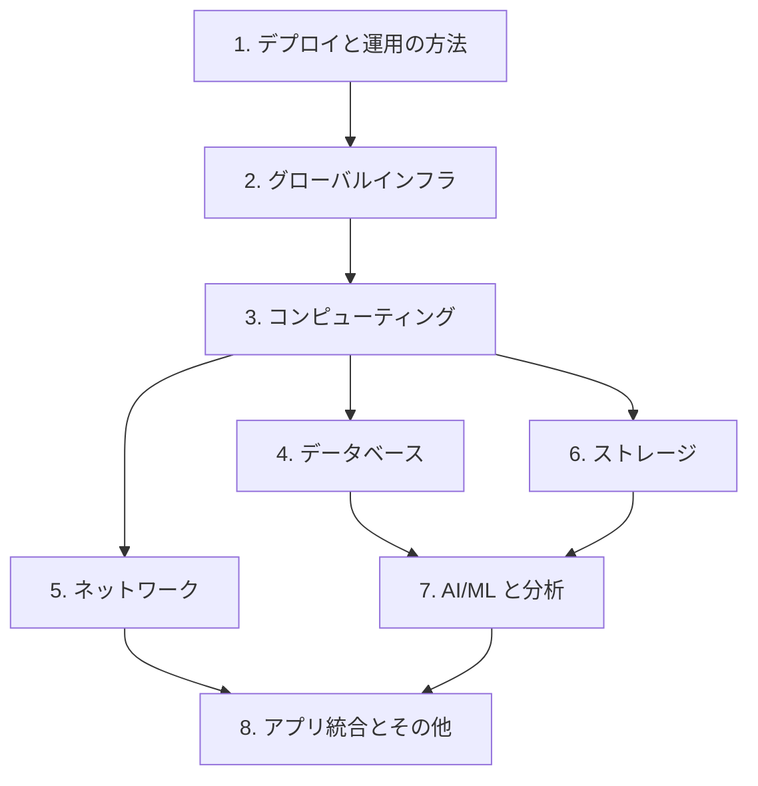

# 分野3: サービス別の学習

分野3（クラウドのテクノロジーとサービス）は CLF-C02 の配点の 34% で、4 分野の中で最大です。

設定値までは問われません。「この要件ならどのサービスか」を答えられるようにします。

| 順番 | 話題 | 問われること | 重要度 |
|---|---|---|---|
| 1 | [デプロイと運用の方法](deployment.md) | コンソール、CLI、SDK、IaC の選択、デプロイモデル | 中 |
| 2 | [グローバルインフラストラクチャ](global-infrastructure.md) | リージョンと AZ、複数 AZ、複数リージョン、エッジ | 高 |
| 3 | [コンピューティング](compute.md) | EC2 のタイプ、コンテナ、サーバーレス、Auto Scaling | 高 |
| 4 | [データベース](databases.md) | RDS、Aurora、DynamoDB、ElastiCache、DMS、SCT | 高 |
| 5 | [ネットワーク](networking.md) | VPC、セキュリティグループ、Route 53、VPN、Direct Connect | 高 |
| 6 | [ストレージ](storage.md) | S3 のクラス、EBS、EFS、FSx、Storage Gateway、Backup | 高 |
| 7 | [AI/ML と分析](ai-analytics.md) | タスクからのサービスの選択 | 中 |
| 8 | [アプリ統合とその他のサービス](other-services.md) | SQS、SNS、SES、Connect、WorkSpaces、Amplify、IoT Core | 中 |

重要度は公式の項目を見たこの wiki の判断で、公式の数字ではありません。

## 他のサービスにまたがる問題 {#other-questions}

<!-- questions:start -->

この分野の問題は、すべてサービス別のページに載っています。

<!-- questions:end -->
