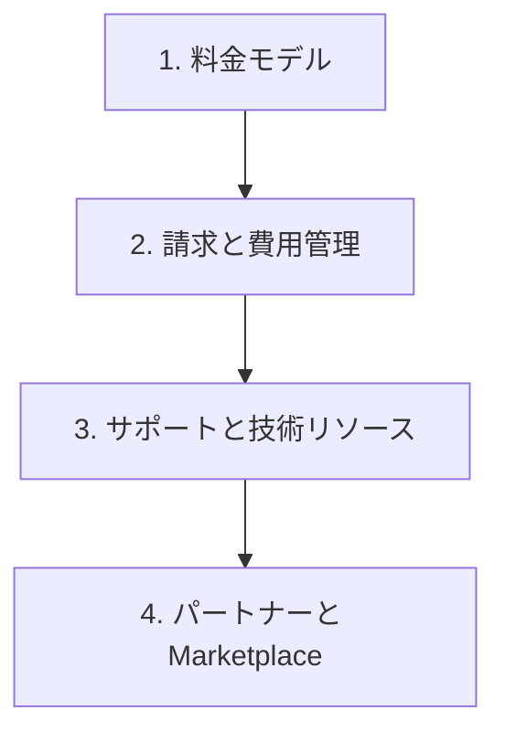

# 分野4: サービス別の学習

分野4（請求、料金、サポート）は CLF-C02 の配点の 12% です。購入オプション、費用管理の道具、サポートプラン、パートナーを扱います。

割引率を細かく覚えるより、要件に合う購入方法と道具を選べるようにします。

| 順番 | 話題 | 問われること | 重要度 |
|---|---|---|---|
| 1 | [料金モデル](pricing.md) | 購入オプション、RI の柔軟性、データ転送、ストレージの料金 | 高 |
| 2 | [請求と費用管理](billing.md) | Budgets、Cost Explorer、Pricing Calculator、一括請求、タグ | 高 |
| 3 | [サポートと技術リソース](support.md) | サポートプラン、Trusted Advisor と Health、情報源 | 高 |
| 4 | [パートナーと Marketplace](partners.md) | APN、パートナーの利点、Marketplace の機能 | 低 |

重要度は公式の項目を見たこの wiki の判断で、公式の数字ではありません。

## 他のサービスにまたがる問題 {#other-questions}

<!-- questions:start -->

この分野の問題は、すべてサービス別のページに載っています。

<!-- questions:end -->
