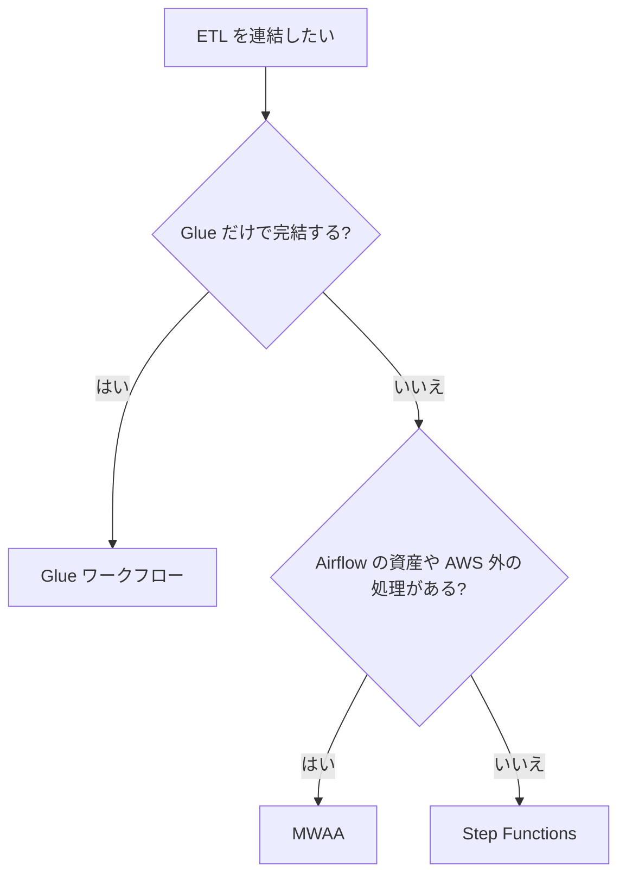
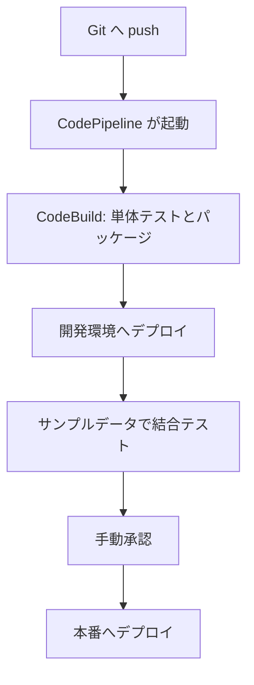

# 分野1: データの取り込みと変換

配点は **34%** で、4分野の中で最大です。データをどう読み、どこで変換し、どう連結するかを問います。

この試験はアソシエイトなので、サービスを選ぶだけでなく、どの設定で動かすかまで問われます。要件の言葉（リアルタイム、既存の Kafka、コード不要、運用を減らす）からサービスを絞り込めるようにします。

[](../../assets/diagrams/data-engineering-pipeline.png)

この分野に限らず、コース全体で使うサービスは[サービス一覧](services.md)から確認できます。

## タスク 1.1: データを取り込む {#task-1-1}

### 1.1.1 ストリーミングソースの読み取り {#skill-1-1-1}

読み手とソースの組み合わせを押さえます。

| ソース | 読み方 | 選ぶ理由、要点 |
|---|---|---|
| Kinesis Data Streams | KCL、Lambda、Flink、Glue ストリーミング | AWS との統合が簡単。シャードの読み取りは共有で 2 MB/秒 |
| MSK | Kafka クライアント、MSK Connect、Lambda | 既存の Kafka のコードやコネクターを使う |
| DynamoDB Streams | Lambda のイベントソースマッピング | 項目の変更を24時間保持する |
| DMS | CDC タスクで Kinesis や Kafka へ流す | データベースの変更を取り出す。リアルタイムの保証はない |
| Glue | Spark Streaming ジョブ | Kinesis や Kafka をマイクロバッチで変換する |
| Redshift | ストリーミング取り込み | Kinesis や MSK からマテリアライズドビューへ直接入れる。S3 を経由しない |

S3 へ届けるだけなら、読み手を作らず Firehose を使います。

詳細: [Kinesis Data Streams](../../services/streaming.md#kinesis-data-streams)、[MSK](../../services/data-engineering.md#msk)、[DynamoDB Streams](../../services/dynamodb.md#streams)、[DMS の CDC](../../services/migration.md#dms-cdc)、[Glue ジョブ](../../services/data-engineering.md#glue-jobs)、[Redshift の取り込み](../../services/data-engineering.md#redshift-ingestion)

### 1.1.2 バッチソースの読み取り {#skill-1-1-2}

| ソース | 読み方 | 向く場面 |
|---|---|---|
| S3 | Glue、EMR、Athena、Redshift の `COPY` | データレイクの基本の入口 |
| Glue | JDBC 接続やカタログからジョブで読む | サーバーレスの Spark ETL |
| EMR | Spark や Hive で S3 や HDFS を読む | 既存の Hadoop 資産、細かな調整 |
| DMS | 全件ロード | データベースの初回移行 |
| Redshift | `UNLOAD` で S3 へ出してから読む | DWH の結果を他のシステムへ渡す |
| Lambda | SDK で読む小さな処理 | 15分以内で終わる処理 |
| AppFlow | スケジュール実行の全件または増分 | Salesforce などの SaaS をコード不要で |

詳細: [変換エンジンの選び方](../../services/data-engineering.md#choosing-transform)、[COPY と UNLOAD](../../services/data-engineering.md#redshift-copy)、[DMS の移行タイプ](../../services/migration.md#dms-migration-types)、[AppFlow](../../services/data-engineering.md#appflow)

### 1.1.3 バッチ取り込みの設定 {#skill-1-1-3}

試験では「この症状にはどの設定か」の形で問われます。

| 目的 | 設定 |
|---|---|
| 新しいデータだけ処理する | Glue のジョブブックマーク `job-bookmark-enable`。既定は無効 |
| 小さなファイルをまとめて読む | `groupFiles: inPartition`。50,000 ファイルを超えると自動で有効 |
| 必要なパーティションだけ読む | `push_down_predicate` |
| 急がないジョブを安くする | Glue の Flex 実行 |
| 指定したファイルだけロードする | `COPY` の `MANIFEST`。`mandatory` は既定で `false` |
| 不良行を許容する | `COPY` の `MAXERROR`。既定は 0 |
| ロードを速くする | 1回の `COPY` で複数ファイルを読む。ファイル数はスライス数の倍数にする |
| 事前に検証する | `COPY` の `NOLOAD` |

ブックマークは同時実行に対応していません。最大同時実行数は 1 のままにします。

詳細: [ブックマーク](../../services/data-engineering.md#glue-bookmarks)、[DPU とワーカー](../../services/data-engineering.md#glue-dpu)、[COPY と UNLOAD](../../services/data-engineering.md#redshift-copy)

### 1.1.4 データ API の利用 {#skill-1-1-4}

外部の API からデータを読むときは、次の4点を設計します。

- **認証情報**: Secrets Manager に置き、コードに書きません。
- **ページネーション**: 次のページのトークンをたどり、途中で切れないようにします。
- **レート制限**: 429 を受けたら指数バックオフとジッターで再試行します。
- **実行時間**: Lambda は最大15分です。長い取得は Glue や Step Functions のループに分けます。

| 要件 | 選択 |
|---|---|
| 対応 SaaS から定型的に取得する | AppFlow |
| 独自の REST API を定期的に読む | EventBridge Scheduler + Lambda |
| 大量のページを取得して変換する | Glue の Python shell か Spark |

詳細: [SDK のページネーション](../../services/sdk-resilience.md#pagination)、[バックオフとジッター](../../services/sdk-resilience.md#backoff-jitter)、[AppFlow](../../services/data-engineering.md#appflow)、[Secrets Manager](../../services/secrets.md#secrets-manager)

### 1.1.5 スケジューラーの設定 {#skill-1-1-5}

| 方法 | 書き方の例 | 向く場面 |
|---|---|---|
| EventBridge Scheduler | `cron(0 9 * * ? *)`、`rate(5 minutes)`。タイムゾーンを指定できる | 任意のターゲットを定期実行する。推奨 |
| Glue のスケジュールトリガー | cron | ジョブとクローラーの定期実行 |
| クローラーのスケジュール | cron | カタログの更新 |
| Airflow（MWAA） | DAG の `schedule="0 2 * * *"` | 依存関係のあるパイプライン全体 |

EventBridge の cron は6項目で、Airflow の cron は通常5項目です。従来のスケジュールされたルールより、Scheduler が勧められています。

詳細: [EventBridge のスケジュール](../../services/messaging.md#eventbridge-schedule)、[Glue のトリガー](../../services/data-engineering.md#glue-workflows)、[クローラー](../../services/data-engineering.md#glue-crawlers)、[MWAA](../../services/data-engineering.md#mwaa)

### 1.1.6 イベントトリガーの設定 {#skill-1-1-6}

「ファイルが届いたら処理する」の実装です。

| 方法 | 動作 | 向く場面 |
|---|---|---|
| S3 Event Notifications | Lambda、SQS、SNS、EventBridge へ送る。プレフィックスとサフィックスで絞る | 単純な起動 |
| EventBridge | 内容で振り分け、複数のターゲットへ送る | Step Functions の起動、Glue ワークフローの開始 |

Glue ワークフローの EventBridge イベントは、件数か時間の先に満たしたほうで開始できます。件数だけ指定するとウィンドウは15分です。小さなファイルが連続して届くときに使います。

書き込み先を入力と同じプレフィックスにすると、イベントがループします。入力と出力は分けます。

詳細: [S3 イベント通知](../../services/messaging.md#s3-events)、[S3 の Event Notifications](../../services/s3.md#event-notifications)、[EventBridge のルール](../../services/messaging.md#eventbridge-rules)、[Glue のトリガー](../../services/data-engineering.md#glue-workflows)

### 1.1.7 Kinesis から Lambda を呼ぶ {#skill-1-1-7}

イベントソースマッピングで Lambda がシャードを読み、同期で関数を呼びます。

| 設定 | 既定 | 使いどころ |
|---|---|---|
| `BatchSize` | 100（最大 10,000） | 1回に渡すレコード数 |
| `MaximumBatchingWindowInSeconds` | 0（最大 300） | ためてから呼び、呼び出しを減らす |
| `ParallelizationFactor` | 1（最大 10） | 処理が追いつかないとき。シャードあたりの同時バッチ数 |
| `StartingPosition` | 必須 | 過去分も読むなら `TRIM_HORIZON` |
| `BisectBatchOnFunctionError` | false | 毒レコードを切り分ける |
| `MaximumRetryAttempts` | -1（無限） | シャードの停止を防ぐ |
| `FunctionResponseTypes` | なし | `ReportBatchItemFailures` で失敗の位置を返す |

既定では、失敗すると**そのシャードの処理が止まり**、レコードが期限切れになるまで再試行します。再試行の上限、バッチ分割、失敗の記録先を組み合わせます。

シャードが4本で `ParallelizationFactor` が2なら、関数は最大8個同時に動きます。

詳細: [Lambda とストリーム](../../services/streaming.md#lambda-streams)、[イベントソースマッピング](../../services/lambda.md#event-source-mapping)、[エラー処理の設定](../../services/lambda.md#esm-stream-errors)、[部分バッチレスポンス](../../services/lambda.md#partial-batch-response)

### 1.1.8 接続元 IP アドレスの許可リスト {#skill-1-1-8}

どちらが接続元で、固定の IP を持てるかを整理します。

| 場面 | 方法 |
|---|---|
| Firehose から Redshift へ配信する | クラスターを公開にし、セキュリティグループでそのリージョンの Firehose の CIDR を許可する |
| VPC 内の Lambda や Glue から社外の API へ接続する | NAT ゲートウェイの Elastic IP を相手の許可リストに登録する |
| 取引先の SFTP を接続元で制限する | Transfer Family を VPC に置き、Elastic IP とセキュリティグループで制限する |
| Glue から VPC 内の RDS へ接続する | IP ではなくセキュリティグループの参照で許可する |
| S3 バケットを接続元で制限する | `aws:SourceIp`。VPC エンドポイント経由には効かないので `aws:SourceVpce` を使う |

Lambda と Glue の出口の IP は固定されません。固定が必要な要件なら NAT ゲートウェイを通します。

詳細: [セキュリティグループ](../../services/networking.md#security-group-rules)、[NAT と Elastic IP](../../services/network-connectivity.md#nat-eip)、[Transfer Family](../../services/migration.md#transfer-family)、[エンドポイントポリシー](../../services/networking.md#endpoint-policies)

### 1.1.9 スロットリングとレート制限への対応 {#skill-1-1-9}

| サービス | 症状 | 対処 |
|---|---|---|
| DynamoDB | `ProvisionedThroughputExceededException`、`ThrottlingException` | Auto Scaling かオンデマンド、キーの分散、GSI の WCU をテーブル以上に |
| RDS | 接続数の枯渇 | RDS Proxy で接続を共有する、リードレプリカへ読み取りを逃がす |
| Kinesis（書き込み） | `WriteProvisionedThroughputExceeded` | `PutRecords`、キーの分散、シャード追加 |
| Kinesis（読み取り） | `ReadProvisionedThroughputExceeded` | 拡張ファンアウト、消費者の整理 |

共通の対策は、指数バックオフとジッターによる再試行と、SQS を挟んだ流量の平準化です。Lambda の予約済み同時実行で、下流へ送る量を抑えることもできます。

全体で余裕があるのにスロットリングするなら、ホットパーティションかホットシャードを疑います。シャードレベルのメトリクスで特定します。

詳細: [DynamoDB のスロットリング](../../services/dynamodb.md#throttling)、[RDS Proxy](../../services/databases.md#rds-proxy)、[Kinesis のエラー](../../services/streaming.md#kinesis-errors)、[パーティションキー](../../services/streaming.md#partition-key)、[再試行](../../services/sdk-resilience.md#retries)

### 1.1.10 ファンインとファンアウト {#skill-1-1-10}

**ファンイン**は多数の生産者を1つのストリームに集めることです。**ファンアウト**は1つのストリームを多数の消費者へ配ることです。

| 目的 | 方法 | 要点 |
|---|---|---|
| 多数の生産者を集める | Kinesis の `PutRecords`、Firehose の Direct PUT | `PutRecords` は1リクエスト500レコード、10 MiB まで |
| 書き込みを分散する | 値の種類が多いパーティションキー | 偏るとホットシャードになる |
| 複数の消費者が低遅延で読む | 拡張ファンアウト | 消費者ごとに 2 MB/秒。登録は20（On-demand Advantage は50） |
| 消費者が少なく費用を抑える | 共有スループット | シャードごとに全消費者で 2 MB/秒 |
| 複数の宛先へ配る | SNS から複数の SQS、EventBridge | 消費者ごとにキューで緩衝できる |
| Kafka で配る | コンシューマーグループ | グループごとに独立して読む |

DynamoDB Streams は1シャードあたり2プロセスまでです。

詳細: [拡張ファンアウト](../../services/streaming.md#enhanced-fan-out)、[シャードの容量](../../services/streaming.md#shards)、[リシャーディング](../../services/streaming.md#resharding)、[SNS のファンアウト](../../services/messaging.md#fanout)、[MSK と Kinesis の違い](../../services/data-engineering.md#msk-vs-kinesis)

### 1.1.11 取り込みの再実行性（リプレイ） {#skill-1-1-11}

変換のバグを直した後に、同じデータをもう一度流せるかを設計します。

| 対象 | 読み直せる範囲 | 方法 |
|---|---|---|
| Kinesis Data Streams | 保持期間内。既定24時間、最大365日 | `AT_TIMESTAMP`、`TRIM_HORIZON` のイテレーター |
| MSK | トピックの保持期間内 | コンシューマーのオフセットを戻す |
| DynamoDB Streams | 24時間 | 延ばせない。長期の再処理には S3 へ退避する |
| Firehose | 読み直す API はない | 配信先の S3 を入力にする |
| EventBridge | アーカイブの保持期間内 | リプレイ。順序は保証されない |
| Glue ジョブ | S3 の元データ | ブックマークをリセットする |

基本は、加工前のデータを S3 に不変のまま残すことです。

再処理は重複を生みます。Glue のブックマークをリセットしても出力先のファイルは消えないので、出力先を分けるか、処理を冪等にします。

詳細: [Kinesis の保持期間](../../services/streaming.md#retention)、[シャードイテレーター](../../services/streaming.md#shard-iterators)、[アーカイブとリプレイ](../../services/messaging.md#archive-replay)、[ブックマーク](../../services/data-engineering.md#glue-bookmarks)、[冪等性](../../services/sdk-resilience.md#idempotency)

### 1.1.12 ステートフルとステートレスの処理 {#skill-1-1-12}

過去のレコードの情報が要るかどうかで分けます。

| 種類 | 処理の例 | サービス |
|---|---|---|
| ステートレス | 1レコードごとの形式変換、フィルター | Lambda、Firehose の Lambda 変換 |
| ステートフル | 時間ウィンドウの集計、重複除去、ストリーム同士の結合 | Managed Service for Apache Flink |
| 簡単なステートフル | シャードごとの短い集計 | Lambda の `TumblingWindowInSeconds`（最大900秒、状態は1 MB まで） |

ステートフルな処理では、障害時に状態を復元する仕組みが必要です。Flink はチェックポイントを自動で取ります。既定の間隔は60秒です。

詳細: [ステートフルとステートレス](../../services/sdk-resilience.md#stateful-stateless)、[Flink](../../services/data-engineering.md#flink)、[TumblingWindowInSeconds](../../services/lambda.md#esm-tumbling-window)、[Firehose の変換](../../services/streaming.md#firehose-transform)

## タスク 1.2: データを変換して処理する {#task-1-2}

### 1.2.1 コンテナの性能の最適化 {#skill-1-2-1}

| 判断 | 選択 | 理由 |
|---|---|---|
| サーバーを管理したくない | Fargate | タスク単位で CPU とメモリを指定する |
| GPU や細かな調整、安い Spot の組み合わせ | EC2 | インスタンスを選べる |
| Kubernetes に集約済みで Spark も動かす | EMR on EKS | 資源を共用して使用率を上げる |
| 大量のバッチをキューで実行する | AWS Batch | スケジューラーと容量を任せる |

性能の調整点は次のとおりです。

- **ECS**: タスクの CPU とメモリ、サービスの Auto Scaling、キャパシティプロバイダーで Fargate Spot などを選びます。
- **EKS**: Pod の `resources` の要求と上限を設定します。小さすぎると OOM で再起動します。

詳細: [Fargate と EC2](../../services/containers.md#fargate-vs-ec2)、[タスクレベルのパラメータ](../../services/containers.md#task-level-parameters)、[キャパシティプロバイダー](../../services/containers.md#capacity-providers)、[resources](../../services/containers.md#k8s-resources)、[EMR on EKS](../../services/data-engineering.md#emr-on-eks)、[Batch](../../services/other-services.md#batch)

### 1.2.2 データソースへの接続（JDBC、ODBC） {#skill-1-2-2}

JDBC は Java、ODBC はそれ以外の言語や BI ツールが使う、データベース接続の標準です。Redshift と Athena はどちらのドライバーも提供しています。

Glue から接続するには、**Glue 接続**を作ります。接続は Data Catalog の中のオブジェクトで、URI、認証情報、VPC の情報を持ちます。クローラーとジョブで再利用できます。

VPC 内の RDS へ接続するときは、次を確認します。

| 確認すること | 内容 |
|---|---|
| セキュリティグループ | すべての TCP を自分自身から許可する**自己参照ルール**。Glue の部品同士の通信に必要 |
| S3 への経路 | S3 のゲートウェイエンドポイント。アウトバウンドを絞るなら HTTPS をプレフィックスリストへ許可 |
| 認証情報 | Secrets Manager |

自己参照ルールがないと、ジョブは接続できずに失敗します。ルールは同じセキュリティグループだけを許可するので、VPC 全体を開けることにはなりません。

Redshift を接続なしで使うなら、Data API があります。[1.2.8](#skill-1-2-8) を参照してください。

詳細: [Glue](../../services/data-engineering.md#glue)、[セキュリティグループのルール](../../services/networking.md#security-group-rules)、[VPC エンドポイント](../../services/networking.md#vpc-endpoints)

### 1.2.3 複数のソースのデータの統合 {#skill-1-2-3}

| 要件 | 選択 | 動作 |
|---|---|---|
| 複数のソースを結合して保存する | Glue ジョブ | カタログと接続から読み、結合して S3 や Redshift へ書く |
| コピーせず S3 と DWH を結合する | Redshift Spectrum | ローカルのテーブルと外部テーブルを結合 |
| RDS や Aurora を直接読む | フェデレーテッドクエリ | PostgreSQL と MySQL をそのまま参照 |
| パイプラインなしで運用 DB を分析する | ゼロ ETL 統合 | Aurora などから Redshift へ自動で複製 |
| SaaS を取り込む | AppFlow | コード不要 |
| 第三者のデータを使う | Data Exchange | 購読して S3 や Redshift で使う |

詳細: [Redshift の取り込み](../../services/data-engineering.md#redshift-ingestion)、[Spectrum](../../services/data-engineering.md#redshift-spectrum)、[Data Exchange](../../services/data-engineering.md#data-exchange)、[データの共有](../../services/data-engineering.md#choosing-sharing)

### 1.2.4 処理コストの最適化 {#skill-1-2-4}

| サービス | 方法 |
|---|---|
| Glue | 急がないジョブは Flex、Auto Scaling で並列度の低いステージの費用を削る |
| EMR | タスクノードに Spot、自動終了ポリシー、一時クラスターと S3 の組み合わせ |
| Athena | Parquet とパーティションでスキャン量を減らす、クエリ結果の再利用、ワークグループの制限 |
| Redshift | 断続的な利用は Serverless で最大 RPU を指定、定常利用は Provisioned |
| Firehose | 5 KB 単位に切り上げて課金されるので、小さなレコードはまとめて送る |
| 全体 | Cost Explorer で分析し、Budgets で超過前に通知する |

詳細: [Glue ジョブ](../../services/data-engineering.md#glue-jobs)、[EMR のスケーリングと終了](../../services/data-engineering.md#emr-scaling)、[Athena の形式と料金](../../services/streaming.md#athena-formats-cost)、[Redshift Serverless](../../services/data-engineering.md#redshift-serverless)、[Cost Explorer](../../services/cost-management.md#cost-explorer)、[Budgets](../../services/cost-management.md#budgets)

### 1.2.5 要件に合う変換サービスの選択 {#skill-1-2-5}

| 要件 | 選択 |
|---|---|
| 15分以内の小さな変換 | Lambda |
| サーバーレスの Spark、カタログと連携 | Glue |
| 既存の Spark や Hive、細かな調整 | EMR on EC2 |
| クラスターを持たず既存の Spark を動かす | EMR Serverless |
| 画面操作で整形 | DataBrew |
| DWH の中で SQL で変換 | Redshift |
| S3 上で単発の SQL 変換 | Athena の CTAS |
| ストリームの状態付き処理 | Managed Service for Apache Flink |

Glue と EMR Serverless で迷ったら、Data Quality やブックマークを使うなら Glue、既存のコードとリリースをそのまま持ち込むなら EMR Serverless です。

詳細: [変換エンジン](../../services/data-engineering.md#choosing-transform)、[EMR Serverless](../../services/data-engineering.md#emr-serverless)、[EMR のノード](../../services/data-engineering.md#emr-nodes)

### 1.2.6 データ形式の変換 {#skill-1-2-6}

| 形式 | 向き | 向く場面 |
|---|---|---|
| CSV、JSON | 行 | 受け取り、交換、ログ |
| Avro | 行 | スキーマ付きのストリーム、Kafka |
| Parquet | 列 | 分析全般。迷ったらこれ |
| ORC | 列 | Hive 中心の環境 |

| 変換の方法 | 向く場面 |
|---|---|
| Athena の CTAS | 単発の変換 |
| Glue ジョブ | 定期的な大規模変換 |
| Firehose の形式変換 | ストリームを JSON から Parquet や ORC で S3 へ。Glue Data Catalog のスキーマが必要 |

gzip は分割して読めないので、大きな1ファイルは避けます。Parquet の中で Snappy を使えば、列の単位で読めます。

詳細: [データ形式](../../services/data-engineering.md#data-formats)、[Firehose の機能](../../services/streaming.md#firehose-features)

### 1.2.7 変換の失敗と性能問題の調査 {#skill-1-2-7}

| 症状 | 原因の候補 | 対処 |
|---|---|---|
| Glue のドライバーが OOM | 小さなファイルが大量 | `groupFiles` |
| Glue のエグゼキューターが OOM | シャッフル、集計が重い | `R` タイプ、大きなワーカー |
| 同じデータを再処理する | `job.commit()` や `transformation_ctx` がない、同時実行数が2以上 | スクリプトと設定を直す |
| 同時に起動すると失敗する | 最大同時実行数の既定が1 | 値を上げる（ブックマークとは両立しない） |
| Spark のタスクの一部だけ遅い | データの偏り | [3.4.5](domain3.md#skill-3-4-5) |
| Redshift の `COPY` が失敗する | 形式の不一致、不良行 | `SYS_LOAD_ERROR_DETAIL`、`STL_LOAD_ERRORS` |
| Lambda がタイムアウトする | 15分を超える処理 | Glue へ移す、分割する |
| Firehose で配信が失敗する | 変換や配信先のエラー | エラー用プレフィックスを確認 |

詳細: [DPU と症状](../../services/data-engineering.md#glue-dpu)、[ブックマーク](../../services/data-engineering.md#glue-bookmarks)、[COPY](../../services/data-engineering.md#redshift-copy)、[Firehose の失敗](../../services/streaming.md#firehose-failure)

### 1.2.8 データ API の作成 {#skill-1-2-8}

データを他のシステムへ渡す API を作ります。

| 構成 | 向く場面 |
|---|---|
| API Gateway + Lambda + DynamoDB | キーで引く低遅延の API |
| API Gateway + Lambda + Athena | S3 のデータを返す。クエリは非同期 |
| API Gateway + Lambda + Redshift Data API | DWH の結果を返す |

**Redshift Data API** は、ドライバーと常時接続が要らない HTTP の API です。呼び出しは非同期で、`ExecuteStatement` の後に `DescribeStatement` で状態を確認し、`GetStatementResult` で結果を取ります。認証は Secrets Manager か一時的な認証情報です。

| 項目 | 値 |
|---|---|
| クエリの最大時間 | 24時間 |
| クエリ結果の最大サイズ | 500 MB（gzip 圧縮後） |
| 結果の保持 | 24時間 |
| SQL 文の最大サイズ | 200 KB |

API Gateway の統合タイムアウトは既定で29秒です。重いクエリは受付と結果の取得で API を分けます。実行 ID を返して、後から取りに来てもらいます。

詳細: [統合タイプ](../../services/api-gateway.md#integration-types)、[使用量プラン](../../services/api-gateway.md#usage-plans)、[キャッシュ](../../services/api-gateway.md#caching)、[Athena](../../services/streaming.md#athena)

### 1.2.9 データの量、速度、種類 {#skill-1-2-9}

| 観点 | 意味 | 設計への影響 |
|---|---|---|
| 量（Volume） | データの大きさ | 分散処理、列指向、パーティション、階層化ストレージ |
| 速度（Velocity） | 発生と処理の速さ | バッチかストリームか、シャード数、バッファ |
| 種類（Variety） | データの形 | スキーマの管理、保存先の選択 |

| 種類 | 例 | 置き場の例 |
|---|---|---|
| 構造化 | 売上テーブル | RDS、Redshift |
| 半構造化 | JSON のログ | S3、DynamoDB、OpenSearch |
| 非構造化 | 画像、PDF、音声 | S3 |

詳細: [データストアの選び方](../../services/databases.md#choosing-data-store)、[データ形式](../../services/data-engineering.md#data-formats)、[データの置き場](../../services/data-engineering.md#choosing-query)

### 1.2.10 LLM を使ったデータ処理 {#skill-1-2-10}

分類、要約、情報の抽出など、ルールでは難しい変換を LLM に任せます。モデルの学習は範囲外です。呼び出し方の選択を押さえます。

| 要件 | 選択 |
|---|---|
| パイプラインの中で1件ずつ呼ぶ | Lambda から Bedrock の Converse API |
| 大量のデータを非同期でまとめて処理する | Bedrock のバッチ推論。入力を S3 に置き、結果も S3 に出る |
| PDF、画像、音声を構造化データにする | Bedrock Data Automation |
| 手順を連結する、再試行する | Step Functions |

バッチ推論はプロビジョンドのモデルでは使えません。完了の検知は EventBridge で行えます。

レート制限は `ThrottlingException` で現れます。SQS で流量を抑えるか、バックオフを入れます。

詳細: [Bedrock Runtime](../../services/ai.md#bedrock-runtime)、[エラーとスロットリング](../../services/ai.md#errors-throttling)、[スループットの選択肢](../../services/ai.md#throughput-options)、[Data Automation](../../services/genai-apps.md#bda)

## タスク 1.3: データパイプラインを連結する {#task-1-3}

### 1.3.1 オーケストレーションサービスの利用 {#skill-1-3-1}

| 観点 | Glue ワークフロー | Step Functions | MWAA | EventBridge | Lambda |
|---|---|---|---|---|---|
| 役割 | Glue の連結 | AWS サービス全般の状態機械 | Python の DAG | イベントとスケジュール | 小さな接着処理 |
| 分岐と再試行 | 条件トリガーのみ | `Retry`、`Catch`、`Choice` | 豊富 | なし | 自分で書く |
| サーバー | なし | なし | 環境の料金（Serverless もあり） | なし | なし |
| 向く場面 | Glue だけで完結 | AWS で完結する混在処理 | 既存の Airflow、AWS 外との連携 | 開始のきっかけ | 短い処理 |



Step Functions から Glue を呼ぶときは、`startJobRun.sync` で完了まで待ちます。`.sync` を外すと、ジョブの起動だけで次へ進みます。

詳細: [オーケストレーションの比較](../../services/data-engineering.md#orchestration)、[Glue ワークフロー](../../services/data-engineering.md#glue-workflows)、[MWAA](../../services/data-engineering.md#mwaa)、[統合パターン](../../services/step-functions.md#integration-patterns)

### 1.3.2 性能、可用性、耐障害性のあるパイプライン {#skill-1-3-2}

| 目標 | 方法 |
|---|---|
| 失敗からの回復 | Step Functions の `Retry` と `Catch`、Glue のリトライ（0〜10。タイムアウトしたジョブは再実行されない） |
| 部分的な失敗の分離 | SQS の DLQ、ストリームの失敗の記録先 |
| 再実行しても壊れない | 冪等な書き込み、出力先の分離、Iceberg の ACID |
| ストリームの復旧 | Flink のチェックポイント、Kinesis の保持期間 |
| 単一障害点の除去 | EMR のプライマリを3台（ただし1つの AZ） |
| データの保持 | 入出力は HDFS ではなく S3 |
| スケール | Glue の Auto Scaling、EMR のマネージドスケーリング、Kinesis のオンデマンド |

詳細: [Step Functions のエラー処理](../../services/step-functions.md#error-handling)、[疎結合と耐障害性](../../services/resilience.md#loose-coupling)、[EMR の HDFS と S3](../../services/data-engineering.md#emr-hdfs-vs-s3)、[Kinesis のキャパシティモード](../../services/streaming.md#capacity-modes)

### 1.3.3 サーバーレスワークフローの実装と保守 {#skill-1-3-3}

| 観点 | Standard | Express |
|---|---|---|
| 最大実行時間 | 1年 | 5分 |
| 実行の保証 | 正確に1回 | 非同期は少なくとも1回 |
| 料金 | 状態遷移の数 | 実行回数、時間、メモリ |
| `.sync` | 使える | 使えない |
| 向く場面 | ETL、人の承認 | 大量で短いイベント処理 |

Glue ジョブを待つ ETL は Standard です。大量のファイルを並列に処理するなら Map を使います。

保守では、失敗した実行を途中から再開する `redrive`、ログ、変更の IaC 化を押さえます。

詳細: [Standard と Express](../../services/step-functions.md#standard-express)、[Map の設定](../../services/step-functions.md#map-settings)、[再実行とログ](../../services/step-functions.md#redrive-logging)

### 1.3.4 通知サービスによるアラート {#skill-1-3-4}

| 方法 | 動作 |
|---|---|
| Glue のジョブ状態の変更 → EventBridge → SNS | 失敗をメールや Lambda へ通知する |
| Step Functions の `Catch` → SNS | 失敗の分岐で通知する |
| CloudWatch アラーム → SNS | しきい値の超過を通知する |
| Athena のワークグループ全体のデータ制限 → SNS | スキャン量の超過を通知する |

| サービス | 特徴 |
|---|---|
| SNS | プッシュで複数の宛先へ同時に配信する |
| SQS | 処理側が自分のペースで取り出す。通知を確実に処理したいときに SNS の後ろに置く |

詳細: [SNS](../../services/messaging.md#sns)、[SQS](../../services/messaging.md#sqs)、[アラームのアクション](../../services/observability.md#alarm-actions)、[Catch](../../services/step-functions.md#catch)

## タスク 1.4: プログラミングの概念を適用する {#task-1-4}

### 1.4.1 実行時間を短くするコードの最適化 {#skill-1-4-1}

| 対象 | 方法 |
|---|---|
| Spark | 読み込みの前に絞る（`push_down_predicate`）、必要な列だけ選ぶ、小さなテーブルをブロードキャストして結合する |
| SQL | `SELECT *` を避ける、パーティション列で絞る |
| Redshift | `INSERT` の繰り返しをやめて `COPY` にする |
| Lambda | SDK クライアントをハンドラーの外で作り再利用する、パッケージを小さくする |
| API 呼び出し | `PutRecords` などのバッチ API を使う |

詳細: [DPU と症状](../../services/data-engineering.md#glue-dpu)、[Athena を速くするコツ](../../services/streaming.md#athena-performance)、[Lambda のコードの最適化](../../services/lambda.md#code-optimization)、[メモリと CPU](../../services/lambda.md#memory-tuning)

### 1.4.2 Lambda の同時実行と性能の設定 {#skill-1-4-2}

| 設定 | 値 | 効果 |
|---|---|---|
| メモリ | 128〜10,240 MB | 増やすと CPU も比例して増える |
| タイムアウト | 既定3秒、最大900秒 | 処理時間に合わせて伸ばす |
| 予約済み同時実行 | 関数ごとに枠を確保 | 同時に上限にもなる。下流の DB を守る |
| Provisioned Concurrency | 事前に初期化 | コールドスタートをなくす。費用がかかる |
| アカウントの同時実行数 | 既定 1,000 | 引き上げ可能 |

同時実行が足りないと 429 でスロットリングされます。ストリームの処理では `ParallelizationFactor` を上げると、必要な同時実行数も増えます。

詳細: [同時実行](../../services/lambda.md#concurrency)、[予約済みと Provisioned](../../services/lambda.md#reserved-provisioned)、[スロットリング](../../services/lambda.md#throttling)、[メモリ](../../services/lambda.md#memory)

### 1.4.3 データエンジニアリングの言語とフレームワーク {#skill-1-4-3}

言語固有の構文は範囲外です。どの場面で何を使うかを押さえます。

| 言語 | 主な使いどころ |
|---|---|
| Python | Glue、Lambda、PySpark、Airflow の DAG |
| SQL | Athena、Redshift、Spark SQL、Flink SQL |
| Scala | Glue と EMR の Spark |
| Java | Flink、KCL、Kafka のクライアント |
| R | EMR の Spark などでの統計処理 |
| Bash | EMR のブートストラップ、CLI の自動化 |
| PowerShell | Windows 環境からの運用自動化 |

| フレームワーク | 特徴 |
|---|---|
| Spark | バッチとマイクロバッチの標準 |
| Flink | 状態付きのストリーム処理 |
| Airflow | DAG によるワークフロー |

詳細: [Glue ジョブ](../../services/data-engineering.md#glue-jobs)、[Flink](../../services/data-engineering.md#flink)、[MWAA](../../services/data-engineering.md#mwaa)、[AWS CLI](../../services/iac.md#aws-cli)

### 1.4.4 ソフトウェアエンジニアリングのベストプラクティス {#skill-1-4-4}

| 実践 | データパイプラインでの例 |
|---|---|
| バージョン管理 | ETL スクリプト、DAG、SQL、IaC を Git で管理する。ブランチとタグでリリースを管理する |
| テスト | 変換関数の単体テスト、小さなサンプルデータでの結合テスト、データ品質の検査 |
| ロギング | 構造化ログで実行 ID や件数を残す。機密情報は書かない |
| 監視 | 処理件数、遅延、失敗をメトリクスにしてアラームを付ける |

詳細: [ブランチとタグ](../../services/cicd.md#branches-tags)、[単体テスト](../../services/sdk-resilience.md#unit-testing)、[構造化ログ](../../services/observability.md#structured-logging)、[ログとモニタリングの違い](../../services/observability.md#logging-monitoring-observability)

### 1.4.5 IaC によるソリューションのデプロイ {#skill-1-4-5}

データ基盤も手作業ではなくコードで作ります。環境ごとの差をなくせるからです。

対象は、Glue のジョブ、クローラー、接続、Step Functions、Redshift、S3 バケット、IAM ロールです。ETL スクリプトは S3 に置き、ジョブの定義から参照します。環境ごとの値はパラメータで分けます。

```yaml
Resources:
  OrdersJob:
    Type: AWS::Glue::Job
    Properties:
      Role: !Ref GlueRole
      GlueVersion: "5.0"
      WorkerType: G.1X
      NumberOfWorkers: 10
      Command:
        Name: glueetl
        ScriptLocation: !Sub "s3://${ScriptBucket}/jobs/orders.py"
```

詳細: [CloudFormation テンプレート](../../services/iac.md#cloudformation-template)、[パラメータ](../../services/iac.md#parameters)、[どれを使うか](../../services/iac.md#choosing)

### 1.4.6 AWS SAM によるサーバーレスパイプラインのデプロイ {#skill-1-4-6}

SAM は CloudFormation の拡張で、Lambda、Step Functions、DynamoDB を短く書けます。

| 書き方 | 作るもの |
|---|---|
| `AWS::Serverless::Function` | Lambda 関数とイベント |
| `AWS::Serverless::StateMachine` | Step Functions |
| `AWS::Serverless::SimpleTable` | DynamoDB テーブル |

手順は `sam build` でパッケージを作り、`sam deploy` でデプロイします。`sam local invoke` で手元の確認もできます。

詳細: [SAM](../../services/iac.md#sam)、[テンプレート](../../services/iac.md#sam-template)、[SAM CLI](../../services/iac.md#sam-cli)

### 1.4.7 Lambda でのストレージボリュームの利用 {#skill-1-4-7}

| 置き場 | 容量と特徴 | 向く場面 |
|---|---|---|
| `/tmp` | 512〜10,240 MB。実行環境ごとで共有されない | 一時ファイル |
| EFS | `/mnt/` で始まるパスにマウント。関数の間で共有できる | 共有データ、大きなモデル |
| S3 Files | S3 バケットをファイルシステムとしてマウントする | S3 のデータをファイルとして扱う |
| レイヤー、コンテナイメージ | 読み取り専用のコード | ライブラリ |

EFS を使うには、関数を VPC に接続し、EFS アクセスポイントの ARN を `FileSystemConfigs` に指定します。接続できないときは、セキュリティグループの 2049 番とマウントターゲットを確認します。

詳細: [EFS と Lambda](../../services/storage.md#efs-lambda)、[エフェメラルストレージ](../../services/lambda.md#ephemeral-storage)

### 1.4.8 IaC による繰り返しのデプロイ（CloudFormation と CDK） {#skill-1-4-8}

| 観点 | CloudFormation | CDK |
|---|---|---|
| 書き方 | YAML、JSON | TypeScript、Python などのコード |
| 再利用 | ネストされたスタック | コンストラクト |
| 実行 | スタックの操作 | `cdk synth` で CloudFormation を生成し、`cdk deploy` |
| 最初の準備 | なし | `cdk bootstrap` |

データ基盤で押さえる設定は次のとおりです。

- `DeletionPolicy: Retain` で、スタックを消してもデータのバケットを残します。
- 変更セットで、更新の影響を事前に確認します。
- ドリフト検出で、手作業の変更を見つけます。
- StackSets で、複数のアカウントとリージョンに展開します。

詳細: [DeletionPolicy](../../services/iac.md#deletion-policy)、[変更セット](../../services/iac.md#change-sets)、[ドリフト検出](../../services/iac.md#drift)、[CDK](../../services/iac.md#cdk)、[StackSets](../../services/iac.md#stacksets-settings)

### 1.4.9 データパイプラインの CI/CD {#skill-1-4-9}



| サービス | 役割 |
|---|---|
| CodePipeline | ステージの連結、手動承認 |
| CodeBuild | テスト、パッケージ作成。`buildspec.yml` で定義 |
| CodeDeploy | Lambda の段階的な切り替えなど |

詳細: [サービスの役割](../../services/cicd.md#overview)、[buildspec](../../services/cicd.md#buildspec)、[手動承認](../../services/cicd.md#manual-approval)、[複数環境への展開](../../services/cicd.md#multi-environment)

### 1.4.10 分散コンピューティング {#skill-1-4-10}

データを複数のノードに分け、並列に処理する考え方です。1台に収まらない量や、1台では間に合わない処理に使います。

| 用語 | 意味 | AWS での例 |
|---|---|---|
| パーティション | データの分割単位 | Spark のパーティション、Kinesis のシャード |
| シャッフル | キーごとにデータをノード間で移す。結合や集計で起きる。重い | Spark、Redshift の再配布 |
| MPP | 多数のノードが同じクエリを並列に実行する | Redshift |
| ドライバーとワーカー | 計画と実行の分担 | Spark のドライバーとエグゼキューター、Redshift のリーダーとコンピュート |
| データの局所性 | データの近くで処理する | EMR の HDFS |
| 複製 | 障害に備えて複数持つ | HDFS の `dfs.replication` |

性能は、一番遅いノードで決まります。データが偏ると並列の効果がなくなります。

詳細: [Redshift の構成](../../services/data-engineering.md#redshift-architecture)、[EMR のノード](../../services/data-engineering.md#emr-nodes)、[分散スタイル](../../services/data-engineering.md#redshift-distribution)

### 1.4.11 データ構造とアルゴリズム {#skill-1-4-11}

| 構造 | 特徴 | 使われる場面 |
|---|---|---|
| グラフ | ノードとエッジ | Neptune の関係データ、Airflow の DAG、HNSW のベクトルインデックス |
| 木（ツリー） | 階層。範囲検索が速い | RDS の B ツリーインデックス |
| ハッシュ表 | キーで一定時間に引く | DynamoDB のパーティションキー、ハッシュ結合 |
| キュー | 先入れ先出し | SQS |
| ログ | 追記のみの列 | Kinesis のシャード、Kafka のトピック |
| 列指向 | 列ごとに保存する | Parquet、Redshift |

DAG は循環のないグラフです。依存関係の順序を表せるので、ワークフローの定義に使います。

詳細: [Neptune](../../services/databases-specialized.md#neptune)、[ベクトルインデックス](../../services/databases-specialized.md#vector-indexes)、[DynamoDB のキー](../../services/dynamodb.md#keys)

## 確認問題 {#self-check}

??? question "問1: 既存の Kafka のコネクターとクライアントを変更せずに AWS へ移し、S3 へデータを書き出したいです。運用はなるべく減らします。どう構成しますか？"
    MSK と MSK Connect です。Kafka の API とコネクターをそのまま使えます。Kinesis Data Streams は API が異なるので、コードの変更が必要です。負荷が読めないなら MSK Serverless も候補ですが、認証は IAM のみです。

??? question "問2: Kinesis Data Streams をソースにした Lambda で、1件の不正なレコードのためにシャードの処理が何時間も止まりました。設定をどう変えますか？"
    `BisectBatchOnFunctionError` でバッチを分割し、`MaximumRetryAttempts` か `MaximumRecordAgeInSeconds` で再試行を制限し、`DestinationConfig` で失敗を記録します。`ReportBatchItemFailures` も有効にします。既定では再試行が無限なので、レコードが期限切れになるまで止まります。

??? question "問3: Glue ジョブのブックマークを有効にしたのに、実行のたびに同じ S3 のファイルを処理します。何を確認しますか？"
    スクリプトの `job.commit()` と `transformation_ctx`、最大同時実行数が1であること、上流がファイルを上書きしていないことです。S3 では最終更新時刻で判定するので、上書きされると新しいデータとして扱われます。

??? question "問4: 毎日のバッチで Spark を実行します。既存のコードと特定のリリースをそのまま使い、クラスターは運用したくありません。Spot の調整も不要です。何を選びますか？"
    EMR Serverless です。既存の Spark のコードと EMR のリリースを指定して動かせます。Glue もサーバーレスですが、カタログと一体の ETL を使いたい場合に向きます。EMR on EC2 はクラスターの運用が残ります。

??? question "問5: S3 にファイルが届いたら、Glue ジョブ、Redshift へのロード、完了の通知を順に実行します。Glue の完了を待たずにロードが始まってしまいます。どう直しますか？"
    Step Functions の Glue のタスクを `arn:aws:states:::glue:startJobRun.sync` にします。`.sync` がないとジョブの起動だけで次の状態へ進みます。起動は EventBridge で S3 のイベントを受けます。Standard ワークフローを使います。Express は `.sync` を使えません。

??? question "問6: VPC 内の Glue ジョブから RDS に JDBC で接続できず、失敗します。ネットワークで確認することは？"
    Glue の部品同士が通信できるように、セキュリティグループにすべての TCP を自分自身から許可する自己参照ルールがあることです。あわせて、データベースのポートの許可と、S3 への経路（ゲートウェイエンドポイントなど）を確認します。
