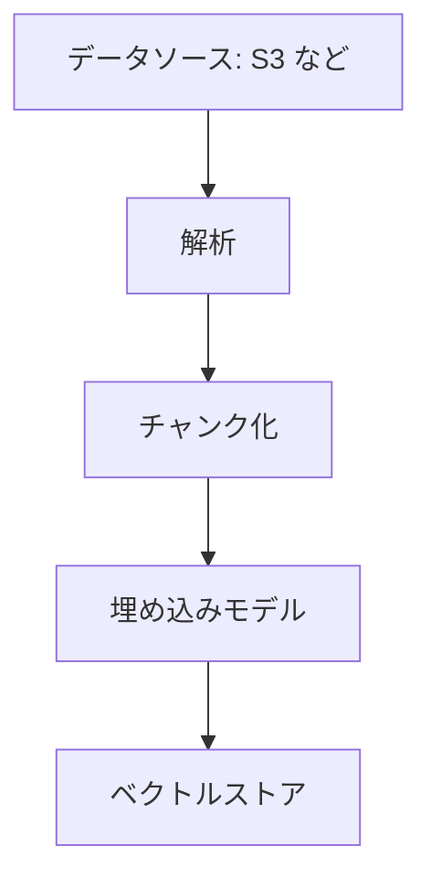

# 分野2: データストアの管理

配点は **26%** です。アクセスパターンとコストに合う保存先を選び、カタログ、ライフサイクル、スキーマを管理します。

Redshift の設計と S3 のライフサイクルは細かい設定まで問われます。ガイド 1.1 で、Iceberg、ベクトルインデックス、ビジネスカタログが追加されました。

この分野に限らず、コース全体で使うサービスは[サービス一覧](services.md)から確認できます。

## タスク 2.1: データストアを選ぶ {#task-2-1}

### 2.1.1 コストと性能の要件に合うストレージ {#skill-2-1-1}

| サービス | 向く要件 | 費用の決まり方 |
|---|---|---|
| Redshift | 大きなテーブルの結合と集計。定常的な BI | ノードか RPU |
| S3 + Athena | 単発の分析、ログ | 保存量とスキャン量 |
| EMR（HDFS） | 中間データ、頻繁に読む作業用データ | ノード。クラスターの終了で消える |
| RDS、Aurora | OLTP、トランザクション、SQL の結合 | インスタンス、ストレージ、I/O |
| DynamoDB | キーで高速に読み書き、スケール重視 | RCU、WCU、オンデマンドのリクエスト |
| Kinesis Data Streams | ストリームの一時保持。最大365日 | シャード時間、または処理量。24時間を超える保持は追加料金 |
| MSK | Kafka のトピック。古いデータは階層型ストレージへ | ブローカーとストレージ |

Lake Formation はストレージではなく、S3 上のデータの権限を管理するサービスです。「データレイクを作るための選択肢」として出てきたときは、実体が S3 であることを思い出します。

詳細: [データの置き場と SQL エンジン](../../services/data-engineering.md#choosing-query)、[全エンジンの比較表](../../services/databases-specialized.md#decision-table)、[Kinesis のキャパシティモード](../../services/streaming.md#capacity-modes)、[MSK](../../services/data-engineering.md#msk)、[Lake Formation](../../services/data-engineering.md#lake-formation)

### 2.1.2 アクセスパターンに合う設定 {#skill-2-1-2}

| サービス | アクセスパターン | 設定 |
|---|---|---|
| Redshift | ファクトとディメンションの結合 | 結合列を `DISTKEY`、小さなディメンションは `ALL` |
| Redshift | 日付の範囲で絞る | 日付を `SORTKEY` |
| Redshift | 迷ったとき | `DISTSTYLE AUTO`、`SORTKEY AUTO` |
| EMR | クラスターを消してもデータを残す | 入出力は S3、中間データは HDFS |
| Lake Formation | テーブルの列や行で分ける | データフィルター |
| RDS | 読み取りを増やす | リードレプリカ。Multi-AZ は可用性のため |
| DynamoDB | キー以外で引く | GSI。LSI は作成時だけ定義できる |
| DynamoDB | 読み取りの遅延を減らす | DAX |

クエリプランに `DS_DIST_BOTH` や `DS_BCAST_INNER` が多いときは、結合で再配布が起きています。`DS_DIST_NONE` なら、データ移動なしで結合できています。

詳細: [分散スタイル](../../services/data-engineering.md#redshift-distribution)、[ソートキー](../../services/data-engineering.md#redshift-sort-keys)、[HDFS と S3](../../services/data-engineering.md#emr-hdfs-vs-s3)、[リードレプリカ](../../services/databases.md#read-replicas)、[DynamoDB のインデックス](../../services/dynamodb.md#indexes)

### 2.1.3 ユースケースに合うストレージ {#skill-2-1-3}

| 要件 | 選択 |
|---|---|
| PostgreSQL の中でベクトル検索（HNSW） | Aurora PostgreSQL + pgvector |
| 耐久性のあるキーと値の高速アクセス | MemoryDB。読み取りはマイクロ秒、書き込みは1桁ミリ秒 |
| データベースの前に置くキャッシュ | ElastiCache |
| つながりをたどるグラフ | Neptune |
| MongoDB 互換のドキュメント | DocumentDB |
| Cassandra 互換のワイドカラム | Keyspaces |
| 全文検索、ログの検索 | OpenSearch Service |
| ファイルの長期保存、データレイク | S3 |
| マネージドな Iceberg テーブル | S3 Tables |

MemoryDB と ElastiCache の違いは耐久性です。MemoryDB は Multi-AZ のトランザクションログへ書いてから応答するので、主データベースとして使えます。

詳細: [データベースの選び方](../../services/databases-specialized.md#choosing)、[MemoryDB と ElastiCache](../../services/databases-specialized.md#memorydb-vs-elasticache)、[紛らわしい組み合わせ](../../services/databases-specialized.md#confusable)、[pgvector](../../services/genai-apps.md#pgvector)

### 2.1.4 移行ツールの組み込み {#skill-2-1-4}

| 要件 | 選択 |
|---|---|
| 取引先の SFTP をそのまま受けて S3 に保存する | Transfer Family |
| NFS、SMB、他のオブジェクトストレージから S3 へ定期的に転送する | DataSync |
| データベースの全件と変更を複製する | DMS |
| 回線に乗らないデータを運ぶ | Snow Family（新規は提供なし）、Data Transfer Terminal |

処理系への組み込みの例です。Transfer Family で届いたファイルを S3 に置き、S3 のイベントを EventBridge が受けて Glue ジョブを起動します。

Transfer Family の公開エンドポイントは SFTP だけで、セキュリティグループで制限できません。接続元を限定するなら VPC に置きます。

詳細: [Transfer Family](../../services/migration.md#transfer-family)、[DataSync](../../services/migration.md#datasync)、[DMS](../../services/migration.md#dms)、[転送方法の比較](../../services/migration.md#transfer-comparison)、[Snow Family](../../services/migration.md#snow-family)

### 2.1.5 データの移行と遠隔アクセス {#skill-2-1-5}

| 方法 | データの場所 | 向く場面 |
|---|---|---|
| フェデレーテッドクエリ | RDS、Aurora（PostgreSQL、MySQL） | 運用データをコピーせずに参照する |
| Spectrum | S3 | めったに使わないデータ、DWH と S3 の結合 |
| マテリアライズドビュー | Redshift に事前計算を保存 | 同じ集計を繰り返すダッシュボード |
| `COPY` | Redshift へロード | 頻繁に使うデータ |
| ゼロ ETL 統合 | Redshift へ自動で複製 | パイプラインを作らず運用データを分析する |

Spectrum の外部テーブルは更新できません。マテリアライズドビューは `AUTO REFRESH YES` か手動の `REFRESH` で更新します。古い間は自動書き換えが効かず、遅くなります。

詳細: [Spectrum](../../services/data-engineering.md#redshift-spectrum)、[取り込みの方法](../../services/data-engineering.md#redshift-ingestion)、[マテリアライズドビュー](../../services/data-engineering.md#redshift-materialized-views)

### 2.1.6 ロックの管理 {#skill-2-1-6}

| 目的 | Redshift | RDS（PostgreSQL） | RDS（MySQL） |
|---|---|---|---|
| ロックを見る | `STV_LOCKS`、`SVV_TRANSACTIONS` | `pg_locks`、`pg_stat_activity` | `performance_schema.data_locks` |
| セッションを切る | `pg_terminate_backend(pid)` | `pg_terminate_backend(pid)` | `KILL` |

Redshift の読み取りは、更新中でもコミット済みのスナップショットを読みます。`DROP TABLE` と `TRUNCATE` は排他ロックを取り、読み取りも止めます。明示的に取るならトランザクションの中で `LOCK table_name` を実行します。

競合の履歴は `STL_TR_CONFLICT` で確認します。

詳細: [ロックと同時実行](../../services/data-engineering.md#redshift-locks)

### 2.1.7 オープンテーブル形式 {#skill-2-1-7}

Apache Iceberg は、S3 のファイルの上にテーブルの機能を載せます。

| 機能 | できること |
|---|---|
| ACID トランザクション | 同時の読み書きで壊れない |
| スキーマの進化 | 列の追加や変更でファイルを書き直さない |
| パーティションの進化 | データを書き直さず粒度を変える |
| 隠しパーティション | クエリが区分の列を意識しない |
| スナップショット | タイムトラベルとロールバック |
| 行レベルの更新 | `UPDATE`、`DELETE`、`MERGE` |

小さなファイルと古いスナップショットは溜まるので、保守が必要です。

| 置き場 | 保守 |
|---|---|
| 汎用バケット | Glue の Iceberg テーブル最適化を設定する（圧縮、スナップショットの保持、孤立ファイルの削除） |
| S3 Tables | 既定で有効（圧縮の目標 512 MB、スナップショットは最小1個、最大120時間） |

S3 Tables のサービス名前空間は `s3tables` で、`s3` とは別の権限が必要です。

詳細: [Iceberg](../../services/data-engineering.md#iceberg)、[S3 Tables](../../services/data-engineering.md#s3-tables)

### 2.1.8 ベクトルインデックスの種類 {#skill-2-1-8}

| 方式 | 仕組み | 速度 | 精度 | メモリ | 構築 |
|---|---|---|---|---|---|
| Flat | 全件と比較する | 遅い | 完全 | 少ない | 不要 |
| HNSW | 階層化したグラフをたどる | 速い | 高い | 多い | 遅い |
| IVF（IVFFlat） | クラスターに分け、近いものだけ探す | 中間 | パラメータ次第 | 少なめ | 速い。データ投入後に作る |

調整の方向も問われます。

| パラメータ | 上げると |
|---|---|
| `ef_search`（HNSW） | 精度が上がり、検索が遅くなる |
| `m`、`ef_construction`（HNSW） | 精度が上がり、構築が遅くなる |
| `probes`（IVFFlat） | 精度が上がり、検索が遅くなる |

Aurora PostgreSQL と RDS for PostgreSQL は pgvector の HNSW と IVFFlat に対応します。HNSW には pgvector 0.5.0 以上が必要です。

詳細: [ベクトルインデックス](../../services/databases-specialized.md#vector-indexes)、[ベクトルストア](../../services/genai-apps.md#vector-stores)

## タスク 2.2: データカタログを理解する {#task-2-2}

### 2.2.1 カタログを使ったソースのデータの利用 {#skill-2-2-1}

カタログはメタデータだけを持ち、データ本体は S3 などに残ります。そのため、1回の定義を複数のエンジンで使えます。

| エンジン | 使い方 |
|---|---|
| Athena | カタログのテーブルにそのまま SQL を実行する |
| Redshift Spectrum | `CREATE EXTERNAL SCHEMA ... FROM DATA CATALOG` |
| EMR | Hive メタストアの代わりに参照する |
| Glue ジョブ | `create_dynamic_frame.from_catalog` |
| 別のアカウント | Lake Formation で共有し、リソースリンクを作る |

テーブルを削除しても、S3 のファイルは消えません。

詳細: [Data Catalog](../../services/data-engineering.md#glue-data-catalog)、[Spectrum](../../services/data-engineering.md#redshift-spectrum)、[クロスアカウント共有](../../services/data-engineering.md#lake-formation-cross-account)

### 2.2.2 技術カタログの構築と参照 {#skill-2-2-2}

| 観点 | Glue Data Catalog | Apache Hive メタストア |
|---|---|---|
| 管理 | サーバーレス、アカウントのリージョンごとに1つ | 自分で運用する |
| 利用先 | Athena、EMR、Redshift Spectrum、Lake Formation | Hive 互換のエンジン |
| 権限 | IAM、Lake Formation | 自前の仕組み |
| 向く場面 | 新規の構成 | 既存の Hadoop 環境をそのまま使う |

**技術カタログ**はエンジン向けで、テーブル名、列、型、場所を持ちます。**ビジネスカタログ**は人向けで、意味、所有者、申請の流れを持ちます（[2.2.6](#skill-2-2-6)）。

詳細: [Data Catalog](../../services/data-engineering.md#glue-data-catalog)、[Glue](../../services/data-engineering.md#glue)

### 2.2.3 スキーマの検出とクローラー {#skill-2-2-3}

クローラーはデータを読み、スキーマを推定してテーブルとパーティションを作ります。ストリーミングのソースには使えません。

| 設定 | 使いどころ |
|---|---|
| `CRAWL_NEW_FOLDERS_ONLY` | 新しいフォルダだけ見る増分クロール。更新と削除の動作は `LOG` に固定される |
| `UpdateBehavior: LOG` | 手で直した定義を上書きさせない |
| `MergeNewColumns` | 既存の列を変えず、新しい列だけ足す |
| `InheritFromTable` | パーティションのスキーマをテーブルに合わせる |
| `CombineCompatibleSchemas` | フォルダごとにテーブルが大量にできるのを防ぐ |
| テーブルレベル | テーブルを作る S3 パスの深さを指定する |
| S3 イベント通知 | 変更のあったフォルダだけ一覧する |

詳細: [クローラー](../../services/data-engineering.md#glue-crawlers)

### 2.2.4 パーティションの同期 {#skill-2-2-4}

S3 に新しいフォルダを作っても、カタログには自動で載りません。「データはあるのに結果が空」の代表的な原因です。

| 方法 | 向く場面 |
|---|---|
| クローラー | 形が読めない、スキーマも変わる |
| `MSCK REPAIR TABLE` | Hive 形式のフォルダで、手動で少量 |
| `ALTER TABLE ADD PARTITION` | Hive 形式以外、数が分かっている |
| Glue ジョブの `enableUpdateCatalog` | ETL の最後に確実に反映する |
| パーティション射影 | 非常に多いパーティション。カタログに載せない |
| パーティションインデックス | カタログの検索を速くする |

パーティション射影を有効にすると、Athena はカタログに登録されたパーティションを無視します。

詳細: [パーティションの同期](../../services/data-engineering.md#partition-sync)、[Athena のパーティションの設定](../../services/streaming.md#athena-partitions)

### 2.2.5 カタログ用の接続の作成 {#skill-2-2-5}

**Glue 接続**は Data Catalog のオブジェクトで、URI、認証情報、VPC の情報を持ちます。クローラーとジョブの両方で、ソースにもターゲットにも再利用できます。

新しい接続スキーマは、Glue、Athena、SageMaker Unified Studio で共通に使えます。

| 接続先 | 方法 |
|---|---|
| JDBC のデータベース | JDBC 接続。VPC 内なら自己参照のセキュリティグループが必要 |
| ネイティブ対応していないデータストア | AWS Marketplace のコネクターか、自作のコネクター |

作る順序は、コネクターを選ぶ、接続を作る、ジョブ用の IAM ロールを作る、クローラーかジョブで指定する、です。

詳細: [Glue](../../services/data-engineering.md#glue)、[クローラー](../../services/data-engineering.md#glue-crawlers)、JDBC のネットワーク設定は[スキル 1.2.2](domain1.md#skill-1-2-2) を参照してください。

### 2.2.6 ビジネスカタログの作成と管理 {#skill-2-2-6}

SageMaker Catalog は、DataZone を基盤にしたカタログとガバナンスの機能です。データを人が見つけ、申請して使えるようにします。

1. **プロデューサー**が Glue や Redshift のアセットをプロジェクトに取り込み、説明を付けて公開します。
2. **コンシューマー**がカタログを検索し、利用を申請します。
3. 所有者が承認すると、権限が付与されます。
4. Athena や Redshift のエディターで分析します。

用語集とメタデータフォームで、説明の項目をそろえられます。どのプロジェクトが作れるかは、ドメインユニットの認可ポリシーで制御します（[スキル 4.1.7](domain4.md#skill-4-1-7)）。

| 比較 | 違い |
|---|---|
| Glue Data Catalog と SageMaker Catalog | 前者はエンジン向けのメタデータ、後者は人向けのカタログと申請 |
| Lake Formation と SageMaker Catalog | 前者は実際の権限の仕組み、後者はその上の申請の流れ |

詳細: [DataZone と Unified Studio](../../services/data-engineering.md#datazone-unified-studio)

## タスク 2.3: データのライフサイクルを管理する {#task-2-3}

### 2.3.1 S3 と Redshift の間のロードとアンロード {#skill-2-3-1}

| 操作 | 要点 |
|---|---|
| `COPY` | S3 からのロードの標準。`IAM_ROLE` で権限を渡す。形式は CSV、JSON、Avro、Parquet、ORC など |
| `UNLOAD` | クエリの結果を S3 へ出す。既定はパイプ区切りのテキスト。`FORMAT AS PARQUET`、`PARTITION BY`、`MAXFILESIZE` を指定できる |

- 1回の `COPY` で複数ファイルを読みます。同時に複数の `COPY` を実行すると直列になって遅くなります。
- 通信を VPC の中に通すなら、Enhanced VPC Routing を有効にします。
- エラーは `SYS_LOAD_ERROR_DETAIL` か `STL_LOAD_ERRORS` で確認します。
- クライアント側暗号化を使う `COPY` と `UNLOAD` は、2025年4月30日から新規顧客に提供されていません。

詳細: [COPY と UNLOAD](../../services/data-engineering.md#redshift-copy)、[暗号化とセキュリティ](../../services/data-engineering.md#redshift-security)

### 2.3.2 ライフサイクルによるストレージ階層の変更 {#skill-2-3-2}

```json
{
  "Rules": [{
    "ID": "archive-logs",
    "Status": "Enabled",
    "Filter": {"Prefix": "logs/"},
    "Transitions": [
      {"Days": 30, "StorageClass": "STANDARD_IA"},
      {"Days": 120, "StorageClass": "GLACIER"}
    ]
  }]
}
```

- 移行は低コスト側への一方向です。Deep Archive から戻すルールは作れません。
- 128 KB 未満のオブジェクトは、既定では移行しません。
- 最小保存期間の前に移行や削除をすると、残り分が課金されます。
- アクセスパターンが読めないなら、Intelligent-Tiering を検討します。

詳細: [ライフサイクル](../../services/s3.md#lifecycle)、[ストレージクラス](../../services/s3.md#storage-classes)、[S3 のストレージ費用](../../services/cost-management.md#s3-cost)

### 2.3.3 期限が来たデータの失効 {#skill-2-3-3}

`Expiration` で、指定した日数を過ぎたオブジェクトを失効させます。

| 要素 | 動作 |
|---|---|
| `Expiration` | 現行バージョンを失効させる |
| `NoncurrentVersionExpiration` | 非現行バージョンを完全に削除する |
| `ExpiredObjectDeleteMarker` | 不要な削除マーカーを消す |
| `AbortIncompleteMultipartUpload` | 未完了のマルチパートを片付ける |

**バージョニングを有効にしたバケットで `Expiration` だけを設定しても、削除マーカーが付くだけで実データは残ります。** 費用も続きます。実データを消すには `NoncurrentVersionExpiration` も設定します。

詳細: [ライフサイクルのルール要素](../../services/s3.md#lifecycle-elements)、[片付けの設定](../../services/s3.md#abort-multipart)

### 2.3.4 S3 バージョニングと DynamoDB TTL {#skill-2-3-4}

**S3 バージョニング**

- 上書きと削除で以前のバージョンが残ります。各バージョンが丸ごと課金されます。
- 一度有効にすると未設定には戻せず、停止だけできます。
- 誤って消したら、削除マーカーのバージョン ID を指定して `DELETE` します。前のバージョンが現行に戻ります。

**DynamoDB TTL**

- 属性は Number 型で、秒単位の Unix エポック時刻にします。ミリ秒や文字列は期待どおりに動きません。
- 削除は通常数日以内で、期限直後ではありません。正確さが必要ならフィルター式で除きます。
- WCU を消費しません。
- 削除した項目を S3 に残すなら、Streams と Lambda で `userIdentity.type` が `Service` のレコードを処理します。

詳細: [バージョニング](../../services/s3.md#versioning)、[削除マーカー](../../services/s3.md#delete-markers)、[TTL](../../services/dynamodb.md#ttl)

### 2.3.5 業務と法律の要件に合わせたデータの削除 {#skill-2-3-5}

削除には、保持の義務と消去の義務の両方があります。

| 要件 | 方法 |
|---|---|
| 一定期間は誰にも消させない | Object Lock のコンプライアンスモード |
| 調査中のデータを無期限に残す | リーガルホールド |
| 期限を過ぎたら確実に消す | ライフサイクルの失効。バージョニングがあれば非現行も |
| 特定の人のデータを消す | Iceberg の `DELETE` の後に古いスナップショットを失効させる |
| Redshift の行を消す | `DELETE` の後に `VACUUM` で領域を回収する |

見落としやすいのは、実データの複製です。バージョン、スナップショット、バックアップ、レプリケーション先にも同じデータが残ります。

コンプライアンスモードで期限前に消す方法は、AWS アカウントの削除だけです。設定の前に保持期間を確認します。

詳細: [Object Lock](../../services/s3.md#object-lock)、[ライフサイクル](../../services/s3.md#lifecycle)、[Iceberg](../../services/data-engineering.md#iceberg)、[ソートキーと VACUUM](../../services/data-engineering.md#redshift-sort-keys)

### 2.3.6 回復性と可用性によるデータの保護 {#skill-2-3-6}

| 対象 | 方法 | 守れるもの |
|---|---|---|
| S3 | バージョニング | 誤った上書きと削除 |
| S3 | レプリケーション（CRR、SRR） | リージョンの障害、別アカウントへの隔離 |
| RDS、Aurora | Multi-AZ、自動バックアップ | AZ の障害、過去の時点への復元 |
| DynamoDB | PITR（1〜35日）、グローバルテーブル | 誤操作、リージョンの障害 |
| Redshift | 自動スナップショット（約8時間か 5 GB/ノードごと、保持の既定は1日） | 誤操作、障害 |
| 全体 | AWS Backup | 複数のサービスのバックアップの一元管理、リージョンとアカウントをまたぐコピー |

RTO と RPO の要件で方法を決めます。RPO が短いなら継続的な複製、長くてよいならバックアップで足ります。

レプリケーションには送信元と送信先の両方のバージョニングが必要です。

詳細: [レプリケーション](../../services/s3.md#replication)、[RTO と RPO](../../services/resilience.md#rto-rpo)、[AWS Backup](../../services/resilience.md#backup)、[DynamoDB のバックアップ](../../services/dynamodb.md#backup)、[サービスごとの Multi-AZ](../../services/resilience.md#patterns-by-service)

## タスク 2.4: データモデルとスキーマの進化を設計する {#task-2-4}

### 2.4.1 Redshift、DynamoDB、Lake Formation のスキーマ設計 {#skill-2-4-1}

| サービス | 設計の起点 | 要点 |
|---|---|---|
| Redshift | 分析のクエリ | スタースキーマ（ファクトとディメンション）。結合列を `DISTKEY`、範囲の列を `SORTKEY` |
| DynamoDB | アクセスパターン | 結合はできない。値の種類が多いパーティションキー、必要なら単一テーブル設計と GSI |
| Lake Formation | 権限の単位 | データベースとテーブルの分け方、LF タグの設計、列と行のフィルター |

```sql
CREATE TABLE sales (
  sale_id     BIGINT,
  customer_id BIGINT,
  sold_at     TIMESTAMP,
  amount      DECIMAL(12, 2)
)
DISTSTYLE KEY DISTKEY (customer_id)
SORTKEY (sold_at);
```

Redshift は列指向で、行単位の更新を大量に行う OLTP には向きません。

詳細: [分散スタイル](../../services/data-engineering.md#redshift-distribution)、[単一テーブル設計](../../services/dynamodb.md#single-table)、[高カーディナリティ](../../services/dynamodb.md#high-cardinality)、[LF タグ](../../services/data-engineering.md#lake-formation-lf-tags)

### 2.4.2 データの特性の変化への対応 {#skill-2-4-2}

列の追加、型の変更、量の増加にパイプラインが耐えるようにします。

| 変化 | 方法 |
|---|---|
| S3 のスキーマが変わる | クローラーのスキーマ変更ポリシー（`MergeNewColumns`、`UpdateBehavior`） |
| ストリームのスキーマが変わる | Glue Schema Registry で互換性のない変更を登録時に拒否する |
| 列の追加や変更を書き直しなしで | Iceberg のスキーマの進化 |
| パーティションの粒度を変える | Iceberg のパーティションの進化 |
| 量が増える | パーティションの見直し、Glue の Auto Scaling、Redshift の RMS |

Schema Registry の互換性モードは、`BACKWARD` が推奨です。コンシューマーは現在と1つ前のバージョンを読めます。必須列の追加は、古いメッセージを読めなくなるので拒否されます。

詳細: [Schema Registry](../../services/data-engineering.md#glue-schema-registry)、[クローラー](../../services/data-engineering.md#glue-crawlers)、[Iceberg](../../services/data-engineering.md#iceberg)

### 2.4.3 スキーマの変換 {#skill-2-4-3}

| 観点 | AWS SCT | DMS Schema Conversion |
|---|---|---|
| 形態 | ダウンロードするデスクトップアプリ | DMS のマネージド機能 |
| 変換先 | RDS、Aurora、Redshift | Aurora、RDS、Redshift |
| 追加の機能 | 拡張パック、データ抽出エージェント、ETL の変換、Redshift のキーの提案 | ターゲットがない段階でも仮想ターゲットで評価 |

| 移行 | 必要なもの |
|---|---|
| Oracle → Aurora PostgreSQL（異種間） | スキーマの変換 + DMS でデータ |
| MySQL → Aurora MySQL（同種間） | スキーマの変換は不要 |
| Netezza、Oracle DW、Snowflake → Redshift | SCT とデータ抽出エージェント |

どちらもスキーマとコードだけを変換し、データは移しません。データは DMS で移します。変換できない機能は評価レポートに残ります。

AWS SCT はガイド 1.1 の範囲のサービス一覧から外れましたが、スキル 2.4.3 の例には名前が残っています。

詳細: [SCT と DMS Schema Conversion](../../services/migration.md#sct)、[DMS](../../services/migration.md#dms)、[SCT と DMS の比較](../../services/data-engineering.md#sct-dms)

### 2.4.4 データリネージの確立 {#skill-2-4-4}

データがどこから来て、どう変換され、誰が使っているかを追跡します。問題のあるデータの影響範囲の調査や監査に使います。

| ツール | 追跡するもの | 向く場面 |
|---|---|---|
| SageMaker Catalog のリネージ | データ資産の由来、変換、利用者。OpenLineage 互換で、イベントを取り込み可視化する | データパイプライン全体 |
| SageMaker ML Lineage Tracking | ML のワークフロー。データセット、学習ジョブ、モデル、エンドポイントの関係 | モデルの再現と監査 |

SageMaker Catalog のリネージは、OpenLineage に対応したシステムや API からイベントを受け取ります。カタログの外で起きた処理も、API で記録できます。

ML Lineage Tracking は、データ準備からデプロイまでの手順の情報を保存します。どのデータで学習したモデルかを後から調べられます。

詳細: [DataZone と Unified Studio](../../services/data-engineering.md#datazone-unified-studio)、[SageMaker Pipelines](../../services/sagemaker.md#pipelines)、[Model Registry](../../services/sagemaker.md#model-registry)

### 2.4.5 インデックス、パーティション、圧縮のベストプラクティス {#skill-2-4-5}

| 手法 | 良い設計 | 悪い設計の症状 |
|---|---|---|
| パーティション | よく絞る列（日付、リージョン）、カーディナリティは中程度 | `user_id` で分けると小さなファイルが大量にでき、遅くなる |
| ファイルサイズ | ある程度の大きさにまとめる | 小さなファイルが多いと一覧の費用が増える |
| 圧縮 | Parquet の中で Snappy など | 大きな gzip の1ファイルは分割して読めない |
| 列指向 | Parquet、ORC | 行形式は全列を読むのでスキャン量が増える |
| Redshift のソートキー | 範囲で絞る列を先頭に | `COMPOUND` は先頭列のない条件に効かない |
| DynamoDB のインデックス | 必要な属性だけ射影する | `ALL` の射影は費用が増える |

パーティションとファイルの形式は、Athena の費用に直接響きます。

詳細: [パーティション](../../services/data-engineering.md#partitioning)、[データ形式](../../services/data-engineering.md#data-formats)、[ソートキー](../../services/data-engineering.md#redshift-sort-keys)、[Athena を速くするコツ](../../services/streaming.md#athena-performance)、[射影とフェッチ](../../services/dynamodb.md#projection)

### 2.4.6 ベクトル化の概念 {#skill-2-4-6}

文章や画像を数値の列（埋め込み）に変換します。意味が近いものは、近いベクトルになります。これでキーワードが一致しなくても検索できます。

Bedrock Knowledge Bases の取り込みの流れです。



| 概念 | 要点 |
|---|---|
| チャンク化 | 文書を分割する。既定は約300トークン。小さいと文脈が足りず、大きいと無関係な文が増える |
| 次元数 | 大きいと精度が上がる傾向で、保存と検索のコストが増える |
| 列の定義 | `vector(n)` の `n` をモデルの次元と揃える。違うと取り込みエラーになる |
| モデルの変更 | 全データの再埋め込みが必要 |
| 距離 | ユークリッド、コサイン、内積 |
| 量の見積もり | 100万チャンク、1,024次元、float32 で約 4.1 GB |

詳細: [Knowledge Bases](../../services/genai-apps.md#knowledge-bases)、[チャンク化](../../services/genai-apps.md#chunking)、[埋め込みの選び方](../../services/genai-apps.md#embedding-selection)、[ベクトルストア](../../services/genai-apps.md#vector-stores)

## 確認問題 {#self-check}

??? question "問1: Redshift のファクトテーブルと大きな顧客ディメンションを頻繁に結合しており、クエリプランに DS_DIST_BOTH が出ています。どう直しますか？"
    両方のテーブルで結合列の `customer_id` を `DISTKEY` にします。同じスライスに同じキーの行が置かれ、`DS_DIST_NONE` になれば再配布なしで結合できます。小さく更新の少ないディメンションなら `DISTSTYLE ALL` も候補です。

??? question "問2: バージョニングを有効にしたバケットに、365日で失効するルールを設定しました。1年後も費用が減りません。原因と対処は？"
    `Expiration` は現行バージョンに削除マーカーを付けるだけで、実データは非現行バージョンとして残っています。`NoncurrentVersionExpiration` を追加します。残った削除マーカーは `ExpiredObjectDeleteMarker` で片付けます。

??? question "問3: S3 に日付のフォルダが毎日増えますが、Athena の結果に新しい日のデータが出ません。パーティションは数年分で、形は規則的です。運用を減らす方法は？"
    パーティション射影です。値をテーブルのプロパティから計算するので、カタログへの追加が不要で、件数が多くても速く動きます。`MSCK REPAIR TABLE` は件数が多いと遅く、毎回の実行が必要です。

??? question "問4: 同時に読み書きがある S3 のデータレイクで、行単位の削除と過去の時点の参照が必要です。小さなファイルの保守も任せたいです。何を選びますか？"
    S3 Tables です。Iceberg 形式で、ACID、行レベルの更新、タイムトラベルを使え、圧縮とスナップショットの管理が既定で有効です。汎用バケットの Iceberg でも機能は同じですが、Glue のテーブル最適化の設定が必要です。

??? question "問5: Aurora PostgreSQL のベクトル検索で、精度を上げたいです。メモリに余裕があり、高速な検索も求められます。インデックスと調整方法は？"
    pgvector の HNSW を使い、`ef_search` を上げます。検索は少し遅くなりますが、精度が上がります。構築時の `m` や `ef_construction` を上げる方法もあります。IVFFlat はメモリが少なめで済みますが、HNSW より検索の速度と精度のバランスで劣ります。

??? question "問6: Oracle のデータウェアハウスを Redshift へ移行します。スキーマの変換と、Oracle 固有の機能の評価が必要です。データの移行まで含めて、どのツールを使いますか？"
    スキーマの変換と評価は AWS SCT か DMS Schema Conversion です。DWH の移行では SCT のデータ抽出エージェントが使えます。変換できない機能は評価レポートで確認し、拡張パックなどで補います。これらのツールはスキーマを扱うので、データの複製には DMS を組み合わせます。
