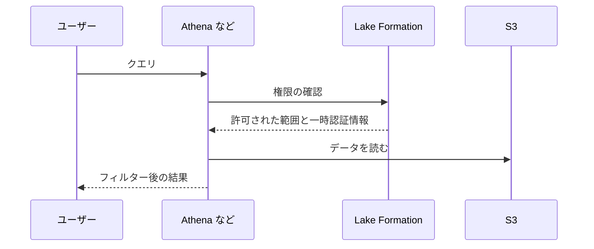
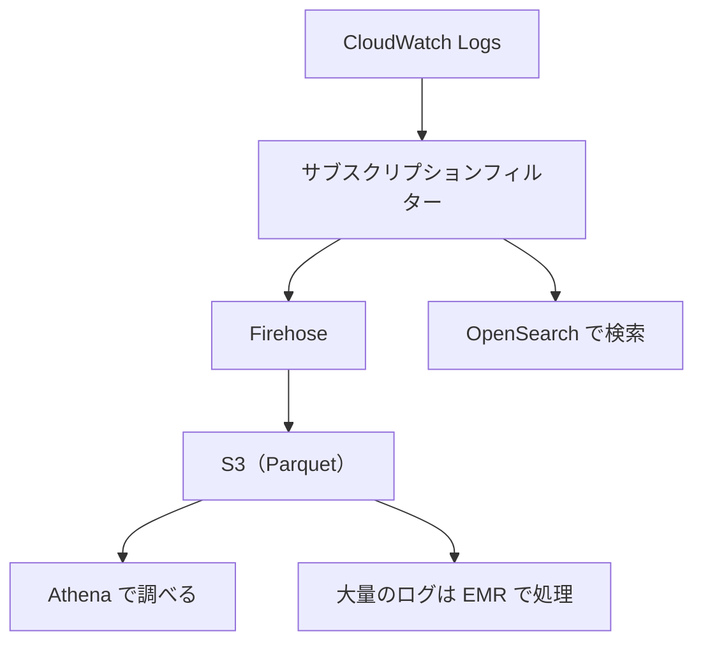
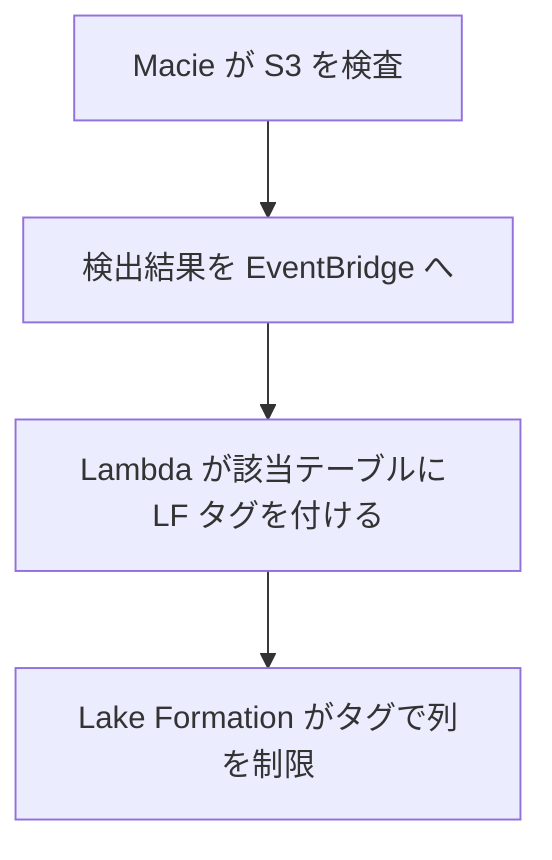

# 分野4: データのセキュリティとガバナンス

配点は **18%** です。誰がデータに接続でき、何を読め、どう暗号化し、どう記録するかを問います。

データ向けの権限である Lake Formation と Redshift の権限が中心です。ガイド 1.1 で、SageMaker Unified Studio と SageMaker Catalog のガバナンスが追加されました。

この分野に限らず、コース全体で使うサービスは[サービス一覧](services.md)から確認できます。

## タスク 4.1: 認証の仕組みを適用する {#task-4-1}

### 4.1.1 VPC セキュリティグループの更新 {#skill-4-1-1}

データ系のサービスは、ネットワークの許可がないと接続できません。

| 接続先 | 許可するもの |
|---|---|
| Redshift | クライアントのセキュリティグループからクラスターのポート |
| RDS、Aurora | アプリや Glue のセキュリティグループからデータベースのポート |
| Glue（VPC 内のジョブ） | すべての TCP を自分自身から許可する自己参照ルール |
| EFS | Lambda のセキュリティグループから 2049 番 |
| MSK | 認証方式ごとのポート（IAM 9098、SCRAM 9096、TLS 9094） |

CIDR より、セキュリティグループの参照を使います。接続元の IP が変わっても設定を直さずに済みます。セキュリティグループはステートフルなので、戻りの通信の許可は要りません。

詳細: [セキュリティグループのルール](../../services/networking.md#security-group-rules)、[接続できないときの切り分け](../../services/networking.md#vpc-troubleshooting)、[MSK](../../services/data-engineering.md#msk)、[Glue の接続](domain1.md#skill-1-2-2)

### 4.1.2 IAM グループ、ロール、エンドポイント、サービス {#skill-4-1-2}

| 対象 | 使いどころ |
|---|---|
| IAM グループ | 人のユーザーをまとめて権限を付ける。データアナリスト、データエンジニアなど |
| IAM ロール | Glue、EMR、Lambda などのサービスに権限を渡す、別のアカウントへの切り替え |
| サービスリンクロール | サービスが自分の管理のために使う。権限はサービスが定義する |
| VPC エンドポイント | インターネットを経由せずに S3 や KMS へ接続する |

サービスにロールを渡す人には `iam:PassRole` が必要です。Glue のジョブを作れない原因によくあります。

詳細: [プリンシパル](../../services/iam.md#principals)、[サービスロールとサービスリンクロール](../../services/iam.md#service-linked-roles)、[iam:PassRole](../../services/iam.md#passrole)、[VPC エンドポイント](../../services/networking.md#vpc-endpoints)

### 4.1.3 認証情報の作成とローテーション {#skill-4-1-3}

Secrets Manager は、データベースのパスワードを保存し、自動でローテーションします。Parameter Store には自動のローテーションがありません。

| 項目 | 内容 |
|---|---|
| ローテーション | スケジュールを指定し、Lambda か管理型のローテーションで更新する |
| RDS との統合 | マスターユーザーのパスワードを Secrets Manager で管理できる |
| 取得 | SDK、Lambda 拡張、キャッシュ |
| MSK の SCRAM | 名前は `AmazonMSK_` で始める。カスタマー管理キーで暗号化する |

ローテーションの後に接続が切れるなら、アプリが値をキャッシュしたままになっていないかを確認します。

詳細: [Secrets Manager](../../services/secrets.md#secrets-manager)、[ローテーション](../../services/secrets.md#rotation)、[RDS との統合](../../services/databases.md#rds-secrets-manager)、[MSK](../../services/data-engineering.md#msk)

### 4.1.4 アクセス用の IAM ロールの設定 {#skill-4-1-4}

| 呼び出し元 | ロールの設定 |
|---|---|
| Lambda | 実行ロール。ログの書き込みと、読むサービスの権限 |
| API Gateway | 統合の認証情報のロール。リソースポリシーとの組み合わせ |
| AWS CLI | プロファイルの `role_arn` で引き受ける |
| CloudFormation | サービスロールでスタックの操作を行う |
| Glue、EMR、Redshift | S3 と KMS を読むロール。Redshift は `COPY` の `IAM_ROLE` で渡す |

ロールには2つの面があります。信頼ポリシーは誰が引き受けられるかを、権限ポリシーは何ができるかを決めます。信頼ポリシーの `Principal` が `glue.amazonaws.com` でないと、Glue は引き受けられません。

詳細: [信頼ポリシー](../../services/iam.md#trust-policy)、[Lambda の実行ロール](../../services/iam.md#lambda-execution-role)、[IAM 認証](../../services/api-gateway.md#iam-auth)、[CLI のプロファイル](../../services/iac.md#cli-profiles)

### 4.1.5 ロール、エンドポイント、サービスへのポリシーの適用 {#skill-4-1-5}

| 対象 | ポリシー | 使いどころ |
|---|---|---|
| S3 Access Points | アクセスポイントのポリシー | 巨大なバケットポリシーを用途別に分ける。VPC 限定にする |
| PrivateLink（VPC エンドポイント） | エンドポイントポリシー | そのエンドポイントで許す操作とリソースを絞る |
| S3 バケット | バケットポリシー | `aws:SourceVpce` で特定のエンドポイントだけ許可する |

- アクセスポイントの権限は、そのポリシーと元のバケットのポリシーの両方で評価されます。
- エンドポイントポリシーは権限を与えません。IAM やバケットポリシーの許可と合わせて評価されます。既定はフルアクセスです。

詳細: [アクセスポイント](../../services/s3.md#access-points)、[エンドポイントポリシー](../../services/networking.md#endpoint-policies)、[バケットポリシー](../../services/s3.md#bucket-policies)

### 4.1.6 マネージドサービスとアンマネージドサービスの違い {#skill-4-1-6}

責任共有モデルでの線引きが変わります。

| 観点 | マネージド（Glue、RDS、MSK、Redshift） | アンマネージド（EC2 上の Spark、Kafka、データベース） |
|---|---|---|
| OS とパッチ | AWS | 利用者 |
| スケーリング、可用性 | 多くを AWS が担う | 利用者が設計する |
| 認証 | IAM 統合などを使える | 自分で構築する |
| 自由度 | 限られる | 高い |
| データの暗号化、権限 | 利用者の責任 | 利用者の責任 |

マネージドでも、データそのものとアクセスの管理は利用者の責任です。

試験では「運用の負荷を最小にする」とあれば、マネージドかサーバーレスを選びます。

詳細: [責任共有モデル](../../services/cloud-foundations.md#shared-responsibility)、[サービスごとの違い](../../services/cloud-foundations.md#responsibility-by-service)

### 4.1.7 SageMaker Unified Studio のドメイン、ドメインユニット、プロジェクト {#skill-4-1-7}

| 単位 | 役割 |
|---|---|
| ドメイン | 組織全体の入れ物。ユーザー、カタログ、ポリシーをまとめる |
| ドメインユニット | ドメインの中を事業部やチームで分ける。アセットを整理し、権限を委任する |
| プロジェクト | 共同作業の単位。メンバーと資源を持ち、データを公開、購読する |

ドメインユニットには認可ポリシーを割り当てます。

| 割り当て先 | ポリシー |
|---|---|
| ユーザーとグループ | ドメインユニットの作成、プロジェクトの作成、プロジェクトのメンバーシップ、所有権の引き受け |
| プロジェクト | 用語集の作成、メタデータフォームの作成、カスタムアセットタイプの作成 |

ドメインユニットの所有者は、アカウントの所有者に代わって、プロジェクトプロファイルを誰が使えるかを設定できます。メタデータフォームを作れるプロジェクトを絞れば、メタデータの品質を保てます。

詳細: [DataZone と Unified Studio](../../services/data-engineering.md#datazone-unified-studio)、[Unified Studio の位置づけ](../../services/sagemaker.md#unified-studio)

## タスク 4.2: 認可の仕組みを適用する {#task-4-2}

### 4.2.1 カスタム IAM ポリシーの作成 {#skill-4-2-1}

管理ポリシーは範囲が広すぎることがあります。特定のバケットやテーブルに絞るときは、カスタムポリシーを書きます。

```json
{
  "Version": "2012-10-17",
  "Statement": [{
    "Effect": "Allow",
    "Action": ["s3:GetObject"],
    "Resource": "arn:aws:s3:::lake/curated/*"
  }, {
    "Effect": "Allow",
    "Action": ["s3:ListBucket"],
    "Resource": "arn:aws:s3:::lake",
    "Condition": {"StringLike": {"s3:prefix": "curated/*"}}
  }]
}
```

`ListBucket` はバケットの ARN に、`GetObject` はオブジェクトの ARN に付けます。ここを間違えると `AccessDenied` になります。

詳細: [ポリシーの要素](../../services/iam.md#policy-elements)、[管理ポリシーとインラインポリシー](../../services/iam.md#managed-vs-inline)、[ポリシー評価](../../services/iam.md#policy-evaluation)

### 4.2.2 認証情報の保存 {#skill-4-2-2}

| 観点 | Secrets Manager | Parameter Store |
|---|---|---|
| 主な用途 | データベースの資格情報、API キー | 設定値、低リスクの秘密情報 |
| 自動ローテーション | あり | なし |
| 暗号化 | KMS で必須 | `SecureString` と KMS で任意 |
| 料金 | シークレット単位の月額と API 呼び出し | スタンダードは無料 |
| 値のサイズ上限 | 65,536 バイト | 4 KB または 8 KB |

「自動でローテーションする」なら Secrets Manager、「費用を抑えて設定値を置く」なら Parameter Store です。

詳細: [3つのサービスの比較](../../services/secrets.md#comparison)、[Parameter Store](../../services/secrets.md#parameter-store)、[CloudFormation の動的参照](../../services/secrets.md#dynamic-references)

### 4.2.3 データベースのユーザー、グループ、ロールの権限 {#skill-4-2-3}

Redshift はロールベースのアクセス制御（RBAC）に対応します。

```sql
CREATE ROLE analyst;
GRANT SELECT ON TABLE sales TO ROLE analyst;
GRANT ROLE analyst TO alice;
```

| 機能 | 内容 |
|---|---|
| ロール | 権限をまとめて付与する。ユーザーごとの `GRANT` を減らす |
| 行レベルセキュリティ（RLS） | ユーザーやロールごとに見える行を制限する |
| 動的データマスキング | 列の値を、見る人によって隠す |
| データ共有 | 別のクラスターやワークグループへライブで共有する |

RDS では、IAM データベース認証で IAM の認証を使えます。

詳細: [暗号化とセキュリティ](../../services/data-engineering.md#redshift-security)、[IAM データベース認証](../../services/databases.md#rds-iam-auth)

### 4.2.4 Lake Formation による権限の管理 {#skill-4-2-4}

S3 上のデータに、テーブル、列、行の権限を付けます。Athena、Glue、EMR、Redshift Spectrum などの統合エンジンが権限を守ります。



| 手順 | 忘れたときの症状 |
|---|---|
| データレイク管理者を指定する | 誰も付与できない |
| S3 パスを登録する | 基盤データのアクセスを管理できない |
| `IAMAllowedPrincipals` の `Super` を外す | 権限を絞っても全員読める |

| レベル | 例 |
|---|---|
| 列 | `ssn` を除く |
| 行 | `country = 'JP'` |
| セル | `country = 'UK'` の行だけ `address` を隠す |

既存の IAM のアクセスを止めずに移すなら、ハイブリッドアクセスモードを使います。

詳細: [Lake Formation](../../services/data-engineering.md#lake-formation)、[始めるときの設定](../../services/data-engineering.md#lake-formation-setup)、[権限](../../services/data-engineering.md#lake-formation-permissions)

### 4.2.5 業務に合う認可の方式 {#skill-4-2-5}

| 方式 | 動作 | 向く場面 |
|---|---|---|
| ロールベース（RBAC） | 職務のロールに権限を付ける | 職務が明確で少ない。Redshift のロール |
| タグベース | リソースのタグで付与する | テーブルが多い。Lake Formation の LF タグ |
| 属性ベース（ABAC） | プリンシパルとリソースの属性を条件で比べる | チームやプロジェクトが増える。`aws:PrincipalTag` |

LF タグの例です。3人の主体に7個のテーブルの権限を付けると、名前付きの方式では17回の付与が必要です。`module=Sales` のタグにすれば、主体ごとのタグの付与で済み、新しいテーブルはタグを付けるだけで対象になります。

**LF タグと IAM タグは別物です。** IAM ポリシーの条件に LF タグは使えません。

詳細: [LF タグ](../../services/data-engineering.md#lake-formation-lf-tags)、[条件とアクセス制御](../../services/iam.md#conditions)、[セッションタグ](../../services/iam.md#session-tags)

### 4.2.6 最小権限のカスタムポリシー {#skill-4-2-6}

| 手段 | 効果 |
|---|---|
| `Action` を絞る | `s3:*` ではなく `s3:GetObject` |
| `Resource` を絞る | `*` ではなく特定の ARN |
| `Condition` を付ける | `aws:SourceVpce`、`aws:RequestedRegion` など |
| 権限境界 | 付与できる権限の上限を決める |
| Access Analyzer | 実際の利用から不要な権限を見つけ、外部からのアクセスを検出する |

Glue のジョブロールなら、読むプレフィックス、書くプレフィックス、使う KMS キーだけを許可します。

詳細: [最小権限](../../services/iam.md#least-privilege)、[権限境界](../../services/iam.md#permissions-boundary)、[Access Analyzer](../../services/iam.md#access-analyzer)、[条件キー](../../services/iam.md#condition-keys)

## タスク 4.3: データの暗号化とマスキングを確保する {#task-4-3}

### 4.3.1 データマスキングと匿名化 {#skill-4-3-1}

| 手法 | 動作 | 元に戻せるか | 例 |
|---|---|---|---|
| マスキング | 一部を隠す | 不可 | `****-1234` |
| トークン化 | 別の値に置き換え、対応表で管理 | 対応表があれば可 | `tok_a1b2` |
| ハッシュ化 | 一方向の変換 | 不可 | 突合用の識別子。推測しやすい値にはソルトを使う |
| 暗号化 | 鍵で変換 | 鍵があれば可 | フィールド単位の暗号化 |
| 削除 | 列を除く | 不可 | ETL で持ち込まない |

| サービス | 方法 |
|---|---|
| Redshift | 動的データマスキング。データはそのままで、見る人によって隠す |
| Lake Formation | 列やセルのフィルター |
| DataBrew | マスク、ハッシュ、暗号化のレシピ |
| AppFlow | 転送中のマスク |
| CloudWatch Logs | データ保護ポリシー。取り込み時にマスクする |

ログや分析用のデータに個人情報を持ち込まないのが基本です。

詳細: [サニタイズとマスキング](../../services/secrets.md#sanitization-masking)、[CloudWatch Logs のデータ保護](../../services/secrets.md#cloudwatch-data-protection)、[Redshift のセキュリティ](../../services/data-engineering.md#redshift-security)、[Lake Formation の権限](../../services/data-engineering.md#lake-formation-permissions)

### 4.3.2 暗号鍵による暗号化と復号 {#skill-4-3-2}

| 鍵 | 特徴 | 向く場面 |
|---|---|---|
| AWS 所有キー | 利用者からは見えない。無料 | 既定で十分な場合 |
| AWS 管理キー | サービスごとに作られる。ポリシーは変更できない | 監査は必要だが、制御は要らない |
| カスタマー管理キー | ポリシー、ローテーション、削除を制御する | アカウントをまたぐ、鍵の監査と制御が必要 |

| 対象 | 方式 |
|---|---|
| S3 | SSE-S3、SSE-KMS。SSE-KMS の費用は Bucket Key で減らす |
| Redshift | KMS または HSM。キーを無効にすると `inaccessible-kms-key` になる。14日以内に戻せば復旧できる |
| Kinesis | KMS のサーバー側暗号化 |
| Glue | セキュリティ設定で S3 のデータ、ログ、ブックマークを暗号化する |
| EMR | セキュリティ設定で保存時と転送時を暗号化する |

KMS の呼び出しが多いと `ThrottlingException` になります。S3 では Bucket Key が効きます。

詳細: [KMS キーの種類](../../services/kms.md#key-types)、[エンベロープ暗号化](../../services/kms.md#envelope-encryption)、[S3 の暗号化](../../services/s3.md#encryption)、[S3 Bucket Key](../../services/s3.md#bucket-key)、[Redshift のセキュリティ](../../services/data-engineering.md#redshift-security)

### 4.3.3 アカウントをまたぐ暗号化 {#skill-4-3-3}

アカウント A のキーをアカウント B のロールが使うには、両方の許可が必要です。

1. A のキーポリシーで、B のアカウントかロールに `kms:Decrypt` などを許可します。
2. B の IAM ポリシーで、ロールにキーの ARN への同じ権限を許可します。
3. B のロールは呼び出しでキーの ARN か別名の ARN を指定します。

片方だけだと `AccessDeniedException` です。

**AWS 管理キーは共有できません。** ポリシーを変更できないからです。別のアカウントへ渡す S3 のデータには、カスタマー管理キーを使います。

詳細: [アカウントをまたぐ手順](../../services/kms.md#cross-account-steps)、[アカウントをまたぐ暗号化](../../services/kms.md#cross-account)、[キーポリシー](../../services/kms.md#access-control)

### 4.3.4 転送時と転送前の暗号化 {#skill-4-3-4}

| 段階 | 方法 |
|---|---|
| 転送前（クライアント側） | データを送る前に手元で暗号化する。AWS Encryption SDK。AWS は平文を見ない |
| 転送時 | TLS |
| S3 | バケットポリシーの `aws:SecureTransport` で HTTP を拒否する |
| Redshift | パラメータグループの `require_ssl` |
| RDS | SSL/TLS 接続を強制する |
| MSK | クライアントとの間は TLS のみが既定。ブローカー間も既定で TLS |
| EMR | セキュリティ設定で転送時の暗号化を有効にする |

「AWS にも平文を見せない」が要件なら、クライアント側暗号化です。ただし、Redshift の `COPY` と `UNLOAD` のクライアント側暗号化は新規顧客に提供されていないので、この場合はサーバー側暗号化を使います。

詳細: [保存時と転送時の暗号化](../../services/kms.md#at-rest-in-transit)、[クライアント側とサーバー側](../../services/kms.md#client-vs-server-side)、[S3 の暗号化の強制](../../services/s3.md#enforcing-encryption)、[RDS の SSL/TLS](../../services/databases.md#rds-ssl)

## タスク 4.4: 監査用のログを準備する {#task-4-4}

### 4.4.1 CloudTrail による API の追跡 {#skill-4-4-1}

監査の観点で押さえることは次のとおりです。

| 要件 | 設定 |
|---|---|
| 90日より長く残す | 証跡で S3 へ |
| 全リージョンと全アカウント | 組織の証跡 |
| 改ざんの検出 | ログファイルの検証 |
| S3 のデータの読み書きの記録 | データイベントを有効にする |
| 誰が Lake Formation の権限を変えたか | 管理イベントを検索する |

イベントの種類は[スキル 3.3.5](domain3.md#skill-3-3-5) を参照してください。

詳細: [証跡とイベント履歴](../../services/observability.md#cloudtrail-trails)、[CloudTrail の調査](../../services/threat-detection.md#investigate-cloudtrail)

### 4.4.2 CloudWatch Logs によるアプリケーションログの保存 {#skill-4-4-2}

| 要件 | 設定 |
|---|---|
| 監査の期間だけ残す | ロググループの保持期間 |
| 長期保存を安く | S3 へエクスポートし、ライフサイクルで移行する |
| 機密データを残さない | データ保護ポリシー |
| ログを暗号化する | KMS キーを関連付ける |
| 他のアカウントへ集める | サブスクリプションフィルター |

Glue、Lambda、MWAA、Step Functions のログは CloudWatch Logs に出力できます。

詳細: [ロググループと保持期間](../../services/observability.md#log-groups)、[KMS による暗号化](../../services/observability.md#logs-kms)、[データ保護ポリシー](../../services/observability.md#logs-data-protection)

### 4.4.3 CloudTrail Lake による一元的なログのクエリ {#skill-4-4-3}

CloudTrail Lake は、イベントを ORC 形式のイベントデータストアに集め、SQL で検索します。S3 と Athena の環境を自分で作らずに、複数のアカウントのイベントを検索できます。

!!! note "CloudTrail Lake の現在の状況"
    CloudTrail Lake は 2026年5月31日で新規顧客の受付を終了しました。既存の顧客は引き続き使えます。新規の環境では、証跡を S3 に出力して Athena で検索します。試験ではガイドのとおり、一元的な SQL 検索の手段として問われる可能性があります。

詳細: [CloudTrail Lake](../../services/observability.md#cloudtrail-lake)

### 4.4.4 AWS サービスによるログの分析 {#skill-4-4-4}

| 要件 | 選択 |
|---|---|
| S3 の CloudTrail を SQL で調べる | Athena |
| アプリのログをその場で検索する | CloudWatch Logs Insights |
| 全文検索とダッシュボードで常時調べる | OpenSearch Service |

監査の問いの例です。「過去90日に、このバケットのポリシーを変えた人は誰か」は Athena、「直近1時間のエラーの傾向」は Logs Insights です。

詳細: [Logs Insights](../../services/observability.md#logs-insights)、[S3 上のログを問い合わせる](../../services/streaming.md#athena-logs)、[OpenSearch Service](../../services/streaming.md#opensearch)、[どのログを見るか](../../services/threat-detection.md#log-sources)

### 4.4.5 サービスを組み合わせたロギング {#skill-4-4-5}



| ログの量と使い方 | 選択 |
|---|---|
| 非常に大量で複雑な処理が要る | EMR で Spark を実行する |
| S3 に集めて単発で調べる | Athena |
| ほぼリアルタイムの検索 | Firehose から OpenSearch へ |

EMR 自身のログも S3 に出力でき、Athena で分析できます。

詳細: [サブスクリプションフィルター](../../services/observability.md#subscription-filters)、[Firehose](../../services/streaming.md#firehose)、[EMR のスケーリングと終了](../../services/data-engineering.md#emr-scaling)

## タスク 4.5: データのプライバシーとガバナンスを理解する {#task-4-5}

### 4.5.1 データ共有の権限の付与 {#skill-4-5-1}

Redshift のデータ共有は、データをコピーせず、ライブのまま別のクラスターへ渡します。アカウントやリージョンをまたげます。

```sql
-- プロデューサー側
CREATE DATASHARE sales_share;
ALTER DATASHARE sales_share ADD SCHEMA public;
ALTER DATASHARE sales_share ADD TABLE public.sales;
GRANT USAGE ON DATASHARE sales_share TO NAMESPACE '<consumer-namespace-id>';

-- コンシューマー側
CREATE DATABASE sales_db FROM DATASHARE sales_share
  OF NAMESPACE '<producer-namespace-id>';
```

用途は、ETL と BI の計算資源を分けることです。

詳細: [データ共有](../../services/data-engineering.md#redshift-data-sharing)、[データの共有の選び方](../../services/data-engineering.md#choosing-sharing)

### 4.5.2 個人情報の特定 {#skill-4-5-2}

Macie は S3 のオブジェクトの中の機密データを、機械学習とパターンマッチで検出します。

| 方式 | 向く場面 |
|---|---|
| 自動検出 | 毎日サンプリングで検査し、全体を見通す |
| ジョブ | 特定のバケットを詳しく検査する |

Lake Formation との組み合わせの例です。



検査できないときは、Macie が KMS キーを使えるか、バケットポリシーが Macie を許可しているかを確認します。

詳細: [Macie](../../services/threat-detection.md#macie)、[識別子と許可リスト](../../services/threat-detection.md#macie-identifiers)、[検出結果](../../services/threat-detection.md#macie-findings)、[LF タグ](../../services/data-engineering.md#lake-formation-lf-tags)

### 4.5.3 許可しないリージョンへのバックアップと複製の防止 {#skill-4-5-3}

| 手段 | 動作 |
|---|---|
| SCP の `aws:RequestedRegion` | 許可しないリージョンでの操作を組織全体で拒否する |
| Control Tower のリージョン拒否コントロール | 同じ制限をランディングゾーンとして適用する |
| S3 レプリケーションの設定 | ルールの送信先を許可するリージョンだけにする |
| AWS Backup のコピールール | コピー先のリージョンを決める |
| Config ルール | 違反を検出する |

```json
{
  "Effect": "Deny",
  "NotAction": ["iam:*", "organizations:*", "sts:*", "support:*", "route53:*", "cloudfront:*"],
  "Resource": "*",
  "Condition": {
    "StringNotEquals": {"aws:RequestedRegion": ["ap-northeast-1"]}
  }
}
```

グローバルサービスは特定のリージョンのエンドポイントを使うことがあるので、`NotAction` で除きます。

SCP は管理アカウントと、サービスリンクロールの操作を制限できません。

詳細: [SCP](../../services/governance.md#scp)、[コントロール](../../services/governance.md#ct-controls)、[条件キー](../../services/iam.md#condition-keys)、[リージョン間コピー](../../services/resilience.md#backup-cross-region)

### 4.5.4 アカウントの設定変更の確認 {#skill-4-5-4}

AWS Config は、リソースの設定の履歴を記録し、ルールで評価します。

| 観点 | Config | CloudTrail |
|---|---|---|
| 答える問い | 設定はどう変わり、基準に合っているか | 誰がいつどの API を呼んだか |
| 記録するもの | 設定の状態（CI） | API の呼び出しイベント |

Config のタイムラインから CloudTrail のイベントへたどれます。両方で「何がどう変わり、誰が変えたか」が分かります。

例として、S3 バケットが公開になったら Config ルールで検出し、修復アクションで元に戻します。複数のアカウントはアグリゲーターで集約します。

詳細: [Config](../../services/governance.md#config)、[Config ルール](../../services/governance.md#config-rules)、[修復](../../services/governance.md#config-remediation)、[アグリゲーター](../../services/governance.md#config-aggregators)

### 4.5.5 データ主権の維持 {#skill-4-5-5}

データ主権は、データがその保存場所の国や地域の法律に従うという考え方です。保存場所と処理場所の両方を管理します。

| 確認すること | 方法 |
|---|---|
| どのリージョンに置くか | リージョンの選択と、SCP での制限（[4.5.3](#skill-4-5-3)） |
| 複製先 | S3 レプリケーション、グローバルテーブル、スナップショットのコピー |
| 処理の場所 | Bedrock の推論プロファイルは他のリージョンで処理することがある |
| 鍵の管理 | カスタマー管理キーで、誰が復号できるかを制御する |
| 準拠の証明 | AWS Artifact で監査レポートを入手する |

データは、利用者が指定したリージョンに置かれます。リージョンをまたぐ機能を有効にするときは、法律の要件を確認します。

詳細: [リージョン](../../services/cloud-foundations.md#regions)、[モデル ID と推論プロファイル](../../services/ai.md#model-identifiers)、[グローバルテーブル](../../services/dynamodb.md#global-tables)、[AWS Artifact](../../services/threat-detection.md#artifact)

### 4.5.6 SageMaker Catalog のプロジェクトによるアクセスの管理 {#skill-4-5-6}

アクセスはプロジェクトの単位で管理します。

| 役割 | 動作 |
|---|---|
| プロデューサーのプロジェクト | アセットを公開する |
| コンシューマーのプロジェクト | カタログを検索し、利用を申請する（購読） |
| 所有者 | 申請を承認する。承認すると権限が付与される |

権限の実体は Lake Formation や Redshift の権限で、SageMaker Catalog はその上の申請の流れです。個人ごとに権限を付けるのではなく、プロジェクトのメンバーになれば使えるようになります。

詳細: [DataZone と Unified Studio](../../services/data-engineering.md#datazone-unified-studio)

### 4.5.7 データガバナンスのフレームワークと共有パターン {#skill-4-5-7}

ガバナンスの組み立て方は、3つの要素で考えます。

| 要素 | 内容 | AWS のサービス |
|---|---|---|
| 発見 | データを見つけ、意味を理解する | SageMaker Catalog、Glue Data Catalog |
| アクセス | 申請、承認、権限の付与 | SageMaker Catalog、Lake Formation |
| 監視 | 品質、リネージ、監査、機密データの検出 | Glue Data Quality、リネージ、CloudTrail、Macie |

| 組織の型 | 動作 | 向く場面 |
|---|---|---|
| 中央集権 | 1つのチームがデータと権限を管理する | 規模が小さい、規制が厳しい |
| フェデレーション（データメッシュ） | ドメインごとにデータを所有し、データ製品として公開する。標準は中央で決める | 事業部が多く、中央がボトルネックになる |

| 共有の要件 | 選択 |
|---|---|
| Redshift のライブデータを別のクラスターへ | Redshift データ共有 |
| S3 データレイクを別のアカウントへ | Lake Formation のクロスアカウント共有 |
| 社外とデータを売買、交換する | Data Exchange |
| 生データを見せず共同で分析する | Clean Rooms |
| 社内でデータを検索、申請する | SageMaker Catalog |

詳細: [データの共有](../../services/data-engineering.md#choosing-sharing)、[クロスアカウント共有](../../services/data-engineering.md#lake-formation-cross-account)、[Clean Rooms](../../services/data-engineering.md#clean-rooms)、[Data Exchange](../../services/data-engineering.md#data-exchange)、[マルチアカウントのパターン](../../services/governance.md#multi-account-patterns)

## 確認問題 {#self-check}

??? question "問1: Lake Formation でテーブルの権限を絞りましたが、IAM で S3 の権限を持つ人なら誰でも Athena で読めます。原因と対処は？"
    後方互換のために `IAMAllowedPrincipals` グループに `Super` が付いたままです。これを外し、S3 パスを Lake Formation に登録します。既存のアクセスを止めずに段階的に移すなら、ハイブリッドアクセスモードを使います。

??? question "問2: テーブルが数千あり、部門ごとの権限を付与しています。新しいテーブルを作るたびに付与の作業が発生します。どう減らしますか？"
    Lake Formation の LF タグ（LF-TBAC）です。主体にはタグの式で権限を付け、新しいテーブルにはタグを付けるだけで対象にできます。IAM のタグとは別のもので、IAM の条件には使えません。

??? question "問3: アカウント A の S3 のデータを、アカウント B の Glue ジョブが読むと AccessDenied になります。データは SSE-KMS で暗号化されています。何を確認しますか？"
    カスタマー管理キーを使っていること、A のキーポリシーで B のロールに `kms:Decrypt` を許可していること、B のロールの IAM ポリシーでも同じキーの権限を許可していること、バケットポリシーで B のロールを許可していることです。AWS 管理キーはポリシーを変更できないので、アカウントをまたげません。

??? question "問4: データベースのパスワードを定期的に自動で変更し、Glue の接続から使いたいです。Secrets Manager と Parameter Store のどちらを使いますか？"
    Secrets Manager です。自動ローテーションに対応し、RDS とも統合されています。Parameter Store の `SecureString` は暗号化できますが、自動ローテーションの機能がありません。

??? question "問5: 規制によりデータを東京リージョンの外に出せません。全アカウントで、他のリージョンへの作成と複製を防ぎたいです。どうしますか？"
    Organizations の SCP で `aws:RequestedRegion` を条件に、許可しないリージョンでの操作を拒否します。グローバルサービスは `NotAction` で除きます。あわせて、S3 レプリケーションと AWS Backup のコピー先を確認し、Config ルールで違反を検出します。SCP は管理アカウントには効きません。

??? question "問6: S3 のデータレイクに個人情報が含まれるかを調べ、見つかった列をアナリストから隠したいです。どう組み合わせますか？"
    Macie で S3 の機密データを検出し、結果を EventBridge で受けて、該当するテーブルに LF タグを付けます。Lake Formation でそのタグや列のフィルターを使い、アナリストのロールから列を除きます。Redshift の場合は、動的データマスキングで列を隠せます。
