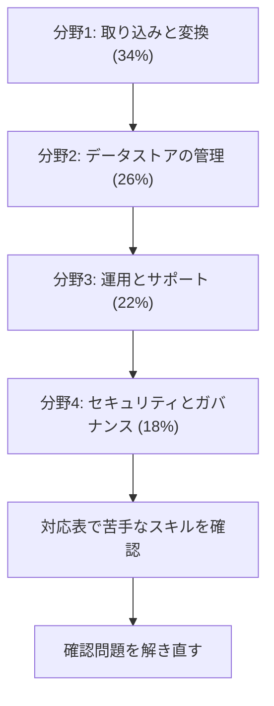

# Data Engineer - Associate（DEA）

データパイプラインを実装し、監視、トラブルシューティング、コストと性能の最適化を行う力を問う試験です。このコースは **DEA-C01**（試験ガイド バージョン 1.1、2025年12月12日公開）を基準にしています。

全120スキルと解説の対応は[対応表](coverage.md)で確認できます。

[:material-format-list-bulleted: このコースのサービス一覧](services.md){ .md-button }

## 試験の概要 {#overview}

| 項目 | 内容 | 出典 |
|---|---|---|
| 試験コード | DEA-C01 | 試験ガイド |
| カテゴリ | Associate | 公式ページ |
| 問題数 | 65問（採点対象50問 + 採点対象外15問） | 試験ガイド、公式ページ |
| 試験時間 | 130分 | 公式ページ |
| 合格点 | 720点（100〜1,000点） | 試験ガイド |
| 受験料 | 150 USD（為替などで追加の費用がかかる場合があります） | 公式ページ |
| 言語 | 英語、日本語、韓国語、簡体字中国語 | 公式ページ |
| 受験方法 | Pearson VUE のテストセンターまたはオンライン監視 | 公式ページ |
| 形式 | 択一（正解1つ、誤答3つ）、複数選択（5つ以上の選択肢から正解2つ以上） | 試験ガイド |
| 採点方式 | 全体の得点で合否を判定します。分野ごとの合格点はありません | 試験ガイド |
| 減点 | 誤答による減点はありません。未回答は不正解になるので、すべて回答します | 試験ガイド |

2026年10月31日に公式ページを確認した時点で、DEA-C01 の終了や後継版の告知はありません。

公式ページには、一部のサービスを短い名前で表記する変更が案内されています。英語版から始まり、他の言語へ順に広がります。日付は示されていません。

## 学習の順番 {#study-path}

配点の大きい分野から順に進めます。分野1と分野2でサービスの選び方を固め、分野3と分野4で運用とセキュリティを重ねます。

| 分野 | 配点 | タスク数 | スキル数 | 主なサービス |
|---|---|---|---|---|
| [分野1: データの取り込みと変換](domain1.md) | 34% | 4 | 37 | Kinesis、MSK、Glue、EMR、Lambda、Step Functions、MWAA |
| [分野2: データストアの管理](domain2.md) | 26% | 4 | 26 | Redshift、DynamoDB、S3、Data Catalog、Iceberg、Aurora |
| [分野3: データの運用とサポート](domain3.md) | 22% | 4 | 28 | Athena、Glue Data Quality、DataBrew、CloudWatch、CloudTrail |
| [分野4: データのセキュリティとガバナンス](domain4.md) | 18% | 5 | 29 | IAM、Lake Formation、KMS、Macie、SageMaker Catalog |

## ガイド 1.1 の変更点 {#guide-revision}

バージョン 1.1 で、知識とスキルの2つの一覧が、タスクごとのスキルの一覧にまとまりました。古い教材には次の内容がありません。

| 変更 | 内容 |
|---|---|
| 新しいスキル | 1.2.10 LLM、2.1.7 オープンテーブル形式、2.1.8 ベクトルインデックス、2.2.6 ビジネスカタログ、2.4.6 ベクトル化、4.1.7 Unified Studio、4.5.6 Catalog のプロジェクト、4.5.7 ガバナンスと共有のパターン |
| 範囲に追加 | Aurora、Amazon Q、Bedrock、Kendra、Data Exchange、S3 Tables |
| 範囲から削除 | Cloud9、CodeCommit、AWS SCT（ただしスキル 2.4.3 の例には SCT の名前が残っています） |

## 想定する受験者 {#target-candidate}

データエンジニアリングの経験が2〜3年、AWS の実務経験が1〜2年の人を想定しています。データの量、種類、速度が設計に与える影響を理解していることが前提です。

前提知識は次のとおりです。

- ETL パイプラインの構築と保守、言語に依存しないプログラミングの概念
- Git、データレイク、ネットワーク、ストレージ、コンピューティング、ベクトルの一般的な概念
- SQL の書き方と、AWS のサービスでの実行方法
- コスト、性能、機能の観点でのサービスの比較

## 範囲外のもの {#out-of-scope}

次の作業は受験者に求められていません。

- ML の学習と推論の実行
- プログラミング言語固有の構文の知識
- データからビジネス上の結論を導くこと

範囲外のサービスの例は、FinSpace、Elastic Beanstalk、App Runner、Outposts、X-Ray、FIS、AppSync、Amplify、SES、Migration Hub、Mainframe Modernization、DevOps Guru、IoT の各サービスです。

## 範囲のサービスと解説ページ {#services}

| カテゴリ | サービス | 解説 |
|---|---|---|
| 分析 | Glue、DataBrew、EMR、Lake Formation、MSK、Managed Service for Apache Flink、Quick | [データエンジニアリング](../../services/data-engineering.md) |
| 分析 | Athena、Kinesis Data Streams、Data Firehose、OpenSearch Service | [ストリーミングと分析](../../services/streaming.md) |
| 分析、ML | SageMaker AI | [SageMaker](../../services/sagemaker.md) |
| アプリケーション統合 | AppFlow、MWAA | [データエンジニアリング](../../services/data-engineering.md#appflow) |
| アプリケーション統合 | EventBridge、SNS、SQS | [メッセージング](../../services/messaging.md) |
| アプリケーション統合 | Step Functions | [Step Functions](../../services/step-functions.md) |
| コスト管理 | Budgets、Cost Explorer | [コスト管理](../../services/cost-management.md) |
| コンピューティング | Lambda | [Lambda](../../services/lambda.md) |
| コンピューティング | Batch | [その他のサービス](../../services/other-services.md#batch) |
| コンピューティング | EC2 | [EC2 と Beanstalk](../../services/ec2-beanstalk.md) |
| コンピューティング、開発 | SAM、CloudFormation、CDK、CLI | [IaC](../../services/iac.md) |
| コンテナ | ECR、ECS、EKS | [コンテナ](../../services/containers.md) |
| データベース | RDS、Aurora | [データベース](../../services/databases.md) |
| データベース | DocumentDB、Keyspaces、MemoryDB、Neptune | [専門データベース](../../services/databases-specialized.md) |
| データベース | DynamoDB | [DynamoDB](../../services/dynamodb.md) |
| データベース | Redshift | [データエンジニアリング](../../services/data-engineering.md#redshift) |
| 開発ツール | CodeBuild、CodeDeploy、CodePipeline | [CI/CD](../../services/cicd.md) |
| 開発ツール | Amazon Q | [AI](../../services/ai.md#q-developer) |
| Web | API Gateway | [API Gateway](../../services/api-gateway.md) |
| ML | Bedrock | [AI](../../services/ai.md)、[生成 AI アプリ](../../services/genai-apps.md) |
| ML | Kendra | [マネージド AI サービス](../../services/ai-managed-services.md#kendra) |
| 管理とガバナンス | CloudTrail、CloudWatch、CloudWatch Logs | [オブザーバビリティ](../../services/observability.md) |
| 管理とガバナンス | Config | [ガバナンス](../../services/governance.md#config) |
| 管理とガバナンス | Managed Grafana、Systems Manager | [運用](../../services/operations.md) |
| 管理とガバナンス | Well-Architected Tool | [クラウドの基礎](../../services/cloud-foundations.md#wa-tool) |
| 管理とガバナンス | Data Exchange | [データエンジニアリング](../../services/data-engineering.md#data-exchange) |
| 移行と転送 | Application Discovery Service、Application Migration Service、DMS、DataSync、Snow Family、Transfer Family | [移行](../../services/migration.md) |
| ネットワーク | VPC、PrivateLink、Route 53、CloudFront | [ネットワーク](../../services/networking.md) |
| セキュリティ | IAM | [IAM](../../services/iam.md) |
| セキュリティ | KMS | [KMS](../../services/kms.md) |
| セキュリティ | Macie、Shield | [脅威検出](../../services/threat-detection.md) |
| セキュリティ | Secrets Manager | [シークレット](../../services/secrets.md) |
| セキュリティ | WAF | [証明書と WAF](../../services/certificates.md#waf) |
| ストレージ | Backup | [回復性](../../services/resilience.md#backup) |
| ストレージ | EBS、EFS | [ストレージ](../../services/storage.md) |
| ストレージ | S3、S3 Glacier | [S3](../../services/s3.md) |
| ストレージ | S3 Tables | [S3 Tables](../../services/data-engineering.md#s3-tables) |

!!! note "ガイドの名前と現在の状況"
    試験ガイドの一覧と現在の提供状況が異なるサービスがあります。試験では今も問われる可能性があるので、役割は押さえておきます。

    - **名称の変更**: Amazon Kinesis Data Firehose は Amazon Data Firehose に、Amazon QuickSight は Amazon Quick の Quick Sight に、Application Migration Service は AWS Transform MGN になりました。
    - **Kendra**: 2026年6月30日にメンテナンスへ移行しました。社内文書の自然文検索という役割は同じです。
    - **Application Discovery Service**: 2025年10月7日にメンテナンスの公表がありました。
    - **Snow Family**: 新規のお客様には提供されません。回線に乗らないデータをオフラインで運ぶ、という位置づけで覚えます。
    - **S3 Glacier のボールト API（Glacier Direct）**: 2025年10月7日にメンテナンスの公表がありました。S3 のストレージクラスとしての Glacier は別物です。
    - **Amazon Q Developer**: IDE プラグインは、2027年4月30日にサポートが終了します。
    - **CodeCommit**: 範囲から外れましたが、サービスは一般提供に戻っています。

## 参考 {#references}

- [DEA-C01 試験ガイド](https://docs.aws.amazon.com/aws-certification/latest/data-engineer-associate-01/data-engineer-associate-01.html)
- [範囲のサービス](https://docs.aws.amazon.com/aws-certification/latest/data-engineer-associate-01/dea-01-in-scope-services.html)
- [範囲外のサービス](https://docs.aws.amazon.com/aws-certification/latest/data-engineer-associate-01/dea-01-out-of-scope-services.html)
- [ガイドの改訂履歴](https://docs.aws.amazon.com/aws-certification/latest/data-engineer-associate-01/dea-01-revisions.html)
- [認定の公式ページ](https://aws.amazon.com/certification/certified-data-engineer-associate/)
- [Services in Maintenance](https://docs.aws.amazon.com/general/latest/gr/maintenance_services.html)
