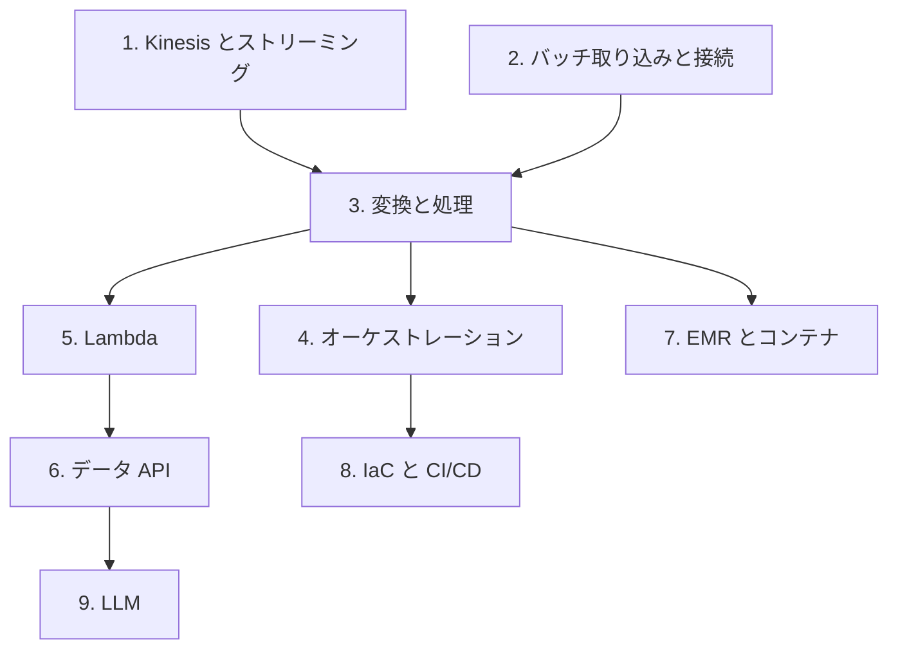

# 分野1: サービス別の学習

分野1（データの取り込みと変換）は DEA-C01 の配点の 34% を占めます。取り込み、変換、連結、プログラミングの概念の 4 つを扱います。読み手と変換の選び方を固めてから、連結と開発の実践へ進みます。

| 順番 | サービス | 問われること | 重要度 |
|---|---|---|---|
| 1 | [Kinesis とストリーミング](streaming.md) | 読み手の選択、Lambda の設定、偏り、リプレイ、状態 | 高 |
| 2 | [バッチ取り込みと接続](ingestion.md) | Glue と `COPY` の設定、接続元の制限、JDBC | 高 |
| 3 | [変換と処理](transform.md) | 変換サービスの選択、データ形式、費用、失敗の調査 | 高 |
| 4 | [オーケストレーションとイベント](orchestration.md) | スケジュール、イベント、Step Functions と MWAA の選択、通知 | 高 |
| 5 | [Lambda](lambda.md) | コードの最適化、同時実行、`/tmp` と EFS | 中 |
| 6 | [データ API](data-apis.md) | API の利用と作成、Redshift Data API | 中 |
| 7 | [EMR、コンテナと分散処理](emr-containers.md) | コンテナの資源、分散処理、データ構造 | 中 |
| 8 | [IaC、CI/CD と開発の実践](devops.md) | 言語の選択、IaC、SAM、CI/CD | 中 |
| 9 | [LLM を使った処理](genai-vector.md) | Converse API、バッチ推論、Data Automation | 低 |

重要度は公式のスキル一覧を見たこの wiki の判断で、公式の数字ではありません。

## 他のサービスにまたがる問題 {#other-questions}

<!-- questions:start -->

この分野の問題は、すべてサービス別のページに載っています。

<!-- questions:end -->
