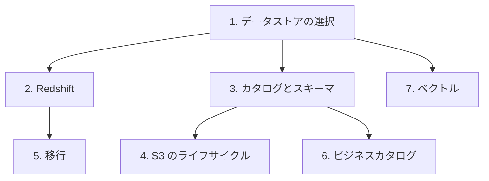

# 分野2: サービス別の学習

分野2（データストアの管理）は DEA-C01 の配点の 26% を占めます。データストアの選択、カタログ、ライフサイクル、モデルの 4 つを扱います。保存先の選択を先に固めます。

| 順番 | サービス | 問われること | 重要度 |
|---|---|---|---|
| 1 | [データストアの選択](datastores.md) | 費用とアクセスパターンに合う保存先、パーティションの実践 | 高 |
| 2 | [Redshift](redshift.md) | 遠隔アクセス、ロック、`COPY` と `UNLOAD`、スキーマ設計 | 高 |
| 3 | [データカタログとスキーマ](catalog.md) | クローラー、パーティションの同期、接続、スキーマの変化 | 高 |
| 4 | [S3 のライフサイクルとオープンテーブル形式](s3-lifecycle.md) | 階層、失効、バージョニング、TTL、削除、Iceberg | 高 |
| 5 | [移行とスキーマ変換](migration.md) | 転送ツールの選択、SCT と DMS Schema Conversion | 中 |
| 6 | [ビジネスカタログとリネージ](sagemaker-governance.md) | SageMaker Catalog、リネージ | 中 |
| 7 | [ベクトルインデックスとベクトル化](genai-vector.md) | HNSW と IVF の調整、チャンク化、埋め込み | 中 |

重要度は公式のスキル一覧を見たこの wiki の判断で、公式の数字ではありません。

## 他のサービスにまたがる問題 {#other-questions}

<!-- questions:start -->

この分野の問題は、すべてサービス別のページに載っています。

<!-- questions:end -->
