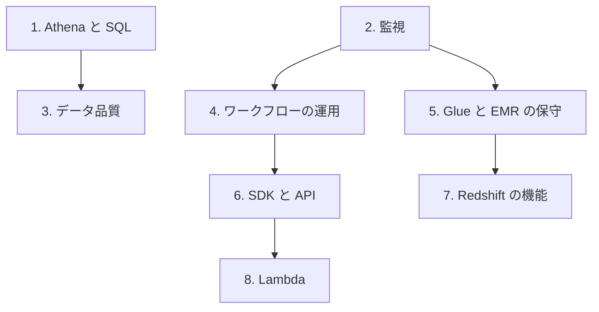

# 分野3: サービス別の学習

分野3（データの運用とサポート）は DEA-C01 の配点の 22% を占めます。自動化、分析、保守と監視、データ品質の 4 つを扱います。Athena と監視を中心に進めます。

| 順番 | サービス | 問われること | 重要度 |
|---|---|---|---|
| 1 | [Athena と SQL](athena.md) | クエリの最適化、ビュー、Spark、集計の SQL | 高 |
| 2 | [監視とトラブルシューティング](monitoring.md) | CloudTrail、CloudWatch、性能問題、ログの分析 | 高 |
| 3 | [データ品質とデータ準備](data-quality.md) | DataBrew、Data Quality、可視化、サンプリング、偏り | 高 |
| 4 | [MWAA、Step Functions、EventBridge の運用](orchestration.md) | トラブルシューティング、イベントとスケジューラーの管理 | 中 |
| 5 | [プロビジョンドとサーバーレス、Glue と EMR の保守](emr-containers.md) | トレードオフ、Glue と EMR の症状と対処 | 中 |
| 6 | [SDK と API の運用](data-apis.md) | 非同期の API、使用量プラン、エラーコード | 中 |
| 7 | [Redshift の機能](redshift.md) | WLM、SQA、マテリアライズドビュー | 中 |
| 8 | [Lambda による自動化](lambda.md) | 起動元と使いどころ | 低 |

重要度は公式のスキル一覧を見たこの wiki の判断で、公式の数字ではありません。

## 他のサービスにまたがる問題 {#other-questions}

<!-- questions:start -->

この分野の問題は、すべてサービス別のページに載っています。

<!-- questions:end -->
