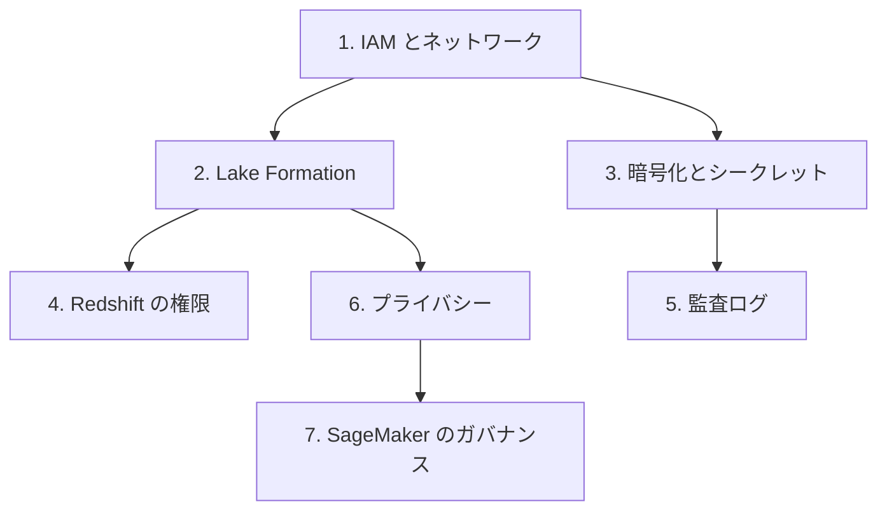

# 分野4: サービス別の学習

分野4（データのセキュリティとガバナンス）は DEA-C01 の配点の 18% を占めます。認証、認可、暗号化、監査、プライバシーの 5 つを扱います。IAM を先に読むと、後のページの権限の話が読みやすくなります。

| 順番 | サービス | 問われること | 重要度 |
|---|---|---|---|
| 1 | [IAM とネットワークの権限](iam.md) | セキュリティグループ、ロール、ポリシー、責任の分担 | 高 |
| 2 | [Lake Formation と認可の方式](lake-formation.md) | 初期設定、データフィルター、LF タグ、ABAC | 高 |
| 3 | [暗号化とシークレット](encryption-secrets.md) | Secrets Manager、鍵の選択、アカウントをまたぐ暗号化 | 高 |
| 4 | [Redshift の権限とデータ共有](redshift.md) | ロール、RLS、マスキング、データ共有 | 中 |
| 5 | [監査ログ](audit-logging.md) | 証跡、データ保護、CloudTrail Lake、ログの分析 | 中 |
| 6 | [プライバシーとコンプライアンス](privacy-compliance.md) | Macie、SCP、Config、データ主権 | 中 |
| 7 | [SageMaker のガバナンス](sagemaker-governance.md) | ドメインユニット、プロジェクト、共有のパターン | 中 |

重要度は公式のスキル一覧を見たこの wiki の判断で、公式の数字ではありません。

## 他のサービスにまたがる問題 {#other-questions}

<!-- questions:start -->

この分野の問題は、すべてサービス別のページに載っています。

<!-- questions:end -->
