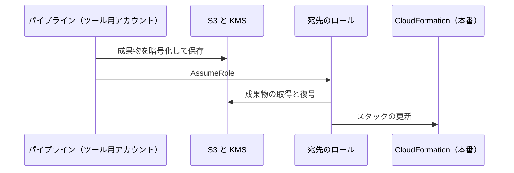
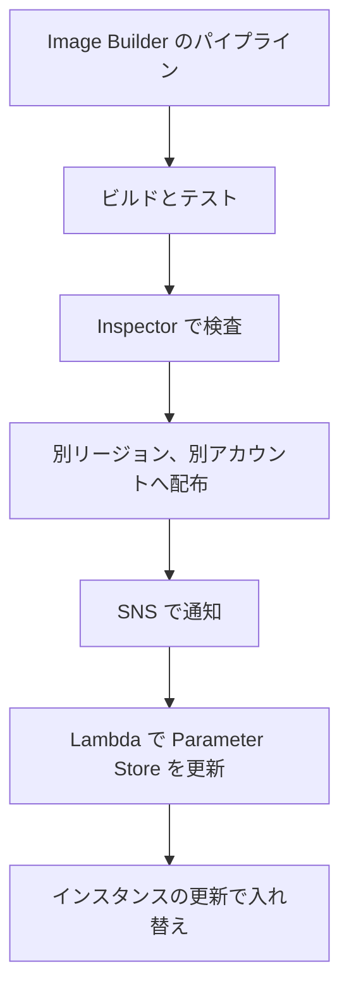

# 分野1: SDLC の自動化

配点は **22%** で、6分野の中で最大です。パイプラインの構成、テストの配置、成果物の管理、デプロイ方式の4つを扱います。

個々の設定を知っているだけでは足りません。「複数アカウントで」「ダウンタイムなしで」「最小の運用負荷で」といった条件から、組み合わせを選ぶ力が問われます。

## タスク 1.1: CI/CD パイプラインを実装する {#task-1-1}

### SDLC の概念とモデル {#t1-1-sdlc}

**ガイドの項目:** 知識「SDLC の概念、フェーズ、モデル」

SDLC は、計画、設計、実装、ビルド、テスト、デプロイ、運用と続く流れです。DevOps では、この流れを小さく何度も回します。

| 用語 | 意味 | 本番への反映 |
|---|---|---|
| 継続的インテグレーション | コミットごとにビルドとテストを行う | しない |
| 継続的デリバリー | いつでも出せる状態を保つ | 人の承認の後 |
| 継続的デプロイ | テストを通れば自動で出す | 自動 |

ウォーターフォールは工程を順に一度だけ進めます。アジャイルは短い周期で繰り返します。問題文に「手動承認が必須」とあれば継続的デリバリーで、CodePipeline の Approval アクションを置きます。

詳細: [サービスの役割](../../services/cicd.md#overview)、[手動承認](../../services/cicd.md#manual-approval)

### 単一アカウントと複数アカウントのパイプライン {#t1-1-multi-account}

**ガイドの項目:** 知識「単一アカウント、複数アカウントのパイプラインのデプロイパターン」

本番と開発のアカウントを分け、パイプラインは専用のアカウントに置くのが基本です。OU では Deployments がこれに当たります。

| 観点 | 単一アカウント | 複数アカウント |
|---|---|---|
| 影響範囲 | 開発の誤りが本番に及ぶ | アカウントで分離できる |
| 権限 | パイプラインのロールだけ | 宛先アカウントのロールを引き受ける |
| 暗号化 | 既定のキーでも動く | カスタマー管理の KMS キーが必要 |
| 向く場面 | 小規模、検証 | 本番を含む組織 |

他のアカウントへデプロイするときに必要なものは、次の4つです。問題では、このどれかが欠けています。

1. アーティファクトをカスタマー管理の KMS キーで暗号化する。AWS 管理キーは別のアカウントから使えません。
2. KMS のキーポリシーで、宛先アカウントに復号を許可する。
3. アーティファクト用 S3 バケットのポリシーで、宛先アカウントに読み取りを許可する。
4. 宛先アカウントにロールを作り、パイプラインのアカウントからの引き受けを許可する。

別のリージョンへのデプロイでは、リージョンごとにアーティファクトバケットが必要です。

組織全体へ同じ基盤を配るなら、パイプラインから [StackSets](domain2.md#t2-1-stacksets) を呼びます。

詳細: [複数環境への展開](../../services/cicd.md#multi-environment)、[マルチアカウントのパターン](../../services/governance.md#multi-account-patterns)、[アカウントをまたぐ暗号化](../../services/kms.md#cross-account)

### コード、イメージ、成果物のリポジトリ {#t1-1-repositories}

**ガイドの項目:** スキル「コード、イメージ、成果物のリポジトリの設定」

| 置くもの | サービス | 押さえる設定 |
|---|---|---|
| ソースコード | GitHub など、CodeCommit | CodeConnections の接続、ブランチ保護 |
| コンテナイメージ | ECR | 不変タグ、スキャン、レプリケーション、ライフサイクル |
| パッケージ | CodeArtifact | ドメイン、アップストリーム、外部接続 |
| ビルド成果物 | S3 | バージョニング、暗号化、ライフサイクル |

!!! note "CodeCommit の状況"
    CodeCommit は 2024 年に新規受付を止めましたが、2025 年 11 月に一般提供へ戻り、新規の利用者も使えます。

詳細: [リポジトリ](../../services/cicd.md#repositories)、[CodeCommit の現状](../../services/cicd.md#codecommit-status)、[ECR](../../services/containers.md#ecr)、[CodeArtifact](../../services/cicd.md#codeartifact)

### バージョン管理とパイプラインの連携 {#t1-1-version-control}

**ガイドの項目:** スキル「バージョン管理によるパイプラインとアプリケーション環境の統合」

ブランチやタグを環境に対応させます。GitHub などからは CodeConnections で接続し、V2 パイプラインのトリガーフィルターで起動の条件を絞ります。

| 要件 | 方法 |
|---|---|
| `main` へのプッシュだけで本番系を動かす | ブランチのフィルター |
| `v*` のタグでリリースする | タグのフィルター |
| モノレポで特定のサービスだけ起動する | ファイルパスのフィルター |
| 検証済みの同じ版を昇格する | 環境ごとにビルドせず、同じ成果物を次のステージへ進める |

環境ごとにビルドし直すと、テストしたものと本番のものが変わるおそれがあります。設定の違いはパラメータで吸収します。

詳細: [ブランチとタグ](../../services/cicd.md#branches-tags)、[起動のトリガー](../../services/cicd.md#pipeline-triggers)、[アプリケーション環境](../../services/cicd.md#app-environments)

### ビルドプロセス {#t1-1-build}

**ガイドの項目:** スキル「ビルドプロセスの設定（CodeBuild など）」

CodeBuild の手順は `buildspec.yml` に書きます。フェーズは `install`、`pre_build`、`build`、`post_build` の順です。

| 問題文の条件 | 設定 |
|---|---|
| Docker イメージをビルドする | 特権モードを有効にする |
| VPC 内のデータベースでテストする | プロジェクトの VPC 設定 |
| 依存関係の取得を速くする | S3 またはローカルのキャッシュ |
| 複数の構成を並行してビルドする | `batch` |

詳細: [CodeBuild](../../services/cicd.md#codebuild)、[buildspec](../../services/cicd.md#buildspec)、[キャッシュ](../../services/cicd.md#build-cache)、[VPC の設定](../../services/cicd.md#codebuild-vpc)

### ビルドとデプロイのシークレット {#t1-1-secrets}

**ガイドの項目:** スキル「ビルドとデプロイのシークレットの管理（Secrets Manager、Parameter Store など）」

シークレットは平文の環境変数に置きません。buildspec の `env.secrets-manager` か `env.parameter-store` で参照し、実行時に取得します。

| 比較 | Secrets Manager | Parameter Store |
|---|---|---|
| 自動ローテーション | あり | なし |
| 費用 | シークレットごとに課金 | 標準ティアは無料 |
| 他リージョンへの複製 | あり | なし |
| 向くもの | データベースの認証情報、API キー | 設定値、ローテーション不要の値 |

CodeBuild のサービスロールには、取得の権限と KMS の復号の権限が必要です。テンプレートでは動的参照を使い、値をテンプレートに書きません。

詳細: [3 つのサービスの比較](../../services/secrets.md#comparison)、[buildspec のシークレット](../../services/cicd.md#buildspec-secrets)、[環境変数とシークレット](../../services/cicd.md#build-env)、[動的参照](../../services/secrets.md#dynamic-references)

### デプロイ戦略の判断 {#t1-1-deployment-strategy}

**ガイドの項目:** スキル「適切なデプロイ戦略の判断（CodeDeploy など）」

判断の軸は、ダウンタイム、戻す速さ、追加コストの3つです。

| 条件 | 選択 |
|---|---|
| 開発環境で速さを優先する | 一括 |
| 追加コストをかけず止めずに更新する | ローリング |
| 即座に切り戻す、2 環境の費用は許容する | Blue/Green |
| 一部の利用者で実データを確認する | カナリア |
| 段階的に増やし、途中で問題を検知する | 線形 |

方式と実行環境の組み合わせは[タスク 1.4](#t1-4-methods) で扱います。

詳細: [デプロイ戦略の比較](../../services/cicd.md#deployment-strategies)、[デプロイ設定](../../services/cicd.md#deployment-configs)

## タスク 1.2: CI/CD パイプラインに自動テストを組み込む {#task-1-2}

### テストの種類と配置 {#t1-2-test-types}

**ガイドの項目:** 知識「テストの種類（単体、結合、受け入れ、UI、セキュリティスキャン）」「パイプラインの各段階でのテストの使い分け」

速くて安いテストを先に、遅くて高いテストを後に置きます。失敗を早く見つけ、無駄な費用を抑えるためです。

| 段階 | テスト | サービスの例 |
|---|---|---|
| PR、コミット | 単体テスト、静的解析、依存関係のスキャン | CodeBuild、Inspector の Code Security |
| ビルド後 | イメージの脆弱性スキャン | ECR と Inspector |
| 検証環境 | 結合テスト、API テスト | CodeBuild、Lambda |
| 検証環境 | 受け入れテスト、UI テスト | CodeBuild、Device Farm、Synthetics |
| 本番の前 | 負荷テスト、障害注入 | Distributed Load Testing、FIS |
| 本番 | 外形監視、カナリアの評価 | Synthetics、CloudWatch アラーム |

詳細: [単体テスト](../../services/sdk-resilience.md#unit-testing)、[結合テスト](../../services/iac.md#integration-tests)、[Device Farm](../../services/operations.md#device-farm)、[Synthetics](../../services/operations.md#synthetics)、[Inspector のコードスキャン](../../services/threat-detection.md#inspector-code)

### PR とマージでのビルド {#t1-2-pr-builds}

**ガイドの項目:** スキル「PR の作成やコードのマージ時のビルド、テストの実行（CodeBuild など）」

CodeBuild の Webhook で、`PULL_REQUEST_CREATED`、`PULL_REQUEST_UPDATED`、`PULL_REQUEST_MERGED` のイベントを受けます。

- 1 つのフィルターグループの中は AND、グループどうしは OR です。
- `BASE_REF` で PR の宛先を絞ります。例は `^refs/heads/main$` です。
- `HEAD_REF` に `main` とだけ書くと `main-old` にも一致するので、`^` と `$` で囲みます。

結果を PR に返せば、テストが通らない PR のマージをブランチ保護で止められます。

詳細: [Webhook とフィルターグループ](../../services/cicd.md#codebuild-webhook)、[コミットでの起動](../../services/cicd.md#commit-triggers)

### 負荷テストと性能の測定 {#t1-2-load-testing}

**ガイドの項目:** スキル「負荷テスト、ストレステスト、性能のベンチマーク、大規模なアプリケーションテストの実行」

本番に近い構成の検証環境で実行します。テストの基準値を決め、超えたらパイプラインを止めます。

| 手段 | 向く場面 |
|---|---|
| CodeBuild で JMeter や Locust を実行 | 小規模で、パイプラインに直接組み込む |
| [Distributed Load Testing on AWS](https://docs.aws.amazon.com/solutions/distributed-load-testing-on-aws/) | Fargate のタスクで複数リージョンから大きな負荷をかける |
| Device Farm | 実機やブラウザでの UI テスト |
| FIS | 負荷の中で障害を起こし、回復を確かめる |

スケーリングの上限や Lambda の同時実行のクォータは、負荷テストで初めて当たることがあります。検証環境のクォータも本番に合わせます。

詳細: [FIS](../../services/resilience.md#fis)、[Device Farm](../../services/operations.md#device-farm)、[Lambda のクォータ](../../services/lambda.md#concurrency-quota)

### 終了コードによる判定 {#t1-2-exit-codes}

**ガイドの項目:** スキル「アプリケーションの終了コードに基づく健全性の測定」

多くの仕組みが「0 は成功、それ以外は失敗」で判定します。テストコマンドの終了コードを、途中で握りつぶさないことが大切です。

| 仕組み | 0 以外のとき |
|---|---|
| CodeBuild のコマンド | そのフェーズが失敗する |
| CodeDeploy のフックスクリプト | そのライフサイクルイベントが失敗する |
| ECS の `healthCheck` | 失敗として数え、異常ならタスクを置き換える |
| ECS の `dependsOn` の `SUCCESS` | 依存先が 0 で終わらないと後続が起動しない |
| Kubernetes の `exec` プローブ | 失敗として数える |
| `cfn-signal -e $?` | 失敗のシグナルを送り、リソースの作成が失敗する |

**例:** `npm test | tee out.log` は `tee` の終了コードを返すので、テストが失敗してもビルドが成功に見えます。

詳細: [ビルドフェーズ](../../services/cicd.md#build-phases)、[ライフサイクルイベント](../../services/cicd.md#lifecycle-hooks)、[ECS の healthCheck](../../services/containers.md#ecs-healthcheck)、[ヘルパースクリプト](../../services/iac.md#cfn-helpers)

### 単体テストとカバレッジの自動化 {#t1-2-unit-coverage}

**ガイドの項目:** スキル「単体テストとコードカバレッジの自動化」

buildspec の `reports` にファイルを指定すると、結果をコンソールで確認できます。

- テストの形式: JUnit XML、Cucumber JSON、NUnit、TestNG、Visual Studio TRX
- カバレッジの形式: Clover XML、Cobertura XML、JaCoCo XML、SimpleCov
- レポートの期限は 30 日です。長く残すなら生データを S3 へエクスポートします。

レポートは結果を見せるだけです。「カバレッジが 80% 未満なら止める」といった判定は、ビルドのコマンドで計算し、0 以外で終了させます。

詳細: [テストレポート](../../services/cicd.md#build-reports)

### パイプラインから AWS サービスを呼ぶ {#t1-2-invoke-services}

**ガイドの項目:** スキル「テストのためにパイプラインから AWS サービスを呼び出す」

| 手段 | 向く場面 | 注意 |
|---|---|---|
| CodeBuild アクション | コマンドで書けるテスト | 最も一般的 |
| Lambda の呼び出しアクション | 短い検証、API の確認 | `PutJobSuccessResult` か `PutJobFailureResult` で結果を返す |
| Step Functions アクション | 複数の工程からなるテスト | 待機や分岐を含められる |
| ステージ条件 | アラームや関数の判定で進行を決める | `CloudWatchAlarm`、`LambdaInvoke` など |
| CodeDeploy のフック | 切り替えの前後の検証 | Lambda のデプロイは `BeforeAllowTraffic`、`AfterAllowTraffic` |

Lambda アクションの関数は、結果を返す権限（`codepipeline:PutJobSuccessResult` など）を実行ロールに持たせます。CodePipeline が渡すイベントには一時的な認証情報が含まれるので、イベント全体をログに出さないようにします。

詳細: [アクションの設定](../../services/cicd.md#pipeline-actions)、[ステージ条件](../../services/cicd.md#stage-conditions)、[Lambda のフック](../../services/cicd.md#lifecycle-hooks)

## タスク 1.3: 成果物を作成し管理する {#task-1-3}

### 成果物の用途と安全な管理 {#t1-3-security}

**ガイドの項目:** 知識「成果物のユースケースと安全な管理」

成果物は、テストしたものをそのまま本番へ運ぶための単位です。JAR、ZIP、コンテナイメージ、AMI、テンプレートがあります。

| 脅威 | 対策 |
|---|---|
| タグの上書き | ECR の不変タグ、ダイジェストでの参照 |
| 脆弱なイメージの配布 | ECR と Inspector のスキャン、配布の前の判定 |
| 改ざんされたコードのデプロイ | Lambda のコード署名 |
| 公開パッケージの汚染 | CodeArtifact のアップストリームに一本化し、外部接続を集約 |
| 成果物の漏えい | KMS での暗号化、リポジトリポリシー、最小権限 |

詳細: [タグと不変タグ](../../services/containers.md#image-tags)、[イメージスキャン](../../services/containers.md#ecr-scanning)、[コード署名](../../services/lambda.md#code-signing)

### 成果物の作り方 {#t1-3-create}

**ガイドの項目:** 知識「成果物の作成、生成の方法」、スキル「成果物を生成するビルドツールの設定（CodeBuild、Lambda など）」

| 成果物 | 作り方 |
|---|---|
| アプリのパッケージ | buildspec の `artifacts` |
| コンテナイメージ | CodeBuild で `docker build`（特権モード） |
| サーバーレスアプリ | `sam build` と `sam package`、`cdk synth` |
| 公開するサーバーレスアプリ | `sam publish` で Serverless Application Repository へ |
| AMI | EC2 Image Builder |

CodeBuild は、コンピュートに EC2 と Lambda を選べます。

| 比較 | EC2 | Lambda |
|---|---|---|
| 起動 | 遅い | 速い、キュー待ちがない |
| Docker のビルド | できる | できない |
| 実行時間 | 長時間も可 | 15 分まで |
| VPC 接続、キャッシュ | できる | できない |
| root が必要なツール | 使える | 使えない |
| 書き込み先 | 制限なし | `/tmp` のみ |

短いビルドは Lambda が向きます。Docker のビルドや VPC の中のテストがあれば EC2 です。

詳細: [アーティファクト](../../services/cicd.md#build-artifacts)、[プロジェクトの設定](../../services/cicd.md#codebuild-project)、[SAM CLI](../../services/iac.md#sam-cli)、[その他の SAM コマンド](../../services/iac.md#sam-cli-more)

### 成果物のライフサイクル {#t1-3-lifecycle}

**ガイドの項目:** 知識「成果物のライフサイクルの考慮点」

古い成果物を残すと費用がかかります。一方で、ロールバック先は消してはいけません。

| 置き場所 | 仕組み |
|---|---|
| S3 | ライフサイクルルール、古いバージョンの期限切れ |
| ECR | ライフサイクルポリシー（イメージ数や経過日数） |
| Image Builder | ライフサイクルポリシー（非推奨化、無効化、削除） |
| Elastic Beanstalk | アプリケーションバージョンのライフサイクル |
| CodeBuild のレポート | 30 日で期限切れ |

詳細: [S3 のライフサイクル](../../services/s3.md#lifecycle)、[ECR のライフサイクル](../../services/containers.md#ecr-lifecycle)、[Beanstalk のバージョン](../../services/ec2-beanstalk.md#version-lifecycle)

### リポジトリの作成と設定 {#t1-3-repositories}

**ガイドの項目:** スキル「成果物のリポジトリの作成と設定（CodeArtifact、S3、ECR など）」

| 要件 | 設定 |
|---|---|
| 組織で社内パッケージを共有する | CodeArtifact のドメインを 1 つにし、リポジトリポリシーで共有 |
| PyPI や npm の取得元を統制する | 外部接続を持つリポジトリをアップストリームにする |
| 別リージョンでも同じイメージを使う | ECR のレプリケーション |
| 別のアカウントからイメージを取得する | ECR のリポジトリポリシー |
| 公開を防ぐ | S3 のブロックパブリックアクセス |

詳細: [CodeArtifact の設定](../../services/cicd.md#codeartifact-settings)、[ECR のレプリケーション](../../services/containers.md#ecr-replication)、[ブロックパブリックアクセス](../../services/s3.md#block-public-access)

### AMI とコンテナイメージの自動ビルド {#t1-3-image-builder}

**ガイドの項目:** スキル「EC2 インスタンスとコンテナイメージのビルドの自動化（EC2 Image Builder など）」

Image Builder は、レシピ、コンポーネント、インフラストラクチャ設定、配布設定、パイプラインからなります。

典型的な構成は次のとおりです。週次で AMI を作り、Inspector で検査し、配布先に渡します。完了の通知を SNS で受け、Lambda で Parameter Store の AMI ID を更新します。Auto Scaling はインスタンスの更新で入れ替えます。

ビルドがタイムアウトするなら、ビルド用インスタンスのロールと、SSM に接続できるネットワークを確認します。

詳細: [EC2 Image Builder](../../services/operations.md#image-builder)、[AMI の管理](../../services/operations.md#amis)、[インスタンスの更新](../../services/operations.md#instance-refresh)

## タスク 1.4: インスタンス、コンテナ、サーバーレスのデプロイ戦略を実装する {#task-1-4}

### 実行環境ごとのデプロイ方式 {#t1-4-methods}

**ガイドの項目:** 知識「各プラットフォームのデプロイ方式（EC2、ECS、EKS、Lambda）」、スキル「さまざまなデプロイ方式の使用（Blue/Green、カナリアなど）」

| 実行環境 | 方式 | 自動で戻す仕組み |
|---|---|---|
| EC2 | CodeDeploy のインプレース、Blue/Green。Auto Scaling のインスタンスの更新 | CodeDeploy の自動ロールバック、`AutoRollback` |
| Elastic Beanstalk | 一括、ローリング、追加バッチ、イミュータブル、トラフィック分割 | 種類により異なる |
| ECS | ローリング、Blue/Green、カナリア、線形（ECS の組み込み、または CodeDeploy） | デプロイサーキットブレーカー、アラーム |
| EKS | Deployment のローリング更新 | `kubectl rollout undo` |
| Lambda | エイリアスの重み付け、CodeDeploy のカナリアと線形 | CodeDeploy とアラーム |
| API Gateway | ステージのカナリアリリース | なし |

Lambda のカナリアは `LambdaCanary10Percent5Minutes` のような設定名で指定します。SAM なら `DeploymentPreference` に書きます。

詳細: [デプロイ戦略の比較](../../services/cicd.md#deployment-strategies)、[ロールバックの方法](../../services/cicd.md#rollback)、[ECS のデプロイ](../../services/containers.md#ecs-deployments)、[EKS のマニフェスト](../../services/containers.md#eks-manifests)、[Lambda のトラフィック分割](../../services/lambda.md#alias-routing)、[Beanstalk のデプロイポリシー](../../services/ec2-beanstalk.md#deployment-policies)、[SAM のカナリア](../../services/iac.md#deployment-preference)

### アプリケーションのストレージパターン {#t1-4-storage}

**ガイドの項目:** 知識「アプリケーションのストレージパターン（EFS、S3、EBS）」

デプロイ方式は、データの置き場所に左右されます。インスタンスを入れ替える方式では、データをインスタンスの外に出します。

| ストレージ | 共有 | デプロイへの影響 |
|---|---|---|
| EFS | 複数 AZ の複数インスタンス | 入れ替えても共有データが残る。ECS、EKS、Lambda でも使える |
| S3 | API で共有 | アップロードファイルや静的コンテンツの置き場に向く |
| EBS | 原則 1 インスタンス、1 AZ | 入れ替え時に付け替えが必要。別の AZ にはスナップショット経由 |
| インスタンスストア | なし | 停止や終了で消える |

詳細: [比較](../../services/storage.md#comparison)、[EFS を Lambda とコンテナで使う](../../services/storage.md#efs)、[EBS の変更と AZ の制約](../../services/storage.md#ebs-modify)

### ミュータブルとイミュータブル {#t1-4-mutable-immutable}

**ガイドの項目:** 知識「ミュータブルとイミュータブルのデプロイパターンの違い」

| 比較 | ミュータブル | イミュータブル |
|---|---|---|
| 更新の方法 | 動いているサーバーを直接更新 | 新しいものを作って入れ替える |
| 例 | CodeDeploy のインプレース、Run Command | Beanstalk のイミュータブル、AMI の入れ替え、コンテナ |
| 速さ | 速い | 遅い |
| 構成のずれ | 起こりやすい | 起こりにくい |
| 戻す方法 | 再デプロイ | 古いものへ切り替える |

「構成のずれをなくしたい」「失敗時に既存のサーバーに影響を与えたくない」ならイミュータブルです。

詳細: [Beanstalk の不変デプロイ](../../services/ec2-beanstalk.md#immutable)、[インスタンスの更新](../../services/operations.md#instance-refresh)

### コードを配布するツール {#t1-4-distribution}

**ガイドの項目:** 知識「コードの配布に使えるツールとサービス（CodeDeploy、Image Builder など）」

| ツール | 配布するもの | 向く場面 |
|---|---|---|
| CodeDeploy | アプリのリビジョン | EC2、オンプレミス、ECS、Lambda |
| Image Builder | AMI、コンテナイメージ | 焼き込み型の配布 |
| Systems Manager Distributor | ソフトウェアのパッケージ | エージェントなどをフリートへ |
| Systems Manager Run Command | スクリプト | 単発の変更 |
| Elastic Beanstalk | アプリケーションバージョン | 基盤の管理を任せたい |

**ハイブリッドの場合:** CodeDeploy はオンプレミスのサーバーにも配布できます。Systems Manager はオンプレミスと他のクラウドのノードも管理できます。コンテナなら ECS Anywhere と EKS Anywhere があります。

詳細: [CodeDeploy](../../services/cicd.md#codedeploy)、[Distributor](../../services/operations.md#distributor)、[Run Command](../../services/operations.md#run-command)、[オンプレミスと他クラウド](../../services/operations.md#hybrid-nodes)、[ECS Anywhere](../../services/operations.md#ecs-anywhere)、[EKS Anywhere](../../services/operations.md#eks-anywhere)

### リポジトリへのアクセス権限 {#t1-4-permissions}

**ガイドの項目:** スキル「成果物のリポジトリへのアクセス権限の設定（IAM、CodeArtifact など）」

| 取得元 | 必要な権限 |
|---|---|
| CodeArtifact | トークンの取得と読み取りの権限。トークンは既定で 12 時間なので、ビルドの `pre_build` で取得 |
| ECR（ECS の場合） | タスク**実行**ロール。タスクロールではない |
| ECR（別アカウント） | リポジトリポリシーと呼び出し側の IAM の両方 |
| S3（EC2 の CodeDeploy） | インスタンスプロファイル |
| KMS で暗号化された成果物 | `kms:Decrypt` とキーポリシー |

詳細: [CodeArtifact の設定](../../services/cicd.md#codeartifact-settings)、[ECR の認証](../../services/containers.md#ecr-auth)、[タスクロールと実行ロール](../../services/containers.md#task-role-vs-execution-role)、[インスタンスプロファイル](../../services/ec2-beanstalk.md#instance-profile)

### デプロイエージェントの設定 {#t1-4-agents}

**ガイドの項目:** スキル「デプロイエージェントの設定（CodeDeploy エージェントなど）」

エージェントが要るのは EC2 とオンプレミスだけです。Lambda と ECS では要りません。

- エージェントを導入して起動します。Systems Manager の Distributor や State Manager で配布すると、新しいインスタンスにも自動で入ります。
- インスタンスプロファイルで、リビジョンのある S3 へのアクセスを許可します。
- 外向きの HTTPS（443 番）の通信が必要です。

詳細: [CodeDeploy エージェント](../../services/cicd.md#codedeploy-agent)、[State Manager](../../services/operations.md#state-manager)

### デプロイの問題の解決 {#t1-4-troubleshooting}

**ガイドの項目:** スキル「デプロイの問題のトラブルシューティング」

| 症状 | 原因 |
|---|---|
| すべてのイベントが Skipped | エージェントが動いていない、インスタンスプロファイルがない、外へ出られない |
| `DownloadBundle` で失敗 | S3 の権限不足、リビジョンの場所の誤り |
| `ApplicationStop` で失敗 | 前回の版のスクリプトの不備 |
| `AllowTraffic` で失敗 | ターゲットグループのヘルスチェック |
| ECS のタスクが起動しない | イメージ取得の失敗、ヘルスチェックの失敗 |
| 別アカウントへのデプロイが `AccessDenied` | KMS のキーポリシー、バケットポリシー、引き受けるロール |

失敗の分析は[タスク 5.3](domain5.md#t5-3-failed-deployments) でも扱います。

詳細: [デプロイ失敗の診断](../../services/cicd.md#troubleshooting-deployments)

## 確認問題 {#self-check}

??? question "問1: ツール用アカウントの CodePipeline から本番アカウントへ CloudFormation でデプロイします。ロールの信頼関係は正しいのに、本番側のアクションが成果物を読めず失敗します。アーティファクトは S3 の既定の aws/s3 キーで暗号化されています。どう直しますか？"
    カスタマー管理の KMS キーで暗号化するように変え、キーポリシーで本番アカウントに復号を許可します。バケットポリシーでも読み取りを許可します。AWS 管理キーのポリシーは変更できないので、別のアカウントからは使えません。

??? question "問2: 2 分で終わるテストと 40 分かかる負荷テストがあります。コストを抑えつつ問題を早く見つけたいです。パイプラインにどう配置しますか？"
    短いテストを PR やコミットの段階で実行し、負荷テストは検証環境へのデプロイの後に置きます。速いテストで落ちるものに、高い負荷テストの費用をかけずに済みます。

??? question "問3: CodeBuild のカバレッジレポートには 60% と表示されますが、基準の 80% を下回ってもパイプラインが止まりません。どう直しますか？"
    レポートは結果を表示するだけで、ビルドの成否を変えません。ビルドのコマンドでカバレッジを計算し、基準未満なら 0 以外で終了させます。

??? question "問4: 毎月の OS 更新で、稼働中の Auto Scaling グループのサーバーに構成の差が生まれ、再現しない障害が続いています。運用の手間も減らしたいです。どう変えますか？"
    イミュータブルに変えます。Image Builder のパイプラインで AMI を定期的に作り、起動テンプレートを更新して、インスタンスの更新で入れ替えます。`AutoRollback` とアラームを設定すれば、問題のときに戻せます。

??? question "問5: CodeBuild を Lambda コンピュートに切り替えたところ、コンテナイメージのビルドと VPC 内のデータベースを使うテストが動かなくなりました。短いビルドの速さは残したいです。どうしますか？"
    Lambda コンピュートは Docker のビルドと VPC 接続に対応していません。この 2 つは EC2 コンピュートのプロジェクトに戻し、短い単体テストなどだけを Lambda に残します。

??? question "問6: CodeDeploy で EC2 にデプロイすると、新しいインスタンスだけ全イベントが Skipped になります。Auto Scaling で増えたインスタンスです。原因と恒久的な対策は？"
    新しいインスタンスに、エージェントがないか、インスタンスプロファイルが付いていない可能性があります。起動テンプレートでインスタンスプロファイルを指定し、エージェントは AMI に焼き込むか State Manager の関連付けで導入します。
