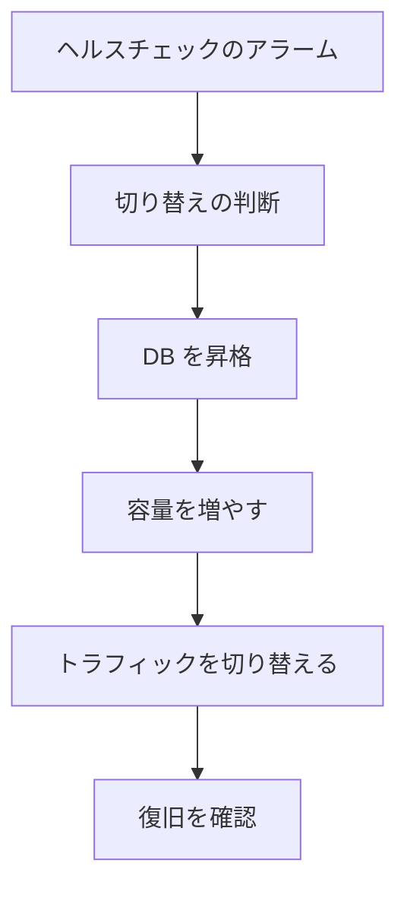

# 分野3: 回復力のあるクラウドソリューション

配点は **15%** です。高可用性、スケーラビリティ、自動復旧の3つを扱います。

問題文には、RTO、RPO、費用、運用負荷の条件が並びます。「最も回復力が高いもの」ではなく、**条件を満たす中で最も安いもの**を選びます。

## タスク 3.1: 回復力とビジネス要件を満たす高可用なソリューションを実装する {#task-3-1}

### Multi-AZ と Multi-Region の配置 {#t3-1-multi-az-region}

**ガイドの項目:** 知識「Multi-AZ と Multi-Region のデプロイ（コンピュート層、データ層）」「高可用性を実現する手法（Multi-AZ、Multi-Region）」

| 層 | Multi-AZ | Multi-Region |
|---|---|---|
| EC2 | Auto Scaling を複数の AZ に | AMI のコピー、別リージョンの Auto Scaling |
| コンテナ | タスクや Pod を AZ に分散 | リージョンごとにクラスター、ECR のレプリケーション |
| Lambda、API Gateway | 標準で複数 AZ | 別のリージョンにデプロイ |
| RDS | Multi-AZ | クロスリージョンのリードレプリカ |
| Aurora | 3 AZ のストレージ、レプリカ | Global Database |
| DynamoDB | 標準で複数 AZ | グローバルテーブル |
| S3 | 標準で 3 AZ 以上 | レプリケーション、Multi-Region Access Points |

Multi-AZ は多くの障害に効き、費用も小さく済みます。Multi-Region が必要なのは、リージョン障害に備える要件や、法規、遠隔地の利用者への遅延の要件があるときです。

詳細: [サービスごとの Multi-AZ と Multi-Region](../../services/resilience.md#patterns-by-service)、[高可用性のための Auto Scaling](../../services/resilience.md#auto-scaling-ha)、[コンテナのマルチクラスター戦略](../../services/resilience.md#multi-cluster)

### SLA {#t3-1-sla}

**ガイドの項目:** 知識「SLA」

SLA はサービスの提供者が約束する稼働率で、満たせないときの補償はサービスクレジットです。実際の稼働を保証するものではありません。

システム全体の稼働率は計算できます。

| 構成 | 計算 | 例（各 99.9%） |
|---|---|---|
| 直列（どちらも必要） | 掛け算 | 99.9% × 99.9% = 約 99.8% |
| 並列（片方で動く） | 1 - 故障率の掛け算 | 1 - 0.1% × 0.1% = 99.9999% |

依存先を直列に増やすほど、全体の稼働率は下がります。冗長にすると上がります。個別のサービスの数値は、変わることがあるので受験前に公式の SLA のページで確認します。

詳細: [疎結合と耐障害性](../../services/resilience.md#loose-coupling)、[静的安定性](../../services/resilience.md#static-stability)

### ステートフルなサービスの複製と切り替え {#t3-1-replication}

**ガイドの項目:** 知識「ステートフルなサービスのレプリケーションとフェイルオーバーの方法」

| サービス | 方法 | 同期 | 読み取り | 切り替え |
|---|---|---|---|---|
| RDS Multi-AZ DB インスタンス | スタンバイ | 同期 | スタンバイは不可 | 自動 |
| RDS Multi-AZ DB クラスター | 読み取り可のレプリカ 2 台 | 準同期 | 可 | 自動、通常 35 秒未満 |
| RDS リードレプリカ | 別リージョンにも置ける | 非同期 | 可 | 手動で昇格 |
| Aurora Global Database | 最大 10 のセカンダリ | 非同期、RPO は通常秒単位 | 可 | スイッチオーバー、フェイルオーバー |
| DynamoDB グローバルテーブル | 全リージョンで書き込み | 既定は結果整合 | 可 | アプリの向き先を変える |
| ElastiCache | レプリカ、Global Datastore | 非同期 | 可 | 自動（Multi-AZ） |
| S3 レプリケーション | CRR | 非同期 | 可 | Multi-Region Access Points など |

**落とし穴:** レプリケーションは破損や誤削除も複製します。時点復旧のバックアップも別に持ちます。

詳細: [リードレプリカと Multi-AZ](../../services/databases.md#read-replicas)、[Aurora グローバルデータベース](../../services/databases.md#aurora-global-database)、[グローバルテーブル](../../services/dynamodb.md#global-tables)、[レプリケーションと Multi-AZ](../../services/databases.md#elasticache-replication)、[S3 レプリケーション](../../services/s3.md#replication)、[書き込みの戦略](../../services/resilience.md#write-patterns)

### ビジネス要件から回復力の要件へ {#t3-1-business-requirements}

**ガイドの項目:** スキル「ビジネス要件を技術的な回復力の要件へ変換する」

問題文の言葉を、次のように数値と構成に置き換えます。

| 問題文の言葉 | 技術的な要件 | 構成の例 |
|---|---|---|
| 「データを 1 件も失えない」 | RPO 0 | 同期レプリケーション（Multi-AZ） |
| 「数分のデータ損失は許容する」 | RPO 数分 | Aurora Global Database、継続的バックアップ |
| 「1 時間以内に再開する」 | RTO 1 時間 | パイロットライト |
| 「数分で切り替える、費用は抑える」 | RTO 数分 | ウォームスタンバイ |
| 「AZ の障害でも容量を減らさない」 | 静的安定性 | AZ を 1 つ失っても足りる台数 |

**例:** 必要な台数が 6 台で 3 AZ なら、AZ を 1 つ失っても 6 台残るように、AZ あたり 3 台の合計 9 台にします。

詳細: [RTO と RPO](../../services/resilience.md#rto-rpo)、[達成できるかの計算](../../services/resilience.md#rto-rpo-budget)、[Resilience Hub](../../services/resilience.md#resilience-hub)

### 単一障害点の特定と解消 {#t3-1-spof}

**ガイドの項目:** スキル「既存のワークロードの単一障害点の特定と解消」

| 単一障害点 | 対策 |
|---|---|
| 1 台の EC2 | 複数 AZ の Auto Scaling と ALB |
| 1 つの AZ の NAT ゲートウェイ | AZ ごとに作り、ルートテーブルも分ける |
| Single-AZ の RDS | Multi-AZ |
| サーバー内のセッション | ElastiCache、DynamoDB へ移す |
| 1 本の VPN | トンネルを 2 本使う、Direct Connect と組み合わせる |
| EBS のファイル共有 | EFS |
| 固定の IP を持つ接続先 | DNS 名で接続する |

Resilience Hub は、アプリの構成を評価し、RTO と RPO の目標を満たすかを示します。

詳細: [Resilience Hub](../../services/resilience.md#resilience-hub)、[NAT ゲートウェイ](../../services/network-connectivity.md#nat-gateway)、[ステートフルとステートレス](../../services/sdk-resilience.md#stateful-stateless)

### リージョンをまたぐ機能の有効化 {#t3-1-cross-region}

**ガイドの項目:** スキル「リージョンをまたぐソリューションの有効化（DynamoDB、RDS、Route 53、S3、CloudFront など）」

| サービス | 機能 | 注意 |
|---|---|---|
| DynamoDB | グローバルテーブル | 既定の MREC は競合を後勝ちで解決する |
| RDS | クロスリージョンリードレプリカ | 昇格は手動。KMS キーはリージョンごと |
| Route 53 | フェイルオーバー、レイテンシー | TTL の間は古い応答が残る |
| S3 | CRR | 両方のバケットでバージョニングが必要 |
| CloudFront | オリジンフェイルオーバー | オリジングループを作る |

CloudFront のオリジンフェイルオーバーは、読み取りのリクエスト（GET、HEAD、OPTIONS）が対象です。書き込みの切り替えには、Route 53 などを使います。

Route 53 では、エイリアスに `Evaluate Target Health` を設定すると、ALB の状態がレコードの状態になります。

詳細: [Route 53 のフェイルオーバー設計](../../services/resilience.md#route53-failover)、[オリジンフェイルオーバー](../../services/networking.md#origin-failover)、[Multi-Region Access Points](../../services/storage-advanced.md#mrap)、[マルチリージョンキー](../../services/kms.md#multi-region-keys)、[レコード](../../services/networking.md#route53-records)

### AZ をまたぐ負荷分散 {#t3-1-load-balancing}

**ガイドの項目:** スキル「AZ をまたぐサービスを支える負荷分散の設定」

| 設定 | ALB | NLB |
|---|---|---|
| クロスゾーン負荷分散の既定 | 有効 | 無効 |
| AZ の偏りの影響 | 小さい | 無効のままだとターゲット数の差で偏る |

- ロードバランサーは少なくとも 2 つの AZ のサブネットに置きます。
- ターゲットも同じ AZ に分散します。
- Auto Scaling には ELB ヘルスチェックを有効にします。

詳細: [クロスゾーン負荷分散](../../services/networking.md#cross-zone)、[ALB と NLB の違い](../../services/networking.md#alb-vs-nlb)、[Auto Scaling のヘルスチェック](../../services/ec2-beanstalk.md#asg-health-checks)

### ダウンタイムを抑えるアプリの構成 {#t3-1-minimize-downtime}

**ガイドの項目:** スキル「ダウンタイムを最小にしつつ、複数の AZ とリージョンに対応するようアプリと関連サービスを構成する」

| 課題 | 方法 |
|---|---|
| フェイルオーバーで接続が切れる | RDS Proxy、再接続と再試行のロジック |
| DNS のキャッシュ | TTL を短くする、Aurora のクラスターエンドポイントを使う |
| 切り替えの判断を速く | データプレーンのヘルスチェック、ARC |
| 固定 IP のまま別のリージョンへ | Global Accelerator |
| データベースの更新で止めたくない | [RDS の Blue/Green デプロイ](https://docs.aws.amazon.com/AmazonRDS/latest/UserGuide/blue-green-deployments.html) |
| AZ の障害を素早く避ける | ARC のゾーンシフト |

切り替えの手順は、障害時に使えないコントロールプレーンに頼らないようにします。

詳細: [フェイルオーバーはデータプレーンで](../../services/resilience.md#failover-data-plane)、[ARC](../../services/resilience.md#arc)、[RDS Proxy](../../services/databases.md#rds-proxy)、[Global Accelerator との比較](../../services/resilience.md#global-accelerator)

## タスク 3.2: ビジネス要件を満たすスケーラブルなソリューションを実装する {#task-3-2}

### スケーリングの指標 {#t3-2-metrics}

**ガイドの項目:** 知識「サービスのスケーリングに適したメトリクス」

実際に限界になる指標で増やします。CPU が低くても、キューが溜まるワーカーがあります。

| 対象 | 指標の例 | 使う場面 |
|---|---|---|
| Web の EC2、ECS | `ALBRequestCountPerTarget` | リクエスト数に比例する負荷 |
| 計算の多い処理 | CPU 使用率 | 動画の変換など |
| SQS のワーカー | ターゲットあたりのバックログ | キューを処理する台数 |
| Lambda | `ConcurrentExecutions`、`Throttles` | 同時実行の余裕 |
| DynamoDB | 消費キャパシティ | プロビジョンドの Auto Scaling |
| Kinesis | `IncomingBytes`、`WriteProvisionedThroughputExceeded` | シャードの過不足 |

SQS では、`ApproximateNumberOfMessagesVisible` をタスク数で割った値をカスタムメトリクスにします。メトリクス計算でも求められます。

詳細: [EC2 Auto Scaling](../../services/ec2-beanstalk.md#auto-scaling)、[サービスの Auto Scaling](../../services/containers.md#service-auto-scaling)、[Lambda の既定メトリクス](../../services/observability.md#lambda-metrics)、[メトリクス計算](../../services/observability.md#metric-math)

### 疎結合と分散アーキテクチャ {#t3-2-loose-coupling}

**ガイドの項目:** 知識「疎結合で分散したアーキテクチャ」

間にキューやイベントを挟むと、各層が別々にスケールし、片方が止まっても処理を続けられます。

| 用途 | サービス |
|---|---|
| 負荷の平準化、再試行 | SQS |
| 同じ内容を複数の宛先へ | SNS、EventBridge |
| 順序のある大量のデータ | Kinesis Data Streams |
| 工程の管理 | Step Functions |

詳細: [疎結合](../../services/messaging.md#coupling)、[選び方](../../services/messaging.md#how-to-choose)、[疎結合と耐障害性](../../services/resilience.md#loose-coupling)

### サーバーレスの構成 {#t3-2-serverless}

**ガイドの項目:** 知識「サーバーレスアーキテクチャ」、スキル「サーバーレスアプリケーションの設定（API Gateway、Lambda、Fargate など）」

| 課題 | 設定 |
|---|---|
| コールドスタートで遅い | Provisioned Concurrency、SnapStart |
| 別の関数の同時実行を奪わない | 予約済み同時実行 |
| バックエンドを守る | API Gateway のスロットリング、使用量プラン |
| 同じ応答を何度も計算している | API Gateway のキャッシュ |
| データベースの接続数が足りない | RDS Proxy |
| Fargate のタスク数を自動で増やす | Application Auto Scaling |

API Gateway の統合のタイムアウトより長い処理は、同期で待たずに、キューや Step Functions へ渡します。

詳細: [同時実行とスケーリング](../../services/lambda.md#concurrency)、[コールドスタートを減らす](../../services/lambda.md#cold-start)、[使用量プランとスロットリング](../../services/api-gateway.md#usage-plans-throttling)、[API Gateway のキャッシュ](../../services/api-gateway.md#caching)、[Fargate と EC2](../../services/containers.md#fargate-vs-ec2)

### コンテナプラットフォーム {#t3-2-containers}

**ガイドの項目:** 知識「コンテナプラットフォーム」、スキル「コンテナアプリケーションのデプロイ（ECS、EKS など）」

| プラットフォーム | 向く場面 |
|---|---|
| ECS | AWS に統合された形で、運用を簡単にしたい |
| EKS | Kubernetes の API やエコシステムが必要 |
| Fargate | サーバーの管理をなくしたい |
| App Runner | ソースやイメージから Web アプリを動かすだけ |
| EKS Distro | 自分の環境で、EKS と同じ Kubernetes の配布版を動かす |
| ROSA | OpenShift を AWS のマネージド環境で使う |

デプロイでは、ECS はサービスの更新とサーキットブレーカーを、EKS は Deployment のローリング更新とプローブを押さえます。

詳細: [ECS](../../services/containers.md#ecs)、[EKS](../../services/containers.md#eks)、[App Runner](../../services/other-services.md#app-runner)、[EKS Distro](../../services/operations.md#eks-distro)、[ROSA](../../services/operations.md#rosa)、[サーキットブレーカー](../../services/containers.md#circuit-breaker)

### スケーリングの問題の特定と解消 {#t3-2-scaling-issues}

**ガイドの項目:** スキル「スケーリングの問題の特定と解消」

| 症状 | 原因 | 対策 |
|---|---|---|
| 増えるのが遅く、ピークに間に合わない | 起動に時間がかかる | ウォームプール、AMI への焼き込み、予測スケーリング |
| 増やしてもエラーが減らない | 律速は別の層 | データベース、接続数を確認 |
| インスタンスが増えない | `max` に到達、クォータ、IP の不足 | 活動の履歴を確認 |
| 起動と終了を繰り返す | ヘルスチェックの猶予が短い | 猶予期間を延ばす |
| Lambda の 429 | 同時実行の上限 | クォータの引き上げ、予約 |
| DynamoDB のスロットリング | パーティションの偏り | キーの設計 |
| Kinesis の `ProvisionedThroughputExceeded` | シャードの不足、キーの偏り | リシャーディング、オンデマンド |

詳細: [スケーリングの失敗の調査](../../services/operations.md#asg-troubleshooting)、[ウォームプール](../../services/operations.md#warm-pools)、[予測スケーリング](../../services/operations.md#predictive-scaling)、[スロットリング](../../services/dynamodb.md#throttling)、[Kinesis のエラー](../../services/streaming.md#kinesis-errors)

### Auto Scaling、負荷分散、キャッシュの選択 {#t3-2-autoscaling-caching}

**ガイドの項目:** スキル「適切な Auto Scaling、負荷分散、キャッシュの特定と実装」

| ポリシー | 向く場面 |
|---|---|
| ターゲット追跡 | 基本の形。値を保つ |
| ステップ | 超過の大きさで増やす量を変える |
| スケジュール | 決まった時間の増減 |
| 予測 | 周期のある負荷に先回りする |

| ロードバランサー | 向く場面 |
|---|---|
| ALB | HTTP のパスやヘッダーで振り分ける |
| NLB | 固定 IP、TCP、UDP、低遅延 |
| GWLB | 検査用のアプライアンスへ通す |

| キャッシュ | 置く場所 |
|---|---|
| CloudFront | 利用者の近くで、静的コンテンツや API の応答 |
| API Gateway のキャッシュ | API の手前 |
| ElastiCache | アプリとデータベースの間 |
| DAX | DynamoDB の手前 |

**費用の最適化:** Compute Optimizer で過大なインスタンスを見つけ、Trusted Advisor で未使用のリソースを確認します。中断に耐えるワーカーにはスポットを混ぜ、常時動く分には Savings Plans を使います。

詳細: [DAX、ElastiCache、CloudFront の使い分け](../../services/databases.md#cache-comparison)、[キャッシュ戦略](../../services/databases.md#caching-strategies)、[ステップスケーリング](../../services/ec2-beanstalk.md#step-adjustments)、[Elastic Load Balancing](../../services/networking.md#elb)、[Compute Optimizer](../../services/cost-management.md#compute-optimizer)、[Trusted Advisor](../../services/cloud-foundations.md#trusted-advisor)、[購入オプション](../../services/cost-management.md#purchase-options)

### 複数リージョンでのグローバルなスケール {#t3-2-global}

**ガイドの項目:** スキル「グローバルなスケーラビリティのための複数リージョンへのワークロード配置」

| 要件 | 選択 |
|---|---|
| 近いリージョンへ DNS で振り分ける | Route 53 のレイテンシーベース |
| 利用者の国でリージョンを決める | Route 53 の位置情報 |
| 固定 IP で AWS のネットワークに素早く入る | Global Accelerator |
| 静的コンテンツ、キャッシュできる応答 | CloudFront |
| 各リージョンで読み書き | DynamoDB グローバルテーブル |
| 書き込みは 1 か所、読み取りは各地 | Aurora Global Database |

同じ構成を各リージョンへ出すには、StackSets か、リージョンごとのステージを持つパイプラインを使います。

詳細: [ルーティングポリシー](../../services/networking.md#routing-policies)、[Global Accelerator](../../services/network-connectivity.md#global-accelerator)、[CloudFront](../../services/networking.md#cloudfront)、[書き込みの戦略](../../services/resilience.md#write-patterns)

## タスク 3.3: RTO と RPO を満たす自動復旧プロセスを実装する {#task-3-3}

### RTO と RPO {#t3-3-rto-rpo}

**ガイドの項目:** 知識「DR の概念（RTO、RPO など）」

| 指標 | 意味 | 決めるもの |
|---|---|---|
| RTO | 復旧までに許容する時間 | 待機系をどこまで動かしておくか |
| RPO | 失ってよいデータの時間 | バックアップの間隔、レプリケーション |

RTO は、検知、判断、昇格、増強、DNS の切り替えの時間の合計です。人の承認があれば、その時間も足します。

詳細: [RTO と RPO](../../services/resilience.md#rto-rpo)、[達成できるかの計算](../../services/resilience.md#rto-rpo-budget)

### DR 戦略 {#t3-3-dr-strategies}

**ガイドの項目:** 知識「AWS Backup と復旧の戦略（パイロットライト、ウォームスタンバイなど）」

| 戦略 | 待機系の状態 | RTO、RPO の目安 | 費用 |
|---|---|---|---|
| バックアップと復元 | バックアップだけ | 時間単位 | 低 |
| パイロットライト | データは複製、コンピュートは止める | 数十分 | 中 |
| ウォームスタンバイ | 小さい規模で常時稼働 | 数分 | 中から高 |
| マルチサイトアクティブ/アクティブ | 全規模で常時稼働 | ほぼゼロ | 高 |

サーバーの複製による DR なら、Elastic Disaster Recovery も候補です。継続的にブロックレベルで複製し、低コストのステージングから復旧します。

詳細: [4 つの DR 戦略](../../services/resilience.md#dr-strategies)、[パイロットライト](../../services/resilience.md#pilot-light)、[ウォームスタンバイ](../../services/resilience.md#warm-standby)、[Elastic Disaster Recovery](../../services/resilience.md#drs)、[AWS Backup](../../services/resilience.md#backup)

### 復旧の手順 {#t3-3-recovery-procedures}

**ガイドの項目:** 知識「復旧の手順」

手順は人の記憶に頼らず、コードにします。

| 工程 | 自動化の手段 |
|---|---|
| 判断 | CloudWatch アラーム、または承認ステップ |
| 手順の実行 | Systems Manager Automation、Step Functions |
| 全体の切り替え | ARC の Region switch |
| トラフィック | Route 53、ARC のルーティングコントロール |
| 構成の再作成 | CloudFormation、AMI のコピー |

復旧後の切り戻しの手順と、データの再同期も決めておきます。

詳細: [Region switch](../../services/resilience.md#arc-region-switch)、[ルーティングコントロール](../../services/resilience.md#arc-routing-control)、[Automation](../../services/operations.md#automation)、[プレイブックと実行基盤](../../services/threat-detection.md#ir-playbooks)

### フェイルオーバーのテスト {#t3-3-failover-testing}

**ガイドの項目:** スキル「Multi-AZ、Multi-Region のワークロードのフェイルオーバーのテスト（RDS、Aurora、Route 53、CloudFront など）」

| 対象 | テストの方法 |
|---|---|
| RDS Multi-AZ | `reboot-db-instance --force-failover` |
| Aurora | `failover-db-cluster`、FIS の `aws:rds:failover-db-cluster` |
| Aurora Global Database | スイッチオーバー（データ損失なしの計画的な移動） |
| Route 53 | ヘルスチェックの `Inverted` で異常の状態にする |
| CloudFront | プライマリのオリジンに、条件のエラーコードを返させる |
| アプリ全体 | FIS の実験テンプレート。停止条件にアラームを指定 |

FIS の実験テンプレートには、対象、アクション、停止条件を書きます。本番で実行するなら、アラームで止まるようにします。

詳細: [FIS](../../services/resilience.md#fis)、[実験テンプレート](../../services/resilience.md#fis-template)、[グローバルデータベースの切り替え](../../services/databases-specialized.md#aurora-global-switchover)、[Route 53 ヘルスチェック](../../services/networking.md#route53-health-checks)

### リージョンをまたぐバックアップと復旧 {#t3-3-backup}

**ガイドの項目:** スキル「リージョンをまたぐ適切なバックアップと復旧の特定と実装（AWS Backup、S3、Systems Manager など）」

| 要件 | 方法 |
|---|---|
| 複数のサービスを一か所でバックアップする | バックアッププランとタグでの割り当て |
| 別のリージョンに残す | プランのルールのコピー先 |
| 別のアカウントに残す | 同じ組織の中のアカウント間コピー |
| 組織全体に適用する | バックアップポリシー |
| ランサムウェアから守る | Vault Lock、論理的にエアギャップされたボールト |
| 復元できることを確かめる | 復元テスト |
| RPO を短くする | 対応するサービスの継続的バックアップ |
| S3 の別リージョンへの複製 | CRR |
| DR の手順を実行する | Systems Manager Automation |

コピーのときは、宛先のボールトのキーで再暗号化されます。コールドストレージのバックアップはコピーできません。

詳細: [バックアッププランとルール](../../services/resilience.md#backup-plans)、[リージョン間コピー](../../services/resilience.md#backup-cross-region)、[アカウント間コピー](../../services/resilience.md#backup-cross-account)、[Vault Lock](../../services/resilience.md#vault-lock)、[復元テストと監査](../../services/resilience.md#backup-testing)

### ロードバランサーのバックエンド障害からの復旧 {#t3-3-load-balancer}

**ガイドの項目:** スキル「バックエンドの障害から復旧するロードバランサーの設定」

| 設定 | 効果 |
|---|---|
| ターゲットグループのヘルスチェック | 異常なターゲットへの送信を止める |
| Auto Scaling の ELB ヘルスチェック | 異常なインスタンスを置き換える |
| 登録解除の遅延 | 処理中のリクエストを完了させる |
| Route 53 の `Evaluate Target Health` | ALB が使えなければ別のリージョンへ |

**落とし穴:** すべてのターゲットが異常になると、ALB は全ターゲットへ転送します（フェイルオープン）。ヘルスチェックが依存先を見ていると、データベースの障害で全台が異常と判定されます。Auto Scaling が全台を入れ替え続けるおそれもあるので、確認の範囲を決めておきます。

詳細: [ALB のヘルスチェック](../../services/networking.md#alb-health-checks)、[ターゲットグループの属性](../../services/networking.md#target-group-attributes)、[ヘルスチェックとプローブ](../../services/observability.md#health-checks)

## 確認問題 {#self-check}

??? question "問1: RTO 15 分、RPO 1 分のシステムを別のリージョンで守ります。常時全規模で動かす費用は避けたいです。アプリのサーバーは、起動と確認に 20 分かかります。データベースは Aurora です。どの構成を選びますか？"
    ウォームスタンバイと Aurora Global Database です。RPO は通常秒単位に収まります。小さい規模のコンピュートを動かしておけば、容量を増やしても 15 分に収まりやすくなります。パイロットライトは、障害時のサーバーの起動に 20 分かかるので RTO を超えます。バックアップと復元では RPO と RTO を満たせません。

??? question "問2: Route 53 のフェイルオーバーで 30 秒ごとに 3 回の確認、TTL が 300 秒です。切り替えが遅いと指摘されました。最も効く変更は？"
    TTL を短くします。今は検知の 90 秒より、クライアントのキャッシュの 300 秒が大きな割合を占めています。60 秒にすれば、最悪の場合でも大きく短くなります。

??? question "問3: 3 AZ で動く Web アプリで、AZ が 1 つ止まっても容量を落とさずにいたいです。必要な台数は 12 台です。最小台数はいくつにしますか？"
    18 台です。AZ あたり 12 ÷ (3 - 1) = 6 台で、3 AZ の合計が 18 台になります。障害の後に増やす設計より、静的安定性を保てます。

??? question "問4: SQS のワーカーを CPU 使用率でスケールしていますが、I/O 待ちが多い処理で CPU が上がらず、キューが溜まり続けます。どう変えますか？"
    キューの長さをタスク数で割った、ターゲットあたりのバックログを指標にします。メトリクス計算かカスタムメトリクスで作り、ターゲット追跡スケーリングに設定します。

??? question "問5: ランサムウェアで管理者の権限が奪われても、バックアップを消されないようにしたいです。別のリージョンにも残します。どう構成しますか？"
    AWS Backup のボールトをコンプライアンスモードの Vault Lock で保護し、別のリージョン、別のアカウントのボールトへコピーします。保持期間が終わるまで、管理者でも削除できません。

??? question "問6: データベースへの疎通をヘルスチェックに含めたところ、データベースの短い障害で全インスタンスが Auto Scaling に置き換えられ、復旧が遅れました。どう直しますか？"
    ヘルスチェックのパスは、インスタンス自身が応答できるかだけを見るようにします。依存先の確認は別のアラームで行います。依存先の障害はインスタンスの置き換えでは直りません。
