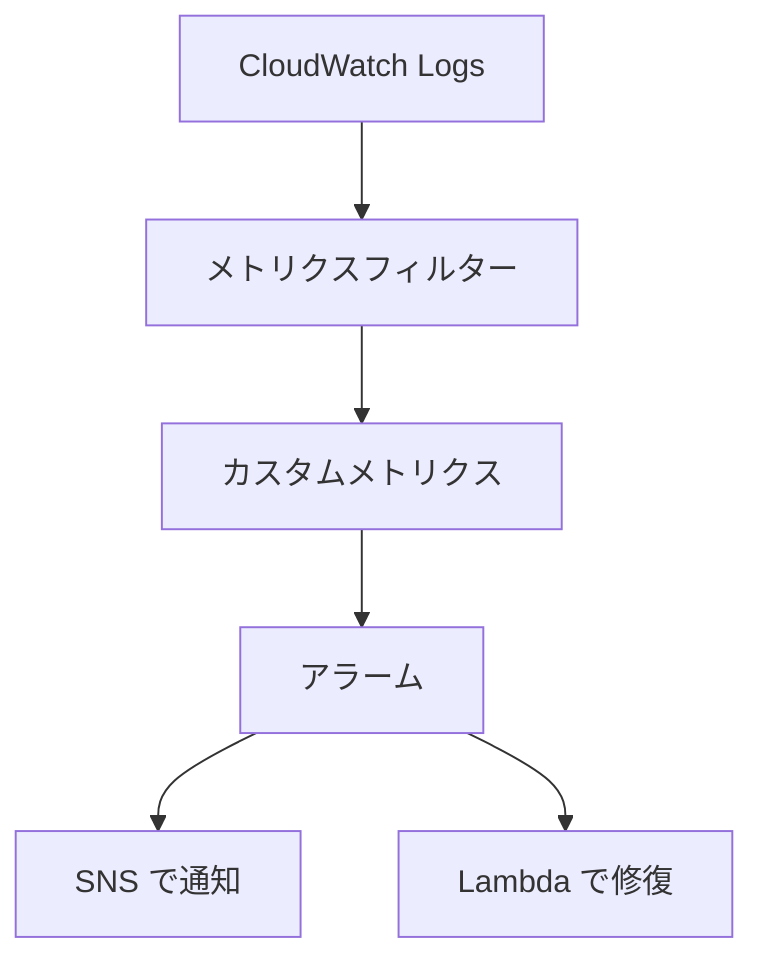
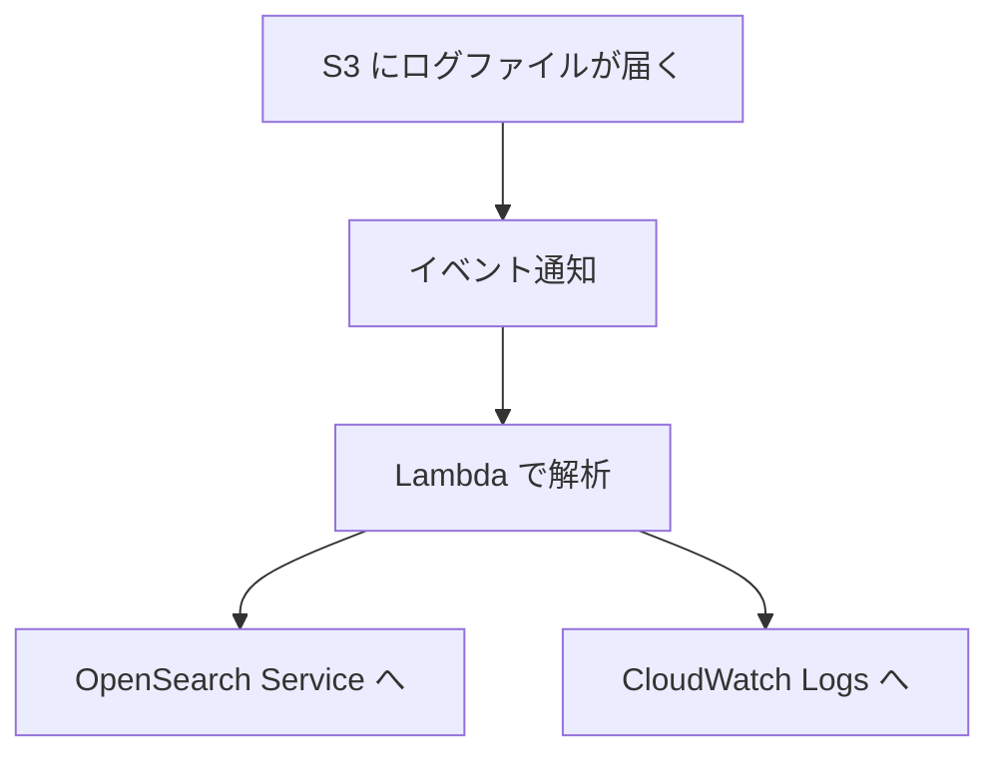

# 分野4: 監視とログ

配点は **15%** です。ログとメトリクスの収集、分析、自動対応の3つを扱います。

同じ「ログを流す」でも、リアルタイムかどうか、加工が必要か、複数アカウントかで答えが変わります。条件を読み分ける問題が中心です。

## タスク 4.1: ログとメトリクスの収集、集約、保存を構成する {#task-4-1}

### アプリとインフラの監視 {#t4-1-monitoring}

**ガイドの項目:** 知識「アプリケーションとインフラの監視の方法」

メトリクスで異常に気づき、ログで内容を調べ、トレースで場所を特定します。

| 見たいもの | 手段 |
|---|---|
| CPU、ネットワークなどの基本 | CloudWatch の標準メトリクス |
| メモリ、ディスク | CloudWatch エージェント |
| コンテナの状態 | Container Insights |
| リクエストの経路 | X-Ray |
| 利用者の視点での死活 | Synthetics |
| ブラウザでの体験 | RUM |
| サービスの SLO | Application Signals |
| Prometheus の指標 | Amazon Managed Service for Prometheus |
| 複数のソースの可視化 | Amazon Managed Grafana |

詳細: [ロギング、モニタリング、オブザーバビリティの違い](../../services/observability.md#logging-monitoring-observability)、[Application Signals](../../services/observability.md#application-signals)、[Managed Grafana](../../services/operations.md#managed-grafana)、[Managed Service for Prometheus](../../services/operations.md#managed-prometheus)

### CloudWatch メトリクスの基本 {#t4-1-metrics}

**ガイドの項目:** 知識「CloudWatch メトリクス（名前空間、メトリクス、ディメンション、解像度）」

| 用語 | 意味 | 例 |
|---|---|---|
| 名前空間 | メトリクスの入れ物 | `AWS/EC2`、`CWAgent` |
| ディメンション | 絞り込みの軸 | `InstanceId`、`AutoScalingGroupName` |
| 解像度 | データの細かさ | 標準 60 秒、高解像度 1 秒 |

データの保持は粒度によって変わります。

| データポイントの期間 | 利用できる期間 |
|---|---|
| 60 秒未満 | 3 時間 |
| 60 秒 | 15 日 |
| 300 秒 | 63 日 |
| 3,600 秒 | 455 日 |

15 か月より長く残すなら、S3 へ流します。

**落とし穴:** ディメンションが違うと、別のメトリクスです。`InstanceId` 付きのメトリクスを Auto Scaling グループで集計したいなら、エージェントの `aggregation_dimensions` を設定します。

詳細: [基本の用語](../../services/observability.md#metrics-concepts)、[解像度と保持期間](../../services/observability.md#metrics-resolution)、[統計とパーセンタイル](../../services/observability.md#statistics)

### リアルタイムのログの取り込み {#t4-1-real-time}

**ガイドの項目:** 知識「リアルタイムのログの取り込み」

| 取り込み先 | 向く場面 |
|---|---|
| CloudWatch Logs | エージェントや `PutLogEvents` で集める |
| Kinesis Data Streams | 独自のコンシューマーで、順序どおりに処理する |
| Amazon Data Firehose | S3 や OpenSearch へ届けるだけ。バッファの分は遅れる |
| Live Tail | 調査の間だけ、人が見る |

!!! note "Kinesis Data Firehose の名前"
    ガイドの Amazon Kinesis Data Firehose は、現在は Amazon Data Firehose という名前です。

詳細: [Kinesis Data Streams、Firehose、SQS の選び方](../../services/streaming.md#choosing)、[Firehose のバッファ](../../services/streaming.md#firehose-buffering)、[Live Tail](../../services/observability.md#live-tail)

### ログの暗号化 {#t4-1-encryption}

**ガイドの項目:** 知識「保存時、転送時のログとメトリクスの暗号化の選択肢（クライアント側、サーバー側、KMS）」、スキル「ログデータの暗号化の設定（KMS など）」

| 場所 | 方法 |
|---|---|
| CloudWatch Logs（保存時） | ロググループに KMS キーを関連付ける |
| S3（保存時） | SSE-S3、SSE-KMS |
| 転送時 | TLS の API エンドポイント、VPC エンドポイント |
| 送る前に暗号化 | クライアント側で暗号化してから送る |
| 機密情報のマスク | CloudWatch Logs のデータ保護ポリシー |

CloudWatch Logs に KMS キーを使うには、`aws logs associate-kms-key` を実行します。キーポリシーで、リージョンの CloudWatch Logs のサービスプリンシパルに権限を与える必要があります。これがないと関連付けが失敗します。

詳細: [KMS による暗号化](../../services/observability.md#logs-kms)、[データ保護ポリシー](../../services/observability.md#logs-data-protection)、[保存時と転送時の暗号化](../../services/kms.md#at-rest-in-transit)、[クライアント側とサーバー側の暗号化](../../services/kms.md#client-vs-server-side)

### ログ収集の権限 {#t4-1-permissions}

**ガイドの項目:** 知識「セキュリティの構成（ログ収集を許可する IAM ロールと権限）」

| 送り元 | 必要なもの |
|---|---|
| EC2 の CloudWatch エージェント | インスタンスのロールに `CloudWatchAgentServerPolicy` |
| ECS の `awslogs` | タスク実行ロールに、ログの作成と送信の権限 |
| Lambda | 実行ロールにログの権限 |
| VPC フローログ | CloudWatch Logs へはロール、S3 へはバケットポリシー |
| CloudTrail | S3 のバケットポリシー、CloudWatch Logs へはロール |
| サブスクリプションフィルター | Kinesis、Firehose へはロール、Lambda へはリソースポリシー |
| 別のアカウントへのログ | 宛先アカウントの `PutDestination` と宛先ポリシー |

詳細: [CloudWatch エージェント](../../services/operations.md#cloudwatch-agent)、[サブスクリプションフィルターの設定](../../services/observability.md#subscription-settings)、[VPC フローログ](../../services/networking.md#flow-logs)、[logConfiguration](../../services/containers.md#log-configuration)

### ログの安全な保管 {#t4-1-secure-storage}

**ガイドの項目:** スキル「ログの安全な保管と管理」

組織のログは、専用のログ保管アカウントに集めます。

| 要件 | 方法 |
|---|---|
| 改ざんを防ぐ | S3 Object Lock、SCP で変更を拒否 |
| 改ざんを検知する | CloudTrail のログファイル検証 |
| 組織全体の証跡 | 組織の証跡を管理アカウントか委任管理者で作る |
| アクセスを制限する | バケットポリシー、KMS のキーポリシー |

詳細: [Object Lock](../../services/s3.md#object-lock)、[証跡とイベント履歴](../../services/observability.md#cloudtrail-trails)、[マルチアカウントのパターン](../../services/governance.md#multi-account-patterns)

### メトリクスフィルター {#t4-1-metric-filters}

**ガイドの項目:** スキル「メトリクスフィルターによるログイベントからの CloudWatch メトリクスの作成」

ログに含まれる文字列や値を、数値のメトリクスに変えます。

```text
{ $.status = 500 }
[ip, user, timestamp, request, status_code = 5*, size]
```

**落とし穴:** フィルターを作った後のログだけが対象です。過去のログには効きません。過去を調べるなら Logs Insights です。

詳細: [メトリクスフィルター](../../services/observability.md#metric-filters)、[メトリクスフィルターの設定](../../services/observability.md#metric-filter-settings)

### メトリクスストリーム {#t4-1-metric-streams}

**ガイドの項目:** スキル「CloudWatch メトリクスストリームの作成（S3、Kinesis Data Firehose など）」

メトリクスを、ほぼリアルタイムで継続して外へ流す機能です。

| 項目 | 内容 |
|---|---|
| 宛先 | Firehose 経由で S3 などへ。S3 とパートナー向けのクイックセットアップもある |
| パートナー | Datadog、Dynatrace、Elastic、New Relic、Splunk Observability Cloud、Sumo Logic |
| 形式 | JSON、OpenTelemetry 1.0.0、OpenTelemetry 0.7.0 |
| フィルター | 名前空間やメトリクスの包含か除外。1 つのストリームに両方は置けない |
| 統計 | `Minimum`、`Maximum`、`SampleCount`、`Sum` が常に含まれる |
| 複数アカウント | 監視アカウントのストリームに、ソースアカウントのメトリクスを含められる |
| 料金 | メトリクスの更新数と、Firehose の費用 |

| 比較 | メトリクスストリーム | `GetMetricData` のポーリング |
|---|---|---|
| 鮮度 | ほぼリアルタイム | 間隔しだい |
| 手間 | 設定だけ | 自分で書く |
| 向く場面 | 外部の監視基盤、データレイク | 少数のメトリクスをたまに取得 |

長期の分析では、S3 へ流して Athena で問い合わせます。

詳細: [Use metric streams（公式）](https://docs.aws.amazon.com/AmazonCloudWatch/latest/monitoring/CloudWatch-Metric-Streams.html)、[Firehose](../../services/streaming.md#firehose)

### カスタムメトリクスの収集 {#t4-1-custom-metrics}

**ガイドの項目:** スキル「カスタムメトリクスの収集（CloudWatch エージェントの使用など）」

| 方法 | 向く場面 |
|---|---|
| CloudWatch エージェント | OS の中のメモリ、ディスク。ログも同時に |
| `PutMetricData` | アプリから直接送る |
| Embedded Metric Format | Lambda などのログからメトリクスを作る |

エージェントの設定は Parameter Store に置くと、全台で共有できます。導入は Run Command の `AWS-ConfigureAWSPackage` を使います。

詳細: [CloudWatch エージェント](../../services/operations.md#cloudwatch-agent)、[PutMetricData](../../services/observability.md#put-metric-data)、[EMF](../../services/observability.md#emf)、[EC2 の既定メトリクスとエージェント](../../services/observability.md#ec2-metrics)

### ログの保存のライフサイクル {#t4-1-lifecycle}

**ガイドの項目:** スキル「ログの保存のライフサイクルの管理（S3 のライフサイクル、ロググループの保持期間など）」

| 場所 | 設定 |
|---|---|
| CloudWatch Logs | ロググループの保持期間。既定は無期限 |
| CloudWatch Logs | ログクラス。Standard と低コストのクラス |
| S3 | ライフサイクルルールで Glacier へ移し、期限で削除 |

既定では消えないので、費用が増え続けます。作成時に保持期間を指定し、Config のルールで確認します。

`CreateExportTask` による S3 へのエクスポートはリアルタイムではありません。継続して S3 へ送るなら、サブスクリプションフィルターと Firehose です。

詳細: [保持期間の設定](../../services/observability.md#log-retention)、[ログクラス](../../services/observability.md#log-classes)、[S3 へのエクスポート](../../services/observability.md#logs-export)、[S3 のライフサイクル](../../services/s3.md#lifecycle)

### サブスクリプションフィルター {#t4-1-subscriptions}

**ガイドの項目:** スキル「CloudWatch Logs のサブスクリプションによるログデータの処理（Kinesis、Lambda、OpenSearch Service など）」

| 宛先 | 向く場面 |
|---|---|
| Lambda | ログに応じた通知や加工 |
| Kinesis Data Streams | 複数のコンシューマー、独自の処理 |
| Firehose | S3 などへの配信 |
| OpenSearch Service | 検索と可視化 |

全アカウントのログを集めるなら、ログ保管アカウントに論理的な宛先を作り、Kinesis や Firehose へ流します。

受け取るデータは Base64 でエンコードされ、gzip で圧縮されています。Lambda では両方を戻してから処理します。

詳細: [サブスクリプションフィルター](../../services/observability.md#subscription-filters)、[設定](../../services/observability.md#subscription-settings)

### ログの検索 {#t4-1-search}

**ガイドの項目:** スキル「フィルターとパターン構文、CloudWatch Logs Insights によるログデータの検索」

```text
fields @timestamp, @message
| filter @message like /ERROR/
| stats count(*) by bin(5m)
| sort @timestamp desc
```

| 手段 | 向く場面 |
|---|---|
| フィルターパターン | メトリクスフィルター、単純な検索 |
| Logs Insights | 集計、複数のロググループ、その場の調査 |
| Athena | S3 上の長期のログ |
| Live Tail | リアルタイムに見る |

詳細: [Logs Insights](../../services/observability.md#logs-insights)、[コマンドの詳細](../../services/observability.md#insights-commands)

## タスク 4.2: ログとメトリクスを監査、監視、分析して問題を検出する {#task-4-2}

### 異常検知 {#t4-2-anomaly}

**ガイドの項目:** 知識「異常検知アラーム（CloudWatch の異常検知など）」

過去のデータから「普通の帯」を学習します。時間や曜日で変わるメトリクスに向いています。

**例:** 平日の昼に多く夜に少ない受注数は、固定のしきい値では夜の急減に気づけません。異常検知なら、夜の水準に対する急減で鳴ります。

**制約:** 異常検知のアラームには Auto Scaling のアクションを付けられません。

詳細: [異常検知](../../services/observability.md#anomaly-detection)

### よく使うメトリクスとログ {#t4-2-common-metrics}

**ガイドの項目:** 知識「よく使う CloudWatch のメトリクスとログ（EC2 の CPU 使用率、RDS のキューの長さ、ALB の 5xx など）」

| サービス | メトリクス | 読み方 |
|---|---|---|
| EC2 | `CPUUtilization` | メモリは含まれない |
| EC2 | `StatusCheckFailed_System` | AWS 側の問題。復旧アクション |
| EC2 | `StatusCheckFailed_Instance` | OS の問題。再起動アクション |
| RDS | `DiskQueueDepth` | ディスクの I/O が追いつかない |
| RDS | `DatabaseConnections`、`FreeStorageSpace` | 接続数、空き容量 |
| ALB | `HTTPCode_Target_5XX_Count` | ターゲットのアプリの問題 |
| ALB | `HTTPCode_ELB_5XX_Count` | ALB 自身が返すエラー |
| ALB | `TargetResponseTime` | ターゲットの遅さ |
| SQS | `ApproximateAgeOfOldestMessage` | 処理の遅れ |
| Lambda | `Errors`、`Throttles`、`IteratorAge` | エラー、制限、ストリームの遅れ |

詳細: [代表的なメトリクスと原因](../../services/observability.md#bottleneck-metrics)、[Lambda の既定メトリクス](../../services/observability.md#lambda-metrics)、[ALB のエラーコード](../../services/networking.md#alb-errors)、[ステータスチェック](../../services/operations.md#status-checks)

### Inspector {#t4-2-inspector}

**ガイドの項目:** 知識「Amazon Inspector とよく使う評価テンプレート」

Inspector は、EC2、ECR のイメージ、Lambda の脆弱性を継続的にスキャンします。

| 対象 | スキャンの内容 |
|---|---|
| EC2 | CVE、ネットワーク到達性 |
| ECR | コンテナイメージ |
| Lambda | 依存関係、独自コード |
| Code Security | 自作コード、依存関係、IaC |

修正が確認できると、検出結果は自動で閉じられます。組織の委任管理者が全アカウントを管理できます。

!!! note "評価テンプレートと Inspector Classic"
    ガイドの「評価テンプレート」は、対象とルールパッケージを定義して実行する Inspector Classic の用語です。Inspector Classic は 2026 年 5 月 20 日にサポートが終了しました。現在の Inspector はテンプレートを作らず、有効にすれば自動でスキャンします。

詳細: [Inspector](../../services/threat-detection.md#inspector)、[スキャンの種類](../../services/threat-detection.md#inspector-scan-types)、[検出結果と管理](../../services/threat-detection.md#inspector-findings)

### AWS Config ルール {#t4-2-config-rules}

**ガイドの項目:** 知識「AWS Config ルール」

| 観点 | 種類 |
|---|---|
| 作り方 | マネージドルール、カスタムルール（Lambda など） |
| トリガー | 設定変更、定期、両方 |
| 評価モード | 検出的、プロアクティブ |

ルールは判定するだけで、操作を止めません。止めるには SCP、直すには[修復](#t4-3-config-remediation)を使います。

詳細: [Config ルール](../../services/governance.md#config-rules)、[設定レコーダー](../../services/governance.md#config-recorder)、[Config と CloudTrail の違い](../../services/governance.md#config-vs-cloudtrail)

### CloudTrail のログイベント {#t4-2-cloudtrail}

**ガイドの項目:** 知識「AWS CloudTrail のログイベント」

| イベント | 内容 | 既定 |
|---|---|---|
| 管理イベント | リソースの作成や設定の変更 | 記録される |
| データイベント | S3 のオブジェクト、Lambda の呼び出しなど | 有効化が必要 |
| Insights イベント | 通常と違う API の呼び出しの量 | 有効化が必要 |

90 日より長く残すには、証跡を作って S3 に送ります。「誰が変更したか」は CloudTrail、「どのような設定だったか」は Config です。

詳細: [イベントの種類](../../services/observability.md#cloudtrail-events)、[CloudTrail Insights](../../services/observability.md#cloudtrail-insights)、[CloudTrail の調査](../../services/threat-detection.md#investigate-cloudtrail)

### ダッシュボードと可視化 {#t4-2-dashboards}

**ガイドの項目:** スキル「CloudWatch ダッシュボードと Amazon Quick Sight の可視化の構築」

| 比較 | CloudWatch ダッシュボード | Quick Sight |
|---|---|---|
| 目的 | 運用の監視 | ビジネスの分析、レポート |
| データ | メトリクス、ログ、アラーム | Athena などの分析データ |
| 範囲 | 複数リージョン、複数アカウントも可 | データセットしだい |

ログを S3 に集めて Athena でテーブルにし、Quick Sight で可視化するのが定番です。

詳細: [ダッシュボードの設定](../../services/observability.md#dashboard-settings)、[Quick Sight](../../services/data-engineering.md#quick-sight)

### アラームとメトリクスの関連付け {#t4-2-alarms}

**ガイドの項目:** スキル「CloudWatch アラームと CloudWatch メトリクス（標準、カスタム）の関連付け」

| 設定 | 効果 |
|---|---|
| M out of N | 一時的な値で鳴らないようにする |
| 欠落データの扱い | データがないときの判定 |
| 複合アラーム | 複数の条件を組み合わせ、通知を減らす |
| メトリクス計算 | エラー率など、計算した値で判定 |
| 高解像度 | 10 秒、20 秒、30 秒の周期で判定。元のメトリクスも高解像度にする |

**例:** 5 分のうち 3 回で超えたときに鳴らすには、`DatapointsToAlarm` を 3、`EvaluationPeriods` を 5 にします。

バッチのように間欠で動く処理は、データが欠落します。`treatMissingData` を `notBreaching` にすると、誤って鳴らなくなります。

詳細: [アラーム](../../services/observability.md#alarms)、[評価の仕組み](../../services/observability.md#alarm-evaluation)、[欠落データの扱い](../../services/observability.md#treat-missing-data)、[複合アラーム](../../services/observability.md#composite-alarms)

### X-Ray の設定 {#t4-2-xray}

**ガイドの項目:** スキル「さまざまなサービスの X-Ray の設定（コンテナ、API Gateway、Lambda など）」

| 実行環境 | 設定 |
|---|---|
| Lambda | アクティブトレースを有効にし、実行ロールに権限を付ける |
| API Gateway | ステージでトレースを有効にする |
| ECS | X-Ray デーモンをサイドカーで動かし、タスクロールに権限を付ける |
| EKS | デーモンを DaemonSet で動かす |
| EC2 | デーモンを導入し、インスタンスのロールに権限を付ける |

検索で使いたい値はアノテーションに入れます。メタデータはインデックスされません。費用はサンプリングで調整します。

!!! note "X-Ray SDK とデーモンの状況"
    X-Ray SDK とデーモンは 2026 年 2 月 25 日にメンテナンスモードに入りました。新しい計装では OpenTelemetry（ADOT）が推奨で、送信には CloudWatch エージェントや OpenTelemetry Collector を使います。トレースの保存先としての X-Ray は引き続き使えます。

詳細: [X-Ray](../../services/observability.md#xray)、[X-Ray デーモン](../../services/observability.md#xray-daemon)、[Lambda のアクティブトレース](../../services/observability.md#lambda-active-tracing)、[API Gateway での有効化](../../services/observability.md#xray-apigateway)、[SDK と OpenTelemetry](../../services/observability.md#xray-opentelemetry)、[サンプリング](../../services/observability.md#xray-sampling)

### リアルタイムのログストリームの分析 {#t4-2-real-time-analysis}

**ガイドの項目:** スキル「リアルタイムのログストリームの分析（Kinesis Data Streams の使用など）」

| 構成 | 向く場面 |
|---|---|
| Kinesis Data Streams と Lambda | イベントごとの判定、通知 |
| Kinesis Data Streams と Managed Service for Apache Flink | 時間枠での集計、連続した分析 |
| 拡張ファンアウト | 複数のコンシューマーがそれぞれ専用の読み取り量を持つ |

遅れは `IteratorAgeMilliseconds` で確かめます。シャードの偏りがあるなら、パーティションキーを見直します。

詳細: [Lambda とストリーム](../../services/streaming.md#lambda-streams)、[拡張ファンアウト](../../services/streaming.md#enhanced-fan-out)、[Flink](../../services/data-engineering.md#flink)、[Kinesis のエラー](../../services/streaming.md#kinesis-errors)

### AWS サービスでのログ分析 {#t4-2-log-analysis}

**ガイドの項目:** スキル「AWS サービスによるログの分析（Athena、CloudWatch Logs Insights など）」

| 比較 | Logs Insights | Athena |
|---|---|---|
| 対象 | CloudWatch Logs | S3 |
| 向く期間 | 最近の調査 | 長期、大量 |
| 費用を抑える方法 | 対象のロググループと時間を絞る | パーティション、列指向の形式 |

Athena で ALB、CloudTrail、VPC フローログを分析できます。CloudTrail のテーブルにパーティションを切ると、スキャン量が減ります。大量のログを定期的に読むなら Parquet へ変換します。

詳細: [Athena](../../services/streaming.md#athena)、[S3 上のログを問い合わせる](../../services/streaming.md#athena-logs)、[速く、安くするコツ](../../services/streaming.md#athena-performance)、[ログからボトルネックを見つける](../../services/observability.md#logs-bottlenecks)

## タスク 4.3: 複雑な環境の監視とイベント管理を自動化する {#task-4-3}

### イベント駆動の非同期パターン {#t4-3-event-patterns}

**ガイドの項目:** 知識「イベント駆動の非同期設計パターン（S3 イベント通知や EventBridge イベントから SNS や Lambda へなど）」

| 比較 | S3 イベント通知 | EventBridge 経由 |
|---|---|---|
| 宛先 | Lambda、SQS、SNS | 多数のターゲット |
| 絞り込み | プレフィックスとサフィックス | 内容のパターン |
| 複数の宛先 | 同じ条件の重複は不可 | ルールごとに可 |
| 向く場面 | 単純な連携 | 複数の処理、再生、複雑な条件 |

詳細: [S3 イベント通知](../../services/messaging.md#s3-events)、[Event Notifications](../../services/s3.md#event-notifications)、[EventBridge](../../services/messaging.md#eventbridge)、[アーカイブとリプレイ](../../services/messaging.md#archive-replay)

### Auto Scaling の機能と設定 {#t4-3-auto-scaling}

**ガイドの項目:** 知識「さまざまなサービスの Auto Scaling の機能（EC2 Auto Scaling グループ、RDS ストレージの Auto Scaling、DynamoDB、ECS キャパシティプロバイダー、EKS のオートスケーラー）」、スキル「Auto Scaling の構成の設定（DynamoDB、EC2 Auto Scaling グループ、RDS ストレージの Auto Scaling、ECS キャパシティプロバイダーなど）」

| サービス | 増やすもの | 仕組み |
|---|---|---|
| EC2 Auto Scaling | インスタンス | ターゲット追跡などのポリシー |
| RDS | ストレージ | 空き容量がしきい値以下で自動拡張 |
| DynamoDB | RCU、WCU | Application Auto Scaling、またはオンデマンド |
| ECS サービス | タスク数 | Application Auto Scaling |
| ECS キャパシティプロバイダー | クラスターの EC2 | マネージドスケーリング |
| EKS | ノード | Karpenter、Cluster Autoscaler、Auto Mode |

**RDS のストレージの Auto Scaling** は、`MaxAllocatedStorage` で上限を指定します。次の 3 つを満たすと拡張します。

- 空き容量が割り当て済みの 10% 以下
- その状態が 5 分以上続く
- 前回の変更の最適化が完了しており、過去 24 時間の変更が 4 回未満

上限は現在の容量より 10% 以上大きく指定する必要があり、26% 以上が推奨です。割り当てた容量は減らせません。大量のデータロードでは間に合わず、ストレージがいっぱいになることがあります。

**ECS のキャパシティプロバイダー** は 2 種類あります。Fargate 用の `FARGATE`、`FARGATE_SPOT` と、Auto Scaling グループを使う EC2 用です。EC2 用でマネージドスケーリングを有効にすると、タスクの配置に必要な分だけインスタンスを増減します。

**EKS のノードの増減:**

| 手段 | 動き | 向く場面 |
|---|---|---|
| Auto Mode | ノードの作成、統合、削除を AWS が行う。Karpenter が基盤 | 運用を任せたい |
| Karpenter | Pod の要件に合うインスタンスを直接起動する。OSS で自分で管理 | 多様なインスタンスを柔軟に使う |
| Cluster Autoscaler | Auto Scaling グループを使ってノード数を調整 | 既存のノードグループを活かす |

Pod の数は Kubernetes の Horizontal Pod Autoscaler が扱います。

詳細: [EC2 Auto Scaling](../../services/ec2-beanstalk.md#auto-scaling)、[プロビジョンドと Auto Scaling](../../services/dynamodb.md#provisioned-auto-scaling)、[キャパシティプロバイダー](../../services/containers.md#capacity-providers)、[サービスの Auto Scaling](../../services/containers.md#service-auto-scaling)、[RDS のストレージ Auto Scaling（公式）](https://docs.aws.amazon.com/AmazonRDS/latest/UserGuide/USER_PIOPS.Autoscaling.html)、[EKS のオートスケーリング（公式）](https://docs.aws.amazon.com/eks/latest/userguide/autoscaling.html)

### アラートと通知のアクション {#t4-3-alerts}

**ガイドの項目:** 知識「アラートの通知とアクションの機能（CloudWatch アラームから SNS、Lambda、EC2 の自動復旧へなど）」、スキル「CloudWatch のカスタムメトリクスとメトリクスフィルター、アラーム、通知の作成（SNS、Lambda など）」

| アクション | 向く場面 |
|---|---|
| SNS | 通知。メール、SQS、Lambda へ |
| Lambda | 通知の加工、修復の処理 |
| EC2 の `recover` | `StatusCheckFailed_System` で別のホストへ |
| EC2 の `reboot` | `StatusCheckFailed_Instance` で再起動 |
| Auto Scaling のポリシー | スケールアウト |
| Systems Manager | OpsItem の作成 |

EC2 の復旧ではインスタンス ID などを保ちますが、メモリの内容とインスタンスストアのデータは失われます。

**典型的な流れ:** ログのパターンをメトリクスフィルターで数値にし、アラームを作り、SNS で通知します。



詳細: [アラームのアクション](../../services/observability.md#alarm-actions)、[ステータスチェック](../../services/operations.md#status-checks)、[メトリクスフィルター](../../services/observability.md#metric-filters)、[通知アラートの実装](../../services/observability.md#alerts)

### ヘルスチェック {#t4-3-health-checks}

**ガイドの項目:** 知識「AWS サービスのヘルスチェックの機能（ALB のターゲットグループ、Route 53）」、スキル「ヘルスチェックの設定（Route 53、ALB など）」

| 比較 | ALB のターゲットグループ | Route 53 |
|---|---|---|
| 確認する場所 | VPC の中から | インターネットから |
| 失敗時の動作 | そのターゲットへの送信を止める | DNS の応答から外す |
| 主な設定 | パス、間隔、しきい値、成功コード | エンドポイント、間隔、失敗のしきい値 |

Route 53 のヘルスチェッカーはインターネットにあるので、プライベートなリソースには届きません。CloudWatch アラームの状態を監視するヘルスチェックを使います。セキュリティグループで、ヘルスチェッカーの IP 範囲を許可する必要もあります。

| ALB の理由コード | 確認すること |
|---|---|
| `Target.ResponseCodeMismatch` | パス、認証が必要なパス、成功コードの設定 |
| `Target.Timeout` | セキュリティグループ、アプリの応答の速さ |
| `Target.FailedHealthChecks` | ポート、アプリの起動 |

詳細: [ALB のヘルスチェック](../../services/networking.md#alb-health-checks)、[Route 53 ヘルスチェック](../../services/networking.md#route53-health-checks)、[ヘルスチェックの計算](../../services/networking.md#health-check-calc)、[ヘルスチェックとプローブ](../../services/observability.md#health-checks)

### S3 イベントによるログ処理 {#t4-3-s3-logs}

**ガイドの項目:** スキル「S3 イベントでログファイルを処理し（Lambda の使用など）、別の宛先へ届ける（OpenSearch Service、CloudWatch Logs など）」

ALB や CloudFront のログは S3 に出力されます。これらを別の宛先へ届ける形です。



大量のファイルなら、間に SQS を挟むと、再試行と負荷の平準化ができます。Lambda のロールには、S3 の読み取りと宛先への書き込みの権限が必要です。

詳細: [Event Notifications](../../services/s3.md#event-notifications)、[S3 イベント通知](../../services/messaging.md#s3-events)、[OpenSearch Service](../../services/streaming.md#opensearch)、[Lambda の実行ロール](../../services/lambda.md#execution-role)

### EventBridge の通知 {#t4-3-eventbridge}

**ガイドの項目:** スキル「特定のイベントパターンで通知を送る EventBridge の設定」

```json
{
  "source": ["aws.codepipeline"],
  "detail-type": ["CodePipeline Pipeline Execution State Change"],
  "detail": {"state": ["FAILED"]}
}
```

入力トランスフォーマーで、読みやすい通知の文に変えます。ターゲットの SNS トピックには、EventBridge からの発行を許可するアクセスポリシーが必要です。

詳細: [ルールとイベントパターン](../../services/messaging.md#eventbridge-rules)、[入力トランスフォーマー](../../services/messaging.md#input-transformer)、[ターゲットの再試行と DLQ](../../services/messaging.md#target-retry-dlq)、[デプロイが完了したとき](../../services/observability.md#deployment-alerts)

### エージェントの導入と設定 {#t4-3-agents}

**ガイドの項目:** スキル「EC2 インスタンスへのエージェントの導入と設定（SSM Agent、CloudWatch エージェントなど）」

| エージェント | 役割 | 必要なもの |
|---|---|---|
| SSM Agent | Systems Manager の操作を受ける | `AmazonSSMManagedInstanceCore`、Systems Manager への経路 |
| CloudWatch エージェント | メトリクスとログを送る | `CloudWatchAgentServerPolicy`、CloudWatch への経路 |

インターネットに出られないサブネットでは、VPC エンドポイントが必要です。SSM には `ssm`、`ssmmessages`、`ec2messages` を使います。

フリートへの導入は、State Manager の関連付けか、AMI への焼き込みです。

詳細: [マネージドノードの条件](../../services/operations.md#managed-nodes)、[CloudWatch エージェント](../../services/operations.md#cloudwatch-agent)、[VPC エンドポイント](../../services/networking.md#vpc-endpoints)

### Config ルールによる修復 {#t4-3-config-remediation}

**ガイドの項目:** スキル「問題を修復する AWS Config ルールの設定」

ルールに Systems Manager の Automation ドキュメントを関連付けます。手動と自動の修復を選べます。

| 設定 | 内容 |
|---|---|
| 自動の修復 | 非準拠になると実行する |
| 再試行 | 回数と秒数を指定 |
| ロール | ランブックが使うロール。必要最小限に |

**設計の注意:** 修復が別のイベントを発生させ、ループにならないようにします。結果は SNS か OpsCenter で人に伝えます。

詳細: [Config の修復](../../services/governance.md#config-remediation)、[EventBridge による修復パターン](../../services/operations.md#eventbridge-remediation)

## 確認問題 {#self-check}

??? question "問1: アプリのログに含まれる ERROR を数えてアラームにするため、メトリクスフィルターを作りました。先週のログで障害の回数を確認したいのに、グラフが空です。なぜで、どうしますか？"
    メトリクスフィルターは作成後のログだけを対象にします。先週の回数は Logs Insights で集計します。

??? question "問2: 全アカウントの CloudWatch メトリクスを、ほぼリアルタイムで外部の監視基盤へ送りたいです。自作のポーリングは避けます。何を使いますか？"
    CloudWatch メトリクスストリームです。監視アカウントのストリームに、ソースアカウントのメトリクスを含められます。対応するパートナーならクイックセットアップ、それ以外は Firehose を経由します。

??? question "問3: ALB の HTTPCode_ELB_5XX_Count だけが増え、HTTPCode_Target_5XX_Count は増えていません。どこを調べますか？"
    ALB 自身が返すエラーなので、正常なターゲットの有無、接続の失敗、ターゲットの応答のタイムアウトを調べます。アプリが 500 を返しているなら Target のほうが増えます。

??? question "問4: RDS でデータロードの途中にストレージが一杯になりました。ストレージの Auto Scaling は有効です。なぜ防げなかったのですか？"
    変更の後は最適化が終わるまで次の変更ができず、24 時間に 4 回未満という制限もあります。大量のロードでは拡張が間に合わないことがあります。事前に容量を増やしてからロードします。

??? question "問5: Route 53 のヘルスチェックで、インターネットに公開していない内部のサービスを監視したいです。どう構成しますか？"
    CloudWatch アラームの状態を監視するヘルスチェックを使います。内部のメトリクスでアラームを作り、Route 53 はアラームの状態を見ます。Route 53 のヘルスチェッカーはプライベートなエンドポイントに届きません。

??? question "問6: 公開された S3 バケットを自動で修復したところ、変更を別の仕組みが元に戻し、修復が延々と繰り返されました。何を見直しますか？"
    修復の連鎖によるループです。元に戻している仕組み（IaC のパイプラインなど）を特定し、正しい設定を IaC に反映します。修復の再試行の回数を制限し、結果を人に知らせます。
