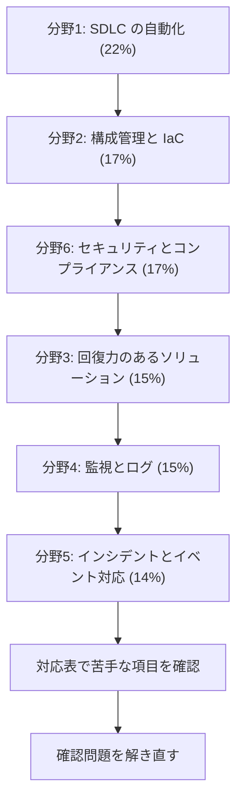

# DevOps Engineer - Professional（DOP）

AWS 上の分散システムのプロビジョニング、運用、管理の力を問う試験です。このコースは **DOP-C02** を基準にしています。

継続的デリバリー、セキュリティとガバナンスの自動化、監視、高可用で自己修復するシステム、運用の自動化が中心です。

!!! warning "韓国語版の試験が終了します"
    公式ページによると、韓国語の試験は **2026年12月31日より後は提供されません**。英語、日本語、簡体字中国語の提供について、終了の案内はありません。新しい版（DOP-C03 など）の告知も、2026年10月31日に確認した時点ではありません。

[:material-format-list-bulleted: このコースのサービス一覧](services.md){ .md-button }

## 試験の概要 {#overview}

| 項目 | 内容 |
|---|---|
| 問題数 | 75問（採点対象65問 + 採点対象外10問） |
| 試験時間 | 180分 |
| 合格点 | 750点（100〜1,000点） |
| 受験料 | 300 USD（為替などで追加の費用がかかる場合があります） |
| 言語 | 英語、日本語、韓国語、簡体字中国語 |
| 形式 | 択一（正解 1、誤答 3）、複数選択（5 つ以上の選択肢から 2 つ以上） |
| 採点方式 | 全体の得点で合否を判定します。分野ごとの合格点はありません |
| 受験方法 | Pearson VUE のテストセンターまたはオンライン |
| 減点 | 誤答による減点はありません。未回答は不正解になるので、すべて回答します |
| 認定の有効期間 | 3年 |

問題数の内訳、合格点、形式、採点方式は[試験ガイド](https://docs.aws.amazon.com/aws-certification/latest/devops-engineer-professional-02/devops-engineer-professional-02.html)によります。総問題数、試験時間、受験料、言語、受験方法、有効期間は[公式ページ](https://aws.amazon.com/certification/certified-devops-engineer-professional/)によります。2026年10月31日に確認しました。

## 学習の順番 {#study-path}

配点の大きい分野から順に進めます。分野5は分野4の監視を前提にするので、最後にしています。各分野のページで要点を確認し、足りないところはサービス解説で補います。

| 分野 | 配点 | 主なサービス |
|---|---|---|
| [分野1: SDLC の自動化](domain1.md) | 22% | CodePipeline、CodeBuild、CodeDeploy、CodeArtifact、ECR、Image Builder |
| [分野2: 構成管理と IaC](domain2.md) | 17% | CloudFormation、CDK、SAM、Organizations、Control Tower、Service Catalog、Systems Manager |
| [分野3: 回復力のあるクラウドソリューション](domain3.md) | 15% | Auto Scaling、ELB、Route 53、Aurora、DynamoDB、AWS Backup、FIS |
| [分野4: 監視とログ](domain4.md) | 15% | CloudWatch、CloudWatch Logs、X-Ray、Kinesis、Athena、AWS Config |
| [分野5: インシデントとイベントへの対応](domain5.md) | 14% | EventBridge、AWS Health、Systems Manager、Step Functions、SQS、SNS |
| [分野6: セキュリティとコンプライアンス](domain6.md) | 17% | IAM、Identity Center、KMS、Secrets Manager、GuardDuty、Security Hub、Macie |

公式のすべての項目と解説の対応は、[対応表](coverage.md)で確認できます。

## 想定する受験者 {#target-candidate}

- AWS 環境のプロビジョニング、運用、管理の経験が 2 年以上あります。
- ソフトウェア開発のライフサイクルと、プログラミングまたはスクリプトの経験があります。
- 高度に自動化されたインフラの構築の経験があります。
- OS の管理の経験があります。
- 現代の開発と運用のプロセスの経験があります。
- AWS のインフラを保護した経験があります。

## 範囲外のもの {#out-of-scope}

次の作業は受験者に求められていません。一覧は網羅的なものではありません。

- 高度なネットワークの知識（高度なルーティングのアルゴリズム、フェイルオーバーの手法など）
- 開発者への深いセキュリティの助言
- データベースの設計、クエリ、性能の最適化
- フルスタックのアプリケーションコードの開発

## 対象のサービスと wiki のページ {#services}

ガイドの一覧です。この一覧は網羅的なものではなく、変更されることがあります。

!!! note "提供状況が変わったサービス"
    次のサービスはガイドの一覧に残っています。試験では役割を問われる可能性があるので、押さえておきます。新しい構成の選択肢にはなりません。

    - **AWS Proton**: 2026年10月7日にサポートが終了しました。
    - **AWS CodeStar**: プロジェクトの作成と表示は 2024年7月に終了しました。CodeStar Connections は AWS CodeConnections に名前が変わり、使い続けられます。
    - **AWS Copilot CLI**: 2026年6月12日にサポートが終了しました。
    - **AWS App2Container**: 2025年11月7日に新規受付を終了しました。後継は AWS Transform です。
    - **AWS App Runner**: メンテナンスに移行しました。公表日は2026年3月31日です。
    - **Amazon CodeGuru**: Reviewer はメンテナンス中で、Security は2025年11月20日にサポートが終了しました。

    OpsWorks は[分野2](domain2.md#t2-1-config-management)、Inspector Classic は[分野4](domain4.md#t4-2-inspector)、Security Hub の名前は[分野2](domain2.md#t2-2-governance)に書いています。名前の変更もあります。AWS Fault Injection Simulator は AWS Fault Injection Service に、Amazon Kinesis Data Firehose は Amazon Data Firehose になりました。

| 分類 | サービスとページ |
|---|---|
| 分析 | [Athena](../../services/streaming.md#athena)、[EMR](../../services/data-engineering.md#emr)、[Firehose](../../services/streaming.md#firehose)、[Kinesis Data Streams](../../services/streaming.md#kinesis-data-streams)、[OpenSearch Service](../../services/streaming.md#opensearch)、[Quick Sight](../../services/data-engineering.md#quick-sight) |
| アプリケーション統合 | [AppFlow](../../services/data-engineering.md#appflow)、[EventBridge](../../services/messaging.md#eventbridge) |
| コンピューティング | [App Runner](../../services/other-services.md#app-runner)、[EC2](../../services/ec2-beanstalk.md#instance-types)、[EC2 Auto Scaling](../../services/ec2-beanstalk.md#auto-scaling)、[EC2 Image Builder](../../services/operations.md#image-builder)、[Elastic Beanstalk](../../services/ec2-beanstalk.md#beanstalk-environments)、[Serverless Application Repository](../../services/iac.md#sam-cli-more) |
| コンテナ | [App2Container](../../services/migration.md#app2container)、[Copilot](../../services/containers.md#copilot)、[ECR](../../services/containers.md#ecr)、[ECS](../../services/containers.md#ecs)、[EKS](../../services/containers.md#eks)、[EKS Distro](../../services/operations.md#eks-distro)、[Fargate](../../services/containers.md#fargate-vs-ec2)、[ROSA](../../services/operations.md#rosa) |
| データベース | [Aurora](../../services/databases.md#aurora)、[Aurora Serverless v2](../../services/databases.md#aurora-serverless-v2)、[DMS](../../services/migration.md#dms)、[DocumentDB](../../services/databases-specialized.md#documentdb)、[DynamoDB](../../services/dynamodb.md)、[ElastiCache](../../services/databases.md#elasticache)、[MemoryDB](../../services/databases-specialized.md#memorydb)、[RDS](../../services/databases.md#rds)、[Redshift](../../services/data-engineering.md#redshift) |
| 開発者ツール | [CLI](../../services/iac.md#aws-cli)、[CDK](../../services/iac.md#cdk)、[CloudShell](../../services/iac.md#cloudshell)、[CodeArtifact](../../services/cicd.md#codeartifact)、[CodeBuild](../../services/cicd.md#codebuild)、[CodeDeploy](../../services/cicd.md#codedeploy)、[CodeGuru](../../services/other-services.md#codeguru)、[CodePipeline](../../services/cicd.md#codepipeline)、[CodeStar](../../services/cicd.md#repositories)（Connections のみ）、[FIS](../../services/resilience.md#fis)、[SDK](../../services/sdk-resilience.md#sdk-basics)、[X-Ray](../../services/observability.md#xray) |
| 管理とガバナンス | [Auto Scaling](../../services/resilience.md#auto-scaling-ha)、[CloudFormation](../../services/iac.md#cloudformation-template)、[CloudTrail](../../services/observability.md#cloudtrail)、[CloudWatch](../../services/observability.md#cloudwatch-metrics)、[CloudWatch Logs](../../services/observability.md#cloudwatch-logs)、[Compute Optimizer](../../services/cost-management.md#compute-optimizer)、[Config](../../services/governance.md#config)、[Control Tower](../../services/governance.md#control-tower)、[Health](../../services/operations.md#health-events)、[License Manager](../../services/governance.md#license-manager)、[Managed Grafana](../../services/operations.md#managed-grafana)、[Managed Service for Prometheus](../../services/operations.md#managed-prometheus)、[OpsWorks](../../services/operations.md#opsworks)、[Organizations](../../services/governance.md#organizations)、[Proton](../../services/governance.md#proton)、[Resilience Hub](../../services/resilience.md#resilience-hub)、[Service Catalog](../../services/governance.md#service-catalog)、[Systems Manager](../../services/operations.md#systems-manager)、[Trusted Advisor](../../services/cloud-foundations.md#trusted-advisor) |
| ネットワーク | [API Gateway](../../services/api-gateway.md)、[Client VPN](../../services/network-connectivity.md#client-vpn)、[CloudFront](../../services/networking.md#cloudfront)、[ELB](../../services/networking.md#elb)、[PrivateLink](../../services/networking.md#vpc-endpoints)、[Route 53](../../services/networking.md#route53)、[Site-to-Site VPN](../../services/network-connectivity.md#site-to-site-vpn)、[Transit Gateway](../../services/network-connectivity.md#transit-gateway)、[VPC](../../services/networking.md#vpc) |
| セキュリティ | [ACM](../../services/certificates.md#acm)、[CloudHSM](../../services/identity-directory.md#cloudhsm)、[Cognito](../../services/cognito.md)、[Detective](../../services/threat-detection.md#detective)、[Directory Service](../../services/identity-directory.md#directory-service)、[GuardDuty](../../services/threat-detection.md#guardduty)、[Identity Center](../../services/identity-directory.md#identity-center)、[IAM](../../services/iam.md)、[Inspector](../../services/threat-detection.md#inspector)、[KMS](../../services/kms.md)、[Macie](../../services/threat-detection.md#macie)、[Network Firewall](../../services/threat-detection.md#network-firewall)、[RAM](../../services/governance.md#ram)、[Secrets Manager](../../services/secrets.md#secrets-manager)、[Security Hub](../../services/threat-detection.md#security-hub)、[STS](../../services/iam.md#sts-settings)、[Shield](../../services/threat-detection.md#shield)、[WAF](../../services/certificates.md#waf) |
| サーバーレス | [Lambda](../../services/lambda.md)、[SAM](../../services/iac.md#sam)、[SNS](../../services/messaging.md#sns)、[SQS](../../services/messaging.md#sqs)、[Step Functions](../../services/step-functions.md) |
| ストレージ | [AWS Backup](../../services/resilience.md#backup)、[EBS](../../services/storage.md#ebs-volume-types)、[Elastic Disaster Recovery](../../services/resilience.md#drs)、[EFS](../../services/storage.md#efs-settings)、[FSx for Lustre](../../services/storage-advanced.md#fsx-lustre)、[FSx for NetApp ONTAP](../../services/storage-advanced.md#fsx-ontap)、[FSx for OpenZFS](../../services/storage-advanced.md#fsx-openzfs)、[FSx for Windows File Server](../../services/storage-advanced.md#fsx-windows)、[S3](../../services/s3.md)、[S3 Glacier](../../services/s3.md#glacier-retrieval)、[Storage Gateway](../../services/migration.md#storage-gateway) |

## 参考 {#references}

- [DOP-C02 試験ガイド](https://docs.aws.amazon.com/aws-certification/latest/devops-engineer-professional-02/devops-engineer-professional-02.html)
- [対象のサービスの一覧](https://docs.aws.amazon.com/aws-certification/latest/devops-engineer-professional-02/dop-02-in-scope-services.html)
- [認定の公式ページ](https://aws.amazon.com/certification/certified-devops-engineer-professional/)
