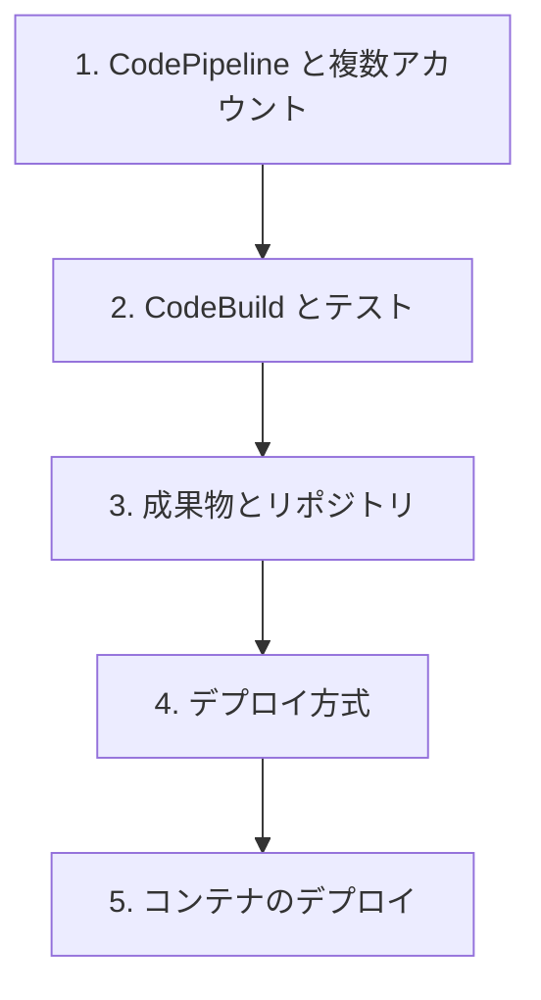

# 分野1: サービス別の学習

分野1（SDLC の自動化）は DOP-C02 の配点の 22% で、6 分野の中で最大です。パイプラインから順に進めると、後のページの成果物とデプロイの話が読みやすくなります。

| 順番 | 話題 | 問われること | 重要度 |
|---|---|---|---|
| 1 | [CodePipeline と複数アカウント](pipelines.md) | 複数アカウントの 4 つの条件、トリガーフィルター、ステージ条件 | 高 |
| 2 | [CodeBuild とテスト](codebuild.md) | buildspec、シークレット、Webhook、テストの配置、終了コード | 高 |
| 3 | [成果物とリポジトリ](artifacts.md) | ECR、CodeArtifact、Image Builder、ライフサイクル、権限 | 中 |
| 4 | [デプロイ方式](deployments.md) | 方式の判断、ストレージ、イミュータブル、配布、エージェント、失敗の解決 | 高 |
| 5 | [コンテナのデプロイ](containers.md) | ECS と EKS の更新、タスク実行ロール、終了コードと依存 | 中 |

重要度は公式のスキル一覧を見たこの wiki の判断で、公式の数字ではありません。

## 他のサービスにまたがる問題 {#other-questions}

<!-- questions:start -->

この分野の問題は、すべてサービス別のページに載っています。

<!-- questions:end -->
